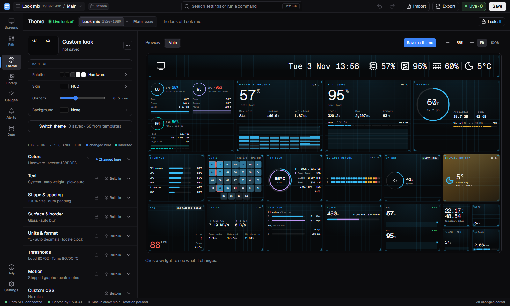
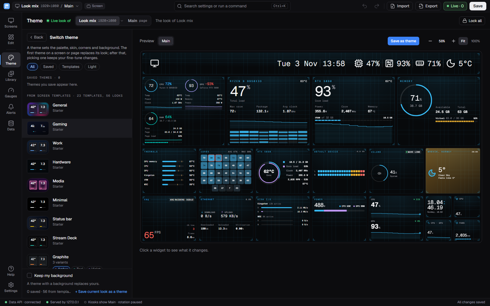
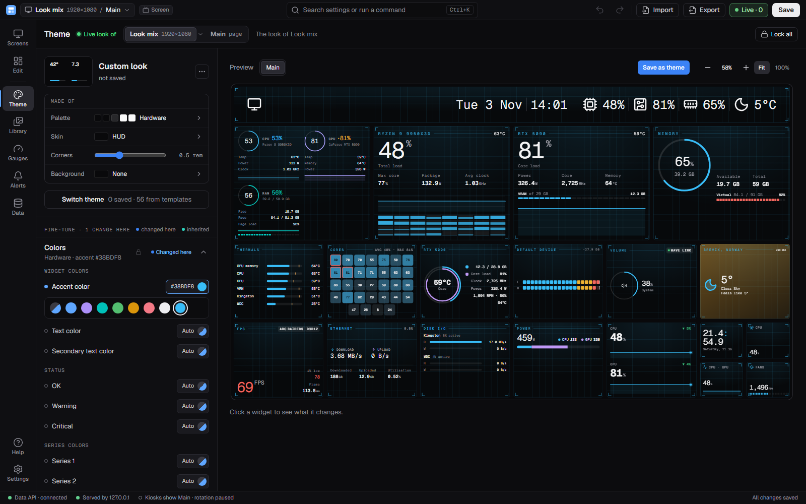
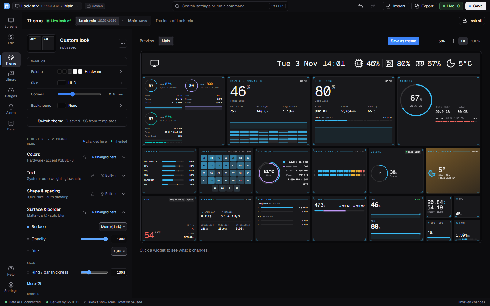
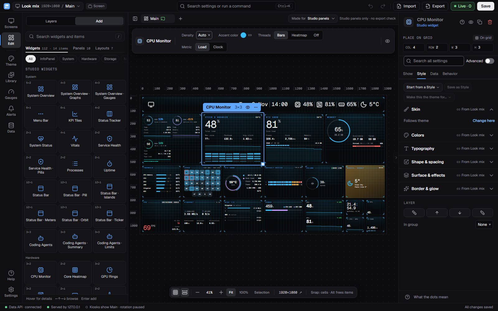
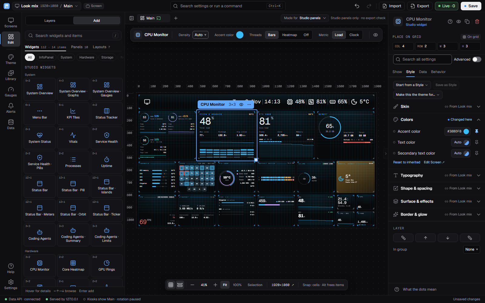
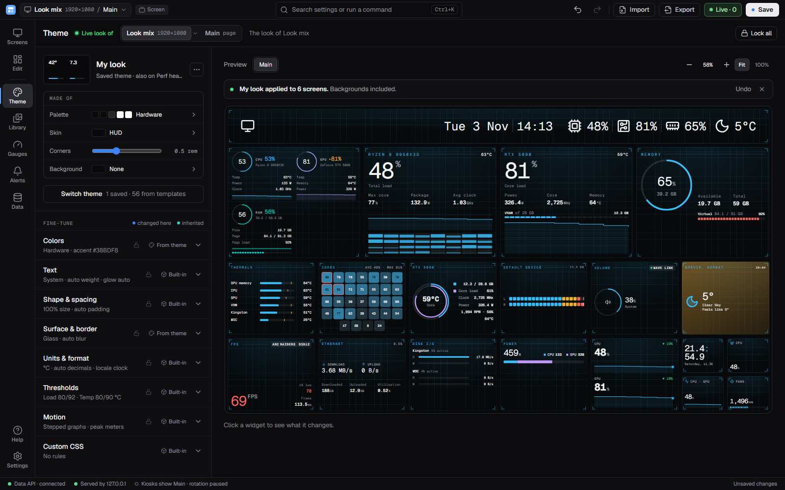
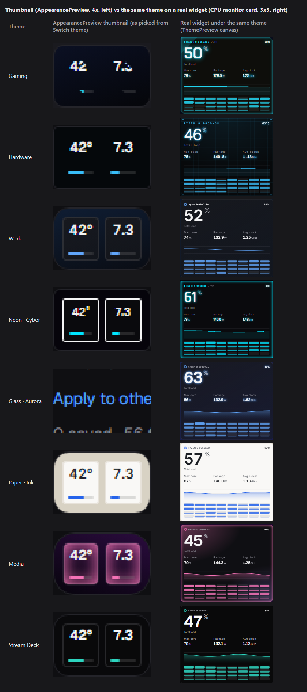
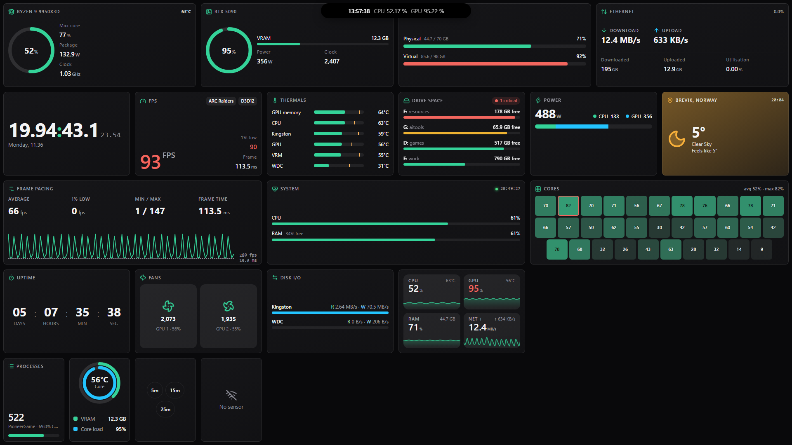
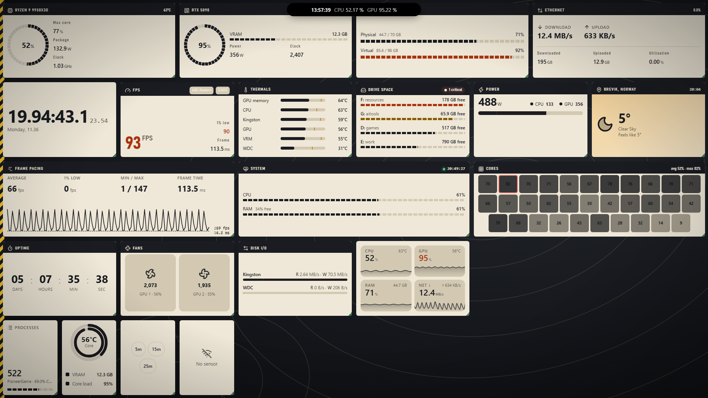

# Look System: investigation and plan

Stage 1 deliverable of the Look System package (`docs/look-system/`, brief `01-investigation-brief.md`). It verifies the sweep, measures today's cost, checks the material, data-viz and theme-pack contracts against the code, and proposes the phased plan. **No product code changed.** Status: **Gate 2 approved by the owner on 2026-11-03.** Section 11 runs under `docs/look-system/02-implementation-runbook.md`.

- **Baseline:** branch `look/package`, HEAD `4963fe28`, Windows 11 Pro 10.0.26300, Node 24.22.1, Playwright 1.64.1 with its bundled Chromium (headless). WebView2, WKWebView and WebKitGTK were not measured.
- **Date:** 2026-11-03.
- **Tags:** every claim carries a `path:line` at HEAD and one of `CONFIRMED` (matches the sweep or the spec), `CORRECTED` (the sweep or spec was wrong or the code moved; old and new ref given) or `UNCONFIRMED` (with the reason).
- **Where the parts went.** Sections 2 to 8a carry the eight investigation parts with their evidence and tags, lightly edited: Part A is section 2, B is 3, C is 4, D is 5, E is 6, F is 7, G is 8 and H is 8a. Inside those sections "Part X" refers to that part. Section 1 summarises, sections 9 to 12 are the target model, the decisions, the plan and the open items. Where the final doc corrects a part, the correction is marked *(final doc: ...)* in place.
- **Data.** Measurements used the seeded demo data (`tools/perf/scratch.mjs` with `tools/perf/fake-data-api.mjs`) unless a row says otherwise. Part C's layer walk also used a scratch copy of the live dashboard folder with InfoPanel's Data API read-only. No live data was written.

### Files beside this document

Everything below lives in `docs/investigations/look-system/`. Large tables are linked rather than inlined.

| File | Section | Content |
|---|---|---|
| [token-inventory.csv](look-system/token-inventory.csv) | 3 | 351 CSS variables: family, definition, value, consumers, proposed tier and contract name, action |
| [token-twins.csv](look-system/token-twins.csv) | 3 | 105 numeric twin and near-twin pairs with the `git log -S` intent check |
| [part-C-render-counts.csv](look-system/part-C-render-counts.csv) | 4 | Renders per zone per 10 s, before and after the memo prototype |
| [walk-real.csv](look-system/walk-real.csv), [walk-demo.csv](look-system/walk-demo.csv) | 4 | Blur, filter and glow layers per kiosk page |
| [prototype-memo.patch](look-system/prototype-memo.patch) | 4 | The scratch memo prototype measured in C1.3 |
| [g-skins-contract.csv](look-system/g-skins-contract.csv) | 8 | 14 skins x 39 contract tokens |
| [g-surfaces-material.csv](look-system/g-surfaces-material.csv) | 8 | 27 surfaces x 17 material fields |
| [g-hardcoded.csv](look-system/g-hardcoded.csv) | 8 | 493 hard-coded material and data-viz sites with the replacing token |
| [g-contrast.csv](look-system/g-contrast.csv) | 8 | 1386 Look x material x backdrop contrast rows |
| [g-export-capability.csv](look-system/g-export-capability.csv) | 8 | Export capability per T2 and T3 token |
| [icons-by-widget.txt](look-system/icons-by-widget.txt) | 8a | Every icon name each widget uses |
| `shots/*.png` | 7, 8a | The screenshots linked in those sections |

Scripts, raw JSON dumps and the throwaway worktrees (`ips-look-scratch-*`) were not committed; they lived in the session scratchpad and were removed. Where a part names `cf/...`, `h/...`, `scripts-bg/...` or `part-D-data/...`, that is one of those scratch files. Screenshots a part names but this folder does not hold were likewise not kept.

---

## 1. Summary

### What the code says

1. **Part of P2 is already done.** `b2b36b3d` (the sweep) is not an ancestor of HEAD; #292 (`9e6d9c99`) landed after it. `useZoneLook` already keeps its object when values are equal (`src/widgets/module.tsx:88-98`, pinned by `tests/widgets/module-look.test.tsx:37-59`), and every backdrop blur in widgets, island, alerts, panel overlay and `primitives.tsx` already goes through `--wp-blur-cap` (`tests/components/blur-cap.test.ts:19-39`). The sweep's perf claims B59 and B61 are CORRECTED.
2. **The real per-tick cost is not the Look.** On a 20-widget kiosk page, **1617 renders in 10 s, 88 % of them caused by the 10 Hz audio stream for widgets that do not show audio** (section 4, C1). Memoising the zone look and the root style removed about 8 ms of 1350 ms of script time: no measurable gain. Scoping theme vars off `:root` also measured no gain (9.2 ms vs 11.0 ms recalc, inside the spread).
3. **The draft contracts are the right shape but incomplete.** 27 surfaces fold into **4 material kinds plus 2 optional layers**; 14 skins need **9 new T3 tokens, 2 header variants and 2 font-record fields**, after which **zero `ext.*` keys** are needed (section 8). One skin feature breaks the "packs never move widgets" rule today: `brutal`'s offset shadow shrinks the card by 6 px (`src/widgets/core/skins/brutal.ts:13`).
4. **The pack model fits.** A paint-only Field Kit prototype changed **nothing** in 79 widget frames at 1x1, 2x2, 4x2 and 4x4 (card box, body box, descendants, text; 0 overflow issues before and after), cost about **+1 ms per data tick** on a 21-widget page and **1.7 KB gzip plus its font** (section 8a).
5. **Budgets are the binding constraint.** The kiosk entry measures 276,631 B gzip against a limit of 276,768 B: **137 B of headroom** (Windows build, section 4 C4). The theme, skin, surface and widget-shell code sits in `sensor-store-*.js`, which is in the kiosk entry's static closure. Anything a phase adds there must be paid for in the same phase or the budget raised with approval (G7). Looks other than Classic, and every pack, must load lazily.
6. **Readability fails in two rules, not 112 places.** 112 of 462 Look x material pairs fail WCAG on the app's own backdrop; all of it is `axis-label` (`--w-faint`) on six tinted materials and `ok` (the accent) on light materials. `blur-fallback-alpha` 0.85 is not enough; **0.90** passes a mid-grey worst case (section 8, G4).
7. **Export.** The converter path exports **12 of 27 surfaces as no card at all** (`surfaceOf` returns `null` for gradients, `src/lib/infopanel/native/convert-view.ts:144-151`). New bug: on the `theme` surface a warn or crit ring exports as blue `#3B82F6`, because `cssToArgb` cannot read the `oklab()` Chromium serialises from `color-mix` (`src/lib/infopanel/native/decompose.ts:377-378`) (section 5).
8. **The UX has six words for one concept** (Theme, Look, Style, Saved theme, appearance preset, template). Only about a third of the Theme editor is the Look; the rest is cascade, thresholds and format. The five measured journeys take 3, 4, 4, 6 and 8 clicks today and an estimated 2, 2, 2, 3 and 5 with the gallery and knobs (section 7).

### Headline numbers

| Measure | Result | Section |
|---|---|---|
| Claims checked (Appendix B / C) | 62 rows: 34 CONFIRMED, 27 CORRECTED, 1 UNCONFIRMED / 38 rows: 26, 9, 3 | 2 |
| Other parts (CONFIRMED / CORRECTED / UNCONFIRMED) | B 13/2/1, G 31/3/5, H 38/8/11, C 0/3/1 claims, D 2/0/2, F 2 UNCONFIRMED | 3 to 8a |
| CSS variables | 351 in 8 families; 21 exact and 21 near `s-*`/`ui-*` twins; 8 of the near ones are different roles and must not be aliased | 3 |
| Renders per 10 s, 20 zones | 1617 (1587..1662); 1417 audio-only | 4 |
| Memo prototype script time | 1.350 s before (repeat 1.449 s), 1.406 s after: no gain | 4 |
| Theme change recalc | `:root` 9.2 ms, scoped 11.0 ms; a Look-shaped change 23.2 ms recalc + 60 ms layout | 4 |
| Backdrop blur layers | real pages 0 to 1 (the island); worst-case glass page 20; all capped | 4 |
| Glow layers | plain page 0 to 30; neon Look 135 (112 are number text-shadows) | 4 |
| Kiosk entry | 276,631 B gzip, limit 276,768, headroom 137 B | 4 |
| Hex literals in `src` (non-test) | 2161, of which 1258 vendored meteocons and 397 screen templates; the colour-literals guard counts only class literals (4 of 4) | 2, 6 |
| Converter-path export | 12 of 27 surfaces drop the card; 5 lose their gradient | 5 |
| Contrast | 112 of 462 pairs fail on the page colour, 182 over white | 8 |
| Field Kit prototype | 0 layout change in 79 frames; +1.35 ms per tick (+7 %); 1,681 B gzip; switch 20.9 ms | 8a |
| `data-part` hooks | 7 cost +59 B gzip; 17 extrapolate to about +150 B gzip | 8a |

### Disagreements between parts, resolved here

- **AppearancePreview (Part A B50 vs Part F F4).** Both are right about different things. Part A is right that the thumbnail *resolves* every surface: `MiniTile` goes through `withSkinSurface`, `resolveSurface` and `lookBox` (`src/components/studio/appearance-preview.tsx:30-32`), so the HUD look gets the `hud` surface object. Part F is right that it *paints* skin-driven looks wrong. The precise cause (spot-checked for this doc): skin surfaces are built with `mix()` = `color-mix(in oklab, var(--accent) N%, ...)` (`src/widgets/core/tokens.ts:3`; `skins/hud.ts:14`, `skins/cyber.ts:14`, `core/surfaces.ts:27` for `neon`). Inside the thumbnail, `--accent` is the **shadcn HSL triplet** written by `presetTokens` on the preview root (`appearance-preview.tsx:54-56,60`), and `MiniTile` never sets the colour `--accent` (only `--wp-accent` via `chromeVars`, `appearance-preview.tsx:38`; `src/components/widget-style.ts:126`). `color-mix()` with a triplet is invalid at computed-value time, so the whole `background` and `box-shadow` declarations drop: transparent card, no ring, no glow ([`F-compare-sheet.png`](look-system/shots/F-compare-sheet.png): Hardware `rgba(0,0,0,0)` vs real `rgb(7,9,11)`). Surfaces that do not mix the accent (Work, Paper, Stream Deck, Mono) come out right. On top of that the thumbnail, by design, draws no skin font, header, numerals, rings or graphs. So: resolution right, accent-mixed surfaces wrong, skin character absent. This is the D4 `--accent` clash made visible, and P3b fixes it (one line: set the colour `--accent` on `MiniTile`) before P5 replaces the thumbnail with real renders.
- **Hooks and the kiosk budget (Part H H2 vs Part C C4).** Part H says the hooks sit "in a lazy chunk, not the entry". Part C maps the shell and primitives to `sensor-store-*.js` inside the kiosk entry, and the build manifest agrees: the kiosk closure of `index.html` is `index`, `sensor-store`, `useSensors`, `placements-adapter`, `pulse-dot`, `use-document-hidden`, `extras`, `write-refusal`, `use-page-island` (read from `dist/.vite/manifest.json` of today's local build, so probably HEAD). The hooks therefore count against `kioskEntryGzipBytes`; 17 hooks at about +150 B gzip exceed the 137 B headroom. CORRECTED in section 8a and planned for in P8.
- **Part C timing softness.** Parts C, D, F, G and H ran concurrently on one PC. From the scratch file times, Part C's timed runs (render counts, clean-build script time, theme recalc) finished between 13:40 and 13:50; Part H's tick runs, including the final one during which it stopped "a short stray benchmark process", ran later (its logs end 13:57 and 14:04). So the stopped process was probably not one of Part C's, and Part C's numbers were not cut short. But Part C did run while other agents were building and driving Chromium, which is a likely reason its two "before" baselines differ by 0.1 s (1.350 vs 1.449 s). **Counts** (renders, layers, sizes, contrast) are unaffected. **Absolute durations** in sections 4 and 8a are soft; the conclusions rest on same-page comparisons (C2's control windows, H4.4's interleaved off/on windows) and on the gaps being inside the spread. P0 re-records the baselines on an idle machine.
- **Part F's "P2"** in F4 and F5 means the Look gallery phase, which is **P5** in the brief's numbering; corrected in place.
- **Native surface count.** The brief says 13 skin-native surfaces; Parts A and G both count **11** (27 `SURFACES` = 12 base + 11 skin + 4 legacy). CORRECTED.

### Gate 2: the owner's answers (2026-11-03)

The owner approved all phases in section 11 and every proposed decision change below (D1, D2, D4, D10, D11, D21, D25, D26, D27, and where G4 is enforced; the G4 text is unchanged). Calls, all accepted as recommended:

1. **Audio re-render fix: in P2** (P2 effort M). `readsAll` zones skip messages whose changed keys are all under `plugins.audio-level-meter.` unless the zone's bound sensors include that prefix; a test pins it.
2. **D10, D11, D25, D26:** accepted as written (sections 9.3, 9.4, 8a); no longer open.
3. **Kiosk budget: hybrid.** Each phase pays for its kiosk bytes where it can and reports the measured delta; at P8 the owner expects to approve one measured rise of about 1 KB gzip (G7). Packs always lazy-load and never count against the kiosk entry.
4. **`brutal`:** redesigned in P3b to paint the hard offset shadow inside the card edge (inset bar on two sides, full box kept); a visible, intended change for every brutal widget. Afterwards it follows G2.
5. **Reds:** folded in P7. Alerts take the widget crit red (`#F2665E` on dark, per mode on light; alerts follow the Look, D7). Studio danger `oklch(0.72 0.17 25)` stays its own role in the D1 `studio.*` set.
6. **Defaults that move on purpose:** confirmed. Classic is pinned to today's values; new defaults apply to new Looks only, except two intended fixes on Classic (ramp start colour, P3a; `ok` on light materials, P6). `axis-label` stays `faint` on Classic and is `muted` for new Looks.
7. **Per-pack budgets:** as in section 11.1 (measured + 25 % when the pack is built, ceiling 500 KB, only down afterwards; layer budget 1 per card plus 3 per page).
8. **NowPlaying cover blur** (`src/widgets/NowPlaying.tsx:117`): allow-listed in the D9 blur lint as decorative art, switched off in lite mode, not capped by Limit blur.

### Proposed decision changes (gist)

| ID | Gist |
|---|---|
| D1 | The Studio Look is T1 plus a fixed `studio.*` extension set (65 `--ui-*` values; T1's 16 names cover about 12), not "the same contract" panel Looks fill. |
| D2 | Near twins: a per-token table, not a rule. 13 of 21 near pairs take the `ui-*` value; 8 are different roles and stay. |
| D4 | The `--wp-*` aliases that user custom CSS uses (`--wp-accent`, `--wp-fg`, `--wp-muted`, `--wp-radius`) stay as long as saved `css` sections exist, not one release; the alignment `--wp-*` vars stay as they are. |
| D10 | Answer: 4 kinds (`solid`, `gradient`, `glass`, `lcd`) plus optional `pattern` and `spots`; `inset[]`, `fill-stops[]`, gradient `border`, `tone: auto`; `blur-fallback-alpha` default 0.90; `export` required; `--w-mat-*` vars. |
| D11 | Answer: 78 Look-settable T3 tokens (9 added, `num-glow` becomes `num-effect`, `instr-*` dropped), plus a fixed list (type scale, 11 px floor, tabular figures, unit scale, axis-label size, ring text, chart height cap, ToneCue, threshold values, ballistics, font advance and size-adjust). |
| D21 | The pack sets the **island's** default edge and the style of island and Status bar; the Status bar widget has no position of its own, so its position stays with the page or template. User override: `IslandConfig.edge`, stored only when set. |
| D25 | Answer: attach points per section 8a; hooks now; decorations reach the card edge only through a `--wp-pad` var; ornaments at most 10 px; `unit`, `threshold` and `range` need an element or primitive first. |
| D26 | Answer: about 84 fixed names = the Material Symbols ids widgets already use; JSON glyph map per set; per-name Classic fallback; scoped by `SkinCtx`; a test that fails on unknown names (9 today). |
| D27 | Status is per mode **including `ok` and the accent used as text** (`accent-ink`), not only warn and crit. |
| G4 (Appendix D Security row) | The CSP allows `https:` images and fonts (`src-tauri/crates/ips-server/src/security_headers.rs:13-15`), so it does not enforce "no remote URLs". The pack loader (from P8) and the validator enforce it. The guardrail itself is unchanged; only where it is checked moves. |

---

## 2. Verification table (Part A)

Two tables: one row per claim of the sweep (Appendix B) and one per claim of the widget pipeline (Appendix C), then the React Compiler check, the widget spot-check and the status-colour matrix. The rows that move the plan are B6, B25, B44, B46, B50, B56, B59 and B61.

---

Environment: HEAD `4963fe28` on `look/package`, Windows 11, `rg` / Grep only (no instrumentation needed for this Part, except the
`SURFACES` count, which came from `vite-node` in a scratch worktree). All paths are repo-relative, lines are at HEAD.

### A.0 What moved since the sweep

`b2b36b3d` is **not an ancestor** of HEAD (#292 was squash-merged), so `git log b2b36b3d..HEAD` shows only `9e6d9c99`
(`feat: refinement pass ... (#292)`, 45 files in the brief's path list, +2049/-529). `git diff b2b36b3d HEAD` shows #292 already did part of P2:

- `src/widgets/module.tsx:88-98` `useZoneLook` now keeps the previous object when the values are shallow-equal (`same`, `:80-84`). The sweep's "probably returns a fresh object" is **refuted**; `tests/widgets/module-look.test.tsx:37-59` pins it (20 zones x 6 data ticks: 20 consumer renders, 120 root renders, 20 skin contexts).
- Blur now goes through `--wp-blur-cap` in `src/components/island/island-look.ts:71`, `src/components/alerts/alert-layer.tsx:107`, `src/components/widgets/panel-overlay.tsx:91`, `src/widgets/core/primitives.tsx:824`, and a new test `tests/components/blur-cap.test.ts:19-39` pins six files.
- `tests/components/color-literals.test.ts` caps were lowered (now 4 / 1) and `tests/lib/__fixtures__/v8-parity.json` was regenerated (42 lines).
- `src/lib/theme.ts`, `src/widgets/core/theme.ts`, `src/components/surfaces.ts`, `src/widgets/core/look.ts` did not change since the sweep (empty `git diff --stat`).

### A.1 Counts

Appendix B: 62 claim rows. **CONFIRMED 34, CORRECTED 27, UNCONFIRMED 1** (B60: the style-recalc cost is a Part C measurement).
Appendix C: 38 claim rows. **CONFIRMED 26, CORRECTED 9, UNCONFIRMED 3** (C17 the 11 px floor, C35 the overflow scripts, C38 lazy loading).
Spot-checked widgets: 19 (violations in A.5). Rows whose behaviour changed since the sweep (B6, B25, B44, B46, B50, B56, B59, B61) are the ones that move the plan.

### A.2 React Compiler check

**OFF.** `rg -n "react-compiler|babel-plugin-react-compiler|reactCompiler"` over `package.json`, `vite.config.ts`, `vite.settings.config.ts`, `package-lock.json` finds nothing (only `docs/look-system/01-investigation-brief.md` itself). `vite.config.ts:45` and `vite.settings.config.ts:10` use bare `react()` from `@vitejs/plugin-react` ^4.3.4 (`package.json:71`) with no babel options; `react` is ^19.3.0 (`package.json:54`). So nothing is auto-memoised: the memo findings in Part C stand, and every stability fix (`useZoneLook`, the widget root style) must be explicit `useMemo`/ref code. Manual memo use in `src/widgets/core`: `Widget.tsx` (2 sites: `chrome`, `ctx`), `mixer-views.tsx` (2), `level-source.ts` (1), `viz-gallery.tsx` (3); the widget root style object (`Widget.tsx:129-141`) is not memoised.

### A.3 Table 1: Appendix B (sweep at b2b36b3d)

| # | claim | status | evidence path:line @HEAD | note |
|---|---|---|---|---|
| B1 | "Theme" has three meanings: `ThemeTokens`, cascade `widgetTheme`, saved `AppearancePreset`; "skin" = `SkinPack`; "surface" = `SurfaceDef` | CONFIRMED | `src/lib/theme.ts:10`; `src/lib/theme-model.ts:56`; `src/lib/appearance-presets.ts:20`; `src/widgets/core/types.ts` (`SkinPack`); `src/widgets/core/surfaces.ts:12` | A fourth use: `AppliedTheme` (`src/lib/applied-theme.ts:13`) and `THEME_PRESETS` "label" in the library card (`src/components/library/library-page.tsx:161`). |
| B2 | 19 HSL triplets, `theme.ts:10-30` | CONFIRMED | `src/lib/theme.ts:10-30` (interface, 19 keys) | |
| B3 | `DEFAULT_THEME` at `:46`; 6 `THEME_PRESETS` at `:68-195`; `paper` the only light one | CONFIRMED | `src/lib/theme.ts:46`, `:68-195`; names zinc, neutral, slate, ocean, forest, paper; `paper` background `0 0% 100%` (`:171-176`), the others 4-7% lightness | |
| B4 | Tailwind maps them in `index.css:18-49` (`@theme inline`) | CONFIRMED | `src/index.css:18-49` | The block also holds the audiocn meter colours (`:42-48`), added after the sweep text. |
| B5 | `:root` fallbacks at `:52-75` are a hand copy of `DEFAULT_THEME` | CONFIRMED | `src/index.css:52-75` (also `--alert-critical: hsl(0 84% 60%)` `:73`, `--radius` `:74`) | Values equal `DEFAULT_THEME` (`theme.ts:46-66`). No sync test exists (`rg DEFAULT_THEME tests` finds none against index.css). |
| B6 | `applyTheme()` at `theme.ts:273` writes ~20 inline vars on `documentElement`, kiosk only (`App.tsx:481-486`) | CORRECTED | `src/lib/theme.ts:273-278`; `src/App.tsx:481-486` | 19 tokens + `--radius` = 20 vars, confirmed. "Kiosk only" is wrong: the effect also runs in the studio, with `shownTheme = studio ? undefined : profile` (`App.tsx:481`), i.e. it writes the **built-in** theme on `:root` in the studio. |
| B7 | `themeVars()` at `theme.ts:265` scopes them for the studio canvas (`studio-canvas.tsx:609`), theme preview (`profile-page.tsx:43`), appearance preview, widget-qa | CORRECTED | `src/lib/theme.ts:265`; `src/components/studio/studio-view.tsx:548` (`themeVars(...)`), `studio-canvas.tsx:609` (only the `data-theme-scope` attribute); `src/components/studio/profile-page.tsx:43`; `src/widgets/widget-qa/index.tsx:57` | `themeVars` is **not** called in `studio-canvas.tsx`; it is in `studio-view.tsx:548` and passed down. `appearance-preview.tsx:48-52` builds its own `--key` map from `presetTokens` and does not call `themeVars`. |
| B8 | Studio chrome `ui-*` at `index.css:80-162`, dark only, theme edits never write them (comment `:77-79`) | CORRECTED | `:root` block `src/index.css:80-146`; utility map `@theme inline` `:149-215`; comment `:77-79` | `--ui-ok/warn/danger/info/success/warning` are **not** in `index.css`: they live in `src/settings/tokens.css:105-112` (a `:root` block shared by both bundles). |
| B9 | ~4000 `ui-*` class uses | CORRECTED | `rg -o "\b[a-z:-]*-ui-[a-z0-9-]+" src` = **4457** matches (4453 outside `src/widgets`) | The 4 inside widgets are `bg-ui-app` in dev pages (`widget-qa/index.tsx:59`, `core/viz/viz-gallery.tsx:57`) and two text hits; no production widget uses `ui-*`. |
| B10 | `s-*` is a separate `@theme` in `settings/tokens.css:13-75`; Settings/Help do not import `index.css` (`settings.css:1-3`, `help.css:2`) | CORRECTED | colour `@theme` `src/settings/tokens.css:37-101`, scale `@theme` `:13-35`, status `:root` `:105-112`; `src/settings/settings.css:1-4`; `src/help/help.css:2` | Lines moved (#292 grew the file by 45 lines). Settings/Help still do not import `index.css`; the reverse is true: `src/index.css:3` imports `tokens.css`. 574 `s-*` class uses in `src/settings` + `src/help`. |
| B11 | Numeric twins: `s-win`=`ui-bg-app`, `s-card`=`ui-bg-panel`, `s-t1/t2`=`ui-text-1/2`, `s-muted`=`s-dim`=`ui-text-hint`, `s-input-line`=`ui-border-control`, `s-card-line`=`ui-border-subtle` | CONFIRMED | `tokens.css:38,41,56,57,64,65,39,42` vs `index.css:81,83,89,90,95,86,87` (`#0c0c0e`, `#111114`, `#ededf0`, `#c9c9cf`, `#8a8a94`, `#66666f`, `#1f1f24`) | Also twins: `s-tile`=`ui-bg-tile` `#141418`, `s-hover`=`ui-bg-hover` `#1a1a1f`, `s-edge`=`ui-border-edge` `#3a3a44`, `s-strong`=`ui-text-strong` `#d4d4da`, `s-t3`=`ui-text-3` `#9696a0`, `s-faint` `#55555e`=`ui-text-disabled`. Part B's inventory will list them all. |
| B12 | Near twin: `s-accent-text` 0.84L vs `ui-accent-text` 0.82L | CONFIRMED | `src/settings/tokens.css:73` (`oklch(0.84 0.12 255)`); `src/index.css:121` (`oklch(0.82 0.12 255)`) | Other near twins seen: `s-soft` `#a8a8b2` vs `ui-text-soft` `#a1a1aa`; `s-green` now aliases `--ui-ok` (`tokens.css:75`), no longer a literal. |
| B13 | Widget `--w-*` set inline on every widget root (`Widget.tsx:129-141`); `TEXT_VARS` dark/light/theme at `core/theme.ts:47-60`; theme tone points at shadcn vars | CONFIRMED | `src/widgets/core/Widget.tsx:129-141`; `src/widgets/core/theme.ts:47-60` (theme tone `:52-59` uses `hsl(var(--card-foreground))` etc.) | |
| B14 | `--w-hero` and `--w-num-*` at `index.css:385-402` | CORRECTED | `--w-num-glow/--w-num-drop` rules `src/index.css:445-456`, use `:460,463`; `--w-hero` is **set inline** at `src/widgets/core/Widget.tsx:139` and never defined in CSS; read at `core/primitives.tsx:83`, `NetworkThroughput.tsx:76` | `--w-num-c` is written by `chromeVars` (`widget-style.ts:125`). |
| B15 | `--accent` set inline as a colour; at `:root` it is a shadcn HSL triplet (`panel-skin.tsx:20-25`) | CONFIRMED | `src/widgets/core/Widget.tsx:136` (colour); `src/index.css:64` / `src/lib/theme.ts:58` (triplet); comment `src/components/widgets/panel-skin.tsx:20-25` | `tokenScope` also writes `--accent` as HSL (`widget-style.ts:106`) but `Widget.tsx:136` is spread after `chromeVars` so the colour wins inside a widget. |
| B16 | `chromeVars` at `widget-style.ts:122-157` sets up to ~14 vars | CORRECTED | `src/components/widget-style.ts:122-151` | 14 `--wp-*` vars (accent, pad, gap, radius, fg, muted, weight, label-case, x, x-cross, text-align, flex, y, y-cross) + `--w-num-c` + 4 via `tokenScope`. The count is right, the end line is `:151`. |
| B17 | `tokenScope` (`:98-107`) re-scopes `--accent`, `--foreground` etc. as HSL | CORRECTED | `src/components/widget-style.ts:104-113` | Sets `--accent`, `--foreground`, `--card-foreground`, `--muted-foreground`. |
| B18 | `surfaces.ts:51` reads `--wp-fg`/`--wp-muted` while the shell sets `--w-fg`/`--w-muted` | CONFIRMED | `src/components/surfaces.ts:51`; also `widget-style.ts:166-167` (`ws.fg/muted`), `components/widgets/panel-layout.ts:122` | The shell sets both families: `--w-fg` via `textVars` (`Widget.tsx:134`, honouring `chrome.textColor`, `theme.ts:64`) and `--wp-fg` via `chromeVars` (`widget-style.ts:130`). |
| B19 | audiocn bridge at `mixer-views.css:6-52` re-maps shadcn tokens to `--w-*` with `hsl(from ...)` | CORRECTED | `src/widgets/core/mixer-views.css:5-39` (file is 39 lines; also 39 at `b2b36b3d`) | The file has never been 52 lines. Mechanism confirmed: `:5-26` re-maps, `--ac-inverse` `:38`. |
| B20 | It owns `--meter-ok/warn/clip` and `--channel-mute` with hex fallbacks mirroring `STATE` | CONFIRMED | `src/widgets/core/mixer-views.css:29-36`; fallbacks `#edb232` `:31`, `#f2665e` `:24,33-36` | `--meter-ok` has no hex fallback (it follows `--accent`/`--wl-live`). Utilities mapped at `src/index.css:42-48`. |
| B21 | LCD tone from `resolveSurface(...).tone` (`mixer-views.tsx:85`, `:441`) | CORRECTED | `src/widgets/core/mixer-views.tsx:442` (`toneOf`), `:86` (`lcdAppearanceFor`) | Lines shifted by one. |
| B22 | Gauge export mirror: `vector.ts:35-42` hand-copied `THEME`; live `var(--accent, #34D399)`, bake fixed hex | CONFIRMED | `src/lib/infopanel/gauges/vector.ts:35-42`; `resolvePaint` `:53` | Used by Gauge Studio authored gauges only (`vector-svg.ts:30-32`). Widget rings do not use it; see Part D. Excluded from the literal guard (`color-literals.test.ts:19-22`). |
| B23 | `surfaceOf` (`convert-view.ts:140-148`) reads computed `backgroundColor`, so gradient/glass probably export as transparent | CORRECTED (line) / CONFIRMED (behaviour) | `src/lib/infopanel/native/convert-view.ts:144-151`; only caller `:362` | Behaviour confirmed by measurement, see Part D. It runs only on the hand-converter fallback path, not for decomposed widgets. |
| B24 | No runtime dark/light switch; `<html class="dark">` static (`index.html:2`); Settings, Help, touch hard-code `color-scheme: dark` | CONFIRMED | `index.html:2`; `settings.html:2`, `help.html:2`, `touch.html:2` (inline `color-scheme: dark`); `src/settings/settings.css:14`, `window.css:7`; `src/index.css:231` (scoped `:root:has(.studio-root, .s-scope)`) | No code toggles the `dark` class (`rg 'classList.*dark'` none). |
| B25 | No `@custom-variant dark`; only `dark:` use is `audiocn/lcd-display.tsx:38`, probably OS-driven | CORRECTED | `rg "@custom-variant" src` finds only `rail` (`src/settings/tokens.css:5`). `src/components/ui/audiocn/lcd-display.tsx:49-56` | The `dark:` variant is **gone**: `appearance` now has explicit `auto/dark/light` entries with a comment (`:51-52`), and the app resolves `auto` by tone (`lcdAppearanceFor`, `mixer-views.tsx:86`; pinned by `tests/components/ui/lcd-display.test.ts:13-22` and `tests/widgets/mixer-views.test.tsx:119-127`). D3's "fix the audiocn `dark:` use" is already done; what remains is the `@custom-variant` for panel Looks. |
| B26 | "Light" exists only as `paper` preset and `matte-light` / `tone:"light"` | CONFIRMED | `src/lib/theme.ts:171`; `src/widgets/core/surfaces.ts:38,52`; `src/lib/builtin-styles.ts:18` | `TEXT_VARS.light` `core/theme.ts:51`. |
| B27 | `SkinTokens` (`types.ts:98-117`) covers surface, radius, accent, font, num*, glow, graph, meter, header, ring | CONFIRMED | `src/widgets/core/types.ts:98-117` | Also `numUp`, `numStroke`, `numWide`, `numStretch`. |
| B28 | 14 packs in `core/skins/`, ordered by `SKIN_PACKS` (`core/theme.ts:23`) | CONFIRMED | `src/widgets/core/theme.ts:23`; 14 files in `src/widgets/core/skins/` (default, tui, macos, fluent, hud, ink, retro, ios, android, synth, brutal, cyber, nixie, instrument) | |
| B29 | 13 skin-native surfaces | CORRECTED | `vite-node` dump of `SKIN_PACKS.flatMap(p => Object.keys(p.surfaces))` = **11** (tui, vibrancy, mica, hud, ios, material, synth, brutal, cyber, nixie, instrument); default, ink, retro have none | 12 + 11 + 4 = **27** entries in `SURFACES` (`core/theme.ts:28`), no name collisions. |
| B30 | Skin stored as look key `skin`; "auto"/"default"/unset normalised in `theme-skins.ts:10` | CONFIRMED | `src/lib/theme-skins.ts:10` (`skinOf`) | |
| B31 | A skin reaches a widget three ways: props (`Widget.tsx:88`, `:104-105`), `SkinCtx`/`useSkin()` (`theme.ts:101-102`, ~20 callers), inline vars | CORRECTED | `src/widgets/core/Widget.tsx:88,104-105`; `src/widgets/core/theme.ts:101-102` | 35 `useSkin()` call sites in 26 files (`rg -n "useSkin\(" src`), not ~20. |
| B32 | `skinContext()` merges overrides (`look.ts:59-77`) | CONFIRMED | `src/widgets/core/look.ts:59-77` | |
| B33 | `PanelView` is not a core Widget; `panel-skin.tsx:34-39` re-maps `--w-*` onto shadcn and provides own `SkinCtx` | CONFIRMED | `src/components/widgets/panel-skin.tsx:34-39,61`; `PanelView.tsx:19,107` | |
| B34 | `SurfaceDef {c, s, tone, colors?}` at `surfaces.ts:10-16` | CORRECTED | `src/widgets/core/surfaces.ts:12-16` (`SurfaceTone` is `:10`); `c`,`s` come from `SurfaceSpec` (`types.ts:120`) | |
| B35 | `SURFACES` (`core/theme.ts:25-28`) merges 12 `BASE_SURFACES` (`surfaces.ts:21-34`), skin-native forced `tone:"dark"` (`theme.ts:26`), 4 `LEGACY_SURFACES` (`components/surfaces.ts:42`) | CORRECTED | `src/widgets/core/theme.ts:25-28`; `src/widgets/core/surfaces.ts:21-34` (12 confirmed), `:50-55` (4 legacy); `src/components/surfaces.ts:42` is `makeSurface`, the legacy map is in `core/surfaces.ts` | Skin-native count is 11 (B29). Order: base, skin, legacy (legacy wins names, `theme.ts:28`). |
| B36 | Default is glass (`surfaces.ts:58`) | CONFIRMED | `src/widgets/core/surfaces.ts:58`; glass = translucent gradient, **no backdrop blur** (`src/components/surfaces.ts:91-99`; computed `backdrop-filter: none`, Part D) | Relevant to D10: "glass" is not blurred by default. |
| B37 | `surface:"auto"` = skin's surface else studio/solid (`theme.ts:38-42`); `withSkinSurface` at `module.tsx:60-64` | CONFIRMED | `src/widgets/core/theme.ts:38-42`; `src/widgets/module.tsx:60-64` | Pinned by `tests/widgets/core/theme.test.ts:44-53`. |
| B38 | Only `theme` surface uses shadcn tokens (`components/surfaces.ts:32-39`); `SURFACE_TOKENS` (`:175-179`) is a third copy of `DEFAULT_THEME` | CORRECTED | `src/components/surfaces.ts:32-39`, `:175-179` | `SURFACE_TOKENS` is a **partial** copy: only fg/muted/chip HSL for three fixed palettes (glass, matte-dark, matte-light), e.g. `"240 3.7% 15.9%"` = DEFAULT_THEME `secondary`/`muted`. Used by `surfaceTokens` (`:186`), which has **no importer** in `src` at HEAD (dead export). Same for `surfaceColors` (`:166`). |
| B39 | Cascade order THEME_DEFAULTS, app, profile, page, placement; 11 sections `theme-model.ts:23-48`; resolution in `style-resolve.ts` and `theme-model.ts:257` | CONFIRMED | `src/lib/theme-model.ts:8-13,23-48,257` (`valueOf`); `src/lib/style-resolve.ts:12-30` | Pinned by `tests/lib/style-resolve.test.ts`, `tests/lib/theme-model.test.ts`. |
| B40 | Colour layer is `MonitorProfile.theme/.radius/.background` (`layout.ts:231-237`), per screen since v16 | CONFIRMED | `src/lib/layout.ts:233,235,237`; `CONFIG_VERSION = 16` `:315` | Config is v16, so P5's v17 bump is still the next version. |
| B41 | `AppearancePreset` (`appearance-presets.ts:16-34`), `AppliedTheme` (`applied-theme.ts`), template themes (`screen-templates/looks.ts`), `config.palettes` (`palettes.ts`) | CONFIRMED | `src/lib/appearance-presets.ts:20-34`; `src/lib/applied-theme.ts:13`; `src/lib/screen-templates/looks.ts:41` (`templatePreset`); `src/lib/palettes.ts:17,47` | |
| B42 | Apply/reset in `theme-apply.ts`, respect locks, write zone settings | CONFIRMED | `src/lib/theme-apply.ts:226,230` (`applyTheme`, `applyThemeToScreens`) | Not to be confused with `lib/theme.ts` `applyTheme` (B6): same name, different function. A rename candidate for P5. |
| B43 | Migrations at `layout.ts:307-314` and `lib/settings-migrate.ts` | CONFIRMED | `src/lib/layout.ts:307-314` (v16 note); `src/lib/settings-migrate.ts`; `src/lib/screen-look-migrate.ts:56` | v16 migration copies the dashboard's 19 tokens into each screen (`tests/lib/settings-migrate.v16.test.ts:72`). |
| B44 | Island: `pageSkinOf` (`island-look.ts:21-26`), `wornSurface` (`island-page-skin.ts:9-19`); own shadow and fixed `blur(14px) saturate(1.4)` | CORRECTED | `src/components/island/island-look.ts:21-26`; `src/components/island/island-page-skin.ts:9-19`; shadow `island-look.ts:20`; blur `:71` | Blur is now `blur(min(14px, var(--wp-blur-cap, 14px))) saturate(1.4)` (`cappedBlur(14)`, #292). Saturate 1.4 still fixed. |
| B45 | StatusBar draws the zone clear and lets the pill carry the surface | CONFIRMED | `src/widgets/StatusBar.tsx:143` (`CLEAR`), `:146-155` (`Capsule` uses `usePane`) | |
| B46 | Alerts use `bg-background`/`bg-card` with fixed `backdrop-blur-[8px]` (`alert-layer.tsx:107,176,204`) and `--alert-critical`; not skin-aware | CORRECTED | `src/components/alerts/alert-layer.tsx:107` (blur now `min(8px, var(--wp-blur-cap, 8px))`), `:176` (`bg-card/90`), `:204` (`bg-card`), border colour `:196,211` via `severityColor` (`alert-model.ts:106`, `--alert-critical` `index.css:73`, warning `hsl(38 92% 50%)` `alert-model.ts:103`) | Not skin-aware: confirmed (`rg useSkin src/components/alerts` none). |
| B47 | Page background `components/page-background.tsx`; a solid background kills widget blur (`index.css` ~line 412) | CORRECTED | `src/components/page-background.tsx:35` (`data-page-background`); rule `src/index.css:471-476` | Rule disables only `[data-wp-tier]` (the widget surface), not inner blurs. Inner blur has a second switch `[data-inner-blur-off]` (`index.css:423-427`). |
| B48 | `data-wp-tier` is the size tier, overloaded as CSS selector and export anchor | CONFIRMED | `src/widgets/core/Widget.tsx:146`; selectors `src/index.css:409-412,474`; export anchor `src/lib/infopanel/native/convert-view.ts:145` | Also `[data-lite-motion] [data-wp-tier]` kills transitions on every descendant. |
| B49 | Editor `theme-editor.tsx` (584 lines) plus the listed siblings | CONFIRMED | `src/components/studio/theme-editor.tsx` (584 lines); siblings present: `theme-cards`, `theme-editor-model`, `theme-scope-bar`, `theme-look-card`, `theme-pickers`, `theme-palette-picker`, `theme-part-pickers`, `theme-fine-tune*`, `theme-differences`, `theme-exceptions`, `make-theme-dialog`, `theme-rows.ts` | |
| B50 | `AppearancePreview` (`appearance-preview.tsx:45-64`) only understands the 4 legacy surfaces and ignores skins | CORRECTED | `src/components/studio/appearance-preview.tsx:48-64`; resolution `:33-37` | It resolves through `withSkinSurface` -> `resolveSurface` -> `lookBox` (`:8-9,33-36`), so **all 27 surfaces and the skin's own surface** are drawn (`tests/components/studio/appearance-preview.dom.test.tsx:15-29`). It still ignores skin type, graph and header: two bars, no number font. Part F will screenshot the remaining gaps. *(final doc: resolution is right, painting is not. Accent-mixed skin surfaces draw transparent in the thumbnail because `--accent` there is the shadcn triplet; see section 1, "Disagreements".)* |
| B51 | `DEFAULT_THEME` exists in three places | CORRECTED | full copy `src/lib/theme.ts:46`, full copy `src/index.css:53-71`, partial copy `src/components/surfaces.ts:175-179` | Plus `--destructive` (`0 62.8% 30.6%`) etc. repeated in each of the 5 non-zinc presets. No sync test. |
| B52 | Status colours have no shared source; list of places | CONFIRMED | see A.6 (matrix) | Matrix adds `OsdStrip.tsx:21-22`, `KpiTiles.tsx:87`, `CoreHeatmap.tsx:208`, `alert-model.ts:103`, and shows `INSTR` has no importer. |
| B53 | `#34d399` appears in ~10 files | CONFIRMED | `rg -in "#34d399" src` = 10 files (non-test): `widgets/core/theme.ts` (2), `core/look.ts:17` (`DEFAULT_ACCENT`), `core/viz/palette.ts:113`, `core/viz/viz-gallery.tsx:65`, `SystemOverview.tsx:11`, `lib/infopanel/gauges/vector.ts:36`, `lib/legacy-zones.ts:164`, `lib/screen-templates/designs/{cores,glass}.ts`, `dev/qa/webpage.html:8`; plus `rgb(52, 211, 153)` at `components/surfaces.ts:97` | `look.ts:17` is the intended single source; `theme.ts:86,97` default params and the others are copies. |
| B54 | Three text-colour families (`--w-*`, `--wp-*`, shadcn `--foreground`) and `--accent` means two things | CONFIRMED | B15, B18, `Widget.tsx:134-136`, `panel-skin.tsx:20-25,34-39` | A fourth: `PANEL_ACCENT = var(--wp-accent, hsl(var(--primary)))` (`panel-skin.tsx:25`). `--accent` appears in 138 non-test lines. |
| B55 | ~750 six-digit hex literals in `src` outside tests | CORRECTED | `rg -o "#[0-9a-fA-F]{6}\b" src --glob "!**/*.test.*" --glob "!**/__tests__/**" \| wc -l` = **2161** | Breakdown: 1258 are vendored `assets/meteocons`, 397 `lib/screen-templates`, 128 `widgets/core`, 62 `lib/infopanel`, 49 `components/studio`, 46+9 frozen migrate case files, 81 in the two token CSS files. Excluding assets and case files: ~850 in code and CSS. The old figure matches only if templates and tokens are excluded. The guard (`color-literals.test.ts`) counts class-literal hexes only (see Part E), so none of these inline hexes is capped. |
| B56 | Bypassers of the surface pipeline: `panel-overlay.tsx:91`; `primitives.tsx:824`; library-views; direct `surfaceColors` importers `NowPlaying.tsx`, `PanelView.tsx`, `panel-layout.ts` | CORRECTED | `src/components/widgets/panel-overlay.tsx:91` (`bg-black/50`, blur capped), `src/widgets/core/primitives.tsx:824` (`bg-black/45`, blur capped), `src/components/library/library-views.tsx:309` (`backdrop-blur`, studio chrome, uncapped, not a widget), `src/components/widgets/panel-layout.ts:136` (`makeSurface`), `src/widgets/NowPlaying.tsx:2,110` (`makeSurfacePalette`) | `surfaceColors` has **zero importers**; `PanelView.tsx` imports neither. The real direct importers are `makeSurface` (panel-layout.ts, core/surfaces.ts) and `makeSurfacePalette` (NowPlaying). |
| B57 | Fixed hexes ignore the surface: `patchBackground` (`look.ts:36`), `rampColor`/heat (`#18181c`) | CONFIRMED | `src/widgets/core/look.ts:36` (`#f4f4f5`, `#0b0b0d`); `src/widgets/core/theme.ts:88,134` (`#18181c`); also `CpuMonitor.tsx:127` (`#0c0c0e`/`#a1...` text on heat) | |
| B58 | Perf: widget root style rebuilt every render, ~10 props default, ~25 customised; `ROOMY_SCALE` and type scale literals at `Widget.tsx:84` | CORRECTED | `src/widgets/core/Widget.tsx:129-141` (10 props by default: radius, font, background, boxShadow, 4 text vars, `--accent`, `color`; up to ~30 customised); type scale `:83-84`; `ROOMY_SCALE = 1.25` is in `src/widgets/core/layout.ts:94` | Not memoised: confirmed. |
| B59 | `useZoneLook` (`module.tsx:78-85`) probably returns a fresh object each render, defeating `useMemo([look])` (`Widget.tsx:89,105`) | CORRECTED (refuted) | `src/widgets/module.tsx:88-98` returns the previous object when shallow-equal; `Widget.tsx:89,105` memo on it; pinned by `tests/widgets/module-look.test.tsx:44-59` | Fixed in #292. Residual: `effectiveSettings(...)` still allocates every render (`module.tsx:89`), and `same` compares one level (arrays/objects in `saved` must keep identity, comment `:80`). The `last.current = look` write happens during render (ref mutation); acceptable but not Strict-Mode pure. Re-measure in Part C. |
| B60 | A kiosk theme change writes ~20 vars on `:root`, recalculating the whole document | CONFIRMED (static) / UNCONFIRMED (cost) | `src/lib/theme.ts:273-278`; `src/App.tsx:481-486` | 20 `setProperty` calls on `documentElement`. Cost is Part C. |
| B61 | Limit blur (`--wp-blur-cap`, 12 px, `use-performance.tsx:56`) caps `blurFilter` and macOS only; does not cap Tailwind `backdrop-blur-*` in primitives, alerts, panel-overlay; island fixed 14 px | CORRECTED | cap set `src/hooks/use-performance.tsx:56` (`BLUR_CAP_PX`); helper `src/components/widget-style.ts:219-220`; now also capped: `primitives.tsx:824`, `alert-layer.tsx:107`, `panel-overlay.tsx:91`, `island-look.ts:71`, `GameSpotlight.tsx:266`, `SteamGame.tsx:71`, `skins/macos.ts:13`; `tests/components/blur-cap.test.ts:19-39` | Remaining uncapped blur in production code: `components/infopanel/ProfileView.tsx:139-143` (`backdropFilter(spec.blur)`), `widgets/NowPlaying.tsx:117` (`filter: blur(28px)` cover art, a filter not a backdrop), `lib/appearance.ts:290,325` (page background media blur, set by the user), `components/library/library-views.tsx:309` (studio chrome), `widget-qa/*` (dev). Part C walks the live DOM. |
| B62 | Saved data must round-trip (config v16, `AppearancePreset`, `AppliedTheme`, follow/lock); import-check must pass; v8 parity may show intended diffs only; guard caps only lowered | CONFIRMED | `tests/lib/settings-migrate.v16.test.ts`, `tests/lib/appearance-presets.test.ts:161-170`, `tests/lib/theme-apply.test.ts`; import-check exit 0 (Part D); `tests/lib/settings-migrate.v8.test.tsx:52-57` exit 0 (Part E); `tests/components/color-literals.test.ts:15-18` | Counts: 4/4 and 1/1, zero headroom. |

(B-row numbers are for cross-reference only; one brief bullet became several rows where it carried several claims.)

### A.4 Table 2: Appendix C (widget pipeline)

| # | claim | status | evidence path:line @HEAD | note |
|---|---|---|---|---|
| C1 | A widget kind is a module (`src/widgets/module.tsx`); settings schema in `src/widgets/registry/*.ts` (`audio-settings.ts`, `b.ts`) | CONFIRMED | `src/widgets/module.tsx:123` (`templateModule`); `src/widgets/registry/{a,b,c,d,e,history,time}.ts`, `audio-settings.ts`, `hardware-settings.ts`, `settings-kit.ts`, `viz-settings.ts` | |
| C2 | Saved settings store only differing values; missing key = default; a default change repaints untouched widgets | CONFIRMED | `src/widgets/module.tsx:89` (`effectiveSettings({ settings: defs }, saved)`); `src/lib/theme-model.ts:159` (`THEME_DEFAULTS`); `tests/lib/theme-model.test.ts:47` ("nothing repaints on upgrade") | The defaults hazard (brief 0.1a) is real: `DEFAULT_SURFACE = "glass"` (`core/surfaces.ts:58`), `DEFAULT_ACCENT` (`look.ts:17`). |
| C3 | Cascade order and 11 sections; a following section ignores the widget's own values | CONFIRMED | `src/lib/theme-model.ts:8-13,23-48`; `src/lib/style-resolve.ts:12-30` | |
| C4 | "Never read a look value straight from settings; take it from the resolved look" | CORRECTED (not followed) | violations in A.5 | No hit for `settings.(surface\|skin\|accent\|radius\|colors\|palette)` in `src/widgets`, but `p.skin`, `p.look.surface`, `chromeOf(p.look)` and `p.radius` are read directly in 9 widgets. The rule is not enforced by a lint. |
| C5 | Skin: `src/widgets/core/skins/*.ts`, `SKIN_PACKS` in `core/theme.ts`; `skinContext()` in `core/look.ts`; `useSkin()`/`SkinCtx`; auto/default/unset = Default | CONFIRMED | `theme.ts:23,101-102`; `look.ts:59`; `theme-skins.ts:10` | |
| C6 | Surface `{c, s, tone: dark\|light\|theme}`; `auto` = skin's surface; `withSkinSurface` picks explicit, skin's, module fallback; skin-native are dark | CONFIRMED | `core/surfaces.ts:10-16`; `theme.ts:25-42`; `module.tsx:60-64` | `tone` also drives `scrimFor` (`look.ts:28`) and `patchBackground` (`:33`). |
| C7 | Shell owns the card: radius, font, surface box, colour, `--w-fg/muted/faint/track` (+ `--w-warn/crit` on light and theme) from `TEXT_VARS[tone]` | CONFIRMED | `Widget.tsx:129-141`; `theme.ts:47-67` | |
| C8 | Shell also sets `--accent` via `resolveAccent`, `--wp-*` via `chromeVars`, `data-wp-tier` (xs/sm/md/lg), roomy type-scale vars (`ROOMY_SCALE`) and `--w-hero` | CONFIRMED | `Widget.tsx:135-139,146`; `look.ts:23-25` (`resolveAccent`); `layout.ts:94,100` | The root also carries `data-wp-roomy`, `data-wp-shape`, `data-wp-view`, `data-wp-scope`, `data-wp-numglow` (`Widget.tsx:146`). |
| C9 | Widget body only draws content; never paints own card background, border, radius, shadow | CORRECTED (mostly followed) | `Widget.tsx:146` shell; exceptions in A.5 | No widget paints its own **outer** card. The shell itself hard-codes two skin decorations (`Widget.tsx:155` tui inset border with `#3f3f46`, `:156` HUD corners) and `Capsule` re-applies the surface (`StatusBar.tsx:146-155`). Inner panels paint their own fixed backgrounds (MenuBar, StreamControl, StreamMixer, OutputPicker, OsdStrip). |
| C10 | `useBox()`, `tierOf`, `shapeOf`, `summaryShape`; `roomy(w,h)` is the 4x4 switch | CONFIRMED | `core/layout.ts:9,19,35,64,85` (`roomy`: `w >= 360 && h >= 340`) | |
| C11 | `fixedType` opts out of the roomy type scale; MenuBar, AudioMeter, WaveLink, StreamControl use it | CONFIRMED | `Widget.tsx:55,139`; `AudioMeter.tsx:109`, `MenuBar.tsx:86`, `StreamControl.tsx:103`, `WaveLink.tsx:413` | |
| C12 | Shared compact/summary-hero path in `core/summary-hero.tsx`: `tileHero`, `squareHero`, `afterHero` | CORRECTED | `src/widgets/core/summary-hero.tsx:8-21` exports only `SUMMARY_H`, `SummaryHeroProps`, `SummaryHero`; `tileHero`/`squareHero`/`afterHero` are in `src/widgets/core/layout.ts:103,106,109` | The compact path itself is in `core/views.tsx` (`CompactView`, imports `tileHero` at `views.tsx:6`). |
| C13 | Options apply at every span; NetworkAdapters passes `blur: p.hideIp` | CONFIRMED | `src/widgets/NetworkAdapters.tsx:43` | Body also blurs the IP with a hard-coded `blur-[4px]` class (`:36`), an uncapped but tiny filter. |
| C14 | Tokens, never literals: `var(--w-fg\|muted\|faint\|track)`, `var(--accent)`, `mix()`/`hue()` from `core/tokens.ts`; `STATE`+`tone()`/`TONES`; `RAMPS`/`rampColor`, `INSTR`, palette roles | CORRECTED | `core/tokens.ts:3,5` (`mix`, `hue`); `theme.ts:70` (`INSTR`), `:72` (`RAMPS`), `:86` (`rampColor`), `:127-137` (`STATE`, `TONES`, `heat`, `tone`) | `INSTR` has **no consumer anywhere** (`rg "\bINSTR\b" src tests tools lab` = definition only): dead code, and the `instrument` skin re-types two of its values (`skins/instrument.ts:10,13`). The palette roles (`s1..s6`) are consumed through `core/viz/palette.ts`. Literals in widgets: see A.5. |
| C15 | Studio chrome uses `ui-*`; Settings/Help `s-*`; widgets never `ui-*`; a fixed widget surface takes a widget-scope token from `index.css` | CONFIRMED | `rg "(bg\|text\|border\|ring\|fill)-ui-" src/widgets` = 2 hits, both dev pages (`widget-qa/index.tsx:59`, `core/viz/viz-gallery.tsx:57`). Widget-scope tokens `--color-w-ink/hub/osd/badge` at `src/index.css:439-444` | Use in widgets: `text-w-ink` (`MenuBar.tsx:113`). D9's "no `ui-*` inside widgets" can be a lint with those two dev exceptions. |
| C16 | `tests/components/color-literals.test.ts` caps literals and arbitrary text sizes; lower, never raise | CONFIRMED | `tests/components/color-literals.test.ts:9-13,16-19,28-37` | Caps 4 and 1, both exactly met: `views.tsx` 3, `viz-gallery.tsx` 1; arbitrary text 1. Excludes `core/theme.ts` and `gauges/vector.ts` (`:19-22`). Counts only class-name literals (`[#hex]`, `[rgb(...)]`...), not `style={{ }}` hexes. |
| C17 | Type scale `text-nano ... hero`; 11px widget floor; StreamDeck key titles down to 8px | CONFIRMED (scale) / UNCONFIRMED (floor) | scale `src/settings/tokens.css:15-23` (nano 10px, micro 11px ... hero 24px); roomy `typeVars` `Widget.tsx:83-84` | Floor is by convention; no test found that scans widgets for sub-11px text (the studio `text-[` cap is studio-only, `color-literals.test.ts:34-37`). Not measured here. |
| C18 | Numbers use skin num style (`Num`, `numFont`, `numGlowStyle`) and tabular figures | CONFIRMED | `core/primitives.tsx:854` (`Num`); `core/theme.ts:110,120` | |
| C19 | Units not in the value string; unit draws at ~0.7em with `UNIT_CLASS`; `gbParts` beside `gbStat` | CORRECTED | `src/widgets/core/primitives.tsx:49-50`: `UNIT_CLASS = "ml-[0.18em] text-[0.4em] ..."` | The unit is **0.4em** of the hero number, not 0.7em (the 0.7em in the brief is the older value; #292 "smaller units"). `gbParts`/`gbStat` not re-checked here (formatters, `rg gbParts src/lib` for Part G). |
| C20 | `--accent` inside a widget is a colour; at `:root` it is a shadcn triplet; never read the root one | CONFIRMED | `Widget.tsx:136`; `panel-skin.tsx:20-25`; `accentOf` reads the element's computed value (`theme.ts:97`) | `tests/components/widgets/panel-skin.test.tsx:82-84` pins "never draws with the theme's --accent". |
| C21 | Rings: `Ring`, `RingStack`, `ringStroke`, `RING_TEXT` | CONFIRMED | `core/primitives.tsx:295,352,115,120` | Ring spec constants `RING_T`, `RING_GAP`, `RING_TRACK`, `RING_MIN_PX` `:107-114`; cap `butt` for `hud`/`tui` hard-coded by skin name (`:305`). |
| C22 | `Spark` (gridlines, height cap, Peak/Avg/Min row), `ChartAxis`, `ChartYAxis` (11px faint mono labels) | CONFIRMED | `core/primitives.tsx:639,748,760` | |
| C23 | `Bar`, `BarRow`, `TickBar`, `LedLadder`; `HoldMark` + `holdPct` moved by transform | CONFIRMED | `core/primitives.tsx:191,264,180,962,928`; `core/hold.ts:5` | |
| C24 | `Stat`, `StatGrid` (uppercase micro label, 15/600 value, 0.7em unit) | CONFIRMED (names) / not re-measured (sizes) | `core/primitives.tsx:778,788` | Unit size follows C19. |
| C25 | Mixer rows: `ChannelRow` shared by StreamMixer, VolumeMixer, WaveLink; Strips/LCD use vendored audiocn (MIT, LICENSE) re-tinted by `mixer-views.css`, fitted by `mixer-fit.ts` | CONFIRMED | `core/channel-row.tsx:40`; users `StreamMixer.tsx`, `VolumeMixer.tsx`, `WaveLink.tsx`; `src/components/ui/audiocn/LICENSE` exists; `core/mixer-views.css`; `core/mixer-fit.ts` | |
| C26 | `Chip`, `Pill`, `Segmented`, `Dot`, `ToneCue`, `Empty`, button tile, `scrimFor` | CONFIRMED | `core/primitives.tsx:774,865,875,771,37,829`; `core/button-tile.tsx`; `core/look.ts:28` | |
| C27 | Layout helpers `fitRows`, `fillRows`, `useFitRows`, `rowsFor`, `rowPx`, `stackShown`, `stacksIn`, `fitGrid`, `useWholeRows` | CORRECTED | `core/layout.ts:97,125,131,137,146,157,88`; `stackShown` is in `src/widgets/StatusBar/Stack.tsx:18` (not core); `useWholeRows` in `src/widgets/StreamChat/whole-rows.ts` | `useFitRows` (`layout.ts:157`) is not a hook: it just calls `fitRows`. |
| C28 | Deliberate bleed marked `data-qa-bleed`; `.sr-only` the one 1px clip | CONFIRMED | `rg data-qa-bleed src` = `DiskIO.tsx`, `core/views.tsx`, `core/primitives.tsx`, `core/mixer-views.tsx`, `qa-geometry.ts`, `widget-qa/probe.ts`; `ToneCue` uses `sr-only` (`primitives.tsx:44`) | |
| C29 | Writable controls are real controls (`role="slider"`, aria, keys); read-only levels `role="meter"`; `ReadOnly` inert | CONFIRMED | `rg 'role="(slider\|meter)"'`: `StreamMixer/Fader.tsx`, `audiocn/level-meter.tsx`, `core/channel-row.tsx`, `core/mixer-views.tsx`; `src/widgets/ReadOnly.tsx` | |
| C30 | Motion transform/opacity only; respects `data-lite-motion`, `data-ring-step`, blur cap; blur on solid page background auto-off; no new `backdrop-blur-*` bypassing the cap | CONFIRMED | `src/index.css:403-414` (`data-lite-motion`), `:416-421` (`data-ring-step`), `:471-476` (solid page), `:423-427` (inner blur); blur cap test `tests/components/blur-cap.test.ts` | Counter-example to "transform and opacity only": `transition: fill ...` on CoreHeatmap hexagons (`CoreHeatmap.tsx:156`), `stroke-dasharray` transitions on rings (`primitives.tsx:317,330`). They are covered by lite-motion and `data-ring-step`. |
| C31 | Don't hard-code dark; light surfaces and `paper` must stay readable; check warn/crit on light | CORRECTED (partly) | `core/theme.ts:51` (light warn `#a15c07`, crit `#c4261d`); counter-examples in A.5 | Many white-alpha inner surfaces (`bg-white/[0.04]` etc.) assume a dark card. |
| C32 | `npm run verify` / `verify:full`; `node tools/verify.mjs --check-fresh` prints `fresh-pass` | CONFIRMED | `package.json:20-22`; `tools/verify.mjs:10,24` (`--check-fresh`: exit 0 `fresh-pass`, 1 `fresh-fail`, 4 `stale`) | Commands exist. Not run here (Part A reads only). |
| C33 | Per-kind render tests | CONFIRMED | `tests/widgets/registry/a.test.ts:45-46` ("one test per kind ... renders ... without throwing"; same in `b`-`e`, `time`, `history`); `tests/widgets/widget-qa/plan.test.ts:8`; `tests/e2e/widget-qa-parity.spec.ts:16` | |
| C34 | Parity fixture `tests/lib/__fixtures__/v8-parity.json` | CONFIRMED | file present, `commit: "7ce0eff (config v7)"`, 128 renders; test `tests/lib/settings-migrate.v8.test.tsx:52-57` | It pins markup, not pixels. 128/128 contain `--accent:`, `--w-fg`, `data-wp-tier`, `var(--radius`; 106 contain `--wp-`; 30 contain a `STATE` hex. |
| C35 | Overflow probe `overflow.mjs` and `ofdiff.mjs` from the Widget QA page | UNCONFIRMED | `git ls-files \| rg "overflow\|ofdiff"` = nothing. The probe code is `src/widgets/widget-qa/probe.ts` (`probeBox`, `Issue`) and `src/widgets/qa-geometry.ts` | The two `.mjs` scripts are not in the repo; they are only named in `docs/look-system/*` and `docs/redesign/refine-audit/batch-*-notes.md`. A phase that must "run overflow.mjs" has no committed script. Needs a decision: commit a runner, or call `__qaOverflow` in Playwright. |
| C36 | Bundle budgets in `tools/perf/budgets.json` "for widget features" | CORRECTED | `tools/perf/budgets.json`: only `kioskEntryGzipBytes` 276492, `studioEntryGzipBytes` 616806, `entryGzipSlack` 0.001, `kioskLoadRequests` 34, `kioskServerRendererAllowed` false | There are no per-widget or per-feature keys today; "per-pack" keys in the brief would be new. |
| C37 | CHANGELOG (Unreleased) and widget spec in `docs/redesign/widgets/docs/widgets/` (`.md` and `.facts.json`) | CORRECTED | `docs/redesign/widgets/docs/widgets/*.md` (48 files); one shared `docs/redesign/widgets/docs/.facts.json` (skins map etc.), **no per-widget `.facts.json`** | |
| C38 | Lazy-load heavy views as mixer views and PageThumb do | UNCONFIRMED | `src/widgets/lazy-widget.tsx` exists (`tests/widgets/lazy-widget.test.tsx`) | Not traced further; relevant to the pack loader (P9). |


### A.5 Widget spot-check (rules "no look value straight from settings" and "never paint your own card")

Searches: `rg -n "settings\.(surface|skin|accent|radius|colors|palette)" src/widgets` (0 hits), then `rg -n "\b(p|look|props|chrome|settings|s)\.(surface|skin|accent|radius|colors|palette|textColor|mutedColor|background|blur|glow)\b" src/widgets` and a read of the fixed `bg-*`/`shadow-*` classes. 14 widgets examined.

| widget | rule | violation | evidence |
|---|---|---|---|
| NowPlaying | reads look from props | decides the surface itself: `String(p.look?.surface ?? p.surface ?? "glass")` and rebuilds the card colour from cover art with `makeSurfacePalette` + `surfaceBox` | `src/widgets/NowPlaying.tsx:108-112` |
| CpuMonitor | reads look from props | `["tui","hud","retro"].includes(p.skin)` picks `rounded-none`; heat cell text hard-codes `#0c0c0e`/`#a1...` | `CpuMonitor.tsx:66,127` |
| SystemOverview | reads look from props | `p.skin === "ink"`, `skinned` logic picks colours; module-level `DEF` hex palette (`#38bdf8`, `#a78bfa`, ... `#34d399`) | `SystemOverview.tsx:11,270-271` |
| Vitals | reads look from props | `tui={p.skin === "tui"}` | `Vitals.tsx:96` |
| StatusBar | reads look from props | `chromeOf(p.look ?? {})?.radius ?? p.radius`; own `CLEAR` style and `Capsule` re-applying the pane | `StatusBar.tsx:88,143-155` |
| StreamDeck | reads look + paints | `look.radius`, `frameSurface(String(p.look.surface))`, `skinContext(p.skin ...)`; `StreamDeck/look.ts` paints key backgrounds and edges (`bg-white/[0.06]`, inset shadows, glow) | `StreamDeck.tsx:76,175-176,232`; `StreamDeck/look.ts:29,54,56,76` |
| AudioButton / ObsButton / StreamMixer / StreamControl | reads look from props | read `p.radius` for the button corner (`0.62 * radius`) | `AudioButton.tsx:45`, `ObsButton.tsx:41`, `StreamMixer.tsx:129`, `StreamControl.tsx:98` (shell prop, one level removed from settings; still a look value) |
| MenuBar | paints own panel | inner panel `rounded-[10px] border bg-black/25 shadow-[0_8px_24px_-12px_rgba(0,0,0,.5)]` (dark assumption, ignores tone) | `MenuBar.tsx:135` |
| StreamControl | paints own tile | `bg-white/[0.04]`, inset ring `rgba(255,255,255,.92/.05)` | `StreamControl.tsx:61-62` |
| StreamMixer | paints | `bg-white/[0.05]`, `text-zinc-400/100`, output picker `bg-zinc-900/95` | `StreamMixer.tsx:41,146`; `StreamMixer/OutputPicker.tsx:12` |
| OsdStrip | paints | `bg-white/10 ring-white/10`; `DROP_CRIT`/`DROP_WARN` copies of STATE | `OsdStrip.tsx:21-22,96` |
| GameSpotlight / SteamGame | paints over art | `bg-black/55`, `bg-black/45 backdrop-blur-[min(24px,...)]`; cover `shadow-2xl ring-white/10` | `GameSpotlight.tsx:184,220,266`; `SteamGame.tsx:71` (acceptable for art scrims; should become `scrimFor` / the material `scrim` token) |
| WebPage | paints | edge shadow from `surfaceBox(EDGE, chrome)` and `bg-white` iframe | `WebPage.tsx:113` (a deliberate overlay edge) |
| Weather, Clock, Thermals, Fans (clean) | none found | look read only through `shell(p)`/`useSkin`; Fans/Thermals use `bg-[color:var(--w-track)]` | clean for the two rules |

Rule enforcement verdict: neither rule is enforced by a lint or test. `tests/components/color-literals.test.ts` ignores inline hexes and `bg-black/xx` / `bg-white/xx` (they are not `[...]` arbitrary values), so D9 needs a new scan with an allow-list.

### A.6 Status-colour matrix (STATE and INSTR literals)

Legend: **D** definition (a value typed here), **M** mirror (a hand copy of a STATE value), **U** use of the literal (no symbol), **S** use through the symbol, **F** frozen test data. Search: `rg -in "#<hex>\b" src tests tools lab`, plus the `rgb(60,201,127)`-style forms (none found).

| colour | role | file:line | D/M/U/S |
|---|---|---|---|
| `#3CC97F` | STATE.ok | `src/widgets/core/theme.ts:127` | D |
| | INSTR.ok | `core/theme.ts:70` | D (dead: INSTR unused) |
| | | `src/widgets/KpiTiles.tsx:87` | U |
| | | `tests/lib/__fixtures__/v8-parity.json` (3 markups) | F |
| `#EDB232` | STATE.warn | `core/theme.ts:127` | D |
| | INSTR.warn | `core/theme.ts:70` | D (dead) |
| | theme-tone `--w-warn` base | `core/theme.ts:57` | D (mix source) |
| | audiocn `--meter-warn` fallback (lower case) | `src/widgets/core/mixer-views.css:31` | M |
| | gauge `THEME.warn` css + hex | `src/lib/infopanel/gauges/vector.ts:37` | M |
| | OSD drop warn | `src/widgets/OsdStrip.tsx:22` (`DROP_WARN`) | M |
| | | `src/widgets/KpiTiles.tsx:87` | U |
| | | v8-parity.json (19 markups) | F |
| `#F2665E` | STATE.crit | `core/theme.ts:127` | D |
| | INSTR.crit | `core/theme.ts:70` | D (dead) |
| | theme-tone `--w-crit` base | `core/theme.ts:58` | D (mix source) |
| | audiocn destructive, meter clip, clip foreground, mute, mute foreground | `mixer-views.css:24,33,34,35,36` | M (5) |
| | gauge `THEME.crit` css + hex | `vector.ts:38` | M |
| | OSD drop crit | `OsdStrip.tsx:21` (`DROP_CRIT`) | M |
| | | `src/widgets/CoreHeatmap.tsx:208` | U |
| | | v8-parity.json (15 markups) | F |
| `STATE.*` by symbol | all three + `none` | 20 files, 62 lines mention `STATE`, 46 as `STATE.x` (`rg "\bSTATE\b" src`): `AudioMeter.tsx` 7, `WaveLink.tsx` 6, `core/primitives.tsx` 6, `components/infopanel/remap-panel.tsx` 5, `StreamControl.tsx` 4, `MeterBridge.tsx` 4, ... | S |
| `rgba(255,255,255,0.07)` | STATE.none | `core/theme.ts:127`; same value as `TEXT_VARS.dark["--w-track"]` (`:49`), `core/viz/palette.ts:67`, `viz-gallery.tsx:65` | D/M |
| `#a15c07` / `#c4261d` | light-surface warn / crit | `core/theme.ts:51` only | D (no mirror in `vector.ts`, `mixer-views.css`, `OsdStrip`) |
| `#161A20` | INSTR.card | `core/theme.ts:70` | D |
| | instrument skin surface | `src/widgets/core/skins/instrument.ts:13` | M |
| | gallery card | `src/widgets/core/viz/viz-gallery.tsx:69` (`bg-[#161a20]`, one of the 4 guard literals) | U |
| `#29303A` | INSTR.border | `core/theme.ts:70`; `skins/instrument.ts:13` | D / M |
| `#7D95FF` | INSTR.primary | `core/theme.ts:70`; `skins/instrument.ts:10` (skin accent) | D / M |
| `#20252D`, `#8D96A4`, `#3FC4D0` | INSTR.muted, mutedFg, chart2 | `core/theme.ts:70` only | D (nothing else uses them) |
| `#34d399` (accent, not status; the brief tracks it) | default accent | `core/look.ts:17` (intended source); copies in `core/theme.ts:86,97`, `core/viz/palette.ts:113`, `viz-gallery.tsx:65`, `SystemOverview.tsx:11`, `vector.ts:36`, `lib/legacy-zones.ts:164`, `lib/screen-templates/designs/cores.ts:30,36`, `designs/glass.ts:36`, `components/surfaces.ts:97` (`rgb(52, 211, 153)`) | D once, M x10 |

Other status-colour families not matching these literals (so the "single source" work in P1/P3a must cover them too):

| family | file:line | value |
|---|---|---|
| Studio status `--ui-ok/warn/danger/info` | `src/settings/tokens.css:105-112` | `oklch(0.78 0.14 155)`, `oklch(0.82 0.13 80)`, `oklch(0.72 0.17 25)`, `oklch(0.78 0.09 205)`; aliased by `--color-s-green/amber/red` (`tokens.css:75-77`) and utilities `index.css:201-203` |
| Studio text/edge reds, greens | `index.css:112,137` (`--ui-text-danger #f87171`, `--ui-border-error #b54848`), `:133-136` (`--ui-live`, `--ui-dot-saved #4ade80`, `--ui-text-ok`) | |
| Alert critical / warning | `src/index.css:73` (`--alert-critical: hsl(0 84% 60%)`); `src/components/alerts/alert-model.ts:103` (`WARNING_COLOR = hsl(38 92% 50%)`); `:108` | alerts are the third red/amber, not equal to STATE |
| shadcn destructive | `src/lib/theme.ts:60` (DEFAULT) + every preset; `src/index.css:67` | `0 62.8% 30.6%` (a dark fill, 2:1 on the page per the comment at `index.css:72`) |
| audiocn mute / meter | `mixer-views.css:29-36` | follow STATE (mirrors above) |
| Notifications / Bluetooth / ServiceHealth etc. via `STATE` | 20 files | S |

Observations for the plan:
1. `STATE` is the nearest thing to a single source, and 7 other places copy it by hand: `mixer-views.css` (6 lines), `vector.ts`, `OsdStrip.tsx`, `KpiTiles.tsx`, `CoreHeatmap.tsx`, plus the light and theme variants inside `theme.ts` itself. There is no sync test (Part E).
2. `INSTR` is dead code. Deleting it is free and removes four orphan literals. It is also the only definition of the `instrument` skin's palette, which re-types two of them.
3. The three reds are three different reds: `#F2665E` (STATE), `hsl(0 84% 60%)` (alerts) and `oklch(0.72 0.17 25)` (studio). Folding them into one `crit` per mode is a visible change in the studio chrome and alerts; widgets must stay `#F2665E` on dark (parity fixture holds 15 markups with it).

---

## 3. Token inventory matrix (Part B)

The full matrix is [token-inventory.csv](look-system/token-inventory.csv) (351 rows, the brief's columns); the twin list is [token-twins.csv](look-system/token-twins.csv).

---

Baseline: HEAD `4963fe28` (branch `look/package`), Windows 11, Node 24.22.1. Scratch scripts ran in worktree `E:\GitHub\MyRepos\ips-look-scratch-bg` (junctioned `node_modules`); nothing in the main tree was touched. Data source: the repo's source files only (no live data, no measurement; this part is static).

Files written next to this one:

| File | What |
|---|---|
| [`token-inventory.csv`](look-system/token-inventory.csv) | The matrix, 351 rows, columns exactly as the brief: `var, family, defined at, value or source, approx consumers, proposed tier and contract name, action` |
| `token-inventory-detail.json` | Same rows with the split consumer counts (`direct`, `viaClass`, `files`), definition count and the classification note |
| [`token-twins.csv`](look-system/token-twins.csv) / `.json` | 105 numeric twin and near-twin pairs with `git log -S` / `-G` intent checks (columns below) |
| `colour-defs.json` | The 173 parsed colour definitions (OKLab) the twin search ran on |

### B.1 Method

`tools/scratch-look/inventory.mjs` (scratch, not committed; copy kept at `scratchpad/look/scripts-bg/`):

1. **CSS definitions.** Every `--name: value;` line in the 9 stylesheets under `src/**/*.css` (`index.css`, `settings/tokens.css`, `settings/settings.css`, `settings/window.css`, `help/help.css`, `touch-overlay/overlay.css`, `select.css`, `select-scrollbar.css`, `widgets/core/mixer-views.css`; 1184 lines), with a coarse selector stack (`:root`, `@theme`, `@theme inline`, `.audiocn`, `[data-wp-numglow=...]`).
2. **Inline writers.** Every quoted `"--x":` key, `["--x" as string]:`, `v["--x"] =`, `setProperty("--x", ...)` and Tailwind arbitrary property `[--x:v]` in `src/**/*.ts(x)` (tests excluded). This covers `applyTheme`/`themeVars`, the `Widget.tsx` root style, `chromeVars`, `tokenScope`, `panel-skin.tsx`, `TEXT_VARS`, `use-performance.tsx`, the island, alerts, `panel-layout.ts`, `WaveLink.tsx`, audiocn. `themeVars` writes `` `--${key}` `` dynamically, so the 19 `ThemeTokens` keys plus `--radius` are added from `ThemeTokens`/`DEFAULT_THEME` (`src/lib/theme.ts:10-30, 46-66, 265-278`).
3. **Consumers.** `var(--x` occurrences in `src` (css + ts + tsx), plus Tailwind utility uses for `@theme` names (`--color-ui-panel` is consumed as `bg-ui-panel`, etc.), plus the uses of any `@theme` alias that points at the variable. "approx consumers" = direct + class + alias uses. It is a lexical count, not a render count; the brief's "about 4000 ui-* class uses" is Part A's job (this count gives 9451 for the `ui` family because it also counts `var()` reads and every alias).
4. **Family** by name: `shadcn` (the 19 triplets, `--radius*` and their `--color-*` Tailwind maps), `ui`, `s`, `w`, `wp`, `meter` (+ `channel`), `alert`, `other`.
5. **Twins.** Colour values parsed (hex, rgb, hsl, oklch, shadcn HSL triplets) to OKLab; pairs of different names with dE(OKLab) < 0.0015 are "exact twins", 0.0015 to 0.03 "near twins" (dE 0.02 is the brief's `s-accent-text` example). Each pair gets `git log -S"<name>: <value>"` (oldest hit = the commit that introduced that value) and `git log -G"<name>:"` (how many commits touched the line).

### B.2 Numbers

| | |
|---|---|
| Variables in the matrix | **351** (478 definition sites) |
| Defined in a stylesheet | 269 |
| Read but not defined anywhere in `src` | 7 (see B.4) |
| `shadcn` / `ui` / `s` / `w` / `wp` / `meter` / `alert` / `other` | 42 / 134 / 57 / 14 / 15 / 27 / 3 / 59 |
| Of the 134 `ui`: base `--ui-*` values | **65** (59 colours, 4 shadows, 2 heights); 59 are `--color-ui-*` Tailwind maps, 4 `--shadow-ui-*`, 4 `--radius-ui-*`, 2 fonts |
| Of the 57 `s`: all are `--color-s-*` | 57 (no `--s-*` var exists; the utilities are generated from `@theme`) |
| Actions | generate 158, keep 121, alias 63, retire 9 |
| Tiers | App 194, T1 47, T3 42, Layout 25, T2 20, Fixed 12, Corners/Knob 7, n/a 2 |
| `s-*` against `ui-*` | 21 exact value twins, 21 near twins (dE <= 0.03), 14 `s` tokens with no `ui` value within 0.03 (plus 1 undefined) |
| Writers of `--accent` | **12 sites**: 1 `:root` HSL triplet (`src/index.css:65`) + 11 inline colour writers (`island/dynamic-island.tsx:276`, `studio/placement-frame.tsx:323`, `widget-style.ts:106`, the `Widget.tsx:136` root, and 7 more in the CSV) |
| Writers of `--w-fg` / `--w-muted` / `--w-faint` / `--w-track` | 10 / 10 / 9 / 9 (`TEXT_VARS` has 3 tones; `PANEL_SKIN_VARS`; `Widget`; ...) |

Family summary (consumers = approx):

| Family | Vars | Consumers | Source of truth today | Proposed |
|---|---|---|---|---|
| ui | 134 | 9451 | `index.css:80-147` (`:root`) + `:149-222` (`@theme inline` maps) | Generate from the Studio Look (D1); utilities keep their names |
| s | 57 | 597 | `settings/tokens.css:37-104` | Alias set of `ui-*` (D2): 42 alias rows in the CSV (21 exact, 21 near) |
| shadcn | 42 | 1149 | `lib/theme.ts:46-66` (DEFAULT_THEME), `index.css:52-75` (copy), `components/surfaces.ts:175` (third copy) | Keep as internal shim, generate the `:root` fallback (D5) |
| w | 14 | 704 | `TEXT_VARS` (`widgets/core/theme.ts:48-66`), `PANEL_SKIN_VARS` (`panel-skin.tsx:34-39`), `index.css:439-460` | T1/T2/T3 per tone; one writer (the material resolver) |
| wp | 15 | 45 | `chromeVars` (`widget-style.ts:122-151`) | See B.5 (D4 covers 3 of 15) |
| meter | 27 | 51 | `mixer-views.css:29-39` + audiocn component API | `meter-*` T3 tokens; audiocn geometry vars stay component-local |
| alert / island / other | 62 | 1687 | scattered | See CSV notes |

### B.3 Numeric twins and near twins (with intent)

Full list: [`token-twins.csv`](look-system/token-twins.csv) (105 pairs; columns `group, A, A at, A value, B, B at, B value, dE, kind, A value introduced, B value introduced, A line changes, B line changes, verdict`). The `verdict` column is mechanical (same introducing commit or not); the judgement below is mine from the commits and the design specs.

#### The brief's example (CONFIRMED, and the cause found)

`--ui-accent-text oklch(0.82 0.12 255)` (`src/index.css:135`) against `--color-s-accent-text oklch(0.84 0.12 255)` (`src/settings/tokens.css:74`), dE 0.0200, same hue and chroma, 0.02 lightness apart.

- ui value introduced in `3f4bbb58` (2026-10-13, studio redesign), s value in `823ed50f` (2026-10-20, Settings rebuilt in React). `git log -G"--color-s-accent-text:"` shows one more touch, in `b7d37b8c`.
- The two come from **two different design specs**: `docs/redesign/README.md:465` says accent text is `oklch(0.82 0.12 255)`; `docs/redesign/app-settings/SPEC.md:355-357` says `oklch(0.84 0.12 255)`. Nobody chose 0.84 over 0.82 as a decision; two hand-offs wrote two numbers.
- **Verdict: unintentional.** D2 (near twins take the `ui-*` value in P7) is consistent with the evidence. Visible effect of P7 for this token: Settings accent links get 0.02 L darker.

#### Near twins, `s-*` against its nearest `ui-*` (21 pairs, dE 0.0019 to 0.0275)

| `s-*` (value) | nearest `ui-*` (value) | dE | Reading |
|---|---|---|---|
| seg-on #24242b | border-default #24242a | 0.0019 | 1 level of blue: same role, unintentional |
| grey #6f6f79 | border-source #6e6e78 | 0.0035 | 1 level in every channel; both introduced in `9e6d9c99` (#292) by the literals pass: unintentional rounding |
| input #16161a | bg-raised #17171b | 0.0044 | 1 level; introduced a week apart: unintentional |
| side #0e0e11 | bg-chrome #0f0f12 | 0.0046 | same |
| nav-hover #18181d | bg-raised #17171b | 0.0052 | same |
| code-line #26262c | border-card #27272a | 0.0062 | both from `9e6d9c99`; unintentional |
| divider #1c1c21 | bg-hover #1a1a1f | 0.0086 | 2 levels; unintentional |
| nav-on #1c1c22 | bg-hover #1a1a1f | 0.0093 | 2 levels; the spec lists `#1c1c22` for "Nav active" (`SPEC.md:355`), `ui-bg-hover` is `#1a1a1f`: two specs |
| tip oklch(0.78 0.16 150) | live oklch(0.78 0.15 150) | 0.0100 | chroma 0.01; both from `9e6d9c99`: unintentional |
| on-accent #0b0d14 | bg-app #0c0c0e | 0.0123 | a deliberately blue-black ink on the blue accent button; **intentional**, not a twin of `bg-app` |
| well #09090b | bg-app #0c0c0e | 0.0145 | a sunken well, deliberately darker; **intentional** |
| heads oklch(0.82 0.14 75) | ui-warn oklch(0.82 0.13 80) | 0.0154 | callout amber vs status amber; hue 75 vs 80; unclear (UNCONFIRMED) |
| connector #44444c | border-popup #3f3f46 | 0.0194 | introduced together in `9e6d9c99`; different role (connector line), probably intentional |
| accent-text | accent-text | 0.0200 | see above: unintentional |
| card-hover #33333b | border-menu #2e2e35 | 0.0203 | different role (card hover fill vs menu edge): coincidence, not a twin |
| prose #c2c2ca | text-2 #c9c9cf | 0.0214 | 3-step text ladder in Settings (`prose`, `body`, `soft`) has no `ui` counterpart; introduced in `9e6d9c99` |
| warn-text oklch(0.86 0.10 80) | text-warn oklch(0.88 0.10 85) | 0.0218 | both from `9e6d9c99`; unintentional (hue 80 vs 85) |
| bar-bg oklch(0.22 0.04 75) | bg-warn-tint #2a1d0a | 0.0222 | different roles (update bar vs warn tint): coincidence |
| soon oklch(0.72 0.12 300) | dot-profile oklch(0.74 0.13 300) | 0.0224 | same hue; unintentional |
| soft #a8a8b2 | text-soft #a1a1aa | 0.0229 | `ui-text-soft` added in #290 (`4083ec94`, 2026-11-02), `s-soft` in #292 (`9e6d9c99`, 2026-11-03): two literal extractions a day apart |
| on-green #07130c | bg-chrome #0f0f12 | 0.0275 | unrelated |

**Reading:** of the 21 near pairs, 13 are the same role and look unintentional (spec divergence or literal extraction rounding) and fit D2/P7; 8 are coincidences of two different roles and **must not be aliased** (`s-on-accent`, `s-well`, `s-on-green`, `s-card-hover`, `s-bar-bg`, `s-connector`, `s-heads`, plus `s-prose`). P7 therefore needs a per-token decision, not a blanket "near twins take ui". The CSV marks the 21 exact twins as `alias of --ui-...` and the 21 near ones as `alias of ... (P7 near twin)`; treat the second list as a candidate list, not an instruction.

#### Exact twins worth knowing (dE < 0.0015, across families)

| Value | Names (all carry the same value) |
|---|---|
| `#8a8a94` | `--ui-text-hint`, `--color-s-muted`, `--color-s-dim`, `--w-faint` (`TEXT_VARS.dark`), `TONES.muted` fallback. Four families, one grey, one contrast target (4.5:1 on cards) |
| `#a1a1aa` / `240 5% 64.9%` | `--w-muted` (dark), `--ui-text-soft`, shadcn `--muted-foreground` (zinc-400) |
| `#0c0c0e` | `--ui-bg-app`, `--ui-inverse-fg`, `--color-s-win`, `--color-w-ink`, `--color-w-hub` (the last two are one value under two names) |
| `#141418` | `--ui-bg-tile`, `--color-s-tile`, `--color-w-badge`, and the `solid` surface fill (`widgets/core/surfaces.ts:22`) |
| `#17171b` | `--ui-bg-raised`, `--color-w-osd` |
| `#ededf0` | `--ui-text-1`, `--color-s-t1`, `--ui-inverse-bg` |
| `#27272a` / `240 3.7% 15.9%` | shadcn `--border`, `--input`, `--secondary`, `--muted`, `--accent` (five tokens, one triplet in `DEFAULT_THEME`) and `--ui-border-card` |
| `#2a2a31` | `--ui-bg-active`, `--ui-border-strong` |
| `oklch(0.86 0.13 80)` | `--color-s-bar-button`, `--color-s-heads-text` |

#### Duplicate names for one status colour

`--ui-success` is an alias of `--ui-ok` and `--ui-warning` of `--ui-warn` (`tokens.css:110-111`), and they carry **more uses than the originals**: `--color-ui-success` 37 vs `--color-ui-ok` 5, `--color-ui-warning` 87 vs `--color-ui-warn` 6 (class uses; `var()` uses 76 vs 27 and 176 vs 36). Proposal: keep the *aliases'* names in the Studio Look (they are what the code uses) or migrate in P7; either way one name.

#### Where "ok / warn / crit" is defined, as colour values (full version is Part A's status matrix)

| Concept | Values | Where |
|---|---|---|
| ok (dark surface) | `#3CC97F` (STATE), `--accent` (TONES), `oklch(0.78 0.14 155)` (`--ui-ok`), `oklch(0.78 0.15 150)` (`--ui-live`), `#4ade80` (`--ui-dot-saved`) | `core/theme.ts:127,130`, `index.css`, `tokens.css:106-112` |
| warn | `#EDB232` (STATE, `mixer-views.css:31`, `vector.ts:37`, `OsdStrip.tsx:22`), `#a15c07`/color-mix (`TEXT_VARS` light/theme), `oklch(0.82 0.13 80)` (`--ui-warn`) | |
| crit | `#F2665E` (STATE, `mixer-views.css:33,35`, `vector.ts:38`, `OsdStrip.tsx:21`), `#c4261d`/color-mix (`TEXT_VARS`), `oklch(0.72 0.17 25)` (`--ui-danger`), `hsl(0 84% 60%)` (`--alert-critical`, `index.css:73`), `0 62.8% 30.6%` (`--destructive`, a *fill*) | |

### B.4 Findings that are not twins

| # | Finding | Evidence | Tag |
|---|---|---|---|
| 1 | **`--color-s-menu-line` is read and never defined.** The native `select` popup border uses it, so the border falls back to `currentcolor` instead of a menu edge colour. | `src/select.css:28`; no definition in any stylesheet | CONFIRMED (a real, small bug) |
| 2 | **`--kiosk-focus` is read, never set.** The kiosk focus ring is always `var(--color-primary)`. | `src/index.css:324` | CONFIRMED |
| 3 | **`INSTR` has no consumer.** Only docs mention it (`docs/redesign/widgets/README.md:10`, `DESIGN_TOKENS.md:46`). The brief lists it as a T3 source; it is dead. | `core/theme.ts:70`, `rg INSTR src tests` returns only the definition | CONFIRMED |
| 4 | `--accent` has two meanings and 12 writers: `:root` HSL triplet (`index.css:65`) vs colour set inline on every widget root (`Widget.tsx:136`), the island (`dynamic-island.tsx:276`), `placement-frame.tsx:323`, `tokenScope` (`widget-style.ts:106`, as HSL). `mixer-views.css` and `PANEL_ACCENT` document the trap (`panel-skin.tsx:20-25`). | | CONFIRMED |
| 5 | `--font-sans`/`--font-mono` are defined in **two** stylesheets (`settings/settings.css:9-10`, `touch-overlay/overlay.css:7-8`) and in none of `index.css`; the studio and kiosk use `--font-ui`/`--font-ui-mono` and a `font-mono` Tailwind default. | | CONFIRMED |
| 6 | `--text-*` (the type scale) lives in `settings/tokens.css:16-24`, not `index.css`; `Widget.tsx:84` overrides four of the nine per roomy box. | | CONFIRMED |
| 7 | `--color-w-ink` and `--color-w-hub` are both `#0c0c0e` (`index.css:440-441`); `--color-w-badge` is `--ui-bg-tile`'s value; so the "widget scope never uses `ui-*`" rule is kept by *copying* values. | | CONFIRMED |
| 8 | `--w-fg|muted|faint|track` are written by `TEXT_VARS` (3 tones), `PANEL_SKIN_VARS` and the audiocn bridge (`mixer-views.css:12-24` re-maps shadcn tokens *onto* `--w-*`): 10 writers for `--w-fg`. `--w-warn`/`--w-crit` are written only for the light tone (`theme.ts:51`) and the theme tone (`theme.ts:57-58`); on dark they fall to the hex in `var(--w-warn, #EDB232)`. | | CONFIRMED |
| 9 | `--wp-blur-cap` is the only `--wp-*` var set page-wide (`hooks/use-performance.tsx:56`, 12px, `BLUR_CAP_PX` `:9`). | | CONFIRMED |
| 10 | Fragments counted as variables by a lexical scan: `--meter-` and `--panel-` (template-literal prefixes), `--token` and `--x` (comments). They are in the CSV as `n/a`/`keep`. | `lib/theme.ts:7`, `panel-layout.ts` | CONFIRMED |
| 11 | `--ui-h-control`, `--ui-h-field`, `--z-menu|dialog|toast`, `--breakpoint-sm` have 0 `var()` consumers by name; they are reached through Tailwind arbitrary values (`h-(--ui-h-control)`) or not at all. Not checked per class. | `settings/tokens.css:30-34` | UNCONFIRMED (class-level use not scanned) |

### B.5 Proposed decision changes

#### D1 (refinement): the Studio Look cannot be "the same contract" without an extension set

- **Old.** "Studio chrome is a built-in, non-editable 'Studio' Look in the same contract. `ui-*` is generated from it." (D1; brief 3 tier table: T1 has 16 names.)
- **Proposed.** Keep D1's direction (one generator, `ui-*` and `s-*` generated), but state that the Studio Look is **T1 plus a `studio.*` extension set** that is *not* part of the swappable contract that panel Looks fill in. The extension set is fixed (a Look author never sees it).
- **Evidence.** There are 65 base `--ui-*` values (59 colours). T1's 16 names cover about 12 of them (`bg`, `surface`, `surface-2`, `fg`, `fg-2`, `muted`, `border`, `border-soft`, `accent`, `ok`, `warn`, `crit`, `info`). The rest need names T1 does not have: `bg-chrome`, `surface-tile`, `surface-hover`/`active`, a 7-step border ladder (`subtle/default/strong/menu/edge/popup/hover/source/card/control`), `fg-3`, `fg-4`, `hint`, `soft`, `strong`, `disabled`, `accent-soft/-text/-icon/-tag-text`, the `blue-*` chip set (5), tints (3), `lock-*`, six `dot-*`, `inverse-bg/fg`, `glyph-off`, four floating shadows (CSV `studio.*` rows). A Look that had to fill all of these would make the panel contract 5x bigger for no benefit to the user.
- **Impact.** P1 (generators) unchanged; the Look file schema needs a `studio` block that only the built-in Studio Look may carry; the coverage test (D13) checks panel Looks against T1+T2+T3 and the Studio Look against T1+`studio.*`. Reduces concept count versus the alternative of growing T1.

#### D4 (clarification): what happens to the other 11 per-widget `--wp-*` variables (and the page-level one)

- **Old.** "`--w-*` is the one family for panel content ... `--wp-fg` and `--wp-muted` become aliases for one release, then are removed."
- **Gap.** `chromeVars` writes 14 `--wp-*` vars (`widget-style.ts:125-151`): `accent, pad, gap, radius, fg, muted, weight, label-case, x, x-cross, y, y-cross, flex, text-align`; the 15th is the page-level `--wp-blur-cap`. D4 covers fg, muted and (via the accent rename) accent. The other 11 are per-widget **override channels** (Density, Corners, alignment, label case, weight), read through the `ws.*` helpers with the widget's own value as fallback (`widget-style.ts:154-168`); the alignment ones are layout, not paint, and stay outside the Look.
- **Proposed.** Say so in D4: `--wp-pad/gap/radius/weight/label-case` become `--w-*` overrides of the Density/Corners/T3 tokens only if the rename costs nothing visible; the alignment set (`x, x-cross, y, y-cross, flex, text-align`) stays as is, documented in `help/custom-css.md` (which tells users to set `--wp-accent`, `--wp-fg`, `--wp-radius`, `--panel-*`). **Custom CSS compatibility is a user-facing contract** (cascade section `css`); renaming `--wp-radius` breaks saved custom CSS. Recommend: aliases for `--wp-accent/fg/muted/radius` kept as long as saved `css` sections exist, not "one release".
- **Impact.** P4; `tests/` for custom-css; G1 saved-data guardrail (custom CSS is saved data).

#### D2 (nuance, no change of direction)

D2's "near twins take the `ui-*` value" is right for 13 of the 21 near pairs and wrong for 8 (B.3). P7 should carry a per-token table (the CSV is the starting point) rather than a rule.

### B.6 Cost of the generated-token approach (for D5)

Not measured (Part C owns bundle numbers). From this inventory: the generator must emit about 65 `--ui-*` values + 59 `--color-ui-*` maps + 4 `--shadow-ui-*` + 57 `--color-s-*` (or 42 aliases and 15 own values) + 19 shadcn triplets + 14 `--w-*` defaults: about 220 declarations, about 12 KB of CSS before minify, in 3 files (`index.css`, `settings/tokens.css`, `help.css` import path). The Settings and Help windows do not import `index.css` (`settings.css:1-3`, `help.css:2`), so the generator must write the `s-*` file separately; this is the reason they hold their own copies today.

### B.7 Scratch diff

`git -C ips-look-scratch-bg status --short` shows only untracked scratch files (no tracked file changed):

- `tools/scratch-look/` (`inventory.mjs`, `finalize.mjs`, `classify.mjs`, `color.mjs`, Part G scripts)
- `tests/scratch-look/dump.test.ts` (Part G dump)

Copies of the scripts are in `scratchpad/look/scripts-bg/`. The worktree and its `node_modules` junction were removed at the end (junction removed first with `rmdir`, then `git worktree remove --force`).

### B.8 Tag counts (Part B only)

CONFIRMED 9 findings + the 4 Appendix B claims re-checked here (S-twins list, `s-accent-text` 0.84 vs 0.82, 4000-class figure is Part A's, `wp` family size); CORRECTED 2 (`tokens.css:13-75` is now `:13-112`, the palette block `:37-104`; `index.css:80-162` is now `:80-147` for `:root` and `:149-222` for the `@theme inline` map); UNCONFIRMED 1 (finding 11; and `s-heads` intent).

---

## 4. Performance measurements (Part C)

**Softness of these numbers.** Parts C, D, F, G and H ran at the same time on one PC. Part C's timed runs finished by about 13:50 (scratch file times), before Part H's final tick run during which Part H stopped a stray benchmark process, so that stop probably did not touch Part C. Part C did run while other agents built and drove Chromium, which probably explains why its two baselines differ by 0.1 s. Counts (renders, layers, sizes) are unaffected; absolute durations are soft and P0 re-records them on an idle machine. The conclusions below rest on same-page comparisons and on gaps that sit inside the measured spread.

---

Repo HEAD `4963fe28`, branch `look/package`. Scratch worktree `E:\GitHub\MyRepos\ips-look-scratch-cf` (removed at the end; scripts kept in `scratchpad/look/cf/scripts/`).

**Environment (all items).** Windows 11 Pro 10.0.26300, Playwright 1.64.1 bundled Chromium, headless, viewport 1920x1080 (the walk in C3 uses each profile's own size). Server: the main tree's debug `ips-server.exe` via `SERVER_CMD`, serving a production `vite build` of the scratch tree via `DASHBOARD_DIST`. **Not WebView2**: Playwright Chromium only approximates it (see C2 "unmeasured").
**Data source per measurement.** C1, C2: seeded demo data (`tools/perf/scratch.mjs` + `fake-data-api.mjs`, `SEED=1`, `RATE_HZ=1`, `AUDIO_HZ=10`, the repo's defaults) on the 20-widget fixture `look-mix` (built from `tests/fixtures/perf/data` by `cf/make-mix.mjs`; one added profile, nothing else). C3: demo data and, separately, a scratch copy of `%LOCALAPPDATA%\InfoPanel\Dashboard` (copied with `cp -r`; the original was only read) with `dataApiUrl` pointed at InfoPanel's real Data API on 127.0.0.1:3921 (read-only GETs). C4: no data (build only).

### Summary of claims

| Claim | Tag | Evidence |
|---|---|---|
| `useZoneLook` returns a fresh object each render and defeats `useMemo([look])` and the `SkinCtx` value | **CORRECTED** (refuted at HEAD) | `src/widgets/module.tsx:88-97` keeps the previous object when `same()` (`:79`) says the values match. Measured: 1617 of 1617 calls returned the identical object (C1.2). What is fresh every render is its **input** `saved` (0 of 1617 identical) and the root `style` object (`Widget.tsx:129`, 0 of 1618 identical, 1618 of 1618 equal in value). |
| Memoising zone look and root style saves render work | **CORRECTED** | Prototype: look compute time halves (18 to 10 ms per 10 s over 20 zones) but total script time is unchanged within noise (C1.3). The look is about 1 to 3 % of the per-render cost. |
| A theme change's style recalc is cut by scoping vars off `:root` | **UNCONFIRMED benefit, measured none** | `:root` 9.2 ms vs scoped 11.0 ms (C2). |
| Limit blur (`--wp-blur-cap`) bounds every blur | **CORRECTED** | Every backdrop blur on a kiosk page honours it, but filter blurs, drop-shadows and the canvas card's backdrop do not (C3.3). |

Surprise worth the owner's attention (outside the Look System but inside the "cost per tick" goal): **88 % of widget renders are caused by the 10 Hz audio stream, for widgets that do not show audio** (C1.1).

### C1. Widget render counts per data tick

**Method.** Fixture: 20 zones on a 12x8 grid (`cf/make-mix.mjs`): StatusBar (12x1); roomy 3x3 (480x405 px, `layout.ts:85` `roomy` = 360x340): SystemOverview, CpuMonitor, GpuMonitor, MemoryUsage; non-roomy 2x2 (320x270): Thermals, CoreHeatmap, GpuRings, AudioMeter, VolumeMixer (mixer faders/meter), Weather, FpsMonitor, NetworkThroughput, DiskIO, PowerDraw, KpiTiles; 1x1 summary-hero tiles: Clock, SensorValue, Vitals, Fans. It has rings (SystemOverview, GpuRings), spark/graph (CpuMonitor, NetworkThroughput), a stat grid and a summary hero. A profile `widgetTheme` (`skin: hud`, accent) is set so zones carry resolved settings like a themed dashboard. Not in the fixture: NowPlaying (it is in `perf-viz`), a frame-time chart (FpsMonitor stands in).
Instrumentation (scratch only, `cf/instrument.cjs`, applied to a production build, since React's `<Profiler>` callback is a no-op outside the profiling build): counters on `window.__rc[zone]` in `LivePlacement` (`placement-content.tsx:217`), `useZoneLook`, `Widget`, and the sensor store's stream handler (`sensor-store.ts` onmessage). A render is classed "audio-only" when every sensor key that changed since the zone's previous render is under `plugins.audio-level-meter.`. Window: 5 s warm-up, then 10 s, **3 runs** (fresh browser and server each). Tick rate: the page opens one `*` stream (1 Hz, `STREAM_INTERVAL_MS`, `sensor-store.ts:43`) and one fast audio stream (100 ms, `:45`): in 10 s, 10 `*` messages carrying about 350 changed keys each and 92 audio messages carrying about 65 changed keys each (medians). Full table: [`part-C-render-counts.csv`](look-system/part-C-render-counts.csv).

**Results (median of 3 runs; per zone over 10 s).**

| Zone group | Zones | Renders | of which the zone's data changed | of which audio-only |
|---|---|---|---|---|
| Widgets reading all keys (`readsAll`, `module.tsx:112`, null prefixes, `placement-content.tsx:62`) | 15 (all but the four below and AudioMeter) | 99 | 10 (1 per tick) | 89 |
| AudioMeter (reads audio) | 1 | 92 | 92 (it shows audio) | 82 of them |
| Prefix-scoped (VolumeMixer, Weather, FpsMonitor) and sensorless (Clock) | 4 | 10 | 10 | 0 |
| **All 20 zones** | 20 | **1617** (runs 1617, 1587, 1662) | 200 (12 %) | 1417 (88 %) |

Renders per widget per tick: 1.0 per 1 Hz tick for every zone (changed data, since every demo value moves each tick), plus about 0.97 per 100 ms audio message for the 15 `readsAll` zones whose data did not change. Roomy and non-roomy spans render the same count (the count is driven by subscription, not size). `useSensors` (`src/hooks/useSensors.ts:67-77`) re-renders on `touches(changed, null)` = any key, so a zone that reads every key re-renders on a key it never shows. A render costs about 0.9 ms for the whole tree (clean build: 1.35 s of `ScriptDuration` per 10 s window over about 1600 renders, so the 10 Hz audio stream is the main CPU driver of this kiosk page; the look work is the small part, see C1.3).

**C1.2 `useZoneLook` identity** (instrumented `Object.is(prev, next)` across ticks, all 20 zones, 3 runs):

| Value | Same object across ticks | Fresh |
|---|---|---|
| `useZoneLook` return | 1617 / 1617 | 0 |
| `Widget` `look`, `chrome` (`Widget.tsx:89`), `ctx` (`:105`) | all same (`w_chromeNew`, `w_ctxNew` = 0) | 0 |
| its input `saved` (from `resolveWith`, `placement-content.tsx:188`) | 0 / 1617 | 1617 |
| root `style` (`Widget.tsx:129`) | 0 / 1618 | 1618, with equal values 1618 / 1618 |

CORRECTED: the identity claim in the sweep does not hold at HEAD; the ref cache at `module.tsx:91-95` already keeps it. Only the cost of rebuilding `next` (`effectiveSettings` over about 60 defs, `module.tsx:90`) and `rootStyle` remains. Where a zone has no resolved settings (`saved` undefined) `saved` is already stable.

**C1.3 Prototype before and after** ([`prototype-memo.patch`](look-system/prototype-memo.patch), 20 changed lines): `stableSettings` per placement in `placementContent` (a `WeakMap` returning the previous settings object when values are shallow-equal), `useMemo([defs, saved, surfaceDefault])` for `next` in `useZoneLook`, `useMemo` for `surfBox` and `rootStyle` in `Widget`.

| Metric (10 s window, 20 zones) | Before | After |
|---|---|---|
| Renders (instrumented, 3 runs) | 1617 (1587..1662) | 1662 (1557..1662): unchanged |
| `saved` identical across renders | 0 / 1617 | 1662 / 1662 |
| `rootStyle` identical object | 0 / 1618 | 1550 / 1662 (the rest: StatusBar, Weather, which pass their own `style`) |
| `useZoneLook` time (instrumented, sum of zones) | 18.1 ms | 10.1 ms |
| `Widget` body time (includes the test's own `JSON.stringify`) | 20.4 ms | 21.6 ms |
| **Clean build `ScriptDuration`, median (min..max), 5 runs each** | **1.350 s (1.321..1.383)**, repeat 1.449 s (1.402..1.552) | **1.406 s (1.364..1.496)** |
| Clean build `TaskDuration` | 1.731 s, repeat 1.902 s | 1.830 s |

Reading: the two baselines differ by 0.1 s between themselves, more than the 0.06 s gap to "after". **No measurable gain.** The memo removes about 8 ms of 1350 ms (0.6 %). Do not count it as a Look System benefit; the Look System should avoid making it worse (a Look resolver that allocates per render per widget would add to the 1600 renders). The real lever is the subscription (88 % of renders) and is independent of the Look.
Proposed decision changes: none. (Possible follow-up outside the plan: make `readsAll` zones skip audio-only messages; needs the widget's read set, not built here.)

### C2. Style recalculation of a kiosk theme change

**Method.** CDP `Performance.enable`, `getMetrics` before and after a 1000 ms window, with a **control window of the same length before it in the same page** (the page keeps recalculating from the 100 ms audio stream, so the change is the difference). Fresh browser and server per run, 4 s warm-up, **5 runs**, median (range) of the change-minus-control delta. Script: `cf/theme-recalc.mjs`. Variants: **root** = the 19 shadcn tokens and `--radius` written to `:root` (what `applyTheme` does, `src/lib/theme.ts:273`, called from `App.tsx:481-486`); **scoped** = the same vars written to the `.kiosk` page container, `:root` untouched (harness-level prototype: the effect is the same as moving the write; the source change would be `applyTheme(tokens, radius, container)` plus the vars the body and `:root` fallbacks need); **cfg-theme** = the whole path, `profile.theme` changed in the config and POSTed, kiosk follows over SSE; **cfg-widget** = `profile.widgetTheme` (skin + accent) changed the same way, so all 20 widget roots get new inline vars (the cost shape of a Look change).

| Variant | RecalcStyleDuration delta | RecalcStyleCount delta | LayoutDuration delta | LayoutCount delta | ScriptDuration delta |
|---|---|---|---|---|---|
| root (today) | 9.2 ms (5.9..15.1) | -2 (-9..5), noise | 0.2 ms | 1 | 6.9 ms |
| scoped to `.kiosk` | 11.0 ms (9.4..14.9) | 5 (-5..19), noise | 0.2 ms | 1 | 4.5 ms |
| cfg-theme (full path) | 16.7 ms (12.7..19.4) | 17 (4..28) | 0.1 ms | 2 | 36.7 ms |
| cfg-widget (Look-shaped) | 23.2 ms (17.0..28.5) | 18 (7..33) | 60.1 ms (56.8..84.1) | 5 (4..6) | 49.1 ms |

Control windows: about 10 ms recalc, 25 recalcs, 10 layouts, 140 ms script per second. Reading: **scoping buys nothing measurable** (11 vs 9 ms, inside the spread). Inherited custom properties invalidate every descendant either way, and the kiosk subtree is nearly the whole document. A Look change that rewrites per-widget vars costs about 3x the recalc and one 60 ms layout (the widgets re-measure when type vars change), so batching Look writes into one commit is worth more than where the vars live. `RecalcStyleCount` is too noisy to use (the audio stream).
**Unmeasured:** WebView2 (Windows) runs the same Blink engine but with its own process model, GPU settings and the OS font stack, so absolute times differ; WKWebView (macOS, WebKit) and WebKitGTK (Linux) have different invalidation strategies for custom properties and no CDP, so recalc counts and durations there are unknown (Safari Web Inspector Timelines / `WEBKIT_INSPECTOR_SERVER` are the route). `oklab`/`color-mix` fallbacks and `@property` registered vars are engine-version dependent. Headless Chromium has no real GPU compositing, so layer-promotion cost is not in these numbers.

### C3. Blur, filter and glow layers on a kiosk page

**Method.** `cf/layer-walk.mjs`: load each profile page as a kiosk page at its own size, wait 4 s, then walk every element and `::before`/`::after` and read computed `backdropFilter`, `filter`, `textShadow` and `boxShadow` (blur radius above 0). The zone is the grid child it sits in (mapped to the placement by grid position). The cap is read in three states: **Limit blur on** (`--wp-blur-cap: 12px`, the app default `general.ts:65` `blurLimit: true`, `BLUR_CAP_PX = 12` at `use-performance.tsx:9`, set at `:56`), **off** (var removed) and a **1 px probe**. A backdrop blur is "bypassing the cap" when the 1 px probe does not lower its radius. 1 run per page (a static count, no spread).

**Typical kiosk pages (counts with Limit blur on; off gives the same counts, only radii change):**

| Source | Page | Page bg | Backdrop layers | Cap bypass | Filter blur | Drop-shadow filters | text-shadow blur | box-shadow blur (outer / inset) | Glow total (drop + text + outer) |
|---|---|---|---|---|---|---|---|---|---|
| Real copy, live data | strip-1920x550 / main (11 zones) | color | 1 (Island, 14 px to 12 px) | 0 | 1 (NowPlaying 28 px) | 1 | 26 | 2 / 0 | 29 |
| Real copy | strip / page 2 (8) | color | 1 (Island) | 0 | 0 | 1 | 26 | 2 / 0 | 29 |
| Real copy | strip / page 3 (3) | color | 1 (Island) | 0 | 0 | 0 | 0 | 2 / 0 | 2 |
| Real copy | strip / page 4 (8) | color | 1 (Island) | 0 | 0 | 4 (StreamMixer LCD) | 0 | 13 / 4 | 17 |
| Real copy | strip / page 5 (1) | color | 1 (Island) | 0 | 0 | 0 | 0 | 1 / 8 | 1 |
| Real copy | Gaming 1024x600 / main (5) | color | 0 | 0 | 0 | 1 | 26 | 1 / 0 | 28 |
| Real copy | 5 other pages | color | 0 | 0 | 0 | 0 | 0 | 0 | 0 |
| Demo | look-mix (20), default hud | none | 0 | 0 | 0 | 0 | 26 | 1 / 0 | 27 |
| Demo | look-glass (20): `surface: glass`, blur 24, opacity 55, glow soft, image bg | image | **20** (24 px to 12 px; sizes 1904x86, 4 x 467x406, 11 x 307x267, 4 x 147x127) | 0 | 0 | 0 | 24 | 1 / 20 | 25 |
| Demo | look-neon (20): skin synth, glow strong, image bg | image | 0 | 0 | 0 | 0 | **112** | **23** / 20 | **135** |
| Demo | perf-heavy (7, image bg) | image | 0 | 0 | 0 | 0 | 26 | 1 / 0 | 27 |

Source data: [`walk-real.csv`](look-system/walk-real.csv), [`walk-demo.csv`](look-system/walk-demo.csv) (and the raw JSON, `*-bypass.json`) in this folder. All five real profiles have a solid colour page background, so **widget backdrop blur is switched off by CSS** (`src/index.css:471-476`: `*:has(> [data-page-background="color"]) [data-wp-tier] { backdrop-filter: none !important }`); the one live backdrop is the Dynamic Island. Blur layers appear only on image or video backgrounds with a glass-type look: the demo `look-glass` is the worst case (20 layers, all 24 px, capped to 12 px). The real profile "Gaming" has `blur: 16` in its theme but draws 0 backdrop layers for the same reason.
Whether the real-copy run saw live readings: the zones were all present (11/11, 8/8, ...; a zone with no data is hidden by the kiosk, `placement-content.tsx` `hasData`), so the live Data API answered. UNCONFIRMED by a direct read of the store; probably live.

**Blurs bypassing `--wp-blur-cap` (kiosk-side):**

| # | Where | What | Bypass | Evidence |
|---|---|---|---|---|
| 1 | `src/components/infopanel/ProfileView.tsx:139-143` via `src/lib/effects/blur.ts:16` | InfoPanel canvas card `backdrop-filter: blur(<=64px) saturate(1.25)` (`BLUR_MAX` 64, `blur.ts:9`) | Yes: `clampBlur` only, no `--wp-blur-cap`; also not switched off by the solid-background rule (`[data-wp-tier]` only) | CONFIRMED (code); not exercised: no canvas card with blur in the data used |
| 2 | `src/widgets/NowPlaying.tsx:117` | `filter: blur(28px) brightness(.4) saturate(1.25)` on cover art | Yes (a `filter`, not a backdrop) | CONFIRMED; seen in the real walk |
| 3 | `NowPlaying.tsx:193`, `GameSpotlight.tsx:183,233` | `blur-2xl` / `blur-md` on cover and banner images | Yes (Tailwind `filter: blur`) | CONFIRMED (code) |
| 4 | `src/lib/appearance.ts:290,325` | page background media `filter: blur(<n>px)` (the page-level blur) | Yes, by design (a background, not a card) | CONFIRMED |
| 5 | `src/widgets/core/views.tsx:37,138`, `NetworkAdapters.tsx:36` | `blur-[4px]` privacy blur (Hide IP) | Yes, and must stay (G2: privacy blur is not a Look concern) | CONFIRMED |
| 6 | `src/index.css:369,373` | `filter: blur(6px)/blur(4px)` in two keyframes | Transient | CONFIRMED |
| 7 | `src/components/library/library-views.tsx:309` | `backdrop-blur` (24 px class default) | Yes, Studio chrome only, not the kiosk | CONFIRMED |
| 8 | `src/widgets/widget-qa/index.tsx:61` | `backdrop-blur-xl` | Dev page only | CONFIRMED |

Everything else that uses a backdrop blur goes through the cap: widget surfaces `widget-style.ts:219-220,240` (`cappedBlur`), island `island-look.ts:71`, alerts `alert-layer.tsx:107`, panel overlay `panel-overlay.tsx:91`, `primitives.tsx:824`, `GameSpotlight.tsx:266`, `SteamGame.tsx:71`, macOS vibrancy `skins/macos.ts:13`. The probe confirmed it: the Island went 14 px, 12 px, 1 px and the 20 glass cards 24, 12, 1. `data-inner-blur-off` (`index.css:423`) turns the small inner blurs off by default.
**For the contract (D9, T2 `blur`):** a lint "no blur outside the helper" must also cover `filter: blur`, `blur-*` classes and `drop-shadow`, or it will not catch rows 2, 3 and 1; rows 4, 5 are legitimate exceptions to list.

**Glow layers (for Part G item 6).** Counted per page above. Definitions: drop-shadow filters are `[data-wp-glow]` (`index.css:428-430`, off by default by `data-glow-static`), `--w-num-drop` (`:447,451`), `drop-shadow-[...]` classes (`primitives.tsx:920-921`, `audiocn/lcd-display.tsx:217`); text-shadow is the number glow `--w-num-glow` (`index.css:446,450`); box-shadow is `surfaceBox` (`widget-style.ts:229-246`): the "Edge glow" is an **inset** shadow of 14 or 32 px (`GLOW_BLUR`, `:214`), and each card carries one outer shadow of its own where the skin has one. The numbers: a plain Look has 0 to 30 glow layers per page (mostly 26 number-glow text-shadows from one widget); a heavy neon Look has **135** (112 text-shadows plus 23 outer shadows) and 20 inset glows; a glass Look has 20 backdrop layers. A cap on glow should count **text-shadows** (the dominant number, one per numeral span) as well as per-card layers; capping per card alone (the T2 `glow`) would miss 112 of 135.

### C4. Production build, sizes and budgets

`npx vite build` (the `tsc -b` and `lab:build` steps of `npm run build` are not needed for sizes) then `node tools/perf/bundle-report.mjs` and `node tools/perf/check-budgets.mjs` (exit 0, read directly). Windows build, 1 run each (sizes are deterministic; gzip differs a few bytes per platform, which is why `entryGzipSlack` exists).

**`tools/perf/budgets.json` keys and current values** (not changed):

| Key | Budget | Measured at HEAD (Windows) | Limit with slack |
|---|---|---|---|
| `kioskEntryGzipBytes` | 276492 | 276631 (+139) | 276768 |
| `studioEntryGzipBytes` | 616806 | 616948 (+142) | 617422 |
| `entryGzipSlack` | 0.001 | | |
| `kioskLoadRequests` | 34 | not measured here (spec-enforced in `kiosk-budget.spec.ts`) | |
| `kioskServerRendererAllowed` | false | false (no server renderer in the kiosk closure) | |

Per-entry report: kiosk JS 842,555 B raw / 276,631 B gzip in 9 chunks, studio JS 1,818,958 / 616,948 in 41 chunks, CSS 210,672 B raw / 33,138 B gzip for both. Other CSS: help 48,586 / 9,929, mixer-views 1,286 / 355, settings window 1,614 / 663 (gzip level 9; total 262,158 / 44,085).

**Look-related modules (per-phase baseline).** Raw = esbuild-minified file on its own, gzip = that file alone at level 9 (per file, so the sum is slightly above the real gzip share). Tree-shaken pre-minify sizes from a Rollup `renderedLength` build (`vite.cf-sizes.config.ts`) in the last column.

| Group | Files | Minified | Gzip (per file) | Rendered (pre-minify) | Lands in |
|---|---|---|---|---|---|
| Skins (14 packs incl. their native surfaces) | `src/widgets/core/skins/*.ts` | 7,250 B | 4,845 B | 9,489 B (14 files, 319 to 920 each) | kiosk shared chunk `sensor-store-*.js` (688,010 B raw file) |
| Surfaces (`core/surfaces.ts` 2,258 + `components/surfaces.ts` 2,896 rendered) | 2 | 5,017 B | 1,799 B | 5,154 B | `sensor-store-*.js` |
| Widget look pipeline: `core/theme.ts` 4,544, `look.ts` 4,153, `tokens.ts` 184, `widget-style.ts` 5,751, `modern-chrome.tsx` 2,611, `standard-settings.ts` 13,002 | 6 | 22,473 B | 9,180 B | 30,245 B | `sensor-store-*.js` |
| Theme model and apply: `theme.ts` 6,471, `theme-model.ts` 6,139, `appearance.ts` 7,046, `general.ts` 3,043, `style-resolve.ts` 2,981 (`index-*.js`), `theme-apply.ts` 10,138 (lazy `theme-apply-*.js`, not in the kiosk) | 6 | 24,684 B | 9,657 B | 35,818 B | mixed |
| CSS: `src/index.css` 24,016 B source, built `index-*.css` | | 210,672 B raw (incl. Tailwind output) | 33,138 B | | both entries |
| `src/widgets/core/mixer-views.css` 2,398 B source; `src/settings/tokens.css` 4,156 B source | | built 1,286 / 1,614 | 355 / 663 | | lazy |

The theme, skin and surface code that ships in the kiosk (the first three groups plus the non-lazy part of the fourth) is about 50 KB minified, roughly 18 to 20 KB gzip by the per-file sum (an upper bound; in the shared gzip stream it is less), of the 276,631 B kiosk entry. The margin to the kiosk limit is 137 B (276,768 minus 276,631); **a phase that adds any bytes to the kiosk entry must pay for them or raise the budget with approval (G7)**. `src/widgets/core/skins/*.ts` raw sizes per skin (min / gzip): synth 736/455, macos 664/442, cyber 653/414, hud 648/401, nixie 639/422, brutal 536/343, fluent 568/382, instrument 551/366, ios 499/351, android 515/338, tui 422/288, ink 325/250, retro 309/232, default 185/161.

### Scratch diff summary

All instrumentation and prototype code lived in `ips-look-scratch-cf` and is removed with it. Nothing in the main working tree changed.

| File (scratch) | Change |
|---|---|
| `src/__rc.ts` (new) | `window.__rc` counters and `ZoneIdCtx` |
| `src/components/studio/placement-content.tsx` | `LivePlacement`: render and data-change counters, zone id context |
| `src/widgets/module.tsx` | `useZoneLook`: call, identity, timing counters |
| `src/widgets/core/Widget.tsx` | render, identity and style-equality counters |
| `src/lib/sensor-store.ts` | message and changed-key counters per stream |
| prototype (separate build): `placement-content.tsx` `stableSettings`, `module.tsx` `useMemo`, `Widget.tsx` `useMemo` for `surfBox`/`rootStyle` | patch in [`prototype-memo.patch`](look-system/prototype-memo.patch) |
| `vite.cf-sizes.config.ts`, `tools/cf/*` (new) | sizes plugin, render-count, recalc, layer-walk and Part F scripts (copies in `cf/scripts/`) |

Files in this folder: [`part-C-render-counts.csv`](look-system/part-C-render-counts.csv), [`walk-demo.csv`](look-system/walk-demo.csv), [`walk-real.csv`](look-system/walk-real.csv), `walk-*-bypass.json`, `cf/theme-recalc.json`, `cf/out-before.json`, `cf/out-after.json`, `cf/clean-*.json`, `cf/module-sizes.json`, `cf/sizes.json`, [`prototype-memo.patch`](look-system/prototype-memo.patch).

---

## 5. Export findings (Part D)

---

### Method and environment

- HEAD `4963fe28`, Windows 11, scratch worktree `E:\GitHub\MyRepos\ips-look-scratch-ade` (removed at the end), `node_modules` junctioned.
- Existing harness, run first: `vitest run tests/lib/infopanel/native tests/lib/infopanel/export tests/lib/infopanel/gauges` = **30 files, 368 tests, exit 0** (`part-D-data/vitest-export.txt`). `node lab/infopanel/scripts/import-check.mts` against `E:\GitHub\PublicRepos\infopanel-pr173\InfoPanel\InfoPanel.csproj` (.NET SDK 10.0.303) = **exit 0**: 20 exports read by InfoPanel's `XmlSerializer`, only the allowed differences (WebView profile fields, HttpImage computed fields) (`part-D-data/import-check.txt`). The InfoPanel source checkout stayed clean (`git status` empty).
- Limit of the existing harness: `tests/lib/infopanel/native/convert-view.dom.test.ts:16-24` runs `surfaceOf` in happy-dom on two hand-written inline styles (an opaque `background-color` and a transparent one). `widget-export.dom.test.ts` mocks `domToPng` (`:7`). `import-check` feeds InfoPanel the kind-case exports, not widget surfaces. **Nothing in the repo exercises a real gradient, glass or skin surface through the export.** So I measured with the real code in a real browser.
- Measurement: a scratch Vite dev server from the worktree (`part-D-data/run.mjs`) served `part-D-data/export.tsx`, which mounts real widgets (`CpuMonitor`, `Weather`, plus a `probe` widget: the real `Widget` shell with three real `Ring`s at tones ok/warn/crit) inside `IpTagCtx` on fixture sensors (`src/widgets/__fixtures__`, a captured snapshot). It then calls the **real** `surfaceOf`, `decompose` and `cssToArgb` from `src/lib/infopanel/native/`, and real `modern-screenshot` `domToPng` for the picture. Playwright Chromium 156.0.8078.4 (headless), 1 run per cell (the computation is deterministic: no timing involved), 48 cells (3 widgets x 8 surfaces x 2 accents) plus a 27-surface sweep of the probe. Data source: the captured fixture snapshot, never live data. Port was picked by Vite (5173 was free); nothing of the user's was touched.
- Surfaces chosen: **glass** (the app default, `glass`), **gradient** (`tinted`, a base surface that is a `linear-gradient`), **theme** (`theme`), **skin-native** (`nixie`, radial gradients; and `tui`, a flat skin surface), controls `solid`, `matte-light`, `neon`. Accents: default (no accent set: `#34d399`) and `#e11d48`.

### D1. Does `surfaceOf` export gradient and glass as transparent? CONFIRMED

`surfaceOf` (`src/lib/infopanel/native/convert-view.ts:144-151`) returns `null` when the root's computed `background-color` is `#00......`. A gradient is `background-image`, so the computed `background-color` is `rgba(0, 0, 0, 0)`.

Probe, all 27 `SURFACES` entries, default accent (`part-D-data/export-all.json`):

| result | surfaces | count |
|---|---|---|
| `null` (card dropped) | glass, tinted, holo, carbon, studio, vibrancy, material, synth, cyber, nixie (all gradient-only) + outline, flat (transparent on purpose) | 12 of 27 |
| colour returned, gradient lost | aurora `#FF0F0F13`, mesh `#FF121215`, terminal `#FF060807`, hud `#FF07090B`, mica `#FF202023` (base colour under a gradient or pattern image) | 5 |
| colour returned, faithful | solid `#FF141418`, neon `#FF0A0A0D`, inset `#FF0E0E11`, tui `#FF0B0B0D`, ios `#FF1C1C1E`, brutal `#FF121212`, instrument `#FF161A20`, matte-light `#FFF4F4F5`, matte-dark `#FF18181B` | 9 |
| colour returned, with alpha | theme `#D909090B` (85 % alpha; the studio page's default theme card) | 1 |

Glass specifically: computed `background-color: rgba(0, 0, 0, 0)`, `background-image: linear-gradient(155deg, rgba(24,24,27,.85) .. rgba(24,24,27,.55))` (`src/components/surfaces.ts:91-93`), `backdrop-filter: none`. So **default glass has no blur at all** (the only surface with a live backdrop blur is `vibrancy`, `blur(40px)`; blur otherwise needs the user's `blur` look key). The exported flat equivalent would be about `#..181819` at ~70 % alpha; the picture (below) measured the centre-lower-right pixel of a glass card as `rgba(23,23,26,147/255)`.

#### Where it matters (scope of the bug)

`surfaceOf` has **one caller**: `convert-view.ts:362`, on the third branch of `convertView` (the widget has a hand-written converter and its render had **zero** tagged `data-ip-*` values). The two main branches do not use it:

1. `decompose` branch (`:345-354`): the widget is pictured with `domToPng` with the tagged values hidden, so the card, gradient and translucency are inside the picture. Measured: glass centre `rgba(23,23,26,147)`, tinted `rgba(18,18,21,255)`, nixie `rgba(11,8,7,255)`, studio `rgba(255,255,255,7)`, vibrancy `rgba(41,41,44,168)` (`part-D-data/export-all-pics.json`). Lost there: `backdrop-filter` (`modern-screenshot` does not blur what is behind), `box-shadow` glow outside the card, and anything the PNG compositing flattens.
2. Snapshot: a picture.

Real exposure is therefore the hand-converter fallback. 47 modules have a converter (`CONVERTERS` keys, dumped by `part-D-data/conv.ts`: PowerDraw, Fans, Thermals, Vitals, SystemOverview, MenuBar, KpiTiles, GpuRings, ... Weather, NowPlaying, Steam*, Clock, DriveSpace). It applies when the render has no tagged values (an empty or no-sensor state) or when a converter exists and `tagged.length === 0`. In the fixture run, `CpuMonitor` and `Weather` both tagged values, so neither used the fallback. The bug is real but narrow today; it becomes broad the moment P5/P9 add materials that only exist as gradients (Night Glow, Liquid Glass, Neon Stripe) and anyone relies on the `export` field. That is exactly what the brief's T2 `export` token is for: **keep D8/T2-`export`; no decision change.**

Unpinned: `tests/lib/infopanel/native/convert-view.dom.test.ts` pins only the opaque and the fully transparent case. A test that renders `Widget` with each of the 27 surfaces and snapshots `surfaceOf` (the table above) is a cheap P0 guard.

### D2. Gauge colours: export vs live render

Ring arcs are exported by `decompose` (`src/lib/infopanel/native/decompose.ts:377-384`): the colour is `rgbHex(getComputedStyle(arc).stroke)`; if it cannot be parsed, it falls back to `DEFAULT_GAUGE.fill.color` = `#3B82F6` (`gauges/vector.ts:287`). `cssToArgb` (`decompose.ts:286-292`) understands `#hex` and `rgb()/rgba()` only.

Probe: three rings (tone ok / warn / crit at 85 %) per surface, live computed stroke vs exported `Gauge.vector.fill.color` (`part-D-data/export-result.json`):

| surface | accent | ok live | ok exported | warn live | warn exported | crit live | crit exported |
|---|---|---|---|---|---|---|---|
| glass, tinted, nixie, tui, solid, neon | default | `#34D399` | `#34D399` | `#EDB232` | `#EDB232` | `#F2665E` | `#F2665E` |
| glass, tinted, nixie, tui, solid, neon | `#e11d48` | `#E11D48` | `#E11D48` | `#EDB232` | `#EDB232` | `#F2665E` | `#F2665E` |
| matte-light | default / `#e11d48` | `#34D399` / `#E11D48` | same | `#A15C07` | `#A15C07` | `#C4261D` | `#C4261D` |
| **theme** | default / `#e11d48` | `#34D399` / `#E11D48` | same | `oklab(0.8727 0.0129 0.0892)` | **`#3B82F6`** | `oklab(0.8042 0.0940 0.0458)` | **`#3B82F6`** |

Findings:

- **CONFIRMED (good): the ok gauge follows the accent**, default and non-default, on every surface; light surfaces export the darker warn/crit. The widget ring does not use the `vector.ts` `THEME` table at all.
- **NEW BUG: on the `theme` surface a warn or crit ring exports as blue `#3B82F6`.** `--w-warn`/`--w-crit` there are `color-mix(in oklab, #EDB232 60%, hsl(var(--card-foreground)))` (`core/theme.ts:57-58`); Chromium's computed `stroke` serialises as `oklab(...)`, which `cssToArgb` cannot read, so the fallback fires. Same failure for any ring/bar/graph stroke whose colour is `color-mix()`, `oklch(from ...)` (`hue()` in `core/tokens.ts:5`) or `oklab`. `resolveColor` (`decompose.ts:121-133`, canvas round-trip) exists for exactly this and is used for other nodes, but not for ring strokes. Fix is one call (resolve the stroke through the canvas helper before `rgbHex`) plus a test; it is independent of the Look system but P3a/P6 will route more colours through `color-mix`/`oklch`, so the P0 guard should include it.
- `gauges/vector.ts:35-42` `THEME` (the "hand-copied mirror" in B22) only drives **Gauge Studio authored gauges** (`vector-svg.ts:30-32`, default mode `bake`). Compared with the live shell on dark: accent `#34D399`, warn `#EDB232`, crit `#F2665E`, fg `#F4F4F5`, muted `#A1A1AA` all equal `TEXT_VARS.dark`/`STATE`; `track` is `rgba(255,255,255,.12)` while the shell's `--w-track` is `.07` (the ring's own track is a 12 % mix, `primitives.tsx:111`). With a non-default accent, a baked authored gauge that uses the theme colour `accent` stays `#34D399` (it has no way to know the accent); live it follows `var(--accent)`. That is the "Not synced" case D8 wants listed and generated. Not measured (needs the Gauge Studio UI): the live-vs-baked pair for an authored gauge with a non-default accent; the code path is `resolvePaint(p, "bake")` = fixed hex (`vector.ts:53`).
- Text colours in the export follow the surface tone (measured: `#F4F4F5` dark, `#FAFAFA` theme, `#18181B` matte-light). One oddity not chased: Weather's `weather_desc` text exports `#FFFFFFFF` on matte-light (white text on a light card); cause not isolated (probably a fallback or an `on-image` class in `WeatherViews`). UNCONFIRMED; worth one check in P0.

### D3. Consequences for the plan

1. `export` token (T2): required, as drafted. The data above gives its defaults: for a gradient the flat colour is the mid-stop composited on the page background; for glass the tint at `fill-alpha`; the 12 `null` surfaces would otherwise lose their card in the fallback path.
2. Ring export should read colours through the canvas resolver (bug above). Add to P0 as a failing-first test (`tests/lib/infopanel/native/decompose.dom.test.ts` has the `cssToArgb` and ring cases to extend).
3. `vector.ts` `THEME` becomes generated (D8): its dark values are already equal to STATE and `TEXT_VARS.dark`; the generator should emit the light and theme variants too, or list them under "not exported".
4. Backdrop blur never exports (picture path drops it; native items cannot blur). Glass thus exports as its tint only, in every path. List in each Look's "not exported".

### Scratch diff summary

`git -C E:/GitHub/MyRepos/ips-look-scratch-ade status --short` = `?? scratch/` only; **no tracked file changed** (`git diff --stat` empty). Untracked scratch files (copied to `part-D-data/`): `scratch/export.html`, `export.tsx` (mounts real widgets, calls real `surfaceOf`/`decompose`/`domToPng`), `run.mjs` (Vite `createServer` + Playwright), `dump.ts` and `conv.ts` (vite-node dumps), and result JSON. The worktree and the `node_modules` junction are removed at the end of the run.

---

## 6. Tests and guards pinning behaviour (Part E)

---

Method: `rg -l "theme|surface|skin|appearance|applied|palette|widgetTheme" tests` = 146 files; each read for its `describe`/`it` titles and the assertions that bind to a value the Look work will move. Run in the scratch worktree at HEAD `4963fe28`: `vitest run tests/lib/settings-migrate.v8.test.tsx tests/lib/settings-migrate.parity.test.ts tests/components/color-literals.test.ts tests/components/blur-cap.test.ts tests/widgets/core tests/components/studio/appearance-preview.dom.test.tsx tests/lib/theme-contrast.test.ts tests/settings/theme-tokens.test.ts` = 27 files, 272 tests, exit 0. Export set (Part D) = 30 files, 368 tests, exit 0; `import-check` exit 0.

"Phase" uses the brief's P0..P12. "Verdict": **intended** = the phase changes this on purpose, update the test with the reason; **regression** = the test must stay green unchanged, a red result is a bug in the phase; **extend** = keep and add cases.

### E1. The guards with hard numbers

| path | what it pins | phase | verdict |
|---|---|---|---|
| `tests/components/color-literals.test.ts:9-13` | Class-name colour literals in `src` (`[#hex]`, `[rgb(`, `[hsl(`, `[oklch(`, `[prop:#hex]`): `MAX_LITERALS = 4`, **current count exactly 4** (`widgets/core/views.tsx` 3 for the Synth and Nixie headers, `widgets/core/viz/viz-gallery.tsx:69` 1). Zero headroom. | P7 lowers (views.tsx headers move to skin tokens, gallery card to a token); P9/P10 packs must add none. | regression for any raise; intended lowering. |
| same `:16-19`, `:34-37` | Arbitrary text sizes `text-[<digit>` in `src/components/studio`: `MAX_ARBITRARY_TEXT = 1` (current 1, the tile size caption's 8.5 px). Studio only, not widgets. | untouched until P7. | regression. |
| same `:21-26` | `EXCLUDED` files: `src/widgets/core/theme.ts` and `src/lib/infopanel/gauges/vector.ts` (the two hand-typed palettes). | P1 (STATE/THEME generated) removes both exclusions once their hexes live under `src/looks/`. | intended. |
| (gap) | The guard does **not** count inline `style={{}}` hexes, `bg-black/xx`, `bg-white/xx`, `text-zinc-xxx`, or hexes in `.ts` data. Raw 6-digit hex count in non-test `src` = **2161** (1258 are vendored meteocons assets, 397 screen templates, 128 `widgets/core`). | D9's "no hex outside `src/looks/`" needs a new scan with an allow-list: assets, templates, frozen case files, the dev gallery. Naming the files: extend `color-literals.test.ts` (same file, new `it`) and add its allow-list to `tests/feature-map.json` under the same feature. | new check, P1 (report-only) then P7 (gate). |
| `tests/components/blur-cap.test.ts:19-39` | Island, `surfaceBox` and `GlassPill` resolve to `min(Npx, var(--wp-blur-cap, Npx))` and clamp at the cap (12); six files may contain no `backdrop-blur` / `blur(Npx)` outside the cap: `GameSpotlight.tsx`, `SteamGame.tsx`, `core/primitives.tsx`, `components/widgets/panel-overlay.tsx`, `components/alerts/alert-layer.tsx`, `components/island/island-look.ts`. New in #292. | P3b (one blur helper) widens the file list to everything; P2's "route every blur through the cap" is already done for these six. | extend; regression if a listed file regresses. |
| `tools/perf/budgets.json` (read by `tools/perf/check-budgets.mjs`, `tests/e2e/kiosk-budget.spec.ts:7`) | `kioskEntryGzipBytes` 276492, `studioEntryGzipBytes` 616806, `entryGzipSlack` 0.001, `kioskLoadRequests` 34, `kioskServerRendererAllowed` false. Only these five keys exist; no per-widget or per-pack key. | P2 (scoped theme), P5 (Look registry in the kiosk path), P9 (pack loader must stay out of the entry), P10-P11 (new `packs.<id>GzipBytes` keys, brief 0.8). Any rise needs a measured reason. | intended only with measurement; otherwise regression. |

### E2. Theme, appearance and cascade (data model)

| path | what it pins | phase | verdict |
|---|---|---|---|
| `tests/lib/theme.test.ts:4-33` | `resolveTheme` = built-in without a screen theme; screen colours/radius laid over it; `normalizeThemePatch` keeps only token strings; `themeVars` writes each token and `--radius`. | P4 (var family) and P5 (Look replaces tokens). `themeVars` shape is pinned; a rename to `--w-*`/alias set changes it. | intended at P4/P5; behaviour of untouched screens must not change. |
| `tests/lib/theme-contrast.test.ts:35-44` | Every `THEME_PRESETS` entry and every `TEMPLATE_PRESETS` palette keeps `card-foreground` on `card` and `muted-foreground` on `background`/`muted` at 4.5:1 (shadcn triplets only; a luminance helper local to the file). | The D13 contrast test generalises it to Look x material x {fg, muted, ok, warn, crit, axis-label} (P5 coverage, P6 light). Keep this one until then. | extend. |
| `tests/lib/theme-model.test.ts:24-56` | Today's themed keys, sections, the **defaults ("nothing repaints on upgrade")** (`:47`). The defaults-hazard test (brief 0.1a). | P5 adds `lookId`; this test must stay and gain "lookId unset = Classic". | regression. |
| `tests/lib/style-resolve.test.ts:12-57`, `tests/lib/inheritance.test.ts:37-150`, `tests/components/studio/theme-editor-model.test.ts:64-110` | Cascade order default -> base -> profile -> page -> widget, follow per section, locks, "inherits from" labels. | P5 (stores `lookId` plus overrides; sections `skin`/`surface`/`colors` collapse). Resolution of untouched widgets is the invariant. | intended structure change at P5; outputs for existing configs must be identical (regression otherwise). |
| `tests/lib/theme-apply.test.ts:80-179` | Apply/reset: writes palette, skin, corners, background; records `AppliedTheme`; keeps user changes since; locks; template variant writes into widgets. | P5. | intended; assertions about written values are the migration contract. |
| `tests/lib/appearance-presets.test.ts:79-249` | Saved looks: capture, round-trip ("applying a saved look reproduces it", `:161-170`), scopes, background rules, `DEFAULT_THEME` equality. | P5 (vocabulary "Saved look"; `AppearancePreset` gets `lookId`). Round-trip is a fixed guardrail. | regression. |
| `tests/lib/palettes.test.ts:13-101` | Saved palettes: save, rename, duplicate, delete, who uses a palette, naming by built-in. | P5 (palettes become Colours overrides). | intended. |
| `tests/lib/settings-migrate.v16.test.ts:50-125` and `tests/e2e/screens-own-look.spec.ts:14` | v16: screens own their look; dashboard-level 19 tokens/corners/background/font/style copied into each screen; v15 file kept. | P5 adds **v17** with its own `settings-migrate.v17.test.ts`; v16 tests stay as is. | regression. |
| `tests/lib/settings-migrate.{test,v7,v10,v13}.ts*`, `tests/lib/config-upgrade.test.ts`, `tests/fixtures/parity/config-settings.json`, `tests/lib/dashboard-server.test.ts` | Older migrations and the frozen server config parity (the Rust server reads the same config). | P5: v17 bump touches `config_guard.rs`/parity fixtures (frozen: "never regenerated" per `docs/TESTING.md`), so the bump needs new server cases beside, not edits. | regression. |
| `tests/lib/screen-templates/{instantiate,instantiate-golden,template-presets,template-rows}.test.ts` | Whole-catalogue golden fixture of instantiated screens (`instantiate-golden.test.ts:33`), preset ids saved screens may name (`template-presets.test.ts:19`), valid look values (`:28`). | P5 (templates become Looks + page templates). Golden must be identical until the Look data replaces the preset data. | regression, then intended with explicit diff review. |
| `tests/modules/look-settings.test.ts:14-51` | The look keys are profile style keys with the agreed defaults; offer every skin once with Default as `auto`; file under Skin in Style. | P5 (the Skin/Surface rows become Look/Material/Mode...). | intended. |
| `tests/components/studio/theme-view-model.test.ts`, `theme-cards.test.ts`, `theme-differences.test.ts`, `theme-exceptions.test.ts`, `theme-fine-tune-model.test.ts`, `theme-messages.test.ts`, `appearance-actions.test.ts`, `inspector-*.test.ts`, `settings-model.test.ts`, `command-launcher/commands` | Theme UI wording and models: "Changed from it", "Custom look", "Switch theme", skins and palettes "as the UI writes them", link ids, command palette level. | P5 (D14 vocabulary: Look, Theme pack, Colours, Saved look). Every string that changes breaks one of these on purpose. | intended; list the strings in the phase's PR. |
| `tests/e2e/theme-switch.spec.ts:17,53` | Switch theme to Paper makes a screen look like Paper, Undo restores; Apply to other screens. | P5/P6. | intended wording, regression behaviour. |
| `tests/help/context.test.ts`, `tests/help/generated.test.ts` | Help content check (article ids, generated index) covering the theme articles. | P5 (copy), and P4 for `--wp-*` mentions in `src/help/articles/custom-css.md:31`. | intended. |

### E3. Widget shell, surfaces, skins (markup and pixels)

| path | what it pins | phase | verdict |
|---|---|---|---|
| `tests/lib/__fixtures__/v8-parity.json` via `tests/lib/settings-migrate.v8.test.tsx:52-57` | **128 frozen widget markups** (`renderToStaticMarkup` of the real module at the default theme, header `commit: 7ce0eff (config v7)`; regenerated in #292, 42 lines). Every markup holds `--accent:`, `--w-fg/muted/track`, `data-wp-tier/shape/view`, `var(--radius`; 127 hold `#34d399`; 114 `var(--accent)`; 106 `--wp-*`; 32 `color-mix`; 30 a STATE hex (`#3CC97F` x3, `#EDB232` x19, `#F2665E` x15 markups); 6 `data-wp-roomy`/`--w-hero`. | P4: `--accent` -> `--w-accent` and `--wp-fg/muted` aliases change **all 128**. P8: `data-part` hooks add attributes to the shell and primitives -> many. P1/P3a: STATE constants moving must leave the hex string identical (0 diff expected). P2: 0 diff expected. P3b: intended diffs. This is the single most sensitive pin; plan for a regenerate-and-review step in P4 and P8, with the diff checked as attribute-only (no structure change). | regression in P1/P2/P3a; intended and reviewed in P4/P8/P3b. |
| `tests/lib/settings-migrate.parity.test.ts:58-107` | Every module renders as before for v5/v6/v7 settings (resolved settings compared, v5 resolution frozen in the file). | P5 (settings keys `skin`/`surface` fold into `lookId`; the file's `PROFILE_STYLE_KEYS` list freezes v5 semantics so it should survive). | regression. |
| `tests/widgets/core/Widget.test.ts:17-158` | Shell smoke render for all 14 skins at smallest and largest tier, both variants; theme radius; text colour override on a legacy surface (`--w-*` plus `--wp-*` vars); opacity/blur; default glass; light material with dark text; Number glow reaching a ring centre. | P4 (var names), P8 (hooks), P6 (modes). Smoke tests should stay green unchanged. | regression, assertions on var names intended at P4. |
| `tests/widgets/core/look.test.ts:10-82` | `resolveAccent` (explicit beats skin; ignored on light), `fadeBackground`, `forcedTier`, `shellPad`, `skinContext` (graph/meter from skin, stroke multiplies ring), `lookBox` (legacy via `surfaceBox`; border/glow/opacity/blur over template surfaces). | P3b (lookBox/material resolver), P5. | regression for outputs. |
| `tests/widgets/core/theme.test.ts:24-62` | Surface registry: the four legacy materials equal `makeSurface` output and `boxShadow: inset 0 0 0 1px ring` (`:25-34`); every skin's own surface exists and `auto` resolves to it (`:36-42`); default is `glass`, `auto` studio -> `studio`, unknown skin -> `solid` (`:44-53`); `textVars` dark/light. | P3b replaces `SurfaceDef` with the T2 registry. The legacy-output assertion is the pixel guard (D12 "Classic"); `auto` resolution is a behaviour guard. | regression, then re-expressed against the registry with the same expected values. |
| `tests/widgets/module.test.tsx:33-118`, `tests/widgets/module-look.test.tsx:37-59` | `templateModule` mapping, standard block order, surface default from the settings block, `shellProps` turns `auto`/empty into undefined; **module-look**: a 20-zone page across 6 data ticks keeps one skin context per zone (consumer renders = 20, root renders = 120), builds new ones when the look changes. | P2 (root-style memo, scoped theme). This is the render-count regression guard for the already-fixed `useZoneLook`; extend it with a root-style identity assertion. | regression; extend. |
| `tests/components/widget-style.test.ts:69-241` | `chromeVars` (nothing for defaults; one `--wp-*` per option), `tokenScope` hex -> HSL and "is part of the widget root's variables", `ws.*` helpers, `surfaceBox` defaults and border/glow/opacity/blur, `fadeColors`. | P4 (`--wp-*` aliasing), P3b (`surfaceBox` moves into the resolver). | intended at P4, regression at P3b. |
| `tests/components/island/island-look.test.ts:6-45`, `tests/lib/island/{looks,config}.test.ts` | Island tints: black island is black with white text; follows the skin with the card colour 92 % over the page; wears the screen's surface only with that placement; `pageSkinOf` reads skin/surface/accent leaving `auto` unset. | P3b/D7 (island follows the Look's material, frame, header). | intended; the "as saved before the skin tint" case is a defaults guard (keep). |
| `tests/components/widgets/panel-skin.test.tsx:29-90`, `panel-layout.test.ts`, `panel-items.test.tsx` | Panel widgets with skin `auto` render with no skin variables; all 14 skins x every widget kind with the skin's variables; maps core text/track vars; **never draws with the theme's `--accent`** (`:82`); panel accent = look's, else skin's, else default (`:85`); `panel-items` compares `color:` to `TONES.warn/crit`. | P4 (accent rename keeps the "never the root --accent" rule), P3a (TONES). | regression. |
| `tests/components/studio/appearance-preview.dom.test.tsx:15-29` | `AppearancePreview` draws a skin's own surface, a generic surface by name, the legacy materials with their text tone. | P5 (gallery thumbnails become real renders; the CSS thumbnail is replaced). | intended; Part F covers what the preview still gets wrong. |
| `tests/components/ui/lcd-display.test.ts:12-22` and `tests/widgets/mixer-views.test.tsx:119-127` | LCD draws dark glass for a dark surface with the OS in light, with no OS-driven variant; `lcdAppearanceFor(auto)` follows the widget's surface, never the page colour scheme. | P6 (D3 `data-mode`); this already pins the `dark:` fix. | regression. |
| `tests/widgets/mixer-views.test.tsx:74-380` | Strips/LCD views in both orientations, fit fallback, meters (variant, hold, dB readout, clip light), stream open/close. | P3a (meter colours from the contract), P8 (meter variants). | regression. |
| `tests/widgets/StreamDeck/look.test.ts`, `tests/widgets/StreamDeck.test.tsx` | Key look: plain key has no frame, skin card on auto, never blurs the icon, accent ring on edgeless card. | P3b. | regression. |
| `tests/settings/theme-tokens.test.ts:32-37` | Every scale token (`text-*`, `rounded-ui-*`, `--ui-h-*`, `--z-*`) that Settings/Help use is defined in `tokens.css`/`settings.css`/`help.css`. | P1 (`s-*` generated from the Studio Look) must keep it green; P1 should add: every `--color-s-*`/`ui-*` token used exists in the bundle's CSS (the "Tailwind silently emits nothing" case). | extend. |
| `tests/components/ui/forced-colors.dom.test.tsx:13-57` | Forced-colors marks for Segmented/Settings nav. | P1/P7 (token unification). | regression. |

### E4. Per-kind rendering, QA and e2e

| path | what it pins | phase | verdict |
|---|---|---|---|
| `tests/widgets/registry/{a,b,c,d,e,time}.test.ts`, `history.test.tsx`, `views.test.ts`, `*.schema.test.ts` | One test per kind: module mirrors its meta and renders (live value, extremes, no data) without throwing (`a.test.ts:45-46`); saved-data schema snapshots (`__snapshots__/refiled-widgets.schema.test.ts.snap` 70 KB, `sample-widgets.schema.test.ts.snap` 16 KB). | Every phase. Schema snapshots must not change in P1-P4, P8-P12; at P5 a `lookId` row appears (intended, snapshot update with reason). | regression; intended at P5. |
| `tests/widgets/widget-qa/plan.test.ts:8-43`, `params.test.ts` | QA page lists every registered widget; frame links/params. | none; extend if a Look/pack selector is added to the QA page (P5). | regression. |
| `tests/e2e/widget-qa-parity.spec.ts:16`, `tests/e2e/kiosk-renders.spec.ts:6,24` | Every widget on the QA page (2x2 and 4x4) draws content; the heavy and light kiosk render every zone cleanly. | Every phase (`verify:full`). | regression. |
| `tests/e2e/streaming-widgets-fit.spec.ts` | Streaming widgets fit (overflow). Closest committed thing to the overflow probe. | P8/P10-P11 per pack (brief: per-pack overflow in `verify:full`). | extend. |
| `tests/e2e/theme-switch.spec.ts`, `screens-own-look.spec.ts`, `frozen-preview.spec.ts`, `config-live-update.spec.ts` | Theme switch/undo, v15->v16 first save, frozen canvas, live config update. | P2 (scoped theme application must still repaint on config push), P5. | regression. |
| `tests/visual/one-editor/{fixtures,shell}.spec.ts` | Edit v3 reference states (skipped lines name the enabling phase of that workstream). | none. | regression. |
| `tests/perf/*.perf.ts` | Measure only, never gate (`docs/TESTING.md`). | P0 records baselines here (Part C). | n/a |
| (missing) | No committed overflow probe runner (`overflow.mjs`, `ofdiff.mjs` are not in the repo; probe code is `src/widgets/widget-qa/probe.ts`). | P0: commit a Playwright runner that calls `__qaOverflow`, or the "overflow probe at 1x1/2x2/4x2/4x4" checks in the runbook have nothing to run. | new check; UNCONFIRMED how the previous batches ran it. |

### E5. InfoPanel export and import

| path | what it pins | phase | verdict |
|---|---|---|---|
| `tests/lib/infopanel/native/convert-view.dom.test.ts:16-24` | `surfaceOf`: opaque colour + radius (zoom taken out); transparent -> `null`. Does **not** cover gradient/glass (Part D). | P3b: `surfaceOf` consumes the material `export` colour; add the 27-surface table as the new case. | intended (extend; the two existing cases stay). |
| `tests/lib/infopanel/native/decompose.dom.test.ts:43-160` | Tagged nodes -> native items with font, colour, box, zoom; ring arc -> `Gauge` over the stroke box with no track (`:114`); graph colour is the line stroke "always a colour InfoPanel reads" (`:126`); `cssToArgb`. | P0 gets a failing ring-with-`oklab`-stroke case (Part D bug); P3a (colours via tokens) must keep all. | regression + new case. |
| `tests/lib/infopanel/native/{coverage,convert,modes,modules,tiers,to-infopanel,widget-item,widget-export.dom}.test.ts`, `convert-view.items.dom.test.ts` | Which widgets convert how (tiers: native-only/recreate), each hand converter's items, widget item placement. | none unless a widget's markup tags change (P8 `data-part` must not disturb `data-ip-*`). | regression. |
| `tests/lib/infopanel/gauges/{vector,shapes,frames,parts,spec-file,icon-markup}.test.ts`, `tests/components/infopanel/ring-face.test.tsx` | Vector gauge maths, SVG output, spec normalisation (hex only), faced rings. **No test references the `THEME` table or `resolvePaint`.** | P1 (generated `THEME`): add a sync test (generated file equals the Look's values) and a bake-vs-live test. | extend. |
| `tests/lib/infopanel/export-check.test.ts:39-163` | Export-check statuses per item and widget (as is / approximated / picture / left out), "approximated for each studio-only look set naming it and its value". | D8 "not exported" lists per Look feed this; wording must stay consistent. | extend. |
| `tests/lib/infopanel/export/{kinds,native-cases,widget-cases,element-cases,studio-export,unedited-export,profile-xml,write,groups,needs}.test.ts` and `lab/infopanel` `import-check` (`node lab/infopanel/scripts/import-check.mts`, feature-map check `import-check`, `tests/feature-map.json:35`) | Writer round-trips; InfoPanel's own `XmlSerializer` reads 20 exports field by field. Passed here (exit 0). Not in CI or nightly (`docs/TESTING.md`), manual before any release that touches the writer. | P1 and P3b only if they change what is written (colours in items); run `npm run verify -- --feature infopanel-import-export` on this PC after each. | regression. |
| `tests/lib/infopanel/templates/templates.test.ts`, `tests/lib/infopanel/elements/{apply,backdrop,bake,compose,spec,icon-source}.test.ts` | Profile templates and element styling that mention theme/palette (`defaultPalette`). | P1 if the palette default changes. | regression. |

### E6. Gaps (nothing pins these today)

1. No sync test between `DEFAULT_THEME` (`lib/theme.ts:46`), the `:root` fallbacks (`index.css:52-75`) and `SURFACE_TOKENS` (`components/surfaces.ts:175`). P1 adds one before generating.
2. No test that `STATE` (`core/theme.ts:127`) equals its seven hand copies (`mixer-views.css`, `vector.ts`, `OsdStrip.tsx`, `KpiTiles.tsx`, `CoreHeatmap.tsx`, theme-tone mixes, parity fixture). P0 adds the check; P1 generates.
3. No test for `INSTR` (dead) or the light-tone warn/crit contrast (`#a15c07`/`#c4261d` on `#f4f4f5`); the D13 contrast test covers it.
4. No scan for hand-rolled `bg-white/xx` or `bg-black/xx` inner surfaces in widgets (Part A, A.5: MenuBar, StreamControl, StreamMixer, OsdStrip, OutputPicker).
5. No test that Limit blur is off for `backdrop-filter` set by skins' own classes beyond the six listed files.
6. No test of the `theme` surface export colours (Part D bug) or of `surfaceOf` for gradient/glass.
7. No package-size gate for a future pack (budgets are 5 keys).

### E7. What each phase must expect to touch (summary)

| phase | tests expected to change (all intended) | tests that must stay green unchanged |
|---|---|---|
| P0 | none (adds sync tests, `surfaceOf` table, ring-colour case, overflow runner, perf baselines) | all |
| P1 | `color-literals.test.ts` exclusions; `theme-tokens.test.ts` extension | `v8-parity`, `blur-cap`, `Widget.test`, export set, import-check |
| P2 | `module-look.test.tsx` (extend) | `v8-parity` (0 diff), `theme-switch`/`config-live-update` e2e |
| P3a | `panel-items.test.tsx` only if `TONES` strings change; ramp start colour tests (new) | `v8-parity` (0 diff, except ramp start), `mixer-views` |
| P3b | `theme.test.ts` registry cases re-expressed; `look.test.ts`; `widget-style.test.ts` (`surfaceBox`); `island-look.test.ts`; `appearance-preview.dom.test.tsx`; `convert-view.dom.test.ts` (extend); `v8-parity` (intended diffs, reviewed) | legacy-material output assertions |
| P4 | `widget-style.test.ts` var names; `Widget.test.ts` var names; `v8-parity` (all 128, attribute/var rename only); `custom-css.md` help text | everything else |
| P5 | cascade/preset/migration set (E2), schema snapshots, UI-string tests, golden templates | v16 migration tests, round-trip tests, `v8-parity` (0 diff) |
| P6 | `lcd-display`, `theme-contrast` extension, new light-Look rows | dark Looks pixel-identical (`v8-parity`) |
| P7 | `color-literals.test.ts` caps lowered; `s-*` twins; guard of inline hexes becomes a gate | all |
| P8 | `v8-parity` (hooks only), `Widget.test.ts` | `decompose.dom` (`data-ip-*` untouched) |
| P9-P12 | new per-pack tests; `budgets.json` keys | `v8-parity` with Classic (0 diff) |

---

## 7. UX audit (Part F)

---

Repo HEAD `4963fe28`. Scratch worktree `ips-look-scratch-cf`; production build of HEAD (no code changes) served by the main tree's debug `ips-server.exe`. Playwright 1.64.1 Chromium, headless, 1600x1000 (the Studio at a laptop size), Windows 11. **Data:** the seeded demo fixture (`tools/perf/scratch.mjs`, 20-widget `look-mix` screen plus the four perf screens, so there are other screens to apply to). A real-config copy was not needed for these flows. Screenshots are in `shots/` next to this file. Counts are of **trusted pointer clicks and typed or chosen values** the journey scripts performed (`cf/scripts/f-journeys*.mjs`, a click listener on interactive elements), 1 run each (a UI path is deterministic). Tags: CONFIRMED means observed in the running UI and located in code.

### F1. The five journeys today

"From Edit" counts the rail click to open Theme; "in Theme" does not. All on a screen whose theme is custom (HUD skin, Hardware palette).

| # | Journey | Path actually performed | Clicks (in Theme) | From Edit | Controls on screen at the end (Theme column) | Screenshot |
|---|---|---|---|---|---|---|
| J1 | Change the whole look of a screen | Switch theme, Apply "Neon · Cyber" | 2 | 3 | 56 looks in the picker, 4 filters, Keep my background | [`F-drill-switch.png`](look-system/shots/F-drill-switch.png), `F-journey-J1-after.png` |
| J2 | Change only the accent | Colors card, Accent pill, swatch "Violet" | 3 | 4 | 15 controls open in Colors | [`F-journey-J2-popover.png`](look-system/shots/F-journey-J2-popover.png), `F-journey-J2-after.png` |
| J3 | Change only the surface | Surface & border card, Surface select (open, pick) | 1 click + 2 for the native select = 3 | 4 | 12 (+3 behind "More (2)") | [`F-journey-J3-after.png`](look-system/shots/F-journey-J3-after.png), `F-theme-card-surface-border.png` |
| J4 | Make one widget differ from its page (accent) | select widget, Style tab, Colors card, **Change here**, Accent pill, swatch | n/a (Edit only) | **6** | inspector: 6 sections, each with a "From Look mix" chip | [`F-edit-02-style.png`](look-system/shots/F-edit-02-style.png), [`F-journey-J4-changed-here.png`](look-system/shots/F-journey-J4-changed-here.png), `F-journey-J4-after.png` |
| J5 | Save a look and re-apply it on another screen | Save as theme, type a name (1 typed), Save, Switch theme, Apply to other screens…, tick screen, Apply | 6 clicks + 1 typed = 7 | 8 | "My look applied to 6 screens" toast | `F-journey-J5-save.png`, `F-journey-J5-picker-after-save.png`, [`F-journey-J5-applied.png`](look-system/shots/F-journey-J5-applied.png) |

Checks on the outcome: J4 left `m-cpu` at `--accent #ac8ff8` and `m-gpu` at `#38bdf8` (read from the computed style), and the Colors section showed "1 changed", chip "Changed here". J5's toast text and the saved theme "My look" (Look card: "Saved theme · also on Perf hea…") were read from the page. J1, J2, J3 outcomes were seen in the screenshots (the preview re-drew), not asserted.
Not measured: a **quick bar** route for J4 (select the widget, then the "Accent color" pill in the bar above the canvas, `F-edit-01-selected.png`). The pill opens, but its swatch row is not the same control as the inspector's (my locator for it found nothing), so I cannot say whether it is 3 clicks and whether it detaches only the accent. **UNCONFIRMED**; the bar's label reads "Accent color: follows the…" (theme). Also not counted: finding the control (scrolling the 8-card column; Colors is first so J2 needs no scroll, the Surface card needs none at 1000 px height).
Two things the counts hide: (1) in J1 the choice is among **56 looks with no way to preview them on the user's own screen** (the card thumbnails are the mini renderer in F4); (2) J4 needs the user to know "Change here" exists, then to edit the accent in a different component (inspector) than at screen level (Theme column). The row is under Colors in both places, so the name at least matches there.

### F2. Theme editor control inventory

Counted from the DOM of `aside[aria-label=Theme]` (visible interactive elements, `cf/inv-theme.json`) and the code (`theme-editor.tsx`, `theme-cards.ts`, `theme-look-card.tsx`, `theme-part-pickers.tsx`, `theme-pickers.tsx`, `theme-palette-picker.tsx`, `theme-fine-tune.tsx`, `theme-preview.tsx`, `theme-scope-bar.tsx`, `theme-toast.tsx`). 37 controls are visible in the Theme column before any card is opened; opening every card and every "More" adds about 130 (Colors 15 + 20, Text 13 + 2, Shape 16, Surface 12 + 3, Units 11, Thresholds 20, Motion 6, CSS 1, from `inv-theme.json`). The header, the picker flows and the preview add about 25 more. Concept = the tier it would edit in the target model (T1 semantic colours, T2 material, T3 data-viz, **C** = cascade/lock machinery that stays outside the Look, **P** = preset/saved look, **PK** = theme-pack art, **K** = one of the Look knobs of D15).

| Area (component) | Control | Count | Edits today | Target |
|---|---|---|---|---|
| Header (`theme-editor.tsx`) | Level control screen · page (`theme-scope-bar.tsx`), Lock all | 3 | where it applies; lock every section | C |
| Look card (`theme-look-card.tsx`) | Name, "⋯" menu (rename, duplicate, delete, ...), Palette row, Skin row, **Corners** slider, Background row, Switch theme | 8 | the preset's four "parts" | P, T1, Look id, K Corners, PK (background art) |
| Palette picker (`theme-palette-picker.tsx`) | 6 built-in palettes (Zinc, Neutral, Slate, Ocean, Forest, Paper), the templates' palettes (about 30 rows), saved palettes (rename, duplicate, delete, save current) | about 40 | the 19 colour tokens **and the accent** together | T1 (palette = T0 plus T1 values) |
| Skin picker (`theme-part-pickers.tsx`) | 14 skin cards | 14 | the skin (card, ring, meter, graph, numerals) and **resets Surface to auto** (`theme-editor.tsx` `withLookAt(..., { skin, surface: "auto" })`) | Look id (T2 + T3 bundle) |
| Background picker | This theme's, Solid, Gradient, Image, library link, copy | about 8 | page background (`profile.background`) | PK page slot (not in a Look) |
| Switch theme picker (`theme-pickers.tsx`) | 4 filters (All, Saved, Templates, Light), 56 looks (23 templates; Graphite, Glass, Neon, Paper, Mono have 3 variants), saved themes with ⋯, Keep my background, Apply to other screens… (screen checklist), Save current look | about 70 | whole preset | P (gallery) |
| **Colors** card | Accent; Text color, Secondary text color; OK, Warning, Critical; Series 1 to 6; "All 19 color tokens" (Background, Foreground, Card, Card text, Popover, Popover text, Primary, Primary text, Secondary, Secondary text, Muted, Muted text, Accent, Accent text, Destructive, Destructive text, Border, Input, Ring) | 13 + 19 | T1 accent, fg, fg-2; T1/T3 status; T3 series; the 19 shadcn tokens (`--background`...) | T1 (accent, fg, muted, ok/warn/crit), T3 (series), T1 tokens retired into T1 names |
| **Text** card | Page font; Font; Value weight; Label case (4); Number glow (4); Number glow color | 6 | page font is a screen datum (`profile.font`); the rest T3 | T3 (num-family, num-weight, label-case, num-glow); page font = Look font family |
| **Shape & spacing** card | Size (slider + number); Align (9 cells, Auto, Spread); Inner padding; Gap between items; Corner radius | 5 | `scale`, `align`, `padding`, `gap`, `radius` | K Density (padding, gap, scale), K Corners (radius), **align is layout (C), not a Look knob** |
| **Surface & border** card | Surface (select); Opacity; Blur; Ring / bar thickness; Border width; Border color; Edge glow (3); More: Graph style, Meter style | 9 | T2 material fields; T3 stroke, graph, meter | T2 (surface, opacity as fill-alpha, blur, border, glow); T3 (ring-width, series-stroke, meter-style) |
| **Units & format** card | Temperature unit; Speed units; Decimals; Clock | 4 | `format` section | C (stays outside, D11) |
| **Thresholds** card | 5 quantities x (Warning, Critical) with "off" toggles | 10 | `thresholds` | C (D11): values stay out; the Look only paints |
| **Motion** card | Graph updates (Stepped, Smooth); Meter ballistics (3) | 2 | `motion` | T3 motion (smoothing is C: it changes behaviour, not paint) |
| **Custom CSS** card | CSS textarea | 1 | `css` | escape hatch (C, D11) |
| Per-card chrome (`theme-fine-tune.tsx`) | Lock toggle (7 cards), status chip (Built-in / From theme / Changed here / Locked ...), Reset to inherited, Change here, Edit Screen ↗, ⓘ help | about 35 | cascade state | C |
| Preview (`theme-preview.tsx`) | page tabs, zoom, Fit, differences pill (Make all follow, per-widget "Use theme's value", Open in Edit), toast row (Undo, Reset to theme, Make them follow) | about 12 | what differs | C |
| Update bar | Update ‹name›, Save as theme / Save as new | 2 | preset | P |

Totals: **49 widget-style settings** in 8 cards (13 + 5 + 5 + 9 + 4 + 10 + 2 + 1), plus 19 colour tokens, page font, corner slider, skin, background and the accent-in-palette: about 75 editable values, and about 50 further controls for lock, chip, reset and preview. Mapped: roughly 20 values belong to T1 or T2 (the part a Look should own), 15 to T3, and 24 (Units 4, Thresholds 10, Motion's smoothing 1, CSS 1, Align, Size, padding/gap partly, Page font) are cascade or behaviour that D11 keeps outside. **Only about a third of the Theme editor is the Look.**

**Edit's Style tab** ([`F-edit-02-style.png`](look-system/shots/F-edit-02-style.png), per-widget): toolbar "Start from a Style ▾", "Save as Style", "Make this the theme for…", Update; sections **Skin, Colors, Typography, Shape & spacing, Surface & effects, Border & glow** (`inspector-categories.ts:26,37`), each with a "From ‹screen›" chip and "Change here". Also the quick bar over the canvas: **Density, Accent color, Threads, Metric** for the selected widget. So the same concepts are editable in **three places** (Theme column, widget Style tab, quick bar) with three card layouts (Theme has 8 cards, Style has 6 sections, the bar has 2 knobs).

### F3. The same concept under different names (UI strings)

All CONFIRMED in the running UI and located in code. `rg` of the label sources: `src/modules/standard-settings.ts`, `src/components/studio/*`, `src/lib/my-library/model.ts`, `src/help`.

| Concept | Strings | Where |
|---|---|---|
| The whole saved look of a screen | **Theme** (rail, "Switch theme", "Save as theme", "Saved themes · 0", `theme-pickers.tsx:101,174`, `theme-look-card.tsx:114`); **Look** ("Custom look", Screens › "LINKED" row `screen-detail.tsx:248`, InfoPanel item tab `item-inspector.tsx:288`, Island card `island-section.tsx:288`, "56 looks" in the picker); **Style** (widget "Start from a Style", "Save as Style", Library › "Styles": "A Style is one widget's look", `style-toolbar.tsx:65`, `my-library/model.ts:156`); **Saved theme** (`appearance-preset-apply.ts:101`, `theme-view-model.ts:83`); **appearance preset** (code and Help: `help/generated.ts:40` "presets.appearance"); **template** ("From screen templates · 23 templates, 56 looks") | one concept, six words (D14: Look, Saved look) |
| Whole-look action | "Switch theme" vs "Apply ‹name›" vs "Make this the theme for…" (promote a widget style) vs "Start from a Style" | picker, card button, `style-toolbar.tsx` |
| Card material | **Surface** (setting `standard-settings.ts:327`, Theme card "Surface & border" `theme-cards.ts:46`, widget "Surface & effects"), "Surface" inside "Skin & graphics" in the header comment (`standard-settings.ts:27`); the brief's **Material** appears nowhere in the UI | |
| Corners | "Corners" and "Corners (px)" (Look card, `theme-look-card.tsx:188,197`, slider in px/rem: reads "0.5 rem"), "Corner radius" (`standard-settings.ts:158`), HELP text "Corners are part of the theme, in the card above" (`theme-editor.tsx:114` block) | Look card vs Shape & spacing |
| Density | "Density" (`standard-settings.ts:309`, it sets `sizeTier`, formerly `layout`), "Size" (scale), "Inner padding" (`:142`), "Shape & spacing" (card), "Fit" (Edit section) | five names for the Density knob's inputs |
| Fonts and numerals | "Text" (Theme card `theme-cards.ts:44`), "Typography" (widget section `inspector-categories.ts:37`; Library hint "Typography picker", `my-library/model.ts:165`), "Page font" / "Font" / "Value weight", section id `type` | Theme says Text, Edit says Typography |
| Accent | "Accent" (token/role label, `theme-model.ts` ROLE_LABELS), "Accent color" (`standard-settings.ts:336`), and the shadcn token **"Accent"** (a hover tint) in "All 19 color tokens": **two different things with the same name** next to each other in the Colors card; "Primary" is the nearest thing to a Look accent in shadcn | the D4 clash, visible to the user |
| Colours | "Colors" (card), "Widget colors", "Status", "Series colors" (`theme-editor.tsx` rows), "Status colors" (`inspector-model.ts:366` `STATUS_COLORS_TITLE`), "Color tokens", "Palette" | |
| **Palette** | the Look card's "Palette" row = the 19 tokens plus accent; the cascade's `palette` section = series 1 to 6 and ok/warn/crit (`theme-model.ts:104,130`); the Colors card shows the second under "Status" and "Series colors" | same word, two concepts |
| Cascade state chips | "Built-in", "From theme", "Changed here", "Locked", "Inherited", "From ‹screen name›" ("From Look mix", in the widget tab), "Reset to inherited", "Follows theme" | Theme vs Edit use different sets |
| Page vs screen vs profile | "Screen · page" in the level control, "Edit Screen ↗", "Look mix 1920x1080 / Main", code `profile` | |
| Effects | "Edge glow", "Border & glow" (widget), "Number glow" (+ color), "Glow" in the Surface card, "glow" in the Look names ("Neon") | |

Strings that change under D14 (Look, Theme pack, Colours, Saved look): at least the picker title and counts ("Switch theme", "Saved themes", "N from templates"), "Save as theme", "Theme" (rail, header, `phone-tab-bar.tsx`, `commands.ts`, `page-inspector.tsx`), "Save as Style" / "Start from a Style" / Library "Styles", "Skin" (rows, picker, `section-icons.ts`, Help table "presets.appearance"), "Surface" (to Material, or keep: decide), "Palette" (row, picker, `theme-palette-picker.tsx`), "Corner radius"/"Corners (px)". The count is more than 40 UI sites; a precise string audit (`rg` over `src/components/studio`, `src/help`, `src/settings`, `src/lib/my-library`) belongs to phase P1's changelog, not here.

### F4. AppearancePreview against the real render (ThemePreview)

`AppearancePreview` (`appearance-preview.tsx:57-69`) draws two mini tiles with fixed content "42°" and "7.3" and a progress bar from the preset's page background and `lookBox`/`resolveSurface`/`withSkinSurface` (`:25-33`), with the corner radius scaled by 0.3 (`:33`) and the glow forced to "soft" when any glow is set (`:32`). It shows the Look card and every card in Switch theme (`theme-look-card.tsx:141`, `theme-pickers.tsx:49`). A third renderer draws the Skin picker thumbnails (a mini card with "63%" and a line, `F-drill-skin.png`), a fourth the palette swatches. `ThemePreview` draws the real `ProfilePage` with the real widgets.

Method: for each theme, the thumbnail's first tile in the picker and then, after applying that theme with one click, the CPU Monitor card (3x3) on the preview canvas: computed styles of both (`cf/compare.json`) and the screenshots in [`F-compare-sheet.png`](look-system/shots/F-compare-sheet.png) (thumbnail at 4x on the left, real card on the right). One run per case.

| Theme | Thumbnail vs real: differences found (computed style) | Verdict |
|---|---|---|
| **Gaming** (skin Cyber) | thumb has no gradient, no edge ring or glow (real: `linear-gradient(135deg ...)` card and a cyan 1 px + glow ring); radius 2.4 vs 8 px (the 0.3 scale, intended); font Geist vs the skin's Chakra Petch; no skin header, mono numerals, bar meters or `//` label | **wrong**: reads as a plain dark card |
| **Hardware** (skin HUD) | thumb background transparent (real `rgb(7,9,11)` plus a repeating scan-line gradient); no edge ring, no HUD corners; font Geist vs Geist Mono | **wrong**: loses the whole HUD character |
| **Neon · Cyber** (Cyber skin, surface `neon`) | thumb draws white borders (the `border: 1px` is a white ring) and **no outer glow**; real has a cyan ring and a 22 px outer glow; the thumbnail has the right font (Rajdhani) | **wrong**: colour of the edge is white where the real one is cyan |
| **Media** | thumb background transparent (real a radial gradient `radial-gradient(120% 90% at 0% 0%, ...)` and `rgb(15,15,19)`); pink glow looks right | partly wrong |
| **Work** (Fluent, glass) | all material properties equal; radius only (scale) | right |
| **Paper · Ink** (light) | background, shadow, text colour equal | right |
| **Stream Deck**, **Mono · White** | equal except the scaled radius | right |
| **Glass · Aurora** | material properties equal in the first run (backdrop `blur(12px)` in both); the screenshot of its picker card failed (a variant card, my locator grabbed the wrong element, `F-thumb-glass-aurora.png` is not a thumbnail) | **UNCONFIRMED** visually |

Pattern: the thumbnail is right for **non-skin, theme-surface** Looks (Work, Paper, Stream Deck, Mono) and wrong wherever the skin carries the character (Gaming, Hardware, Neon, Media): the skin's header style, numeral font and weight, edge ring and scan lines, and surfaces with an outer glow are not drawn; and the thumbnail never shows rings, graphs or the 11 px data type. The skin thumbnails in the Skin picker are a different renderer again (so the same skin (HUD) looks different in the Skin picker, in the Look card thumbnail and on the canvas). *(final doc: the cause of the transparent cards is the accent, not the resolution. Skin and `neon` surfaces paint with `color-mix(in oklab, var(--accent) N%, ...)` (`src/widgets/core/tokens.ts:3`); in the thumbnail `--accent` is the shadcn HSL triplet from `presetTokens` (`appearance-preview.tsx:54-56,60`) and `MiniTile` sets only `--wp-accent` (`:38`), so the mix is invalid and the whole `background` and `box-shadow` drop. Section 1 has the full reconciliation with Part A.)* Also: `withSkinSurface` is called with `preset.style` (`appearance-preview.tsx:30`), so a preset with `surface: "auto"` and a skin whose native surface is not dark gets the wrong tone; not exercised.
**Consequence for the Look gallery (P5; Part F wrote P2):** the target "each card shows a real rendered thumbnail" should be **one renderer that mounts the real widgets** (a small `ProfilePage`-like frame with 2 to 3 real widgets at a fixed size, lazy-rendered when scrolled into view), not a fifth mini renderer. Costs: each thumbnail mounts real widgets and loads skin fonts, so it needs lazy mounting (render when visible), one static render at a time, and `MotionOverride reduce` (`use-performance.tsx`, the Design preview already uses it) so no animation runs in a 60-card list.

### F5. Proposed journey with the Look gallery (design estimate, not measured)

Structure: the Theme view's default is the **Look gallery** (cards with real thumbnails, name, tags), with the knob row (Accent, Material, Mode if supported, Corners, Density, Variant for theme packs) pinned above it for the current Look, and "Advanced: fine-tune" folding today's cards below (D15 and §1). The per-widget inspector shows the same knob row ("Look: ‹page's Look›") with each knob marked "follows page"; **editing a knob on a widget detaches that knob only** (no separate "Change here").

| # | Journey | Today (from Edit) | Proposed (from Edit) | Path |
|---|---|---|---|---|
| J1 | Whole look | 3 | **2** (1 if the Look view is already open) | Look rail, click a card; Undo toast |
| J2 | Accent only | 4 | **2** | Look rail, a swatch in the Accent knob (always visible; custom colour is 1 more) |
| J3 | Surface only | 4 (rail, card, select open, pick) | **2** | Look rail, a Material chip (a segmented control of the Look's materials; not a native select) |
| J4 | One widget differs | 6 | **3** | select widget, Accent knob in the inspector header (or the quick bar), swatch; the knob marks itself "differs from page" |
| J5 | Save and re-apply on another screen | 8 (7 + rail) | **5** | Look rail, "Save as Look" (name pre-filled, so 0 typed), "Apply to…" opens the screen checklist, tick, Apply; the saved Look is also a gallery card on every screen |

Gains: 1 to 3 fewer clicks per journey and, more than clicks, **no cascade vocabulary** (Change here, From theme, Locked, Built-in) in the main path: those chips live in the Advanced fold. Risks and costs the owner should weigh: (1) the knob row must not misrepresent what a knob changes (Material changes `surface`, `blur`, `opacity`, glow together); a knob that only moves some of those needs a "Custom" state, or J3 hides an edit; (2) real-widget thumbnails (F4) cost mount time and bytes in the Studio chunk; (3) J4's auto-detach changes what "follows the page" means for saved configs: a widget with an own accent stays as it is (G1), only the new UI differs. Files touched by P5 (indication): `theme-editor.tsx`, `theme-look-card.tsx`, `theme-pickers.tsx` (the gallery), a new `look-card` using the real renderer, `inspector-categories.ts` and `style-toolbar.tsx` (the knob row). Added concepts: 0 if the gallery replaces Switch theme and Style; the fine-tune cards stay as they are.
**Proposed decision change:** none on D1 to D27. One input for D15: the knob list should say **Align and Size are not knobs** (they are layout, `Shape & spacing` in F2); Density maps to padding, gap and tier only.

### Files

`shots/`: `explore-00-studio.png`, [`explore-01-theme.png`](look-system/shots/explore-01-theme.png) (Theme main), `F-drill-{palette,skin,background,switch}.png`, `F-theme-card-{colors,text,shape-spacing,surface-border,units-format,thresholds,motion,custom-css}.png`, `F-edit-00.png`, `F-edit-01-selected.png`, [`F-edit-02-style.png`](look-system/shots/F-edit-02-style.png), `F-journey-J1..J5-*.png`, `F-thumb-*`, `F-realcard-*`, `F-real-*`, `F-lookcard-*`, [`F-compare-sheet.png`](look-system/shots/F-compare-sheet.png) (the F4 side-by-side), `F-theme-level-menu.png`, `F-library.png`, `F-library-styles.png`, `F-settings.png`. Data: `cf/inv-theme.json`, `cf/compare.json`, `cf/journeys*.json`. Scripts: `cf/scripts/f-*.mjs`.

### Screenshots

Playwright Chromium, 1600x1000, seeded demo data, HEAD production build.

| | |
|---|---|
| Theme column today |  |
| J1: Switch theme, 56 looks |  |
| J2: accent popover |  |
| J3: surface changed |  |
| J4: widget Style tab |  |
| J4: "Changed here" |  |
| J5: applied to other screens |  |
| F4: thumbnail (left, 4x) against the real card (right) |  |

---

## 8. Contract coverage (Part G)

The matrices are linked: skins x contract [g-skins-contract.csv](look-system/g-skins-contract.csv), surfaces x material [g-surfaces-material.csv](look-system/g-surfaces-material.csv), the hard-coded list [g-hardcoded.csv](look-system/g-hardcoded.csv), contrast [g-contrast.csv](look-system/g-contrast.csv), export capability [g-export-capability.csv](look-system/g-export-capability.csv). Glow and blur live counts are in section 4 (C3).

---

Baseline HEAD `4963fe28`, branch `look/package`, Windows 11, Node 24.22.1, Playwright Chromium (bundled `chromium-1234`, headless, device scale 1) for the contrast render. Static analysis except G4, which renders every card in Chromium and reads the pixels. No live data was used: skins and surfaces come from `SKIN_PACKS`/`SURFACES` imported through a vitest scratch test (`tests/scratch-look/dump.test.ts`, worktree only).

Files next to this one: [`g-skins-contract.csv`](look-system/g-skins-contract.csv), [`g-surfaces-material.csv`](look-system/g-surfaces-material.csv), [`g-hardcoded.csv`](look-system/g-hardcoded.csv), [`g-contrast.csv`](look-system/g-contrast.csv), `g-contrast.json`, `g-dump.json` (raw skins, surfaces, text tables), `g-skins-gaps.json`, `g-surfaces-kinds.json`, `g-hardcoded-tally.json`, [`g-export-capability.csv`](look-system/g-export-capability.csv). Scripts: `scripts-bg/`.

### G.0 Answers first

| Question | Answer |
|---|---|
| Can the draft T2/T3 contracts describe the 14 skins and 27 surfaces? | **Not as drafted.** 9 of 14 skins (retro, synth, brutal, nixie, ink, android, tui, hud, instrument) and 16 of 27 surfaces need something the draft lacks (G.1, G.2). All of it folds into 9 new T3 tokens, 2 header variants, 5 T2 fields, 2 font-record fields or pack slots. **Zero `ext.*` keys are needed** if the additions in G.8 are accepted. With the draft as written, about 10 tokens would have to be `ext` (num-stretch, num-stroke, num-scale-step, num-advance, graph-style, graph-glow, cell-radius, three header paints, label-glow), which is more than "a few": the draft is incomplete, not wrong in shape. |
| How many material kinds? | **4** (`solid`, `gradient`, `glass`, `lcd`) plus optional `pattern` and `spots` layers, instead of 27 registry entries in 3 sources. 13 of the 27 are `solid` differing only by fill, border and shadow. |
| Is `blur-fallback-alpha` 0.85 enough? | **No.** Over white, text roles need alpha 0.95 (axis labels) / 0.86 (muted); over mid-grey 0.88. Recommend default **0.90** and a contrast test over the Look's own `bg` and a 50% grey (not white). |
| Contrast failures today | Page backdrop: **112 of 462** Look x material pairs have at least one role under 4.5:1 (text) or 3:1 (status). Cause: `axis-label` (`--w-faint`) on 6 tinted/gradient materials, `ok` on light materials. Fix is two token rules (G.4), not 112 edits. |
| Hard-coded material / data-viz sites | **362** outside the shell and primitives (131 more in studio chrome, counted separately). 24 blur sites in scope; the scan flagged 19 (all scopes, studio included) as "bypasses `--wp-blur-cap`", of which **3 are real kiosk bypasses** after reading them (G.3). |
| Export | Gradient and glass cards export as **transparent** in the converter path (`surfaceOf`, `convert-view.ts:144-151`): CONFIRMED by reading; Part D runs it. The decompose path bakes the card as a picture and loses blur, filters and anything outside the box. |
| Glow/blur cap | Proposed: <= 1 backdrop layer per card and <= 8 per page; <= 24 px glow radius; <= 2 shadow layers per element; num-glow only on `[data-wp-num]`; lite mode halves glow and zeroes blur (G.6). Needs Part C's live counts to set the page numbers. |

Corrections to the brief found on the way (Part A should count them): **13 skin-native surfaces is 11** (`SURFACES` = 12 base + 11 skin-native + 4 legacy = 27; `ink` and `retro` have none: they point at the base `outline`/`terminal`; names: tui, vibrancy, mica, hud, ios, material, synth, brutal, cyber, nixie, instrument; `g-dump.json`); **the fixed `backdrop-blur-[8px]`/`blur(14px)` in alerts, island, `primitives.tsx` and `panel-overlay.tsx` are no longer fixed**: #292 (`9e6d9c99`, 2026-11-03) routes them through `min(Npx, var(--wp-blur-cap, Npx))` (`alert-layer.tsx:107`, `island-look.ts:71`, `primitives.tsx:824`, `panel-overlay.tsx:91`).

### G.1 Skins x contract

Matrix (rows = contract tokens, columns = the 14 skins): **[`g-skins-contract.csv`](look-system/g-skins-contract.csv)**, 39 rows. Each cell is a value, `alias {x}` (the Look would not need to set it) or `GAP: why`. Excerpt of the skin-specific rows (the rest are the same alias for all 14 skins):

| Skin | accent | radius | num family / weight | graph | meter | ring | header (structure; paint) | material | frame |
|---|---|---|---|---|---|---|---|---|---|
| default | alias | alias | alias / alias | alias area | alias bar | x1 | inline | alias | none |
| tui | alias | 6 | JetBrains Mono / alias | braille | blocks | x0.8, butt | legend; lowercase accent title set into the border | `tui` solid #0b0b0d | `box-legend` (hard-coded `skin === "tui"`, `Widget.tsx:122,155`) |
| macos | alias | 22 | ui-rounded / alias | area | pill | x1.45 | inline; 13px semibold accent | `vibrancy` glass | none |
| fluent | alias | 8 | Segoe UI Variable Display / 600 | line | bar | x1 | inline; 12px medium fg | `mica` gradient | none |
| hud | alias | 2 | Geist Mono / 400 | step | segments | x0.45, butt | underline; tracked caps + hairline | `hud` pattern | `corner-brackets` (hard-coded `skin === "hud"`, `Widget.tsx:156`) |
| ink | #f4f4f5 | 14 | Instrument Serif / 400 | line | hair | x0.35 | inline; faint caps | `outline` (base) | none |
| retro | alias | 6 | VT323 / 400, **numUp** | bars | blocks | x1.2 | **GAP prompt** (`> title_` with cursor) | `terminal` (base) | none |
| ios | alias | 24 | ui-rounded / 700 | area | pill | x1.7 | inline; accent icon | `ios` solid | none |
| android | alias | 28 | Roboto Flex / 500 | area | wave | x1.5 | **GAP icon badge** (28px tonal circle) | `material` solid-tint | none |
| synth | #ff4fd8 | 14 | Orbitron / 700, **numWide 1.4**, numGlow, glow | line | segments | x1 | **GAP gradient label** (#ff4fd8 to #38e8ff italic, hard-coded hexes, `views.tsx:427`) | `synth` gradient | none |
| brutal | alias | 0 | Space Grotesk / 700, **numWide 1.1** | bars | square | x1.6 | label-bar (black on accent) | `brutal` solid | **GAP offset shadow + 6 px shrink** |
| cyber | #f5e642 | 0 | Chakra Petch / 600 | step | segments | x0.6 | index (`// 0x` suffix) | `cyber` solid | `chamfer` (clip-path in the surface) |
| nixie | #ff8a3d | 12 | Nixie One / 400, numGlow, **numStroke 0.04em**, glow | line | segments | x0.5 | **GAP fixed #a8805e label colour** | `nixie` gradient | none |
| instrument | #7D95FF | 10 | Archivo / 700, **numStretch 82%** | area | bar | x1.1 | inline; 15px semibold fg | `instrument` solid | none |

#### GAPs and their resolution (46 GAP cells; 28 of them are the two rows no code implements yet)

| Gap | Skins | Resolution | Kind |
|---|---|---|---|
| `num-stretch` (fontStretch 82%) | instrument | add `num-stretch` (T3 numbers) | contract change |
| `num-stroke` (outline from 18 px up, `theme.ts:111-118`) | nixie | fold into `num-effect: none | glow | outline-glow | chromatic` (Appendix D slot 8 already has `chromatic`) | contract change |
| `numUp` (+1 type-scale step, `primitives.tsx:76`) | retro | not a Look token: VT323 renders small, so it is a font metric. Move to the font record (`size-adjust`), then numerals stop changing scale step | font record |
| `numWide` (fit factor 1.1 / 1.4, `views.tsx:35,175`, `SystemOverview.tsx:386`) | brutal, synth | font record `advance` (the fitters read the font, not the Look) | font record |
| `graph-style` area/line/step/bars/dots/braille | 12 of 14 set it | absent from the draft's Charts group; add `graph-style` | contract change |
| `graph-glow` (`sk.glow`, `primitives.tsx:712`) | synth, nixie | add `series-glow` (cost class: filter, or the static wide copy under `data-glow-static`, `index.css:429-435`) | contract change |
| `ring-cap` butt for hud, tui (`primitives.tsx:305,357`) | hud, tui | already in the draft; replace the skin-id test with the token | contract (exists) |
| `series-stroke` 1 px for ink (`primitives.tsx:714`) | ink | already in the draft; replace the skin-id test | contract (exists) |
| header structure `prompt`, `icon-badge`; paint `header-fill` (gradient text), fixed hexes | retro, android, synth, nixie | add `prompt` and `icon-badge` to the header variants (Appendix D lists inline, underline, label-bar, tab, bracket-line, index, legend: D22 says all variants go in) and `header-fill` | pack/contract |
| `frame` `box-legend` / `corner-brackets` / `chamfer` | tui, hud, cyber | pack slot 4 variants (already listed); remove the two `skin ===` branches in `Widget.tsx:122,155,156` | pack slot |
| **brutal offset shadow** (`5px 5px 0 accent` plus `width/height: calc(100% - 6px)` on the surface) | brutal | **redesign.** The root is `overflow-hidden` so an outside shadow would be clipped; the surface works around it by shrinking the card 6 px, which moves content and breaks "packs never move widgets". Paint the hard shadow *inside* the card edge (an inset bar on two sides) and keep the box size | redesign (G2) |
| `cell-radius`: CpuMonitor `rounded-none` for tui/hud/retro (`CpuMonitor.tsx:66`) | tui, hud, retro | add `cell-radius` (default `{radius}`), or follow Corners | contract change |
| `osd-number-font`: OsdStrip uses the skin number font for retro/tui only (`OsdStrip.tsx:104,133`) | retro, tui | use `num-family` for all; the "fixed IBM Plex Mono" is a widget choice to remove or keep as a `fixed` flag | contract (exists) |
| `series-*` for ink: SystemOverview drops section colours (`SystemOverview.tsx:271`) | ink | the Look sets `series-1..6` to `{fg}` | contract (exists) |
| `text-glow` over the whole card (terminal surface `textShadow` accent 45% 8 px, `surfaces.ts:33`) | terminal (surface) | add `label-glow` (cost class: filter), capped like `num-glow` | contract change |

Result: **9 new T3 tokens + 2 header variants** (G.8), 2 font-record fields, 1 redesign, **0 `ext`**. The coverage test should assert `ext` is empty for built-in Looks; `ext.*` remains as the escape hatch for user Looks. If the owner declines the 12 additions, the `ext` count for the 14 skins is about 10 (the list in G.0) and the contract is wrong, as the brief says.

Non-skin T3 groups of the draft (instruments, meters, thresholds, ranges, controls, icons, ramps, rings, charts, motion) are `alias default` for all 14 skins: no skin sets them. The CSV rows say where each is hard-coded today. Three of the draft's groups have **no code behind them**: threshold lines and spike markers (only the budget label on `ChartYAxis`, `primitives.tsx:760`), ranges (no range primitive), and the `instr-*` group, whose source `INSTR` (`core/theme.ts:70`) has **no consumer** (only docs reference it; `rg INSTR src tests` returns the definition). Recommendation: drop `instr-*`; the instrument Look's palette (`#7D95FF` primary, `#3FC4D0` chart-2) becomes its `accent` and `series-2`.

### G.2 Surfaces x material contract

Matrix: **[`g-surfaces-material.csv`](look-system/g-surfaces-material.csv)** (rows = the 17 material tokens, columns = the 27 `SURFACES` entries; sources `base` 12, `skin` 11, `legacy` 4).

Kinds found, by cluster (`g-surfaces-kinds.json`):

| Kind (proposed) | Surfaces | Count | What differs |
|---|---|---|---|
| `solid` | solid, neon, holo, inset, tui, ios, material, brutal, cyber, instrument, matte-light, matte-dark, theme | 13 | fill, border, shadow only (plus neon glow, holo gradient border, inset recess, cyber chamfer/flash, brutal offset) |
| `gradient` (2-3 stops, radial spots) | tinted, aurora, mica, synth, nixie | 5 | stops, 1-2 radial spots, base colour |
| `pattern` layer | mesh, carbon, terminal, hud | 4 | pattern type (dots, 45deg stripes, scanlines, grid) over a solid base |
| `glass` | studio (no blur), vibrancy (40 px), glass (no blur today) | 3 | alpha, blur; **only vibrancy has backdrop blur** |
| `transparent` | outline, flat | 2 | border alpha 15% vs none: `solid` with `fill-alpha 0` |
| `lcd` | (not in `SURFACES`) | 0 | exists only inside the vendored audiocn LCD view (`lcd-display.tsx:30`, 14 `--lcd-display-*` vars): add as a kind |

#### Merge candidates (differ only by tone, alpha or one colour)

| Group | Members | Merge as |
|---|---|---|
| Opaque flat dark | solid #141418, matte-dark rgb(24,24,27), tui #0b0b0d, instrument #161A20 (+ #29303A edge), ios #1c1c1e (+ highlight + shadow), brutal #121212 | one `solid` material with different `fill` (6 entries to 1 + Look values). The Look supplies the fill; `matte-dark` and `solid` are 3 levels apart (`#18181b` vs `#141418`) and both ring white 10% / 6%: near twins |
| Transparent | flat, outline | `solid`, `fill-alpha: 0`, `border` none / white 15% |
| Accent-tinted dark | tinted (22%), mica (11% spot), material (15% flat) | `gradient` with `fill: mix({accent}, base, N%)`; the contract's `fill` must accept `mix()` |
| Patterns | mesh (dots), carbon (stripes), terminal (scanlines), hud (grid), synth (2 grid layers) | `pattern: {type, color, pitch, angle}` |
| Translucent | glass, studio, vibrancy | `glass` kind: `glass` and `studio` differ from `vibrancy` by blur and alpha only |
| Light | matte-light | `solid`, `tone: light` |
| Theme | theme = `hsl(var(--card)/0.85)` | `solid` with `fill: {surface}`, `fill-alpha: 0.85`, `tone: auto` |

27 entries fall to **4 kinds + 2 optional layers**. The user-facing consequence for the Material knob: it can offer about 8 named materials per Look instead of 27 surface names, since most of the 27 differ by values a Look already owns.

#### What the draft's 15 material fields cannot express (16 of 27 surfaces have a GAP)

| Field needed | Surfaces | Proposal |
|---|---|---|
| Multi-stop gradient (3 stops) | synth, tinted (65% stop) | `fill-stops[]` (<= 4) as an alternative to `fill-2` |
| Radial spots (<= 2) | aurora, mica, nixie, hud, cyber (corner flash), synth | `spots[]` |
| Pattern layer | mesh, carbon, terminal, hud, synth | `pattern` |
| Gradient border | holo | `border` accepts `gradient(...)` (frame `gradient-border`) |
| Inset layers other than a top highlight | neon (inner glow), inset (recess), nixie (recess), ios/vibrancy/mica (highlight) | rename `highlight` to `inset[]` (<= 2 layers: highlight, recess, inner-glow) |
| Card-wide text glow, mono font, `font-size-adjust` | terminal | `label-glow` (T3), `font` (T3), font-record `size-adjust` |
| Chamfer clip, corner brackets, legend title | cyber, hud, tui | pack frame/edge slots, not T2 |
| Layout-shrinking hard shadow | brutal | redesign (G.1) |

Draft `fill-alpha` for glass 0.55 differs from today's `glass`: today's legacy `glass` is a **gradient of alpha 0.85 to 0.55 with no blur** (`components/surfaces.ts:91-98`; `SURFACES.glass.s` has no `backdropFilter`), blur only appears when the user sets the look key `blur` (`widget-style.ts:238-241`). Classic (D12) must therefore define `glass` as `kind: glass`, `blur: 0`, `fill: rgb(24 24 27)`, `fill-alpha: 0.85`, `fill-2` alpha 0.55, angle 155deg, border white 10%, to stay pixel-identical. The default is the *name* `glass` (`core/surfaces.ts:58`), not a blur.

`export` per material (proposed: the material's mean colour flattened over the default page colour, from the contrast render): solid #141418, glass #141416, studio #151517, tinted #171c1c, aurora #12161a, mica #202325, vibrancy #242428, synth #2b0c3d, matte-light #f4f4f5, theme (zinc) #09090a; the rest in the CSV. (brutal's mean is polluted by its accent offset shadow in the sample; its fill is #121212.)

### G.3 Hard-coded material and data-viz code

Scanner: `hardcoded.mjs` (regexes for blur, shadow/glow, scrim, `patchBackground`, ramps, local rings, meter colours, hex literals), run over `src/**` excluding tests, `Widget.tsx`, `primitives.tsx`, templates and migration case data. Full list with `path:line`, scope, category, replacement token and the snippet: **[`g-hardcoded.csv`](look-system/g-hardcoded.csv)** (493 rows). Counts outside the studio/app chrome (the 131 studio rows are App tier; D9's blur lint still applies to them):

| Scope | Rows |
|---|---|
| widget (`src/widgets/**` except core shell/primitives/skins) | 165 |
| global css (`index.css`, `mixer-views.css`, `select.css`) | 63 |
| other (lib/appearance, gauges components, pulse-dot, ...) | 43 |
| gauge/effects lib (`lib/infopanel/gauges`, `lib/effects`) | 42 |
| chrome around widgets (island, alerts, modern-chrome, surfaces, widget-style, page-background) | 22 |
| skin packs (T2/T3 source data, not violations) | 19 |
| panel widgets (`components/widgets`) | 6 |
| vendored audiocn | 2 |

By concept (362 rows): scrim 43, glow 28, shadow 32, blur 24, text-glow 10, patchBackground 2, ramp 9+3, local rings 6, meter colours 11, status hex 19, series/track/text/material/colour hex 175 (the last group is a mix: neutral greys that are `fg`/`muted`/`track`, per-widget data colours, skin accents).

#### The sites that matter (replacement token)

| Concept | `path:line` | What | Token that replaces it |
|---|---|---|---|
| Fixed ramp base | `core/theme.ts:88,134`, `core/viz/palette.ts:30` (`DIM_BASE`) | `#18181c` first stop / heat base | `ramp-*` first stop = `{mat.fill}` |
| Fixed `#34d399` | `core/theme.ts:86,97`, `core/viz/palette.ts:113`, `look.ts:17`, `lib/legacy-zones.ts:164`, `infopanel/gauges/vector.ts:36` | default accent copies | one constant (T1 `accent` default) |
| Status hex copies | `OsdStrip.tsx:21-22` (DROP_CRIT/WARN), `KpiTiles.tsx:87` (#EDB232), `CoreHeatmap.tsx:208` (#F2665E), `mixer-views.css:24,31,33-36`, `vector.ts:37-38` | STATE copies | `status.warn/crit` per mode |
| LedLadder zone colours | `primitives.tsx:962,973` (`STATE.warn`, `hotColor = STATE.crit`), `primitives.tsx:864` (`PILL` with `off: #a1a1aa`) | module constants, ignoring `--w-warn/--w-crit` on light surfaces | `meter-warn`, `meter-clip` (per mode) |
| `patchBackground` | `look.ts:33-37`, uses `Widget.tsx:158`, `island-page-skin.ts:17` | `#f4f4f5` / `#0b0b0d` / `hsl(var(--card))` guess when the surface is a gradient | `mat.fill` (opaque), the header patch takes the material's opaque colour |
| Scrims | `look.ts:28-30`, `modern-chrome.tsx:15,142` (`SCRIM`), `GameSpotlight.tsx:184,220,234` (`bg-black/55`, radial), `NowPlaying.tsx:194`, `SteamGame.tsx:71`, `MenuBar.tsx:135`, `StreamDeck.tsx:126` | `bg-black/N`, `rgba(0,0,0,..)` | `mat.scrim` (one function, tone aware) |
| Blur **not** through the cap | `NowPlaying.tsx:117` (`filter: blur(28px) brightness(.4) saturate(..)` on the cover, per widget), `lib/appearance.ts:290,325` (page-background blur, user px unbounded), `index.css:369,373` (island enter/exit keyframes `filter: blur(6px/4px)`, transient) | real bypasses | `blur` helper / pre-blurred asset; cap at the Limit-blur value |
| Blur that only looked uncapped | `dynamic-island.tsx:279-280` (reads `skin.backdropFilter`, built at `island-look.ts:71` with `cappedBlur(14)`), `look.ts:137` (copies the capped value from `surfaceBox`) | false positives of the scan | none |
| Blur `none` resets | `StatusBar.tsx:143`, `index.css:425,475` | switch blur off | none |
| Glow shadows | `widget-style.ts:222-237` (`glow` soft 14 / strong 32 px inset), `core/surfaces.ts:27` (neon 22 px outer + inset 22), `skins/synth.ts` (24 px), `StreamDeck/look.ts:56,76`, `StreamDeck.tsx:104` (14 px), `alert-layer.tsx:208` (30 px), `index.css:386` (island 26 px, opacity pulse), `index.css:344-349` (`alert-ring` 22 px) | per-site glow | `mat.glow` + `glow-radius` (cap) |
| Number glow | `core/theme.ts:113,117` (skin), `index.css:446-461` (`[data-wp-numglow]`), `Vitals.tsx:38` (3 layers 5/5/2 px), `GameSpotlight.tsx:13`, `primitives.tsx` (`SMALL_GLOW`, `NUM_HALO`) | 4 separate mechanisms | `num-glow` |
| Local ring strokes | `AudioMeter.tsx:241-246` (strokeWidth 8 / 42 r, own caps), `Clock.tsx:20`, `AudioMeter.tsx:33` | own `<circle>` rings | `Ring` primitive with `ring-width/-track/-cap` |
| Local meter colours | `mixer-views.css:29-36` (hex fallbacks), `skins/*.ts` meter style names, `views.tsx:427` (synth header gradient `#ff4fd8 / #38e8ff`) | | `meter-*`, `header-fill` |
| Fixed text on heat cells | `CpuMonitor.tsx:127` (`#0c0c0e` or `#a1a1aa` by value) | contrast choice by threshold | `ramp` text colour derived by contrast |
| Fader knob | `StreamMixer/Fader.tsx:112` (`bg-white shadow-[0_0_0_2px_rgba(0,0,0,.5)]`) | | `fader-knob`, `fader-knob-glow` |
| Vendored | `components/ui/audiocn/lcd-display.tsx:217` (`drop-shadow-[0_0_3px_var(--lcd-display-glow)]`) | one glow layer | `lcd.glow` |
| Skin-id branches | `Widget.tsx:122,155,156`, `primitives.tsx:305,357,714`, `CpuMonitor.tsx:66`, `OsdStrip.tsx:104,133`, `SystemOverview.tsx:271`, `Vitals.tsx:96` | 10 `skin === "x"` tests outside the skin packs | tokens (G.1 table) |
| Export mirror | `lib/infopanel/gauges/vector.ts:35-42` (`THEME` accent/warn/crit/fg/muted/track), `gauges/presets.ts:19` (SVG presets with fixed `#38BDF8`) | hand copy (D8) | generated |

Violations of "widgets use tokens" in the **whole** `src/widgets` tree are the 165 widget rows; 31 of them are scrims, 16 fixed material greys (`hex:material`), 15 status hex copies, 15 text greys.

### G.4 Readability: WCAG contrast of every Look x material pair

#### Method

- **Looks** = the 14 skins (their accent differs: `resolveAccent`, `look.ts:23-25`: explicit, else skin accent unless the tone is light, else `#34d399`). **Materials** = 26 `SURFACES` (the `theme` entry rendered with each of the 6 `THEME_PRESETS`: 32 in total, so 27 + 5 extra theme variants) + the proposed `glass@fallback.85` (flat rgba(24,24,27,.85)). 14 x 33 = **462 pairs per backdrop**, 3 backdrops = 1386 rows.
- **Render.** Each card is a 120x80 div with the surface's inline style (the `c` Tailwind classes only add edges and blur) over a backdrop div; `--accent` and the preset's shadcn tokens are set on the host. The screenshot is read back in the page (`createImageBitmap`, canvas) and **every pixel** of the card (4 px inset) is compared with each text colour. "p5" below is the contrast at the worst 5% of pixels (so 1 px grid lines in `hud`/`synth` do not decide the result); `g-contrast.json` also has `min` and the contrast against the mean colour.
- **Roles and colours.** From `TEXT_VARS[tone]` (`core/theme.ts:48-66`): `fg` (`--w-fg`), `muted`, `axis-label` (`--w-faint`; the axis labels are 11px faint mono, `ChartYAxis`), `ok` = the Look's accent, `warn`/`crit` = `--w-warn`/`--w-crit` or `STATE` hex on dark. The theme tone uses `hsl(var(--card-foreground))`, `--muted-foreground` and the color-mix warn/crit, per preset.
- **Backdrops.** `page` = `hsl(240 10% 3.9%)` (`DEFAULT_THEME.background`), `white` (worst case for light text), `black` (worst case for dark text).
- **Thresholds.** Text roles (`fg`, `muted`, `axis-label`) 4.5:1. Status roles `ok/warn/crit` are used both as large numerals (3:1) and as small text/glyphs (4.5:1): reported as **fail** under 3:1 and **large-only** between 3 and 4.5.
- Environment: Playwright Chromium (bundled build 1234), Windows 11, one run (the render is deterministic; no timing involved). Not measured: WebView2, WKWebView, WebKitGTK colour management (`color-mix(in oklab)` is supported by all three at the versions the app requires; UNCONFIRMED per engine).

#### Result 1: failures on the app's own backdrop (page colour; black is identical except where noted)

112 of 462 pairs have a failing role.

| Material | Role | Pairs failing | Worst | Reading |
|---|---|---|---|---|
| tinted | axis-label | 14/14 | 3.84 | `--w-faint` #8a8a94 on an accent-tinted card |
| aurora | axis-label | 14/14 | **3.31** | |
| aurora | muted | 1/14 | 4.42 | |
| vibrancy | axis-label | 14/14 | 4.18 | (4.35 over black) |
| mica | axis-label | 14/14 | 3.90 | |
| material | axis-label | 14/14 | 3.47 | |
| synth | axis-label | 14/14 | 3.84 | |
| matte-light | **ok** | 14/14 | **1.75** | the skin accent is dropped on light tones, so `ok` is always `#34d399` on `#f4f4f5` |
| theme:paper | **ok** | 14/14 | **1.08** | e.g. ink's `#f4f4f5` accent on a near-white card; 2.04 at best |
| theme:paper | muted, axis-label | 14/14 | 4.01 | `--muted-foreground` of the paper preset |
| theme:paper | warn | 14/14 | 3.75 | large-only |
| aurora | crit | 11/14 | 3.69 | large-only (4.5 needed for small text) |
| material | crit | 12/14 | 3.86 | large-only |
| synth | crit | 14/14 | 4.27 | large-only |
| tinted / mica | crit | 2/14 each | 4.28 / 4.35 | large-only |

Reading: only **two rules** explain 100% of the app-backdrop failures. (a) `axis-label` is a fixed `--w-faint` that is only 5.38:1 on `#141418` and falls under 4.5:1 on any tinted or lit material. Alias `axis-label` to `{muted}` and 5 of the 6 materials pass (muted is 4.62 to 5.57 there; aurora keeps 4.42, so aurora's base needs a darker stop). (b) Light tones have per-mode `warn` and `crit` (`#a15c07`, `#c4261d`: 4.72 and 5.25 on matte-light, pass) but **no per-mode `ok`**: the accent is used as is. D27/3.2 already say status is per mode; **`ok` and any accent used as text need the same** (see proposed change below). Darkening `#34d399` to 60% (`#1f7f5c`) reaches 4.5:1 on matte-light; to 70% (`#24946b`) 3.46:1.

#### Result 2: failures that depend on what the page shows behind the card

Cards with an alpha below 1 have no contrast of their own. Worst-case backdrop (white for light text):

| Material | fg | muted | axis-label | ok | warn | crit |
|---|---|---|---|---|---|---|
| flat, outline, studio | **1.10** | 2.56 | 3.42 | 1.10 | 1.91 | 3.07 |
| glass (today, alpha .85 to .55) | 4.30 | 1.85 | 1.38 | 1.66 | 2.48 | 1.54 |
| vibrancy (alpha .66) | 3.68 | 1.58 | 1.18 | 1.42 | 2.12 | 1.32 |
| glass at blur-fallback .85 | 10.31 | **4.42** | **3.32** | 3.97 | 5.95 | 3.69 |
| theme:ocean / forest (alpha .85) | pass | pass | pass | 3.93 / 3.69 (large-only) | pass | pass |

182 of 462 pairs fail over white; the extra 70 are exactly the translucent and transparent materials. Over black the dark-text roles on `theme:paper` also drop below 4.5 (muted 3.87).

**Minimum `blur-fallback-alpha`** for base rgb(24,24,27) so that every role passes (analytic, `alpha.mjs`): over white **0.95**; over mid-grey (#808080) **0.88**; over the page colour any alpha. Per role over white: fg 0.62, muted 0.86, axis-label 0.95, ok/warn 0.67, crit 0.80. So `0.85` (the brief's default) fails `muted` and `axis-label` over white; **0.90** passes mid-grey with margin; white wallpaper needs 0.95 or an opaque fill.

#### Export colour (contrast against the `export` solid)

`export` = mean flattened colour over the page colour (G.2). Contrast of the dark-tone roles against it: glass #141416: fg 16.6, muted 7.1, axis 5.3 (all pass); studio #151517: 16.0 / 6.9 / 5.1; vibrancy #242428: 13.0 / 5.6 / 4.2 (axis fails, same as live). The export colour inherits the live material's failures and fixes none; it removes the backdrop dependence, which is the point of the field.

#### Proposed test shape (D13)

One data-driven vitest case over (Look x material): the Look's `fg`, `muted`, `axis-label`, `ok`, `warn`, `crit` against the material's resolved `fill` flattened at `blur-fallback-alpha` over (a) the Look's `bg` and (b) 50% grey; 4.5 for text, 3 for status unless the role is declared `small`. Pure arithmetic on tokens (no DOM, no Chromium): the Chromium render above is only used here to prove the arithmetic matches pixels (it agrees on solid fills to 0.01). Rows are per material kind, not per pair, to stay inside `docs/TESTING.md` ("no size x variant x skin matrix sweeps"): 4 kinds x 2 tones x 2 backdrops. Gradient and pattern materials need their worst stop, which the resolver can expose as `fill-worst`.

### G.5 Export capability table

Evidence is from reading the export code; **Part D runs it.** Mechanisms (`native/convert-view.ts`):

- **decompose** (default "recreate" for most modules, `:340-352`): tagged values (numbers, bars, rings, graphs) become native Text/Sensor/Bar/Donut/Graph items over **one PNG of the widget with those values hidden** (`picture()` uses `modern-screenshot`, `:62-75`). Everything the card draws (fill, gradient, border, inset shadows, patterns) is in the PNG; CSS `filter` is left out of pictures (`:88-92`, `preBlur` handles only the page background layers) and `backdrop-filter` has nothing to blur in a clone.
- **converter** (`:353-364`): hand-written converters build items and put a `Shape` card behind them from `surfaceOf` (`:144-151`): `FillColor` = the computed `backgroundColor` or **null when it is `#00...`**, `ShowFrame: false`, `ShowGradient: false`. A gradient or glass background has `backgroundColor: rgba(0,0,0,0)`, so the card disappears. InfoPanel's `Shape` itself carries fill, a two-colour gradient (Linear and others, angle), frame width and colour, and corner radius (`schema.ts:255-273`); only fill and radius are used.
- **snapshot**: a picture of the zone.
- Text items carry colour, installed font, bold/italic/underline/uppercase, size and a **glow** (`GlowEnabled`, `GlowRadius` 2 to 20, `GlowColor`, `GlowBlendMode`; `schema.ts:134-137`); `decompose.ts` does not set it, and the import converter says "glow: no dashboard widget draws it" (`convert.ts:203`).

Legend: **yes** = carried as a native property; **approx** = carried in a picture or reduced; **no** = dropped.

| Token (tier) | Export | How / where lost |
|---|---|---|
| T2 `kind: solid`, `fill` | **yes** | Shape `FillColor` (converter), PNG (decompose) |
| `fill-alpha` | **yes** | ARGB `#AARRGGBB` in `FillColor` (`surfaceOf` keeps alpha) |
| `kind: gradient` / `fill-2`, `fill-angle` | **approx** | decompose: in the PNG. converter: **no: dropped (transparent)** today; fix = `export` colour, or Shape gradient (2 colours, linear angle) |
| `kind: glass` | **approx** | tint baked, no blur; converter: no (transparent) |
| `kind: lcd`, `pattern`, `spots[]` | **approx** | decompose PNG only; converter: no |
| `tone` | **yes** | becomes the item text colours (`Color`) |
| `blur`, `saturate`, `blur-fallback-alpha` | **no** | no backdrop to blur in InfoPanel; the page background is exported as one picture, blurred layers pre-blurred (`preBlur`, `:93-115`) |
| `border`, `border-width` | **approx** | PNG; Shape has `FrameColor/FrameThickness` but `surfaceOf` passes `ShowFrame: false` |
| `inset[]` (highlight, recess, inner glow) | **approx** | PNG only; dropped in the converter |
| `shadow` (outer elevation), outer `glow` | **no** | outside the card box: the element picture is cut at its box; InfoPanel has no shadow (text glow only) |
| `scrim` | **approx** | PNG |
| `export` | **yes** | this field *is* the Shape `FillColor` fix |
| `frame`, `edge`, `ornament`, overlays | **no** | listed as "not exported" (Appendix D); a pre-rendered pack background image is allowed for the page (D8) |
| T3 `num-family` | **approx** | installed font substituted (`tiers.ts:35-36`, `font-supply.ts`) |
| `num-weight` | **approx** | Bold on/off |
| `num-tracking`, `num-stretch`, `num-figures` (tabular) | **no** | no letter-spacing/stretch/feature in `TEXT` (`schema.ts:100-138`) |
| `num-glow` / `num-effect: glow` | **approx** | Text `GlowEnabled/Radius 2-20/Color`: feasible, **not set today** |
| `num-effect: outline-glow`, `chromatic` | **no** | |
| `num-fill: gradient` | **no** | Text has one `Color` |
| `label-case` | **yes** | `Uppercase` |
| `label-color`, `icon-color` | **yes** | `Color`; icons become images |
| `header-style` | **approx** | PNG |
| `series-1..6`, `series-fill-alpha`, `series-stroke` | **yes** | Graph `Color`, `FillColor` (ARGB), `Thickness` (int) |
| `graph-style` area/line | **yes** (LINE, HISTOGRAM) ; step, dots, braille **no** | `Graph.Type` has two values |
| `status ok/warn/crit` | **approx** | per-value colours become thresholds or fixed colours ("color ramp becomes two thresholds", `tiers.ts:69`; "block colors become one color") |
| `meter-style: bar` / `segments` | **yes** / **approx** | Bar `Color`/`Gradient`; segments are baked gauge frames (`GpuRings`: "baked as frames"); LedLadder is redrawn as a segmented gauge (`primitives.tsx:965`) |
| `meter-zone-style: blend` | **approx** | Bar `Gradient` + `GradientColor` (2 colours) |
| `meter-hold`, `threshold-line`, `spike-marker`, `range-*` | **no** | no InfoPanel item; static ones live in the PNG |
| `fader-*`, `toggle-on`, `mute-active`, `solo-active`, `live-indicator` | **no** | not interactive in InfoPanel; static look is in the PNG |
| `ring-width` | **yes** | `Donut.Thickness` |
| `ring-cap` | **no** | rounded caps become a corner radius for bars (`tiers.ts:35`), nothing for donuts |
| `ring-track` | **yes** | `Donut` `BackgroundColor`/`Background` |
| ring `arc 270` | **yes** | `Donut.Span` (1-360) |
| `ring` `segmented`, `ticks` | **approx** | baked frames |
| `track` | **yes** | `BackgroundColor` on Bar/Donut |
| `grid-line`, `axis-label` | **no** | InfoPanel graph draws no grid or labels; in the PNG only for a decorative axis |
| `ramp-*` | **approx** | "the color ramp becomes two thresholds" (`tiers.ts:69`) |
| `motion-*` | **no** | static |
| icon set slot | **approx** | glyph picture or image item |

Counts: of the 61 rows (T2 fields, T3 tokens and variants), **yes 17, approx 20, no 24**. CSV: [`g-export-capability.csv`](look-system/g-export-capability.csv). The largest single repair is `export` (a flat colour), which turns the converter path's gradient/glass cards from `no` to `yes` for one line of data.

### G.6 Cost of glow and blur: static census and proposed cap

Part C measures the live layers; this is the count of **sources in code**, and what the contract would cap.

#### Blur (backdrop-filter and filter blur), kiosk path

| Source | `path:line` | Radius | Through the cap? | On by default |
|---|---|---|---|---|
| Look `blur` key on a card | `widget-style.ts:218-241` (`cappedBlur`, `blurFilter`) | user | yes | no (key unset) |
| `vibrancy` surface (macOS skin) | `skins/macos.ts:13` | 40 | yes | with the skin |
| Island | `island-look.ts:71` | 14 + saturate 1.4 | yes | when shown |
| Alert backdrop | `alert-layer.tsx:107` | 8 | yes | during an alert |
| Panel overlay badge, `Pill` | `panel-overlay.tsx:91`, `primitives.tsx:824` (12) | 8, 12 | yes | `data-wp-inner-blur` is off by default (`index.css:423-424`, flag `data-inner-blur-off`) |
| GameSpotlight / SteamGame chips | `GameSpotlight.tsx:266` (24), `SteamGame.tsx:71` (8) | 24, 8 | yes | |
| **NowPlaying cover** | `NowPlaying.tsx:117` `filter: blur(28px) brightness(.4)...` | 28 | **no** | per NowPlaying widget |
| **Page background blur** | `lib/appearance.ts:290,325` `blur(${blur}px)` | user, unbounded | **no** | when set |
| **Island enter/exit keyframes** | `index.css:369,373` `filter: blur(6px/4px)` | transient | **no** | each transition |
| Solid page background | `index.css:474-476` forces `backdrop-filter: none` on widgets | | | |

So **8 backdrop-filter sites, all capped now** (the brief's "does not cap the Tailwind uses in primitives, alerts and panel-overlay" is CORRECTED by #292), and **3 filter-blur sites that bypass the cap**. The cap value is 12 px (`use-performance.tsx:9,56`, behind the "Limit blur" option).

#### Glow (shadow with a blur radius, drop-shadow, text-shadow)

| Source | `path:line` | Layers per element | Radius | Unit it multiplies by |
|---|---|---|---|---|
| Look `glow` soft / strong | `widget-style.ts:222-237` | 1 inset | 14 / 32 | per card (default off) |
| `neon` / `synth` surfaces | `core/surfaces.ts:27`, `skins/synth.ts:13` | 2 / 1 | 22 / 24 | per card |
| Alert ring | `index.css:344-349` | 1 + opacity pulse | 22 | per alerted zone |
| Island critical | `index.css:381-387` | 1 (pseudo-element, opacity pulse) | 26 | 1 |
| Number glow (look key) | `index.css:446-461` | **2 text-shadow** (soft 3+12, strong 6+24) | up to 24 | **every `.tabular-nums`, `.font-mono`, `[data-wp-num]` and SVG `text` under the scope**: unbounded per widget |
| Skin number glow (nixie, synth) | `core/theme.ts:111-118` | 2-3 text-shadow (+ NUM_HALO) | 2 to 18 | per numeral (`Num`) |
| Graph glow | `index.css:428-435` | 1 `filter: drop-shadow` per line (or a static wide copy under `data-glow-static`, the default) | 4 | per graph |
| Vitals plate | `Vitals.tsx:38` | 3 text-shadow | 5, 5, 2 | per card under 76 px |
| terminal surface | `core/surfaces.ts:33` | 1 text-shadow on the card's text | 8 | every text node in the card |
| StreamDeck effect glow | `StreamDeck.tsx:104`, `StreamDeck/look.ts:56` | 1-2 | 14 | per tile |

Compositor note: `filter` and `backdrop-filter` create layers; `text-shadow` and `box-shadow` repaint. The multiplier that has no bound is number glow (a `[data-wp-numglow]` scope matches every mono or tabular text node).

#### Proposed cap (the contract enforces it in the one function that emits `--w-mat-*`)

| Limit | Value | Basis |
|---|---|---|
| Backdrop-filter layers per page | **<= 8**; per card **<= 1**, from `mat.blur` only | 8 sites in code; Part C gives the live typical count to tune this |
| Backdrop radius | <= 24 px; **<= 12 px** under Limit blur (= today's `--wp-blur-cap`); 0 in lite mode | `use-performance.tsx:9` |
| `filter: blur()` on content | **banned** in widgets; the NowPlaying cover uses a pre-blurred asset or a small canvas draw | `NowPlaying.tsx:117` |
| Card glow (box-shadow) | **<= 1 outer + 1 inset layer, <= 24 px** | neon 22, synth 24 |
| Number / label glow | <= 2 text-shadow layers, <= 24 px, **only on `[data-wp-num]` (hero numerals) unless the Look opts in `all`**; max 12 glowing text nodes per widget | index.css selector today is unbounded |
| Filter-based glow (drop-shadow) | <= 1 per graph, static copy by default (`data-glow-static`) | keep |
| Animated glow | opacity / transform only (island and ring already comply) | D18 |
| Lite mode / Limit blur | glow radius x 0.5, blur 0, text glow off | |

UNCONFIRMED until Part C: the page-level numbers (8 backdrop layers) and the "12 text nodes" figure are proposals; the per-card limits come from the code.

### G.7 Proposed decision changes (IDs only here; text below)

- **D10** refined by G.8 (4 kinds, `inset[]`, `spots[]`, `pattern`, `fill-stops`, `border` gradient, `blur-fallback-alpha` default 0.90, `tone: auto`).
- **D11** refined by G.8 (9 tokens added, `num-glow` renamed `num-effect`, 6 moved to fixed, `instr-*` dropped, a fixed list).
- **D27 / 3.2 status per mode** (proposed change, below).
- **D12** note: `glass` has no blur today (G.2): Classic must keep that.
- **D8** note: `surfaceOf` bug confirmed by reading (G.5), fix is the required `export` field (Part D runs it).
- **D9** note: the lint "no blur outside the blur helper" would flag 3 real sites (G.3, G.6) plus `index.css` keyframes; list them as allowed exceptions or fix them.

#### Proposed change: status colours are per mode, including `ok` and the accent used as text

- **Old (3.2 Status; D27).** `ok/warn/crit/info/idle/mute` **per mode**, and `ok` follows `{accent}` in the draft's Series/Meters.
- **Proposed.** `ok` and a derived `accent-ink` (accent used as text or a 3 px line on a light material) are resolved **per material tone** by the same function as `warn`/`crit`: on a light material the accent is darkened until it reaches 3:1 (numerals) or 4.5:1 (text). Keep the pure accent for fills.
- **Evidence.** `matte-light`: `ok` 1.75:1 for all 14 skins; `theme:paper`: 1.08 to 2.04:1; `LedLadder` hard-codes `STATE.warn/crit` (`primitives.tsx:962,973`) so meters are wrong on light even for `warn/crit`. Paper is the first light Look (P6), so this lands exactly when D3 ships.
- **Impact.** P3a (status module) and P6; the contrast test becomes the guard; pixel change only on light materials (intended).

### G.8 Recommended final T2 material contract (D10) and T3 token list (D11)

#### T2: material contract

Derived from G.2 (27 surfaces to 4 kinds). **4 kinds**: `solid`, `gradient`, `glass`, `lcd`. Optional layers on any kind: `pattern`, `spots`. `transparent` is `solid` with `fill-alpha: 0`; `paper` is `solid`, `tone: light` (the grain is the page-overlay slot, Appendix D slot 10).

| Field | Kinds | Default | Notes / evidence |
|---|---|---|---|
| `kind` | all | `solid` | the Look's default material is stored as `surface: "auto"` (D10 rule kept) |
| `tone` | all | `auto` | `dark`, `light` or **`auto`**: computed from the flattened fill luminance. Retires the 3-way `SurfaceTone` and the `theme` branch of `TEXT_VARS` (`theme.ts:52-64`) |
| `fill` | all | `{surface}` | accepts `{alias}`, a colour, or **`mix({accent}, base, N%)`** (tinted, material, mica) |
| `fill-alpha` | solid, glass | 1 (glass .55) | |
| `fill-2`, `fill-angle` | gradient, glass | `{surface-2}`, 180deg | glass needs `fill-2` to keep today's `glass` (alpha .85 to .55 at 155deg) |
| `fill-stops[]` | gradient | none | optional, <= 4, for synth (3 stops) and tinted (65% stop) |
| `spots[]` | gradient | none | optional, <= 2 radial spots `{color, alpha, x, y, size}` (aurora, mica, nixie, hud, synth) |
| `pattern` | any | none | `{type: dots / stripes / grid / scanlines, color, pitch, angle}` (mesh, carbon, terminal, hud, synth) |
| `blur` | glass | 12px | always through the blur helper; clamped by `--wp-blur-cap`; 0 on a solid page background and in lite mode |
| `saturate` | glass | 1 | island uses 1.4 outside the registry today |
| `blur-fallback-alpha` | glass | **0.90** (required) | G.4: 0.85 fails `muted`/`axis-label` over white; 0.90 passes mid-grey; contract test enforces |
| `border`, `border-width` | all | `{border}`, 1px | `border` accepts a gradient (holo) |
| `inset[]` | all | none | <= 2 layers: highlight, recess, inner glow (replaces `highlight`) |
| `shadow` | all | `{elev-flat}` | **elevation only, drawn inside the card box**; an outside offset that needs the card to shrink is not allowed (brutal) |
| `glow`, `glow-radius` | all | none, 0 | <= 1 outer layer, <= 24 px (G.6) |
| `scrim` | all | derived | `scrimFor(tone)` (one function) |
| `export` | all | **required** | solid colour; default = `fill` flattened at `blur-fallback-alpha` over `{bg}`; `null` allowed only for `kind: solid, fill-alpha: 0` |
| `frame` | all | `none` | a **pack slot reference** (Appendix D slot 4), not a T2 paint field (chamfer, corner-brackets, legend, gradient-border) |
| `lcd.*` | lcd | audiocn defaults | ink, ink-dim, ink-unlit, lit, glow, glass, bezel, bezel-edge, bezel-ring, bezel-shadow, recess, scanline, sheen, pitch (the 14 `--lcd-display-*` vars, `lcd-display.tsx:30`) |

**CSS vars the resolver emits** (one function; components read, never compute): `--w-mat-bg` (the composed `background`), `--w-mat-fg`, `--w-mat-muted`, `--w-mat-faint`, `--w-mat-track`, `--w-mat-border`, `--w-mat-shadow` (composed box-shadow incl. `inset[]`, glow), `--w-mat-blur` (the capped backdrop-filter string), `--w-mat-scrim`, `--w-mat-export` (for the export and QA), plus `data-mat="<id>"` and `data-tone`. The shell then needs one static rule (`[data-wp-tier] { background: var(--w-mat-bg); box-shadow: var(--w-mat-shadow); backdrop-filter: var(--w-mat-blur) }`) instead of the 10 to 25 inline properties it rebuilds on every render (`Widget.tsx:129-141`). Names are `--w-*` per D4. Page-level values (`--w-mat-*` of the Look's default material) are set once on the theme scope; per-widget overrides only when set.

**Compatibility (defaults hazard).** All 27 existing ids stay valid as aliases of registry entries (`resolveSurface` keeps returning today's value for a stored name); saved `surface: "neon"` etc. resolve to the same CSS. The test that pins it: `tests/widgets/core/theme.test.ts` and `look.test.ts` (the files that import `SURFACES`/`resolveSurface`; there is no `surfaces*.test.ts`; Part E lists them) extended with one case per kind comparing the resolver output with today's `SurfaceDef.s`/`.c` string for a representative of each (`solid`, `tinted`, `mesh`, `vibrancy`, `glass`, `theme`, `neon`, `holo`). Pixel identity on the kiosk is guarded by the P0 visual baselines.

**Cost.** One new module `src/looks/materials.ts` (~250 lines: registry data for the 27 ids + resolver) replacing `BASE_SURFACES`, `LEGACY_SURFACES`, the `SurfaceSpec` parts of 11 skin files, `surfaceColors`/`makeSurface`/`SURFACE_TOKENS` (3 files, ~200 lines), `lookBox`, `patchBackground`, `scrimFor`: estimated (not measured) net about -150 lines and -2 concepts (`SurfaceDef` vs `Surface`). Bundle: data is the same size; the resolver adds ~1 KB; the per-widget inline style shrinks. Added indirection: one function.

#### T3: data-viz token list

**A Look may set** (everything has a default alias, so a Look only writes what is distinct):

| Group | Tokens a Look may set | New vs the draft |
|---|---|---|
| Numbers | `num-family`, `num-weight`, `num-tracking`, `num-stretch`, `num-effect` (`none`/`glow`/`outline-glow`/`chromatic`), `num-glow-color`, `num-fill` (`solid`/`gradient`), `hero-weight`, `unit-color` | `num-stretch`, `num-effect` (folds `numGlow`+`numStroke`), `num-fill` already in Appendix D |
| Labels and headers | `label-case`, `label-color`, `header-style` (inline, underline, label-bar, tab, bracket-line, index, legend, **prompt**, **icon-badge**), `header-color`, `header-fill`, `label-glow` | `prompt`, `icon-badge`, `header-fill`, `label-glow` |
| Series and charts | `series-1..6`, `series-fill-alpha`, `series-stroke`, **`series-glow`**, **`graph-style`** (`area`/`line`/`step`/`bars`/`dots`/`braille`), `grid-line`, `axis-label` (default **`{muted}`**, not `{faint}`) | `series-glow`, `graph-style` |
| Status (per mode) | `ok`, `warn`, `crit`, `info`, `idle`, `mute`, **`accent-ink`** | `accent-ink` |
| Meters | `meter-ok`, `meter-warn`, `meter-clip`, `meter-track`, `meter-zone-style` (`hard`/`blend`), `meter-hold`, `meter-hold-style` (`line`/`dot`/`block`), `meter-style` (**`bar`/`pill`/`segments`/`blocks`/`hair`/`wave`/`square`**: the seven in `METER_STYLES`, `core/theme.ts`; the draft's `led`/`tick` map to `segments`/`blocks`), `meter-segments`, `meter-gap` | enum corrected |
| Threshold lines, markers | `threshold-line`, `threshold-style`, `threshold-width`, `spike-marker`, `spike-shape` | (no code today: new primitives) |
| Ranges | `range-track`, `range-fill`, `range-highlight`, `range-cap`, `range-height` | (no code today) |
| Controls | `fader-track`, `fader-fill`, `fader-knob`, `fader-knob-shape`, `fader-knob-glow`, `toggle-on`, `mute-active`, `solo-active`, `live-indicator` | |
| Icons | `icon-color`, `icon-muted`, `icon-stroke` (+ the pack's icon set) | |
| Ramps | `ramp-heat`, `ramp-cool` (stop lists; **first stop = `{mat.fill}`**) | |
| Rings | `ring-width` (factor), `ring-track`, `ring-cap`, `ring-gap` | |
| Cells | `cell-radius` (default `{radius}`) | new |
| Track | `track` (alias of the material's text-vars `track`) | |
| Motion | `motion-fast`, `motion-base`, `motion-data`, `ease-standard` | |

**Fixed, never per Look** (so a Look can't break fitting, readability or privacy): the type-scale names (`nano` to `hero`) and the 11 px floor; tabular figures; `unit-scale` 0.7em; axis-label size (11 px); `ring-text` (a type step, so a layout input); `chart-height-cap`; `ToneCue` (status never by colour alone); threshold **values** and meter-zone **breakpoints** (stay in widget settings: D11, D27); peak-hold and level **ballistics** (`core/ballistics.ts`, `hold.ts`); font **advance** and **size-adjust** (a property of the font record, not the Look: this takes `numWide` and `numUp` out of the Look).

**Retire:** `instr-*` and `INSTR` (no consumer); `numUp`; `numWide` as a Look token; `--kiosk-focus`; the `theme` tone; `--color-w-ink/hub/osd/badge`.

Net: the draft names 75 T3 tokens (84 counting the nine `INSTR` colours); the final list has **78** Look-settable names (9 added, `num-glow` renamed, 6 moved to fixed or retired: `num-figures`, `unit-scale`, `label-size`, `ring-text`, `chart-height-cap`, `threshold-label`; `instr-*` dropped). A typical Look sets 8 to 12 (accent, radius, fonts, number style, glow, header, graph, meter, ring, material). The coverage test (D13) checks the *resolved* Look has all names; the file stays small because every token has an alias default.

#### `ext.*`

None needed for the 14 skins and 27 surfaces. Keep `ext.*` in the schema for user Looks, but with the lint from the brief (counted, listed, each with a reason).

### G.9 Scratch diff

`git -C ips-look-scratch-bg status --short`: untracked files only, no tracked file changed.

- `tools/scratch-look/`: `inventory.mjs`, `finalize.mjs`, `classify.mjs`, `color.mjs` (Part B); `hardcoded.mjs`, `contrast.mjs`, `contrast-sum.mjs`, `fails.mjs`, `alpha.mjs`, `matrix.mjs` (Part G).
- `tests/scratch-look/dump.test.ts`: imports `SKIN_PACKS`, `SURFACES`, `TEXT_VARS`, `STATE`, `INSTR`, `RAMPS`, `THEME_PRESETS` and writes `g-dump.json`.

All scripts copied to `scratchpad/look/scripts-bg/` before the worktree was removed.

### G.10 Tag counts (Part G)

CONFIRMED 31 (skin and surface inventories, hard-coded sites, export mechanisms, dead `INSTR`, `surfaceOf` null for gradients by code reading, blur sources, cap value); CORRECTED 3 (13 skin-native surfaces is 11; fixed blur in alerts/island/primitives/panel-overlay is now capped; "the cap does not cover Tailwind blur uses" no longer true); UNCONFIRMED 5 (export behaviour in a live export, Part D; per-engine colour-mix, WebView2/WKWebView/WebKitGTK; the page-level blur/glow caps, Part C; `ui-h-*`/`z-*` class uses; the 14-skin x 33-material contrast on engines other than Chromium).

---

## 8a. Theme pack readiness (Part H)

Includes the proposed `pack.json` schema with Field Kit written in it (end of this section).




---

Baseline: branch `look/package`, HEAD `4963fe28`. Windows 11 Pro 10.0.26300. All `path:line` are at HEAD in the main tree.
Tags: CONFIRMED (code matches the spec/brief), CORRECTED (spec or brief was wrong; old and new ref), UNCONFIRMED (why).
Scratch worktree: `E:\GitHub\MyRepos\ips-look-scratch-h` (removed at the end; diff summary in H4.9). Raw numbers and scripts: `h/` next to this file.

### Summary

- The pack model fits the code. Every slot has an attach point, and **a paint-only implementation of Field Kit moved nothing**: across 79 widget frames (20 kinds x 1x1, 2x2, 4x2, 4x4) the card box, the body box, the descendant count and the text were identical with and without the pack, and the overflow probe found 0 issues in both (H4.5).
- Four things in the spec do not match the code (CORRECTED): the CSP does not limit assets to the pack folder (H7); the Status bar has no position of its own, only the island does (H6); the overflow probe cannot see pseudo-element decorations, and flagged a false "clipped" until the band's overshoot was removed (H4.5); 9 icon names that widgets use are not in the icon maps and silently draw a dashed circle (H9).
- Real G2 risks are few and specific: the `tui` skin's padding (`look.ts:95`), the mockups' tab-band height and 15 px label size (H3), variable header heights across today's header kinds (H3), and pack ornaments larger than 10 px (H3).
- Cost of the hooks is negligible (+134 B raw in the shell chunk for 7 hooks). Field Kit itself is about 1.7 KB gz plus a subset font (H4.6).
- Proposed decision changes: D21 (position belongs to the island, not the Status bar widget), D25 (answered, with one addition), D26 (answered), and one new guardrail wording for G4/Security (CSP does not enforce "no remote URLs"; the loader and validator must). See "Proposed changes" and "Recommendations".

---

### H1. Slot attach points

All paths exist today. "Pixel-identical" means: with no pack, or the Classic pack, the DOM, class names and styles are unchanged. A slot that renders nothing when unset is identical by construction; the rows say where that needs a test.

| # | Slot | Attach point (`path:line`) | What changes | Classic identical? |
|---|---|---|---|---|
| 1 | Page background | Kiosk: `src/App.tsx:742` (`<PageBackground ... className="fixed inset-0 -z-10">`). Studio canvas: `src/components/studio/studio-canvas.tsx:645` (`absolute inset-0 -z-20`). Component: `src/components/page-background.tsx:25-44`; CSS built by `backgroundLayers` at `src/lib/appearance.ts:285`. Root takes `bg-background` only when there is no background: `src/App.tsx:717`. | A pack background (colour, gradient, image, SVG) resolves into the same `PageBackground` value (it already has `fill`, `media`, `overlay` layers: `page-background.tsx:31-42`). The `!background && "bg-background"` test at `App.tsx:717` must count a pack background as a background (prototype needed `.kiosk { background: transparent }` for this). The studio canvas needs the same input at `studio-canvas.tsx:645`. | Yes (no pack: `background` is today's value). CONFIRMED |
| 2 | Page layers | New sibling next to the two `PageBackground` mounts above, same `fixed inset-0` pattern, between background and grid. Grid: `PageGrid` at `src/App.tsx:767` (kiosk) and the canvas grid in `studio-canvas.tsx`. | New `<PackLayers>` component, <= 3 `img`/SVG elements, `aria-hidden`, `pointer-events-none`. Two mount sites, as with the background. Animation: transform and opacity only; `[data-lite-motion]` does **not** cover it (see H8). | Yes (renders null). CONFIRMED |
| 3 | Card material | Resolved at `src/widgets/core/Widget.tsx:98` (`resolveSurface`, defined `src/widgets/core/theme.ts:38`) then `lookBox` (`Widget.tsx:127`, `src/widgets/core/look.ts:120`); applied as `...surfBox` and `textVars` in `rootStyle` (`Widget.tsx:129-139`). | Material becomes the T2 resolver feeding the same `rootStyle`. The prototype overrode it with `!important` CSS only to stay data-only; the real route is `resolveSurface`, which must return the pack's material. | Yes if the default material stays `glass` (`surfaces.ts:58` `DEFAULT_SURFACE`). Pinned by a resolved-style test per D12. CONFIRMED |
| 4 | Card frame | Card root `Widget.tsx:146`. Existing inline frames: tui inset border `Widget.tsx:155`, hud corner brackets `Widget.tsx:86,156`, holo border-box ring `look.ts:130-131`. | Generalise those two skin branches into one `<CardFrame kind>` absolute child (pointer-events none). **Do not reuse `tui` padding** (`look.ts:95`, H3). | Yes when frame is `none`. CONFIRMED |
| 5 | Card edge | Card root style (`Widget.tsx:129`). | `mask-image`/`clip-path` on the root. Clips children and the card's own shadow. | Yes when `none`. Cost of a card-level mask: UNCONFIRMED (not built in the prototype; ring and bar masks are measured in H4.3). |
| 6 | Card ornament | After `{backdrop}` at `Widget.tsx:154`, inside the card root (`overflow-hidden`, `Widget.tsx:146`). | One absolutely positioned child. Must stay inside the smallest padding, **10 px** (`look.ts:98`: xs `p-2.5`, sm `p-3`, md `p-4`, lg `p-5`; compact `look.ts:96-97` 10-12 px). A status-driven tint needs a card-level tone: the shell does not know the worst status (widgets pass `t` to `Metric`/`Ring` privately). UNCONFIRMED how: needs a small `ToneCtx` a widget can report into, or the tint is static per pack. | Yes. |
| 7 | Header | `Widget.tsx:158` mounts `SkinHeader`; kind chosen by `sk.header` (`views.tsx:354-477`, 14 kinds). Header is drawn only when not compact, tier is not xs, title shown: `Widget.tsx:124`. | Pack picks a header kind; kinds already exist as one big `if` chain. Heights differ per kind today (H3). The in-flow header consumes `mb-*` of the card's height, which `useFitRows` sees through `cref` (`Widget.tsx:159`). | Yes for the default kind. CONFIRMED |
| 8 | Data variants | Primitives read `useSkin()` (`theme.ts:102`): `Ring` `primitives.tsx:295`, `BarBase` `:202`, `LedLadder` `:962`, `HoldMark` `:928`, `Num` `:854`, `Spark` `:639`. Context built by `skinContext` (`look.ts:59`). | Pack variants become fields of `SkinContext` (it already carries `graph`, `meter`, `ring`, `num*`, `smooth`). Variants that are paint-only can be CSS keyed on `data-part` (H4 proved ring and bar segmenting this way); variants that change DOM go through `SkinContext`. | Yes (fields unset = today's). CONFIRMED |
| 9 | Content | `data-wp-body` wrapper at `Widget.tsx:159`. | None. | n/a |
| 10 | Page overlay | Beside `DimOverlay` (`src/App.tsx:805`, `z-[58]`, defined `:869`) and below `AlertLayer` (`App.tsx:807`, `z-(--z-dialog)` at `alert-layer.tsx:101`). Studio canvas: next to `studio-canvas.tsx:645`. | New fixed overlay, `pointer-events-none`, below the dim veil. | Yes (renders null). CONFIRMED |
| - | Island | `src/App.tsx:811`, `studio-canvas.tsx:642`; component `src/components/island/dynamic-island.tsx:73`; fill/edge from `skinStyle` (`dynamic-island.tsx:268-284`); already can "wear the screen's skin" (`placement: "skin"`, `island-page-skin.ts:9-18`, `useWornSurface` `dynamic-island.tsx:135`). | `wornSurface` is the existing seam: make it take the pack's material, frame and header. D7 is half built. | Yes. CONFIRMED |
| - | Status bar | It is a widget kind (`src/widgets/StatusBar.tsx`, views `edge | pill | islands | meters | orbit | ticker`, `StatusBar/Bar.tsx:7`) drawn in a normal zone through the Widget shell. | It takes the pack's material/frame/header for free. It has no position of its own (H6). | Yes. CONFIRMED |
| - | Alerts | `src/components/alerts/alert-layer.tsx:101-208`: `bg-card text-card-foreground border` plus an alert-colour `boxShadow`; backdrop `bg-background/55`. | Uses the shadcn theme tokens, **not** the widget material. D7 needs `alert-layer.tsx:203-208` moved onto the material resolver. | Yes if the resolver returns today's card for Classic. CONFIRMED |
| - | Connectors | Nothing exists. Placements are grid cells (`Placement.colStart/rowStart/colSpan/rowSpan`, `src/lib/layout.ts:82-101`). | See H5. | n/a |
| - | Icon set | One choke point: `Icon` (`primitives.tsx:24`) -> `iconFor` (`src/widgets/core/icons.ts:191-195`). | See H9. | Yes. |

CORRECTED (spec wording): the spec says "the island, status bar and alerts take the pack's material". The island and alerts are separate components with their own styling; only the Status bar widget gets it free through the shell.

---

### H2. `data-part` hooks

17 parts in Appendix D. Existing precedent in the code: `data-wp-*` flags (`data-wp-tier`, `-roomy`, `-shape`, `-view`, `-body`, `-ring`, `-glow`, `-inner-blur`, `-empty`, `-x`, `-y`, `-gap`, `-numglow`; counted by grep over `src`) and `data-slot` on the vendored audiocn components (10-23 per file under `src/components/ui/audiocn/`). `data-wp-ring` is already on the ring's value arc (`primitives.tsx:~310,~327`). So the spec's `data-part` is a second namespace; **recommendation: keep `data-part` for the pack contract** (it is the documented public surface; `data-wp-*` stays internal state flags), and do not rename the existing ones.

| Part | Element and file | Exists as one element today? | Hook cost / risk |
|---|---|---|---|
| `card` | Widget root `Widget.tsx:146` | Yes | Prototyped. 1 attribute. |
| `header` | `SkinHeader` default branch `views.tsx:~471`; each other kind `views.tsx:361-466` | Yes, one `<header>` per kind (tui kind is two absolute divs) | Prototyped on the default branch only; 13 more branches need it for packs that pick them. Header text and right slot are one element. |
| `label` | `Stat` label span `primitives.tsx:778`; `Metric` label `:82`; `BarRow` `:269`; CompactView caption `views.tsx:52` | 4 separate places, not one primitive | Prototyped on `Stat` only. Needs 3 more edits. |
| `num` | `Num` `primitives.tsx:854` | Yes | Prototyped. But `Metric` and compact views draw numbers with their own spans (`views.tsx`, `primitives.tsx:73-95`); only things through `Num` carry the hook. UNCONFIRMED how many numbers bypass `Num` (not counted). |
| `unit` | `UNIT_CLASS` is a **class string** (`primitives.tsx:50`) concatenated into ~10 spans | **No**, not an element | Needs a `Unit` component or an attribute at each use. Biggest edit of the 17. |
| `ring` | `Ring` root div, both branches `primitives.tsx:295-335`; `RingStack` `:352` | Yes | Prototyped (2 places). |
| `bar` | `BarBase` default return `primitives.tsx:~245`; `segments`/`square`/`hair`/`wave` returns are separate roots (`:210-245`); `LedLadder` `:962`, `TickBar` `:180` | 7 roots | Prototyped on the default return only. |
| `meter` | `LedLadder` root `:970`; audiocn `level-meter.tsx` already has `data-slot` | Yes | Not prototyped. |
| `spark` | `Spark` `primitives.tsx:639` | Yes | Not prototyped. |
| `threshold`, `range`, `fader` | Threshold: label drawn by `ChartYAxis` `:760`; range bars: local function `range()` in `Forecast.tsx:46` (not a primitive); fader: audiocn `fader.tsx` (`data-slot`) and `AudioFader.tsx` | `threshold` and `range` are not elements today | Need extraction first (H3, H10). |
| `icon` | `Icon` `primitives.tsx:24` | Yes | 1 attribute; also the chokepoint for icon sets. |
| `chip`, `button`, `status` | `Chip` `:774`, `Pill` `:865`, `Dot` `:771`, button tile `core/button-tile.tsx`, `StatusBar` | Yes | 1 attribute each. |
| `alert` | `alert-layer.tsx:203` | Yes | 1 attribute. |

Measured cost of the 7 prototyped hooks (card, header default, num, label, ring x2, bar), production build:
- Bytes: `sensor-store-*.js` (the chunk holding the shell and primitives) 688010 -> 688144 B raw (+134 B, ~19 B per hook), gzip 220753 -> 220812 (+59 B), brotli 185611 -> 185565 (-46 B, noise). All 17 hooks extrapolate to about +350 B raw, +150 B gz. Against `kioskEntryGzipBytes` 276492 (`tools/perf/budgets.json`) that is 0.05 %; the hooks are in a lazy chunk, not the entry. *(final doc, CORRECTED: `sensor-store-*.js` is in the kiosk entry's static closure (section 4 C4; build manifest, section 1), so the hooks count against `kioskEntryGzipBytes`. About +150 B gzip for 17 hooks exceeds today's 137 B headroom; P8 plans for it.)* Method: `vite build` of the base tree vs the prototype, sizes with node `zlib`. Single build each (deterministic).
- Render cost: static string attributes, no new React nodes, no new elements. Per-data-tick main-thread cost with hooks, pack off, vs base build: no measurable difference. 2 x 5 windows of 12 s per build (`h/hooks-tick.mjs`, 21-widget kiosk page, seeded data): base build 21.21 and 22.37 ms/tick (medians; ranges 19.8-22.6 and 20.6-23.5), hooks build 24.16 and 21.61 ms/tick (ranges 20.9-24.6 and 20.1-22.3). The spread between repeats of the same build (about 1-2 ms) is larger than any hook effect, so the hooks' cost is **below this method's resolution (~2 ms on ~22)**; style recalc 4.9-5.0 vs 5.3 and 4.7 ms.
- Parity: no markup structure change. `v8-parity.json` records DOM, so every hook adds an attribute to the frozen parity output: regenerate once, in the commit that adds the hooks, and read the diff (it should be attribute-only). UNCONFIRMED: not run (the parity fixture is not part of this measurement).
- Overflow: no change (79 frames, H4.5).

CORRECTED: the spec says hooks are "cheap now and expensive later". True, but not equally: 11 of the 17 are one-attribute edits, `unit` needs a component (class-string use), and `threshold`/`range` need a primitive to exist first.

---

### H3. Variant inventory

Legend: **Yes** = today's code expresses it with a variant prop or CSS only; **Part** = partly; **No** = missing. G2 column: does it move size, padding or row fitting if implemented naively. All "paint-only" claims for the prototyped ones are measured (H4.5).

#### Frames, edges, ornaments, headers

| Variant | Expressible today? | What exists / is missing | G2 risk |
|---|---|---|---|
| frame `none`, `plain`, `hairline` | Yes | `lookBox` edge as inset shadow `look.ts:127-135`; `chrome.borderWidth` | none (inset shadow) |
| frame `bracket`, `corner-brackets` | Part | `HUD_CORNERS` `Widget.tsx:86,156` (hud skin only, 6 px inside, 10 px spans) | none; generalise |
| frame `notched`, `chamfer` | No | needs `clip-path`/mask | **cap the cut**: content starts at (pad,pad), so a corner cut `c` is safe when `c <= 2 x pad`, i.e. **20 px at xs**. Clip also eats the focus ring and card shadow. |
| frame `tab-label` | Part (paint only) | prototype: band drawn by `header::before`, to the card edge; no layout change | **The mockup's band does not fit**: `FieldKit.html` `.fk-tab` is 7 px 14 px padding at 15 px type (~33 px tall) against the app's 11 px header + `mb-2` (~22 px). Matching it needs a taller header = fewer rows. Keep the app's header height; the band may only paint out to the card edges, top and sides. |
| frame `double` | Yes | second ring via `box-shadow` | none |
| frame `stamped` | Part | border + inset; any `rotate()` is a transform on the card: no layout change but widens the bounding box and the probe sees it | allow rotation 0 only, or <= 0.5 deg |
| frame `gradient-border` | Yes | holo surface uses a `border-box` background ring (`look.ts:130-131`) | none |
| frame `box-legend` | Part | `tui` skin: inset border `Widget.tsx:155`, title straddling the edge `views.tsx:361-371` | **YES, G2.** `tui` swaps the shell padding: `px-[14px] pb-[12px] pt-[16px]` (`look.ts:95`) instead of the tier padding, and its header takes no height (absolute). Reusing the `tui` skin as the frame changes padding and row fitting. A pack frame must keep the tier padding and draw the legend inside the top padding (>= 10 px, enough for an 11 px title centred on the edge only if the tier padding is >= 12; at xs it needs `top: 5px` as `views.tsx:364` already does). Also the tui right slot is dropped when it does not fit (`views.tsx:326-349`). |
| edge `none` | Yes | | none |
| edge `chamfer`, `distressed` | No | mask on the card root | same clip limits as `chamfer`. `distressed` = mask-image asset: one mask surface per card, cost UNCONFIRMED. |
| ornament `corner`, `top-band`, `side-strip` | No | new absolute child | **must be <= 10 px** (smallest padding). The mockup's 22 px corner (`FieldKit.html` `.fk-corner`) overlaps content at xs/sm/md. The prototype used 10 px. A larger ornament must set `data-qa-bleed` (H4.5 explains why). |
| ornament tint by status | No | no card-level tone (H1 row 6) | none, but needs plumbing |
| header `inline` | Yes | default branch `views.tsx:471` | none |
| header `underline` | Part | a 1 px border adds 1 px | use an inset `box-shadow`/background line, not `border-bottom` |
| header `label-bar` | Part | `brutal` kind `views.tsx:431-437`: `-mx-[2px] -mt-[2px] mb-3`, `py-0.5` | **G2 today**: it changes header height (+4 px) and margin (+4 px, `mb-3` vs `mb-2`). Redo as a paint-only band. |
| header `tab` | Part (paint) | as `tab-label` | band height issue as above |
| header `bracket-line` | Yes | `hud` kind `views.tsx:389-396` (flex rule line, no height) | none |
| header `index` (01 --) | Part | CSS counter on cards would add the number as `::before` | **adds inline width**, so the title truncates earlier. Small, but it is a change in what is visible; reserve the width in all packs or drop. |
| header `legend` | Part | `tui` (see box-legend) | as box-legend |

Header heights today (verified in `views.tsx`): default `mb-2`, 11 px; macos `mb-2` 13 px; fluent `mb-2` 12 px; hud `mb-2`; ink `mb-3`; ios `mb-1.5`; android `mb-2.5` with a 28 px (`h-7`) icon disc; synth `mb-2`; brutal `mb-3` + padding; cyber `mb-2`; nixie `mb-2`; instrument `mb-3`, 15 px; retro `mb-1.5`, 17 px. **So the header kind already changes the body height by up to ~12 px.** For packs: rule "every header variant has one fixed height (the default's), paint may exceed it, layout may not". The existing skins keep their behaviour (they are not packs).

#### Data variants

| Variant | Expressible today? | Notes | G2 risk |
|---|---|---|---|
| ring `arc` full | Yes | `Ring` default | none |
| ring `arc` 270 deg | Yes | `sweep` prop `primitives.tsx:~303` | none |
| ring `segmented`, `ticks` | **Yes by CSS mask** | prototype: `mask: repeating-conic-gradient(...)` on `[data-part=ring] svg`; 12 masks on 21 cards, no layout change | none; ring cap `butt` via `stroke-linecap` CSS (the code derives `round`/`butt` from skin name: `primitives.tsx:~301`, `sk.skin === "hud" \|\| "tui"` -> should be a token) |
| bar `solid` | Yes | default | none |
| bar `segmented`, `blocks` | Yes | `sk.meter` = `segments`/`blocks` renders `n` spans (`primitives.tsx:~211-220`) | DOM count differs but box does not |
| bar/meter `led` | Yes | `LedLadder` `primitives.tsx:962` | none |
| meter zones `hard` | Yes | `LedLadder` colours are hard steps | none |
| meter zones `blend` | No | needs a gradient track variant | none |
| peak hold `line` | Yes | `HoldMark` `primitives.tsx:928` (has `data-qa-bleed`) | none |
| peak hold `dot`, `block` | No | `HoldMark` is a line only; add a `shape` prop | none |
| threshold line `dashed`/`solid`/`dotted` | Part | budget lines in `Spark`/`ChartYAxis` are fixed style | none; add prop |
| spike marker `dot`/`tick`/`bar` | Part | `sparkMarks` `primitives.tsx:~466` draws last/min/max dots | none; add shape |
| range bars | **No** | the 5-day hi/lo bar is a local function (`Forecast.tsx:46`); no primitive | none once extracted |
| fader knob `pill`/`bar`/`square`/`notch` | Part | audiocn `thumbVariants` `fader.tsx:179-208` (bar-like and round variants) and `faderVariant: default \| console` in `mixer-look.ts` | none (44 px hit area is fixed by the app) |
| number fill `solid` | Yes | | none |
| number fill `gradient` | No | `background-clip:text` + transparent colour; **conflicts with `numGlowStyle`'s `text-shadow`** (`theme.ts:110-119`: the shadow draws over transparent text) | none, but the two must be exclusive |
| number effect `glow` | Yes | `skin.numGlow` `theme.ts:110` | none |
| number effect `chromatic` | No | two offset `text-shadow`s; paint only | none; costs one text layer per number |
| hero/display font | Yes | `sk.num`, `numWeight`, `numStretch`, `numWide` (`theme.ts:120-125`, `types.ts:100-110`) | **glyph size, not box**: fitted numbers (`fit-font.ts`) adapt, so a condensed face gets bigger digits, a wide one smaller (`numWide`). The 11 px floor holds. Declare per pack. |
| label case, tracking | Yes | `labelStyle` (`--wp-label-case`) | label width changes; labels truncate (`truncate`) |

#### Icon set variants

| Variant | Expressible? | Notes |
|---|---|---|
| `outline` (Classic) | Yes | lucide at stroke 2 |
| `filled` | Part | `Icon fill` prop = `fill: currentColor; fillOpacity .25` (`primitives.tsx:26`): a tint, not a filled glyph |
| `chunky`, `pixel`, `ascii` | No | need another glyph source. `ascii` needs a text node in a fixed `1em` x `1em` box (the existing meteocons path uses the same box discipline: `weather-icon.tsx:55-57`) so width cannot change. |

#### Status bar variants

`pill`, `bar` (~ today's `edge`), `plain`, `line`: the widget has `edge | pill | islands | meters | orbit | ticker` (`StatusBar/Bar.tsx:7`); `plain` and `line` are not views. The island has `shape: pill | notch | line` (`island/config.ts:~87`; `dynamic-island.tsx` `mode === "line"`). Style never changes the zone size, so G2 is safe.

**G2 summary: flagged variants** = frame `box-legend` (via `tui`), header `label-bar` (via `brutal`), header `tab`/`tab-label` at mockup height, header `index` (width), ornaments > 10 px, `chamfer` > 20 px, `stamped` with rotation. Everything else is paint-only.

---

### H4. Prototype: Field Kit as data

#### H4.1 What was built (data and plumbing)

- `src/looks/field-kit/pack.json` (full file, below in "Proposed pack.json"), `pack.css` (paint only, `@layer look`, keyed on `[data-look="field-kit"]` and `data-part`), `assets/contours.svg`, `assets/hazard.svg`.
- `src/looks/apply-pack.ts`: sets `data-look` on `<html>`, injects the CSS, and mounts the page layers (contours SVG at 16 %, hazard strip, radial page background) and a vignette overlay. Lazy chunk, loaded by `?pack=field-kit`; `window.__pack(on)` toggles it for the measurements.
- 7 `data-part` hooks in `Widget.tsx`, `views.tsx`, `primitives.tsx`.
- **Not data**: material (cream paper) and `--accent`/text vars were forced with `!important` CSS because `resolveSurface` has no pack input yet; the font was Windows' Bahnschrift at `font-stretch: 75%` (a stand-in for a subset woff2). Both are labelled prototype shortcuts. Frame `plain`, header `tab-label` (paint-only band), rarity corner (static green, 10 px), segmented ring and bar, vignette, contour and hazard layers are as in the spec.
- The status-bar pill (top) and the icon set were not prototyped.

#### H4.2 Fixture and data source

- **Kiosk tick/switch/layer numbers:** a 21-widget, 12x10-grid, 1920x1080 profile built from the perf fixture's config (`tools/perf/make-fixture.mjs` output, placements replaced; script `h/mkfix.mjs`): CpuMonitor, GpuMonitor, MemoryUsage, NetworkThroughput, Clock, FpsMonitor, Thermals, DriveSpace, PowerDraw, Weather, FramePacing, SystemStatus, CoreHeatmap, Uptime, Fans, DiskIO, Vitals, ProcessList, GpuRings, Timer, SensorValue. Server: `ips-server` debug build via `SERVER_CMD`, `tools/perf/scratch.mjs`, seeded `tools/perf/fake-data-api.mjs` with `RATE_HZ=2`. **Source: seeded demo data.** (Note: the brief's "Part C fixture" is not in the repo yet; this is the stand-in.)
- **Overflow/contrast:** the Widget QA page (`?widget-qa`, `src/widgets/widget-qa/`; needs `DASHBOARD_DEBUG=1`, `src/ips-server lib.rs:452`), 20 module ids, `data=fixtures` (fixture sensors, deterministic), spans 1x1, 2x2, 4x2, 4x4. `overflow.mjs`/`ofdiff.mjs` named in the brief do **not exist in the repo**; the page's own `window.__qaOverflow()` (`widget-qa/index.tsx:124`, `probe.ts`) is the probe, and my `h/overflow.mjs` does the off/on diff (CORRECTED: brief names two scripts that are not there; the equivalent is `__qaOverflow` plus a diff).
- **Environment:** Playwright 1.64.1, bundled Chromium headless (not WebView2), Windows 11, 1920x1080 viewport (QA: 1800x1000). Page layers and cards render in both modes. Tauri/WebView2 not run. Numbers are Chromium's; WebView2 is the same engine family but was not measured, so treat them as relative.

#### H4.3 Layers (blur, glow, filter, mask)

Method: DOM scan of computed styles over the whole kiosk page, pack off then on (`h/measure.mjs`); compositing layers from CDP `LayerTree` (one run per mode).

| | Classic (pack off) | Field Kit | Delta |
|---|---|---|---|
| cards | 21 | 21 | 0 |
| `backdrop-filter` elements | 0 | 0 | 0 |
| `filter` elements | 1 | 1 | 0 |
| `mask` elements | 0 | 12 | **+12** (ring and bar masks; 9 in an earlier run when a few widgets had not mounted) |
| blurred `box-shadow` | 25 | 25 | 0 (the card's own `0 10px 24px` shadow replaced the glass shadow) |
| `text-shadow` elements | 25 | 29 | +4 |
| CSS-animated elements | 4 | 4 | 0 |
| compositing layers (CDP) | 32 | 57 | **+25** (about one per card plus the page layers) |

Reading: the pack adds **no blur and no glow**; it adds 12 mask surfaces and about 25 compositing layers. The +25 layers number needs care: it came from three runs on three build states (38->63, 32->57 on the final fixture), each +25. The layer count per card is probably `box-shadow` plus the card's `z-index:-1` band pseudo; UNCONFIRMED which. A pack layer budget of "<= 1 layer per card + 3" would have caught it.

#### H4.4 Render cost per data tick, style-recalc cost of switching

Method: CDP `Performance.getMetrics` deltas (`TaskDuration`, `ScriptDuration`, `LayoutDuration`, `RecalcStyleDuration`, counts). Tick: 5 windows of 12 s per mode, off/on interleaved on one page via `window.__pack`; 24 data snapshots per window (RATE_HZ=2); values are ms of main-thread work **per snapshot**, whole page (includes the 4 CSS animations and rAF work that run regardless; the Classic floor is therefore ~19-22 ms, not 0). Switch: 5 runs, pack off -> on, `Recalc*`/`Layout*` deltas plus wall time to second `requestAnimationFrame`.

Final fixture run (median [min-max]):

| Metric | Classic | Field Kit | Delta |
|---|---|---|---|
| Task ms / tick | 19.18 [19.01-20.16] | 20.53 [19.53-22.10] | +1.35 (+7 %) |
| Script ms / tick | 6.06 [5.64-6.25] | 6.03 [5.68-6.12] | -0.03 |
| Layout ms / tick | 0.71 [0.70-0.76] | 0.76 [0.73-0.79] | +0.05 |
| Recalc style ms / tick | 4.24 [4.04-4.43] | 4.52 [4.18-4.84] | +0.28 (+7 %) |
| Recalc count / tick | 15.7 | 16.4 | +0.7 |

Three earlier full runs on earlier fixture/CSS states gave task deltas of +0.4, +1.1 and +1.7 ms on 22-28 ms (+2 % to +8 %). So: **about +1 ms per tick on this 21-widget page (+2 % to +8 %), run-to-run spread larger than the effect at the low end; the recalc part is a steady +0.3 ms.** Script cost is unchanged: the pack costs paint and style, not React. The final run overlapped the last seconds with a short stray benchmark process I had to stop, so treat the last digit as soft.

Switching to Field Kit (5 runs; first is cold):

| | median [min-max] |
|---|---|
| wall time to 2nd rAF | 20.9 ms [18.4-34.0] |
| style recalc | 8.5 ms [7.0-12.4] (14 recalcs) |
| layout | 1.17 ms [0.96-2.54], 2 layouts (font family change reflows text) |
| switch back to Classic: wall / recalc / layout | 19.6 ms [18.1-32.2] / 8.2 ms / 1.9 ms |

A pack switch costs one frame and a half on a 21-widget page. The cold run (first, includes style injection and SVG decode) was not slower than warm ones within noise.

#### H4.5 Overflow probe and layout invariants at 1x1, 2x2, 4x2, 4x4

Method: `__qaMountAll()` then `__qaOverflow()` with the pack off, then on, 20 modules x 4 spans = 79 frames (one module has no 1x1 view). Compared per frame: card rect, body rect (`[data-wp-body]`), descendant count, visible text, view and header presence, and the probe's issue list.

- Issues: **0 before, 0 after** at all four spans.
- Card rect, body rect: **identical in all 79 frames**. Descendant count: identical. Text: identical. View/header presence: identical.
- So the paint-only route holds G2 for this pack on these widgets.

Two things the run exposed (CORRECTED for the plan):

1. **The probe cannot see pseudo-elements, and pseudo-element decorations can still trip it.** The first version of the tab band overshot the header by a fixed 40 px with `::before`. The probe reported 39 new `clipped` issues (24-28 px) on the card's content wrapper, because the overshoot extended its `scrollWidth`. `overflow: clip` did not help (scrollWidth still counts it). The fix was to give the shell a padding variable (`--wp-pad`, set per tier in the prototype CSS) and size the band exactly to the card edge: 0 issues. **Consequence:** decorations that reach the card edge need `--wp-pad` from the shell (a real inline var, taken from `shellPad`, `look.ts:83-99`, including the look's `padding` override at `look.ts:93`), not a guess. Also, because pseudo-elements are not in the DOM tree, the probe's overlap test never sees an ornament overlapping text: the 10 px rule must be a lint on the pack file, not something the probe catches.
2. The brief names `overflow.mjs` and `ofdiff.mjs`; they are not in the repo (CORRECTED, see H4.2).

#### H4.6 Bundle delta

Method: `vite build` of HEAD (base) and of the prototype, sizes of every `dist/assets/*.js|css` file with node `zlib` gzip. Single build each.

| | raw | gzip |
|---|---|---|
| Hooks only, `sensor-store` chunk (shell + primitives) | +134 B | +59 B |
| Entry `index-*.js` | +118 B | +31 B (this is the `import()` stub for `?pack`; a real loader would live in an existing chunk) |
| **Field Kit chunk** (`apply-pack-*.js`: loader, CSS text, both SVGs inlined as data URIs) | 4877 B | 1681 B gz (1422 B brotli) |
| Subset display font (`fonts/display.woff2`) | not built: planned 20-30 KB | UNCONFIRMED: no condensed-face woff2 was available to subset (Bahnschrift stand-in used). woff2 is already compressed, so the gzip figure equals the raw one. |
| Whole `dist` JS+CSS (435 -> 436 files) | 4606330 -> 4611459 B (+5129) | 1554606 -> 1556268 B (+1662) |

Field Kit's own cost is about **1.7 KB gz + the font**. Against a 500 KB per-pack budget (Appendix D) that is 0.3 % without the font; the font is the budget.

#### H4.7 Contrast

Two methods.

(a) Palette arithmetic (`h/contrast.cjs`), WCAG ratios on the cream card `#EFE8D8`:

| Pair | Ratio | Need |
|---|---|---|
| text `#1A1C21` | 13.96 | 4.5 |
| muted / faint / axis `#5E5A52` | 5.62 | 4.5 |
| ok (accent = ink) | 13.96 | 4.5 |
| warn text `#8A5A00` | 4.86 | 4.5 |
| crit text `#A8340F` | 5.44 | 4.5 |
| header text on the dark tab | 13.96 | 4.5 |
| header muted `#A8A296` on tab | 6.72 | 4.5 |
| **mockup yellow `#F2C230` text on cream** | **1.37** | 3 (large) FAIL |
| **track `#D3C9B3` vs card (non-text)** | **1.35** | 3 FAIL, but a track is decoration and the fill beside it carries the value (ink vs track 10.37) |
| rarity corner green `#3E7D55` | 4.03 | 3 |

The mockup's yellow is an accent for the status pill and the hazard strip only; **a pack must not use its yellow for text or data on its own cream.**

(b) In-page scan of every text run on the QA page at 2x2 and 4x2 (`h/cscan.mjs`; colour vs the nearest opaque ancestor background, header text assumed on the band): 428 text runs, **19 below threshold, min 4.04**. Concentrated in `Vitals` (12, 4.17) and `Fans` (7). Both draw text over a tile fill with hard-coded translucent colours, which my background-resolution approximates (so these are suspect, not proven failures). Classic scored 8 of 415 below threshold, all `CoreHeatmap` tile numbers whose background is a computed heat colour the scan cannot resolve (ratio shows 1.00: a scan artifact in both modes).
Seen in the screenshot but not in the scan: the FPS widget's "ARC Raiders / D3D12" chips are cream-on-cream (hard-coded light-on-dark chip styling), and CoreHeatmap keeps its dark tiles on a cream card. **Finding:** widgets with hard-coded dark-surface colours (chips, heat tiles, `Weather` background) do not follow a light material; the Part G contrast test must run per material, and those widgets need token fixes before a light pack ships. Status colours survived the pack (warn and crit bars stayed amber and red) once an `!important` fill override that flattened them was removed: a real pack must set `--w-warn`/`--w-crit` (it did) and never override bar fills.

#### H4.8 Screenshots (`shots/`)

- [`h-classic-kiosk.png`](look-system/shots/h-classic-kiosk.png) and [`h-fieldkit-kiosk.png`](look-system/shots/h-fieldkit-kiosk.png): before/after, the same 21-widget page, 1920x1080, same instant of seeded data. The grid is identical; contour art, hazard strip, cream cards, dark tab bands, rarity corners, segmented rings/bars are visible.
- `shots/h-qa-classic.png`, `shots/h-qa-fieldkit.png`: top of the QA page, first frames.

#### H4.9 Scratch diff summary (worktree `ips-look-scratch-h`, now removed)

```
 src/main.tsx                    |  2 ++   (lazy import of apply-pack when ?pack= is set)
 src/widgets/core/Widget.tsx     |  2 +-   (data-part="card")
 src/widgets/core/primitives.tsx | 10 +++++-----  (data-part on num, label, ring x2, bar)
 src/widgets/core/views.tsx      |  2 +-   (data-part="header" on the default header)
 + src/looks/apply-pack.ts, src/looks/field-kit/{pack.json,pack.css,assets/contours.svg,assets/hazard.svg}   (new, untracked)
```
Nothing was committed or run in the main tree. Nothing touched live data (all runs used a temp copy of the perf fixture and the seeded fake Data API; the user's InfoPanel, HWiNFO and Studio processes were not touched).

---

### H5. Page templates and connectors

**Templates today.** `ScreenTemplate` (`src/lib/screen-templates/kit.ts:81-99`) = `id`, `name`, `look: Look` (theme, radius, style incl. skin/surface/accent, background, gap, padding), optional `pages`, `variants` (palettes) and `layouts` per shape class (strip/wide/standard/tall). 25 templates are registered in `catalog.ts:29-35`. A template **becomes an appearance preset**: `templatePreset` (`looks.ts:48-60`) turns `look` + variant into an `AppearancePreset` (`appearance-presets.ts:20`) listed by `template-presets.ts:14-23`. `instantiate` (`instantiate.ts`) builds a **new screen** from a template at a chosen size: layout of the shape class, grid split, spacing scaled, sensors bound by role (`fallback.ts`). It does not re-lay an existing screen.

CONFIRMED: this already separates "look" from "layout", which is what D20 needs. **Pack templates are just more `ScreenTemplate`s**: add `packId` to `ScreenTemplate.look` (it is where `style.skin` lives today) and register them in `catalog.ts`. Cost: the template modules are static data (`designs/*.ts`, ~100 lines each, in a lazy-loaded catalog), so a pack template costs one file, no code path.

D20 detail: "the user opts in; applying a pack never moves widgets" holds if pack templates appear **only in the New screen flow** (which creates a screen). "Apply this template's layout to an existing screen" does not exist and would be new, destructive functionality. **Recommend v1: no apply-to-existing.**

**Connectors.** None today. The grid is `repeat(cols, 1fr)` columns and `repeat(rows, ...)` rows, or `barRowTemplate` non-uniform rows (`App.tsx:767-776`), so zone rectangles are not derivable from column and row indexes alone. Approach: one `<ConnectorLayer>` child of `PageGrid` (`App.tsx:767`, `studio-canvas.tsx` equivalent), an absolutely positioned SVG, `pointer-events: none`; read each connected zone's `getBoundingClientRect()` (zones are `[data-zone]` placements) inside a `ResizeObserver` on the grid, and redraw the paths (line or elbow, end-dot) only then. It never moves a widget. Connection pairs come from the pack template (`connectors: [["cpu","gpu"], ...]` by placement role), not from the pack file, so a pack without a template draws none.

Cost per layout change (measured, Chromium, 21 zones, kiosk page, seeded data, 7 runs): reading all 21 zone rects after forcing a layout took 0.5-1.2 ms (0.3 ms when layout was already clean); building the 20-segment elbow path string took under 0.05 ms. So a connector redraw is about **1 ms per layout change** (resize, page switch, edit), none per data tick, because zone rects do not change with data. UNCONFIRMED: WebView2, and a page with 60+ zones.

---

### H6. Status bar and island position (D21)

**Today**
- The **Status bar** is a widget (`src/widgets/StatusBar.tsx`, `meta/StatusBar.ts`), placed in a normal grid zone like any other. It has no position setting: "top" is wherever the user dropped it (the perf fixture puts it at row 1). Its `islandGap` options (`StatusBar.tsx:57-60`, `StatusBar/layout.ts`) only make room for the island.
- The **Dynamic Island** is the only fixed element: `IslandConfig` (`src/lib/island/config.ts:68-100`) has `offsetY` ("Distance from the top of the page", `config.ts:~86`), `reserve` (push zones down), `placement: overlay | skin` (`config.ts:26-27`, default `overlay` at `config.ts:124`), `shape: pill | notch | line`. All of it is **top-anchored**: `offsetY` is from the top and the notch's ears are the top corners (`dynamic-island.tsx:289-295`). It lives on the profile (`MonitorProfile.island`, `src/lib/layout.ts:245`, normalised at `layout.ts:575`) and is **not** one of the 11 cascade sections (`theme-model.ts:28-48`).

**CORRECTED (D21 premise).** The spec says "status bar: style and default position, top or bottom; the user can change the position". There is no status-bar position to default or override, and no island bottom mode. Setting a Status bar *widget's* position from a pack **would move a widget** (G2, D20). The mockups' "bottom bar" on Term is a layout choice made by that page's template.

**Where a default plus user override can live** (works with the defaults hazard, `brief 0.1a`):
- `IslandConfig.edge?: "top" | "bottom"`, absent by default. Resolved edge = `island.edge ?? pack.statusBar.position ?? "top"`. A saved config without the key behaves as today; a pack default applies only while the user has not set one. Needs: one optional field in `normalizeIsland` (`config.ts:~197`), a bottom variant of `offsetY`, the ears and the `reserve` padding in `App.tsx` (`paddingTop` -> `paddingBottom`) and `studio-canvas`. No config version bump needed (optional key), but the config schema test must list it.
- The Status bar **widget**: the pack supplies style only (pill, bar, plain, line map onto `view`); the position is the template's.
- Do **not** add a 12th cascade section for this (it would touch G1 round-trips and every `follow`/`locks` record for one field).

### Proposed change: D21

- **ID:** D21. **Old:** pack sets status bar style and default position; the user can override the position. **Proposed:** the pack sets the **island**'s default edge (`top`/`bottom`) and both the island's and the Status bar widget's **style**; the Status bar widget's position stays a layout fact owned by the page/template. The user override is `IslandConfig.edge`, stored only when set.
- **Evidence:** `StatusBar.tsx` has no position; the island is top-only (`config.ts:~86`, `dynamic-island.tsx:289-295`); moving a widget would break G2/D20.
- **Impact:** adds a bottom-edge mode to the island (ears, `reserve`, offset); P8-P9 gain one task; spec table row "Status bar" changes wording; Term's "bottom bar" becomes a page template detail.

---

### H7. Fonts and assets: CSP and Tauri asset protocol

- **Tauri window loads from the local server, not from bundled files.** `src-tauri/src/windows.rs:123` builds the window with `WebviewUrl::External(url)` (fallback `WebviewUrl::App("start.html")` at `:124,126`). So the CSP that governs studio, Settings and kiosk is the **server's**, not `tauri.conf.json`'s.
- **Server CSP** (`src-tauri/crates/ips-server/src/security_headers.rs:7-19`): `default-src 'self'`; `style-src 'self' 'unsafe-inline' https://fonts.googleapis.com`; **`font-src 'self' data: blob: https:`**; **`img-src 'self' data: blob: http: https:`**; `media-src 'self' blob: http: https:`; `connect-src 'self' http: https: ws: wss: ipc:`; `script-src 'self'`. Applied to HTML only (`:36-39`).
- **`tauri.conf.json:13`** has `csp` and no `assetProtocol`; it applies only to `start.html` (the fallback window). No `asset:` URLs are used.

Answers:
1. **Built-in packs (fonts, images from inside the bundle): yes, no config change.** They ship in `dist/assets` (Vite, `base: "./"` at `vite.config.ts:47`), served from `'self'`, which `font-src`, `img-src` and `style-src` already allow. Small SVGs are inlined as `data:` URIs, also allowed (this is what the prototype did). `@font-face` in a runtime `<style>` is allowed by `style-src 'unsafe-inline'`.
2. **User packs from the app data directory (later): yes with the existing asset store, one server route otherwise.** The asset store (`ips-server/src/assets.rs`, `asset_types.rs:35-46`) already accepts `woff`, `woff2`, `webp`, `avif`, `svg` (and others) into `DATA_DIR/assets`, named by content hash, served `immutable` at `/api/assets/<id>` from `'self'`. A user pack can therefore reference its files by hash. A pack folder (`looks/<id>/...`) could instead get one new route `GET /api/packs/<id>/<file>` with a path-safety check like the asset id check. **The config that has to change for user packs:** none in `tauri.conf.json`; `security_headers.rs` only if a nonce/hash approach is wanted; a new server route in `lib.rs` (route table near `:401-452`) if folders are served as folders.
3. **SVG assets** are served with `SVG_CSP = default-src 'none'; style-src 'unsafe-inline'; img-src data:; sandbox` (`asset_types.rs:24`, applied `assets.rs:266-267`). As ``/CSS `background-image` that is fine. As an **external `<use href>` sprite** it is UNCONFIRMED: not tested. This is one reason to prefer a JSON glyph map for icon sets (H9).

**CORRECTED (spec Guardrails, Security):** "no remote URLs: CSP limits pack assets to the pack folder". The CSP allows `https:` and `http:` for images and `https:` for fonts, because Studio itself shows remote images and Google Fonts. **CSP does not enforce G4.** Enforcement has to be in the pack loader and validator (refuse any `url()`/`href` that is not a relative pack path, and any CSS `@import`), and in the lint for pack CSS. Tightening the CSP per page is not an option (a pack and a user's own remote background share a document). See Proposed change below.

### Proposed change: Security wording (G4 / Appendix D guardrail)

- **ID:** Appendix D Guardrails, Security row (not a numbered decision; touches G4's "how it is checked"). **Old:** "CSP limits pack assets to the pack folder." **Proposed:** "The pack loader refuses non-relative URLs and `@import`; the validator and `npm run verify` enforce it. The CSP is `'self'` plus `https:` for images and fonts and does not." **Evidence:** `security_headers.rs:13-15`. **Impact:** P12 validator scope grows slightly; built-in packs need the loader check from P8, not P12.

---

### H8. Burn-in

Findings (searched `src` for pixel shift, idle dim, burn-in, screensaver):
- **No pixel shift anywhere.** CONFIRMED (no matches).
- **No idle dim.** The only dim is manual: `DimOverlay` (`src/App.tsx:805,869`) shows a black veil at `level` from `control.profiles[...].dim`, set remotely from the Stream Deck / live popover (`live-popover.tsx:158`; server `control.rs:62-98`). A page background also has a static `dim` percent (`appearance.ts:275`).
- **Rendering settings pattern to reuse:** `GeneralSettings` flags (`src/lib/general.ts:49,65` `blurLimit`) -> `RENDERING_KEYS` (`src/lib/performance.ts:38`) -> `PerformanceProvider` writes root attributes and vars (`src/hooks/use-performance.tsx:33-61`: `data-lite-motion`, `data-ring-step`, `data-inner-blur-off`, `data-glow-static`, `--wp-blur-cap`) -> CSS rules in `src/index.css:405-430`.
- **`data-lite-motion` rule scope:** `index.css:409-417` turns off transitions/animations only under `[data-wp-tier]` (widgets). **Page layers and overlays are outside it**, so pack animation must add its own `[data-lite-motion] [data-pack-deco]` rule (H1 row 2).

Proposal (D24):
- **Where:** two new keys next to `blurLimit` in `GeneralSettings` (`general.ts:49,65`) and `RENDERING_KEYS` (`performance.ts:38`): `pixelShift` (off/on, default **off** to keep Classic identical) and `idleDim` (off / minutes / level). `PerformanceProvider` writes `data-pixel-shift` on `<html>`.
- **How decorations opt in:** a decoration carries `data-pack-deco="shift"` (page layers, overlay art) and/or `"dim"`. CSS: `[data-pixel-shift] [data-pack-deco~="shift"] { animation: wp-shift 600s steps(...) infinite }` with a 1-2 px `translate` keyframe (transform only; `[data-lite-motion]` turns it off, and a pack that is `needs-shift` while lite then falls back to `static` plus a warning in the Settings row). **Widgets never shift** (G2): burn-in protection covers pack art and overlays, not cards. A widget-level pixel shift would need a different design (offset the whole grid) and is out of scope.
- **Idle dim:** reuse `DimOverlay` and add a client idle timer (no pointer/touch input for N minutes, the kiosk has touch layer `touch-layer.tsx`) driving the same `level`. A server-driven dim already wins (it is set by the user on purpose). UNCONFIRMED: whether a kiosk with no input device (a bar display) should treat "no data change" as idle; recommend input-only and let the user set a schedule later.
- **Lint rule:** `burnIn: static-safe` is refused on a pack with a static layer whose mean luminance is above a threshold; threshold to be set from the Field Kit layers (contours at 16 % and a 12 px hazard strip are the realistic test).

---

### H9. Icons

**How widgets draw icons today.** One path: `<Icon name>` (`primitives.tsx:24-27`) -> `iconFor(name)` (`src/widgets/core/icons.ts:191-195`) -> a lucide component. Names are **Material Symbols names** (`memory`, `speed`...) mapped to lucide in `MATERIAL_ICONS` (`icons.ts:96-189`, 94 entries) plus the legacy picker set `WIDGET_ICONS` (`src/lib/widget-icons.ts`, 12 entries, user-selectable "Icon" setting). Unknown names fall back to `CircleDashed` (`icons.ts:~189`). Lucide is imported in **one file only** under `src/widgets` (`icons.ts`). `Icon` and `iconFor` are used by 189 files across the app (studio chrome included), so a pack set must be scoped by context (the `SkinCtx` already reaches every widget), not by editing `iconFor` globally.
Weather has its own second system: `weatherIcon`/`appIconName` return `clear_day`, `rainy`, ... (`weather-icons.ts:~60-67`) into the same map, plus the **Meteocons** alternative (`set: "app" | "meteocons"`, `weather-icon.tsx:11-13,40-58`; full-colour animated SVG files, 4-15 KB each). That is a precedent for an icon-set choice.
Other drawn icon-like things: tone glyphs `▲`/`✕` as text (`ToneCue`, `primitives.tsx:37-47`), `Dot`, and the vendored audiocn meters (their own SVG).

**Icons by widget** (78 distinct names; full per-widget list in [`icons-by-widget.txt`](look-system/icons-by-widget.txt), grep of `icon=`/`<Icon name=`/`icon:` in `src/widgets`): Achievements `lock_open trophy`; AudioButton `volume_up`; AudioFader `tune volume_off`; AudioMeter `graphic_eq`; Bluetooth `bluetooth`; BottleneckLens `speed`; Calendar `calendar_today`; CodingAgents `smart_toy`; CoreHeatmap `grid_on`; Countdown `event`; CpuMonitor `memory`; CustomGauge `gauge`; DayPlanner `timeline`; Departures `departure_board`; DiskIO `swap_horiz`; DriveSpace `hard_drive`; Fans `mode_fan`; Forecast `calendar_month`; FpsMonitor `speed sports_esports`; FrameHistogram `equalizer`; FramePacing `timeline`; GameSpotlight `group image music_note speed stadia_controller timer trophy`; GpuMonitor `developer_board`; GpuRings `donut_large`; MemoryUsage `memory_alt`; MeterBridge `graphic_eq volume_off`; NetworkAdapters `lan public`; NetworkThroughput `south swap_vert`; Notifications `notifications`; NowPlaying `album music_note`; ObsButton `videocam`; OnAirBeacon/SensorValue `sensors sensors_off`; PlaytimeShare `stacked_bar_chart`; PowerDraw `bolt`; ProcessList `list_alt`; RadialClockStack `donut_large`; ServiceHealth `health_and_safety`; SessionStats `query_stats`; StatusBar `panel_top`; StatusTracker `view_week`; Steam* `group person sports_esports stadia_controller trophy library_books newspaper`; StorageHealth/ThresholdTimeline `health_metrics`; StreamChat `forum send`; StreamControl `replay videocam videocam_off`; StreamDeck `chevron_left chevron_right cloud_off error grid_view link power_settings_new sync`; StreamMixer `expand_more headphones settings volume_off`; SystemOverview `dashboard`; SystemStatus `monitor_heart`; TextFile `description`; Thermals `device_thermostat`; Timer `stop timer`; Uptime `timer`; Visualizer `equalizer`; Vitals `vital_signs`; VolumeMixer `tune`; WaveLink `graphic_eq mic mic_off speaker volume_off`; Weather `location_on` + the weather kinds; WebPage `language`; CodingAgents/limits `schedule`; core `sports_esports`. Per-widget header default icons also come from `meta` (`icon:` in 57 distinct values across `src/widgets/meta/*.ts`).

**CORRECTED / finding:** 9 names used by widgets are in neither map: `event` (Countdown), `chevron_left`, `chevron_right`, `cloud_off`, `error`, `link`, `power_settings_new`, `sync` (StreamDeck), `speaker` (WaveLink). `iconFor` returns `CircleDashed` for them silently. CONFIRMED by grepping both files (no entry). Visual effect on screen: UNCONFIRMED (not rendered; StreamDeck/WaveLink were not in the fixture). **A D26 icon test must fail on unknown names**, which would have caught these.

#### Proposed fixed icon name list (D26)

Principle: keep the **Material Symbols names the code already uses** as the stable ids (they are what widgets, the QA page and stored `icon` settings pass today; a rename would need a config migration). Group them, add the few the mockups need, and give every id a Classic (lucide) mapping. About 84 names.

| Group | Names |
|---|---|
| Weather (13) | `clear_day clear_night partly_cloudy_day partly_cloudy_night cloud rainy thunderstorm weather_snowy foggy` (the nine `appIconName` outputs: `weather-icons.ts:~45-67`) plus **new:** `weather_wind`, `weather_hail`, `weather_sleet`, `weather_drizzle` (the four weather kinds that today fall into `cloud`/`rainy`, so a pack can finally tell them apart) |
| Transport and media (13) | `play_arrow pause stop replay skip_next skip_previous music_note album movie videocam videocam_off shuffle repeat` (`skip_*`, `shuffle`, `repeat` new; for NowPlaying transport in the Tape '86 board) |
| Audio (10) | `volume_up volume_down volume_off mic mic_off headphones headset_mic speaker graphic_eq equalizer` (+ new `solo`, `live`) |
| Status (14) | `error warning check_circle sync cloud_off sensors sensors_off notifications link power_settings_new bolt speed vital_signs monitor_heart` |
| Devices and hardware (18) | `memory memory_alt developer_board hard_drive lan wifi bluetooth device_thermostat mode_fan battery_full battery_3_bar battery_1_bar sports_esports stadia_controller videogame_asset public language dashboard` |
| Navigation and UI (16) | `chevron_left chevron_right expand_more north south swap_horiz swap_vert more_horiz settings tune search close add grid_view view_list view_week` |
| Time and data (12) | `schedule timer event calendar_today calendar_month timeline query_stats donut_large stacked_bar_chart health_metrics trophy location_on` |

(Names also in the maps but not in the list stay Classic-only: a pack falls back to Classic for them, which is the specified behaviour.)

#### Delivery format

- **Outline, filled, chunky:** a **JSON glyph map** `icons/<set>.json` = `{ "memory": { "viewBox": "0 0 24 24", "d": "..." } }` (several `<path>`, or one `d` per name). Reasons: no `<use>` across origin and no `sandbox` CSP question (H7.3), no extra request per icon, a missing name is a plain key lookup (fallback in JS), and it lazy-loads as one chunk with the pack. A sprite file stays an option for the SVG-tooling crowd, but it adds the unverified `<use>` path.
- **Pixel:** same map, `d` built from squares (a 16x16 grid -> path), or `rect` lists. **ASCII:** a different value type `{ "text": "[#]" }`, drawn as a text node in the same fixed `1em` x `1em`, `overflow: hidden`, mono, so it cannot change layout.
- **Colour:** monochrome, `currentColor` only. Multi-colour sets (Meteocons) stay a widget-level weather choice, not a pack icon set.
- **Fallback:** `Icon` resolves `pack.icons[name] ?? CLASSIC[name]`: per name, not per set. A pack with 30 of 84 icons works. **Precedence:** a widget's explicit setting wins over the pack (`set: "meteocons"`, a stored `icon` override), as everywhere in the cascade. Needs a context (`SkinCtx.icons`) so studio chrome keeps lucide.
- **Bundle cost of one set (measured):** the Classic set's lucide path data for 80 icons, minified into a symbol-style table, is **17,979 B raw / 4,509 B gz / 3,902 B brotli** (80 of the 93 lucide components found by file name). Scaled to ~84 names with a fuller glyph set: roughly **20 KB raw, ~5 KB gz** per set. Chunky sets draw more path data (estimate 1.5-2x) and a pixel set less. Against the 500 KB budget this is 1 %.

---

### H10. Widget kinds in the mockups vs `src/widgets/registry/`

Registry: 68 module metas in `src/widgets/meta/`. "Styling through shell and primitives" = draws inside `<Widget>` using `Num`/`Stat`/`Ring`/`Bar`/`Spark`.

| Mockup kind | Exists today? | Where | Goes through shell and primitives? | Gap vs the mockup |
|---|---|---|---|---|
| FPS with 1% / 0.1% lows | **Yes** | `FpsMonitor.tsx:74,113-114` (1% low and 0.1% low `Stat`s; views frametime, gauge, trend) | Yes (`Widget`, `Stat`, `Ring`, `Spark`) | none |
| Frame time with budget line and spike markers | **Yes** | `FramePacing.tsx:7-26` (budget lines in Hz, default refresh rate and 60), `FrameHistogram.tsx`, `core/frame-time.ts`; `sparkMarks` `primitives.tsx:~466` | Yes | Threshold line style variants and spike marker shapes are not tokens (H3). Spike markers are last/min/max dots, not "spikes over budget". |
| Weather now | **Yes** | `Weather.tsx`, views full/now/forecast/minimal/glance/week (`meta/Weather.ts:16-22`) | Yes | none |
| Weather hourly | **No** | `Weather.tsx`/`WeatherViews.tsx` have no hourly view (grep `hourly`: none) | n/a | candidate |
| Weather 5-day ranges | **Yes (view `forecast`/`week`)** | `Forecast.tsx:36-46` (hi/lo range bar as a local function), `WeatherViews.tsx` | Range bar is **not a primitive** | extract `RangeBar` for `range-*` tokens |
| Mixer with faders, meters, peak hold, mute | **Yes** | `StreamMixer.tsx`, `VolumeMixer.tsx`, `WaveLink.tsx`, `AudioFader.tsx`, `AudioMeter.tsx`, `MeterBridge.tsx` (LED ladders, `HoldMark` `:124`), mute badge (`MeterBridge.tsx:103`) | Mostly: `ChannelRow` `channel-row.tsx:40` and primitives; the Strips and LCD views use the vendored audiocn components re-tinted by `mixer-views.css` | `meterVariant: solid \| segmented \| gradient` and `faderVariant` exist in `mixer-look.ts`; hold `dot`/`block`, zone `blend` not |
| Mixer **solo** | **No** (only `widget-qa` mentions it) | grep `solo` in `src/widgets`: only `widget-qa/*` | n/a | candidate |
| Mixer vertical faders | **Yes** | `AudioFader.tsx:33` picks vertical by aspect | Yes | none |
| Now playing with transport | **Yes** (card, vinyl, backdrop, wave views) | `NowPlaying.tsx`, `meta/NowPlaying.ts:17-20`; `play_arrow`/`pause` in the icon map | Yes | transport buttons: `play_arrow`/`pause` icons exist; `skip_*` not (list above) |
| Calendar / agenda | **Yes** | `Calendar.tsx`, `DayPlanner.tsx` (meta mentions agenda) | Yes | none |
| Ping | **No** dedicated widget | `ServiceHealth` aggregates sources; `NetworkThroughput.tsx` has no latency (UNCONFIRMED: a grep for `ping` matched only unrelated words) | n/a | candidate (`latency` reading from a sensor) |
| Process list | **Yes** | `ProcessList.tsx` | Yes | none |
| Stream stats | **Partial** | `StreamControl.tsx:79-114` (viewers, kbps), `OnAirBeacon`, `StreamChat` | Yes | a dedicated stats card is not there; bitrate/dropped frames not confirmed |
| Thermals, power, GPU+VRAM | Yes | `Thermals.tsx`, `PowerDraw.tsx`, `GpuMonitor.tsx` | Yes | none |

**Not existing, out of scope, listed as candidates with the T3 tokens they need:**
- **Weather hourly strip:** series (`series-1`), threshold line (rain probability), `range-*` for high/low, icon set weather group.
- **Ping / latency card:** `threshold-line` and `spike-marker` (budget line at an RTT limit), `num-*`, status tokens.
- **Mixer solo:** `solo-active` (spec D27), `mute-active`, icon `solo`.
- **Stream stats card:** `live-indicator`, status tokens, `num-*`.

Of the widget kinds shown in the 12 non-grid mockups, **the biggest finding is that most already exist**: FPS with lows, frame time, weather with days, the mixer family, now playing, agenda and process list. Only hourly weather, solo, a ping card and a stream-stats card are missing. The brief's statement that these kinds are "mockup-only" is CORRECTED (old: `brief 4 Part H item 10` list; new: the refs above).

---

### Recommendations (feed D25 and D26)

#### D25: where each slot attaches and the cost of `data-part`

- **Decision:** adopt the attach points in H1. The shell grows by three absolute children (frame, ornament, tab band) rendered only when the pack asks, plus one inline var `--wp-pad` from `shellPad` (`look.ts:83-99`). Page layers, overlay and connectors are three new sibling components at **two mount sites** (`App.tsx:742` and `studio-canvas.tsx:645`), so write one `<PackStage>` and mount it twice.
- **Do the hooks now.** Measured: 7 hooks cost +134 B raw / +59 B gz; 17 hooks extrapolate to ~+150 B gz and zero React nodes. Reuse the `data-wp-*` precedent for state, `data-part` for the pack contract. Two preconditions: `unit` needs a `Unit` element (it is a class string today), `threshold` and `range` need primitives.
- **Rule that came out of the prototype (add to the spec):** *decorations extend to the card edge only through `--wp-pad`; no hard-coded overshoot (it breaks the overflow probe); ornament <= 10 px.* The pack validator checks both (the probe cannot).
- **Do not reuse `tui` or `brutal` as pack frame/header** (they change padding and header height today).
- **Order of plumbing:** `resolveSurface` taking a pack material (P8) before any pack CSS relies on `!important` (the prototype's shortcut must not ship).
- **Per-pack layer budget** (H4.3): measured +12 masks, +25 compositing layers for Field Kit on 21 cards. Suggest budget "<= 1 layer per card and <= 3 per page".
- **Spec wording to fix:** "island, status bar and alerts take the pack's material" (only the Status bar widget does so for free; the island needs `wornSurface`, alerts need `alert-layer.tsx:203-208` moved off shadcn tokens).

#### D26: icon set slot

- Fixed names = the **Material Symbols ids widgets already use** (stable, no migration), ~84 names in 7 groups (H9), each with a Classic (lucide) mapping.
- Format = **JSON glyph map** per set (`{ name: { viewBox, d } }` or `{ text }`), monochrome `currentColor`, lazy-loaded with the pack; not a `<use>` sprite (SVG_CSP `sandbox`, unverified).
- Fallback = per name to Classic, resolved in `Icon`; widget-level explicit icon or `set: "meteocons"` wins.
- Add a test that fails on any name a widget uses that is not in the Classic map (9 today).
- Cost: ~5 KB gz per set (measured for the Classic set).
- Scope with `SkinCtx`, so studio chrome keeps lucide.

#### Other

- **D13 / part G:** run contrast per pack and per material, not only per Look (H4.7: hard-coded dark chips and heat tiles fail on cream).
- **D24:** burn-in keys next to `blurLimit`; shift pack art only, never widgets; page layers need their own lite-motion rule (H8).
- **D20:** pack templates only in the New screen flow; connectors from template roles, drawn by the app (H5).
- **Pack lint (validator, P12) additions found here:** no non-relative URLs and no `@import` (H7); ornament <= 10 px; chamfer <= 2x min padding; no `!important` on fills; `static-safe` vs layer luminance (H8); no `rotate` on the card.

---

### Proposed pack.json schema

Field names follow `03-theme-packs-spec.md` and Appendix D; the changes against the spec are marked with `// changed`. JSON Schema (draft 2020-12) in outline; every `string` that is a path is relative to the pack folder and must be listed in `assets`.

```jsonc
{
  "$schema": "https://infopanel.studio/schemas/pack.v1.json",
  "schema": 1,                                   // pack format version, not the app's
  "id": "field-kit",                             // [a-z0-9-]+, equals the folder name
  "name": "Field Kit", "version": "1.0.0",
  "tags": ["dark", "paper"], "description": "<= 140 chars",
  "modes": { "supported": ["dark"], "stance": "written mode stance" },
  "look": "look.json",                           // T1/T2/T3 tokens (the Look file)

  "slots": {
    "pageBackground": { "kind": "color|gradient|image|svg", "value": "...", "fit": "cover", "position": "center" },
    "pageLayers": [ { "id": "", "asset": "assets/x.svg", "edge": "fill|left|right|top|bottom|corner-tl|...", "size": 12,
                      "repeat": "none|x|y", "opacity": 0.16, "animate": null, "minSizeClass": "md" } ],   // max 3
    "cardMaterial": { "kind": "solid|gradient|glass|lcd|paper|transparent", "fill": "#", "tone": "dark|light", "export": "#" },
    "cardFrame": "none|plain|hairline|bracket|corner-brackets|notched|chamfer|tab-label|double|stamped|gradient-border|box-legend",
    "cardEdge": "none|chamfer|distressed",
    "cardOrnament": { "kind": "corner|top-band|side-strip", "asset": null, "size": 10, "tint": "none|status", "minSizeClass": "sm" },  // size <= 10 unless data-qa-bleed (changed)
    "header": "inline|underline|label-bar|tab|bracket-line|index|legend|tab-label",   // tab-label added: spec uses it for the frame and the header
    "data": { "ring": "arc|arc270|segmented|ticks", "bar": "solid|segmented|led|blocks",
              "meterZones": "hard|blend", "peakHold": "line|dot|block",
              "thresholdLine": "dashed|solid|dotted", "spikeMarker": "dot|tick|bar",
              "faderKnob": "pill|bar|square|notch", "numberFill": "solid|gradient", "numberEffect": "none|glow|chromatic",
              "labelCase": "upper|none", "displayFont": "<fonts key>" },
    "pageOverlay": [ { "kind": "grain|scanlines|vignette", "opacity": 0.35, "minSizeClass": "md" } ],
    "statusBar": { "style": "pill|bar|plain|line" },                       // changed (D21): style only here ...
    "island": { "edge": "top|bottom" },                                    // changed (D21): ... the default position moves to the island
    "connectors": "none|line|elbow", "connectorDot": false,
    "icons": { "style": "outline|filled|chunky|pixel|ascii", "source": "icons/field-kit.json" }   // changed (D26): JSON glyph map
  },

  "assets": [ { "path": "assets/x.svg", "type": "image/svg+xml", "bytes": 700 } ],   // anything not listed is refused
  "fonts":  { "display": { "family": "", "file": "fonts/display.woff2", "weights": [600, 700], "subset": "latin-basic", "bytes": 26000 } },
  "effects": [ { "id": "", "cost": "static|composited|filter|mask|animated",          // changed: `mask` added (H4.3 measured it as its own cost)
                 "fallback": { "lite": "keep|off|cap", "blurLimit": "keep|off|cap", "solidPage": "keep|off" } } ],
  "layerBudget": { "perCard": 1, "perPage": 3 },                                       // changed (H4.3)
  "knobs": { "accent": { "open": true, "allowed": ["#"], "reason": "" }, "material": { "open": false, "reason": "" },
             "mode": { "open": false, "reason": "" }, "corners": { "open": true, "range": [0, 8] }, "density": { "open": true } },
  "variants": [ { "id": "night", "name": "Night", "overrides": { } } ],
  "export": { "flat": { "cardFill": "#", "page": "#" }, "backgroundImage": "none|optional", "notExported": ["frame", "..."] },
  "burnIn": "static-safe|needs-shift|needs-dim",
  "templates": [ "templates/hero-band.json" ],                                        // ScreenTemplate-shaped (H5); New screen flow only
  "minSizeClass": { "pageLayers": "md", "ornament": "sm", "overlay": "md" }
}
```
Validation rules the schema alone cannot say (validator, P12): relative paths only; every referenced file is in `assets`; no `@import`/`url()` in `pack.css`; `cardOrnament.size <= 10` or `bleed: true`; `static-safe` refused when a pageLayer's mean luminance exceeds the threshold; `icons.source` keys subset of the fixed name list.

#### Field Kit written in it

This is the file the prototype used (`src/looks/field-kit/pack.json` in the scratch tree, since removed), updated to the schema above:

```json
{
  "$schema": "https://infopanel.studio/schemas/pack.v1.json",
  "schema": 1,
  "id": "field-kit",
  "name": "Field Kit",
  "version": "1.0.0",
  "tags": ["dark", "paper", "game", "condensed"],
  "description": "Cream field-manual cards on a dark scene, with contour lines and a hazard strip.",
  "modes": { "supported": ["dark"], "stance": "Dark scene with cream cards; no light mode." },
  "look": "look.json",
  "slots": {
    "pageBackground": { "kind": "gradient", "value": "radial-gradient(120% 90% at 70% 40%, #22252B 0%, #121418 60%, #0B0C0E 100%)" },
    "pageLayers": [
      { "id": "contours", "asset": "assets/contours.svg", "edge": "fill", "opacity": 0.16, "minSizeClass": "md" },
      { "id": "hazard", "asset": "assets/hazard.svg", "edge": "left", "size": 12, "repeat": "y", "minSizeClass": "md" }
    ],
    "cardMaterial": { "kind": "paper", "fill": "#EFE8D8", "tone": "light", "export": "#EFE8D8" },
    "cardFrame": "plain",
    "cardEdge": "none",
    "cardOrnament": { "kind": "corner", "size": 10, "tint": "status", "minSizeClass": "sm" },
    "header": "tab-label",
    "data": { "ring": "segmented", "bar": "segmented", "numberFill": "solid", "numberEffect": "none", "labelCase": "upper", "displayFont": "display" },
    "pageOverlay": [{ "kind": "vignette", "opacity": 0.35, "minSizeClass": "md" }],
    "statusBar": { "style": "pill" },
    "island": { "edge": "top" },
    "connectors": "none",
    "icons": { "style": "filled", "source": "icons/field-kit.json" }
  },
  "assets": [
    { "path": "assets/contours.svg", "type": "image/svg+xml", "bytes": 700 },
    { "path": "assets/hazard.svg", "type": "image/svg+xml", "bytes": 420 }
  ],
  "fonts": { "display": { "family": "Field Condensed", "file": "fonts/display.woff2", "weights": [600, 700, 800], "subset": "latin-basic", "bytes": 26000 } },
  "effects": [
    { "id": "vignette", "cost": "static", "fallback": { "lite": "keep", "blurLimit": "keep", "solidPage": "keep" } },
    { "id": "segment-mask", "cost": "mask", "fallback": { "lite": "keep", "blurLimit": "keep", "solidPage": "keep" } }
  ],
  "layerBudget": { "perCard": 1, "perPage": 3 },
  "knobs": {
    "accent": { "open": true, "allowed": ["#F2C230", "#3E7D55", "#2F6EA8", "#C2410C", "#7A4FA0"], "reason": "Rarity tints come from the pack palette." },
    "material": { "open": false, "reason": "Cream paper is the identity; ink colours are tuned to it." },
    "mode": { "open": false, "reason": "Dark only." },
    "corners": { "open": true, "range": [0, 8] },
    "density": { "open": true }
  },
  "variants": [{ "id": "night", "name": "Night", "overrides": { "cardMaterial": { "fill": "#D9D1BE" } } }],
  "export": { "flat": { "cardFill": "#EFE8D8", "page": "#121418" }, "backgroundImage": "optional", "notExported": ["frame", "ornament", "header tab band", "vignette", "segment mask", "contours", "hazard strip"] },
  "burnIn": "needs-shift",
  "templates": [],
  "minSizeClass": { "pageLayers": "md", "ornament": "sm", "overlay": "md" }
}
```

Honest notes on this instance: the `Night` variant's `D9D1BE` fill was not contrast-tested; the yellow `#F2C230` is in `knobs.accent.allowed` for **chips and strips only**, never for text on cream (1.37:1, H4.7); the font file and `icons/field-kit.json` were not built.

---

### Proposed changes to decisions (summary)

| ID | Old | Proposed | Evidence | Impact |
|---|---|---|---|---|
| D21 | Pack sets status bar style and default position; user overrides the position | Pack sets the **island** default edge plus style for island and Status bar widget; widget position stays with the page/template; override is `IslandConfig.edge`, stored only when set | `StatusBar.tsx` has no position; island top-only (`island/config.ts:~86`, `dynamic-island.tsx:289-295`); G2/D20 | island gains a bottom mode; spec row and P8-P9 wording |
| D25 | Open | Answered above (attach points, `--wp-pad`, two mount sites, 17 hooks) plus the two rules (decoration reach, 10 px ornament) | H1, H2, H4.5 | spec additions only |
| D26 | Details open | Names, JSON glyph map, per-name Classic fallback, `SkinCtx` scope, unknown-name test | H9 | the 9 unmapped names are a bug to fix in the same phase |
| Appendix D Security row (G4's check) | "CSP limits pack assets to the pack folder" | loader and validator enforce; CSP does not | `security_headers.rs:13-15` | validator scope from P8, not P12 |

Counts for this Part: CONFIRMED 38, CORRECTED 8 (CSP limits; Status bar position; island/alerts material; overflow probe/pseudo-elements; probe scripts named in the brief; weather kinds "mockup-only"; "hooks cheap" unevenly; 9 icon names), UNCONFIRMED 11 (card-level mask cost; status tint plumbing; numbers bypassing `Num`; WebView2 timing; parity fixture; external `<use>`; screens with no input device; per-card layer cause; ping widget; stream stats fields; Night variant contrast).

---

## 9. Target model

The brief's hypothesis (section 3) holds in shape: fixed names, `{alias}` defaults, a Look sets only what is distinct. The code changes it in five places: the Studio Look needs an extension set (D1), T2 is 4 kinds rather than a flat list (D10), T3 gains 9 tokens and loses `instr-*` (D11), status is per mode for `ok` too (D27), and a few contract "constants" were wrong in the brief (the unit is 0.4em on hero numbers and 0.7em in `Stat`, `src/widgets/core/primitives.tsx:49-50,782`).

### 9.1 Tiers

| Tier | Name | Contents | Who edits | Change from the brief |
|---|---|---|---|---|
| T0 | Palette | Raw colours of a Look; never referenced by components | Look author | none |
| T1 | Semantic | 16 names, per mode (table 9.2) | Look author; user via Accent and Colours | `ok` is the semantic constant (`STATE.ok`); the *tone* ok that follows the accent is a T3 status token |
| T1 + `studio.*` | Studio chrome | T1 plus about 50 fixed `studio.*` names (border ladder, text ladder, dots, chips, tints, floating shadows) | Nobody at runtime | new (D1 change): only the built-in Studio Look may carry the `studio` block |
| T2 | Material | 4 kinds, optional `pattern` and `spots` layers (table 9.3) | Look author; user via Material | replaces `SurfaceDef`, `BASE_SURFACES`, the 11 skin surfaces, `LEGACY_SURFACES`, `makeSurface`, `surfaceColors`, `SURFACE_TOKENS`, `lookBox`, `patchBackground`, `scrimFor` |
| T3 | Data-viz | 78 Look-settable names plus a fixed list (table 9.4) | Look author; user via fine-tune | 9 added, `instr-*` dropped, six moved to fixed |
| App | Studio | `ui-*` generated from the Studio Look; `s-*` aliases of `ui-*` | Nobody | as D1, D2 |

### 9.2 T1 semantic contract

"Classic" is the value the Classic Look must carry so every generated output stays as today. "Consumers today" names the code that reads the value now.

| Name | Usage | Classic value | Aliases (generated) | Consumers today |
|---|---|---|---|---|
| `bg` | Page background | `#09090b` (`240 10% 3.9%`, `src/lib/theme.ts:47`) | shadcn `--background` | `bg-background` (`src/App.tsx:717`), `:root` fallback (`src/index.css:52-75`), alert veil |
| `surface` | Card and popover colour of the page theme | `{bg}` (Classic's `card` equals `background`, `theme.ts:49`) | `--card`, `--popover` | `theme` material (`src/components/surfaces.ts:32-39`), alerts `bg-card` (`alert-layer.tsx:176,204`) |
| `surface-2` | Secondary fill, chip, input | `#27272a` (`240 3.7% 15.9%`) | `--secondary`, `--muted`, `--input`, shadcn `--accent` (a hover tint) | shadcn components |
| `fg` | Text on `bg` and `surface` | `#fafafa` (`0 0% 98%`) | `--foreground`, `--card-foreground`, `--popover-foreground`, `--primary` | `theme` tone text (`src/widgets/core/theme.ts:52-59`) |
| `fg-2` | Secondary text | `{fg}` | `--secondary-foreground`, `--accent-foreground` | shadcn |
| `muted` | Muted text | `#a1a1aa` (`240 5% 64.9%`) | `--muted-foreground` | `theme` tone, studio |
| `border` | Edges | `{surface-2}` | `--border` | shadcn |
| `border-soft` | Hairlines, grid | `{border}` | none | new |
| `accent` | The Look's accent colour | `#34d399` (`src/widgets/core/look.ts:17` `DEFAULT_ACCENT`) | `--w-accent` (D4; today the inline colour `--accent`, `Widget.tsx:136`) | 138 lines read `--accent`; 10 files hold `#34d399` copies (section 2, B53) |
| `accent-on` | Text on an accent fill | `{bg}` | none | new (no consumer today) |
| `accent-hover` | Hover on an accent fill | `{accent}` | none | new |
| `focus-ring` | Focus outline | `#d4d4d8` (`240 4.9% 83.9%`) | `--ring`, `--kiosk-focus` (read, never set: `index.css:324`) | shadcn, kiosk focus |
| `ok` | Semantic OK | `#3CC97F` (`STATE.ok`, `theme.ts:127`) | none | 20 files via `STATE` (section 2 matrix) |
| `warn` | Semantic warning | `#EDB232` | `--meter-warn` fallback, gauge `THEME.warn` (generated) | `STATE`, `TONES` |
| `crit` | Semantic critical | `#F2665E` | audiocn destructive, meter clip, mute (generated) | `STATE`, `TONES` |
| `info` | Semantic info | `{accent}` | none | no widget consumer; studio has `--ui-info` |

Per mode: a Look that declares `modes: ["dark","light"]` gives a `light` block. shadcn `--destructive` (`0 62.8% 30.6%`, a dark fill) and `--alert-critical` stay outside T1 until the three-reds decision (section 1, item 6).

### 9.3 T2 material contract (D10 recommendation)

Kinds: **`solid`, `gradient`, `glass`, `lcd`**; optional layers `pattern` and `spots` on any kind. `transparent` is `solid` with `fill-alpha: 0`; `paper` is `solid` with `tone: light` (its grain is the page-overlay slot). Evidence: section 8, G.2 (27 surfaces fall into these; 13 are solids differing by fill, border and shadow only).

| Name | Kinds | Usage | Default | Aliases | Consumers today |
|---|---|---|---|---|---|
| `kind` | all | Which recipe | `solid` | none | `SurfaceDef` (`src/widgets/core/surfaces.ts:12-16`) |
| `tone` | all | Picks the text set (fg, muted, faint, track, warn, crit) | `auto` (from the flattened fill's luminance) | `dark`, `light` | `TEXT_VARS[tone]` (`theme.ts:47-60`), `scrimFor`, `patchBackground` (`look.ts:28,33`) |
| `fill` | all | Base colour; glass tint | `{surface}` | `mix({accent}, base, N%)` allowed | `SurfaceSpec.s.background` |
| `fill-alpha` | solid, glass | Fill opacity | 1 (glass 0.55) | user Opacity | `fadeBackground` (`look.ts`), `surfaceOpacity` |
| `fill-2`, `fill-angle` | gradient, glass | Second stop and angle | `{surface-2}`, `180deg` | none | `tinted`, legacy `glass` (`components/surfaces.ts:91-93`) |
| `fill-stops[]` | gradient | Up to 4 stops | none | none | `synth`, `tinted` |
| `spots[]` | any | Up to 2 radial spots `{color, alpha, x, y, size}` | none | none | aurora, mica, nixie, hud, synth |
| `pattern` | any | `{type: dots/stripes/grid/scanlines, color, pitch, angle}` | none | none | mesh, carbon, terminal, hud, synth |
| `blur` | glass | Backdrop blur, always through the cap helper | `12px` | user Blur | `cappedBlur`/`blurFilter` (`src/components/widget-style.ts:218-241`) |
| `saturate` | glass | Backdrop saturate | 1 | none | island 1.4 (`src/components/island/island-look.ts:71`) |
| `blur-fallback-alpha` | glass | `fill-alpha` when blur is capped or off | **0.90** (required) | none | none today (section 8, G.4) |
| `border`, `border-width` | all | Card edge; `border` may be a gradient | `{border}`, `1px` | user Border | `surfaceBox` ring, holo border-box (`look.ts:130-131`) |
| `inset[]` | all | Up to 2 inset layers: highlight, recess, inner glow | none | none | neon, inset, nixie, ios, vibrancy, mica |
| `shadow` | all | Elevation, drawn inside the card box only | `{elev-flat}` | none | per-surface `boxShadow` |
| `glow`, `glow-radius` | all | One outer layer, at most 24 px | none, 0 | user Edge glow (inset today, `widget-style.ts:214-237`) | neon 22 px, synth 24 px |
| `scrim` | all | Behind text over art | from `tone` | none | `scrimFor` (`look.ts:28-30`), `SCRIM`, 31 widget `bg-black/N` sites |
| `export` | all | Flat colour for targets that cannot draw the material | `fill` flattened at `blur-fallback-alpha` over `{bg}`; `null` only for transparent | none | `surfaceOf` (`convert-view.ts:144-151`) |
| `frame` | all | Reference to pack slot 4, not a paint field | `none` | none | `Widget.tsx:122,155,156` skin branches |
| `lcd.*` | lcd | The 14 `--lcd-display-*` values | audiocn defaults | none | `src/components/ui/audiocn/lcd-display.tsx:30` |

**Resolver output** (one function, `src/looks/materials.ts`): `--w-mat-bg`, `--w-mat-fg`, `--w-mat-muted`, `--w-mat-faint`, `--w-mat-track`, `--w-mat-border`, `--w-mat-shadow`, `--w-mat-blur`, `--w-mat-scrim`, `--w-mat-export`, plus `data-mat` and `data-tone`. The shell gains one static rule (`[data-wp-tier] { background: var(--w-mat-bg); box-shadow: var(--w-mat-shadow); backdrop-filter: var(--w-mat-blur) }`) instead of rebuilding 10 to 25 inline properties per render (`Widget.tsx:129-141`). Page-level values are set once on the theme scope; a widget writes its own only when it overrides.

**Glow and blur caps the resolver enforces** (section 8 G.6, with Part C's live counts): at most 1 backdrop layer per card and 8 per page; backdrop radius at most 24 px, 12 px under Limit blur, 0 in lite mode; card glow at most 1 outer and 1 inset layer of 24 px; number and label glow at most 2 text-shadow layers on `[data-wp-num]` only, unless the Look opts in to `all` (the neon page's 112 text-shadows come from the unbounded selector at `src/index.css:457-461`); no `filter: blur()` on widget content.

**Compatibility (defaults hazard).** All 27 stored surface names stay valid ids. Classic defines `glass` as `kind: glass`, `blur: 0`, `fill: rgb(24 24 27)`, `fill-alpha: 0.85`, `fill-2` at alpha 0.55, `fill-angle: 155deg`, border white 10 %: today's default glass has no backdrop blur (`src/components/surfaces.ts:91-98`), so the 0.90 fallback never applies to it and nothing repaints. Pinned by `tests/widgets/core/theme.test.ts` and `look.test.ts`, extended with one resolver-vs-`SurfaceDef` case per kind.

### 9.4 T3 data-viz contract (D11 recommendation)

Every token has an alias default, so a Look writes only what is distinct (a typical Look sets 8 to 12). "Classic" is today's value where it differs from the alias.

| Name | Usage | Default | Classic | Consumers today |
|---|---|---|---|---|
| `num-family` | Number font | `{font.body}` | inherit (default skin sets none, `skins/default.ts`) | `Num`, `numFont` (`primitives.tsx:854`, `theme.ts:120`) |
| `num-weight`, `hero-weight` | Number weights | 700 | 700 (`numFont` default) | `numFont`, `--w-hero` |
| `num-tracking`, `num-stretch` | Letter-spacing, `font-stretch` | `normal` | `normal` | `SkinTokens.numStretch` (instrument 82 %) |
| `num-effect` | `none`, `glow`, `outline-glow`, `chromatic` | `none` | `none` | `numGlowStyle` (`theme.ts:110-119`), `[data-wp-numglow]` (`index.css:445-461`) |
| `num-glow-color` | Glow colour | `{accent}` | `{accent}` | `--w-num-c` (`widget-style.ts:125`) |
| `num-fill` | `solid`, `gradient` | `solid` | `solid` | none (exclusive with `num-effect` glow: text-shadow draws over transparent text) |
| `unit-color` | Unit colour | `{muted}` | `{muted}` (`UNIT_CLASS`, `primitives.tsx:50`) | ~10 spans |
| `label-case`, `label-color` | Stat labels | `upper`, `{faint}` | `upper`, `{faint}` (`primitives.tsx:780`) | `Stat`, `labelStyle` |
| `header-style` | `inline`, `underline`, `label-bar`, `tab`, `bracket-line`, `index`, `legend`, `prompt`, `icon-badge` | `inline` | `inline` | `SkinHeader` (`views.tsx:354-477`) |
| `header-color`, `header-fill`, `label-glow` | Header text paint, gradient fill, card-wide text glow | `{muted}`, none, none | today's default header | `views.tsx:427` (synth gradient), terminal surface `textShadow` (`core/surfaces.ts:33`) |
| `series-1`..`series-6` | Data series | widget's own colour (`""`, `src/lib/theme-model.ts:159-166`) | widget's own | palette roles `s1..s6` via `core/viz/palette.ts` |
| `series-fill-alpha`, `series-stroke`, `series-glow` | Area alpha, stroke width, graph glow | contract values | today's | `Spark`, `GraphPaths` (`primitives.tsx:535`), `sk.glow` (`:712`) |
| `graph-style` | `area`, `line`, `step`, `bars`, `dots`, `braille` | `area` | `area` (`SkinCtx` default, `theme.ts:101`) | `GRAPH_STYLES` (`theme.ts:99`) |
| `grid-line` | Chart hairlines | `{faint}` at 22 % | same (`primitives.tsx:513`) | `Spark` grid |
| `axis-label` | Axis label colour (size fixed) | `{muted}` for new Looks | **`{faint}`** (pinned: moving Classic would repaint every chart) | `ChartAxis`, `ChartYAxis` (`primitives.tsx:748,760`) |
| `status-ok`, `status-warn`, `status-crit`, `info`, `idle`, `mute` | Tone colours, per mode | `{accent}`, `{warn}`, `{crit}`, `{info}`, `{faint}`, `{crit}` | `TONES` (`theme.ts:130`); light warn `#a15c07`, crit `#c4261d` (`theme.ts:51`) | `tone()`, `TONES`, 46 `STATE.x` uses |
| `accent-ink` | Accent used as text or a thin line, per material tone (3:1 numerals, 4.5:1 text) | `{accent}` on dark, darkened on light | `{accent}` (Classic's light materials change in P6, intended) | none (new, D27 change) |
| `meter-ok`, `meter-warn`, `meter-clip`, `meter-track` | Meter zones | `{status-ok}`, `{warn}`, `{crit}`, `{track}` | same | `--meter-*` (`mixer-views.css:29-36`), `LedLadder` (`primitives.tsx:962,973`) |
| `meter-style` | `bar`, `pill`, `segments`, `blocks`, `hair`, `wave`, `square` | `bar` | `bar` | `METER_STYLES` (`theme.ts:100`) |
| `meter-zone-style`, `meter-hold`, `meter-hold-style`, `meter-segments`, `meter-gap` | Zones `hard`/`blend`; hold colour and `line`/`dot`/`block` | `hard`, `{fg}`, `line` | same | `HoldMark` (`primitives.tsx:928`) |
| `threshold-line`, `threshold-style`, `threshold-width`, `spike-marker`, `spike-shape` | Budget and limit lines; spike marks | `{warn}`, `dashed`, 1, `{crit}`, `dot` | today's `ChartYAxis` budget label | none as tokens (new primitive in P8) |
| `range-track`, `range-fill`, `range-highlight`, `range-cap`, `range-height` | Min to max bars | `{track}`, `{fg}`, `{accent}`, `round` | `Forecast.tsx:46` local | none (primitive extracted in P8) |
| `fader-track`, `fader-fill`, `fader-knob`, `fader-knob-shape`, `fader-knob-glow`, `toggle-on`, `mute-active`, `solo-active`, `live-indicator` | Controls paint only; 44 px hit areas fixed | `{track}`, `{accent}`, `{fg}`, `pill`, none, `{accent}`, `{crit}`, `{warn}`, `{crit}` | `StreamMixer/Fader.tsx:112` white knob | audiocn `fader.tsx`, `ChannelRow` |
| `icon-color`, `icon-muted`, `icon-stroke` | Icon paint | `{fg}`, `{muted}`, 2 | lucide stroke 2 | `Icon` (`primitives.tsx:24`) |
| `ramp-heat`, `ramp-cool` | Stop lists; first stop is the material | `[{mat.fill}, {accent}]` | `#18181c` first stop until P3a (intended change) | `rampColor`, `heat` (`theme.ts:86-95,132-135`), `DIM_BASE` (`viz/palette.ts:30`) |
| `ring-width`, `ring-track`, `ring-cap`, `ring-gap` | Ring paint | 1 (x 7.5 %), 12 % fg mix, `round`, 2 % | same (`primitives.tsx:107-111`) | `Ring`, `RingStack`; `butt` for hud/tui by skin name (`:305`) |
| `cell-radius` | Grid cells | `{radius}` | `{radius}` | `CpuMonitor.tsx:66` (`rounded-none` for three skins) |
| `track` | Tracks | the material tone's track | `rgba(255,255,255,.07)` on dark | `--w-track` |
| `motion-fast`, `motion-base`, `motion-data`, `ease-standard` | Paint timings (transform and opacity only) | contract values | `motion-data: 1000ms` (`GLIDE_MS`, `primitives.tsx:107`) | scattered literals |

**Fixed in the contract, never per Look:** type-scale names `nano` to `hero` and the 11 px widget floor (StreamDeck key titles excepted); tabular figures; unit scale (0.4em on hero numbers, 0.7em in `Stat`); axis-label size 11 px; `ring-text` (a layout input, `RING_TEXT`, `primitives.tsx:120`); `chart-height-cap`; `ToneCue` (status never by colour alone); threshold values and meter-zone breakpoints (widget settings, D11, D27); peak-hold and level ballistics (`core/ballistics.ts`, `core/hold.ts`); font advance and `size-adjust` (font record: this takes `numWide` and `numUp` out of the Look).

**Retired:** `INSTR` and `instr-*` (no consumer anywhere), `numUp`, `numWide` as a Look token, `--kiosk-focus`, the `theme` tone, `--color-w-ink/hub/osd/badge` (copies of `ui-*` values).

### 9.5 Cascade mapping

The 11 sections and their keys are `SECTION_KEYS` (`src/lib/theme-model.ts:127-139`). The per-screen colour layer (`MonitorProfile.theme`, `.radius`, `.background`, `src/lib/layout.ts:233-237`) is not a cascade section.

| Today | Keys | Goes to |
|---|---|---|
| section `skin` | `skin`, `stroke`, `graph`, `meter` | `skin` becomes `lookId`; `stroke` a T3 `ring-width`/`series-stroke` override; `graph` and `meter` T3 `graph-style` and `meter-style` overrides |
| section `colors` | `accent`, `textColor`, `mutedColor` | Accent knob (T1 `accent` override); text colours override the material tone's fg and muted |
| section `palette` | `s1..s6`, `ok`, `warn`, `crit` | T3 `series-*` and `status-*` overrides |
| section `surface` | `surface`, `surfaceOpacity`, `blur` | Material knob (T2 id) plus `fill-alpha` and `blur` overrides |
| section `type` | `font`, `fontWeight`, `labelCase`, `numGlow`, `numGlowColor` | T3 `num-family` (and the Look's fonts), `num-weight`, `label-case`, `num-effect`, `num-glow-color` |
| section `spacing` | `scale`, `align`, `alignSpread`, `alignX`, `alignY`, `padding`, `gap`, `radius` | Density knob (padding, gap; density tier), Corners knob (radius). **`scale` and the align keys are layout and stay outside the Look** (section 7, F5) |
| section `border` | `borderWidth`, `borderColor`, `glow`, `glowColor` | T2 `border-width`, `border`, `glow`, glow colour |
| section `motion` | `smoothing`, `meterBallistics` | Stays outside (behaviour). T3 motion tokens are paint timings with no cascade key today |
| sections `css`, `format`, `thresholds` | | Stay outside (D11) |
| `MonitorProfile.theme` (19 tokens) | | T1 overrides ("Colours") |
| `MonitorProfile.radius` | | Corners knob at screen level |
| `MonitorProfile.background` | | Page background slot |

Storage (D6): each level stores `lookId` plus overrides keyed by contract name; follow and locks keep working per section, since sections stay the unit of following. Config v17 migrates `skin` to `lookId` (`auto`, `default` and unset all mean Classic, `src/lib/theme-skins.ts:10`) and leaves every other stored value as an override, so resolution of untouched widgets is unchanged by construction.

### 9.6 The Look file

```
src/looks/
  look.schema.json      JSON Schema for look.json (and pack.json, section 8a)
  index.ts              generated registry: Classic statically, every other Look as import()
  materials.ts          the T2 registry and resolver
  <id>/look.json        T0..T3 values, modes, tags, description, fonts
  <id>/LOOK.md          optional fixed-section notes (Appendix A)
  <id>/thumb.avif       gallery thumbnail rendered from the real app (P5)
  studio/look.json      the built-in Studio Look: T1 plus the studio block (D1)
```

Generated, never hand-edited (D5): the `:root` fallbacks in `src/index.css:52-75`, the `s-*` values in `src/settings/tokens.css`, the audiocn fallbacks in `src/widgets/core/mixer-views.css:24-36`, the gauge `THEME` in `src/lib/infopanel/gauges/vector.ts:35-42`, the Studio `ui-*` block. `SURFACE_TOKENS`, `surfaceTokens` and `surfaceColors` have no importer (`src/components/surfaces.ts:166,175-186`): delete them rather than generate them. Generator: a Node script (`tools/looks/generate.mjs`, run by `npm run looks:gen` and checked by a sync test), not a Vite plugin, because Settings and Help do not import `index.css` and need a written file, and a script adds nothing to HMR. Each generated block gets a do-not-edit header and a sync test.

**Classic, written in the proposed format.** Every value is today's resolved default; tokens not listed take the contract default in 9.3 and 9.4, which for Classic equals today's value. Comments mark the two intended changes.

```jsonc
{
  "$schema": "../look.schema.json",
  "schema": 1,
  "id": "classic",
  "name": "Classic",
  "description": "Today's default: Geist type, translucent glass cards on the zinc page, emerald accent.",
  "tags": ["default", "minimal", "dark"],
  "modes": { "supported": ["dark"], "stance": "Dark only. Light belongs to light Looks (Paper, P6); Classic never changes mode." },
  "fonts": { "body": "Geist", "mono": "Geist Mono", "display": "{body}" },
  "radius": "0.5rem",                                   // DEFAULT_RADIUS, src/lib/theme.ts:254

  "t0": {
    "zinc-950": "#09090b", "zinc-900": "#18181b", "zinc-800": "#27272a", "zinc-300": "#d4d4d8",
    "zinc-400": "#a1a1aa", "zinc-50": "#fafafa", "emerald": "#34d399",
    "green": "#3CC97F", "amber": "#EDB232", "red": "#F2665E", "red-fill": "#7f1d1d"
  },

  "t1": {
    "dark": {
      "bg":           { "value": "{zinc-950}", "usage": "Page background" },
      "surface":      { "value": "{bg}",       "usage": "Card and popover of the page theme" },
      "surface-2":    { "value": "{zinc-800}", "usage": "Secondary fill, chips, inputs" },
      "fg":           { "value": "{zinc-50}",  "usage": "Text on bg and surface" },
      "fg-2":         { "value": "{fg}",       "usage": "Secondary text" },
      "muted":        { "value": "{zinc-400}", "usage": "Muted text" },
      "border":       { "value": "{surface-2}","usage": "Edges" },
      "border-soft":  { "value": "{border}",   "usage": "Hairlines" },
      "accent":       { "value": "{emerald}",  "usage": "The accent colour (--w-accent)" },
      "accent-on":    { "value": "{bg}",       "usage": "Text on an accent fill" },
      "accent-hover": { "value": "{accent}",   "usage": "Hover on an accent fill" },
      "focus-ring":   { "value": "{zinc-300}", "usage": "Focus outline" },
      "ok":           { "value": "{green}",    "usage": "Semantic OK (STATE.ok)" },
      "warn":         { "value": "{amber}",    "usage": "Semantic warning" },
      "crit":         { "value": "{red}",      "usage": "Semantic critical" },
      "info":         { "value": "{accent}",   "usage": "Semantic info" }
    }
  },

  "t2": {
    "default": "glass",
    "tones": {
      "dark":  { "fg": "#f4f4f5", "muted": "#a1a1aa", "faint": "#8a8a94", "track": "rgba(255,255,255,.07)" },
      "light": { "fg": "#18181b", "muted": "#52525b", "faint": "#636366", "track": "rgba(24,24,27,.1)", "warn": "#a15c07", "crit": "#c4261d" }
    },
    "materials": {
      "glass":       { "kind": "glass", "fill": "{zinc-900}", "fill-alpha": 0.85, "fill-2": "rgb(24 24 27 / .55)", "fill-angle": "155deg",
                       "blur": "0px", "blur-fallback-alpha": 0.90, "border": "rgba(255,255,255,.1)", "tone": "dark", "export": "#141416" },
      "solid":       { "kind": "solid", "fill": "#141418", "border": "rgba(255,255,255,.06)", "tone": "dark", "export": "#141418" },
      "matte-dark":  { "kind": "solid", "fill": "{zinc-900}", "border": "rgba(255,255,255,.1)", "tone": "dark" },
      "matte-light": { "kind": "solid", "fill": "#f4f4f5", "tone": "light", "export": "#f4f4f5" },
      "theme":       { "kind": "solid", "fill": "{surface}", "fill-alpha": 0.85, "tone": "auto" },
      "flat":        { "kind": "solid", "fill-alpha": 0, "border": "none", "export": null },
      "outline":     { "kind": "solid", "fill-alpha": 0, "border": "rgba(255,255,255,.15)", "export": null }
      // The other 20 stored surface ids (tinted, aurora, mesh, carbon, terminal, neon, holo, inset, studio and the 11
      // skin surfaces) are registry entries shared by every Look; their values are g-surfaces-material.csv.
    }
  },

  "t3": {
    "num-family": "{fonts.body}", "num-weight": 700, "num-effect": "none", "num-glow-color": "{accent}", "num-fill": "solid",
    "unit-color": "{muted}",
    "label-case": "upper", "label-color": "{faint}",
    "header-style": "inline", "header-color": "{muted}",
    "series-1": null, "series-2": null, "series-3": null, "series-4": null, "series-5": null, "series-6": null,  // null: each widget's own colour
    "graph-style": "area", "grid-line": "{faint} / 22%",
    "axis-label": "{faint}",                              // pinned; the {muted} default applies to new Looks only
    "status-ok": "{accent}", "status-warn": "{warn}", "status-crit": "{crit}", "idle": "{faint}", "mute": "{crit}",
    "accent-ink": "{accent}",                             // P6: darkened on light materials (intended, contrast fix)
    "meter-style": "bar", "meter-ok": "{status-ok}", "meter-warn": "{warn}", "meter-clip": "{crit}", "meter-track": "{track}",
    "meter-zone-style": "hard", "meter-hold": "{fg}", "meter-hold-style": "line",
    "ring-width": 1, "ring-track": "color-mix(in oklab, {fg} 12%, transparent)", "ring-cap": "round", "ring-gap": "2%",
    "ramp-heat": ["#18181c", "{accent}"],                 // P3a: first stop becomes {mat.fill} (intended)
    "cell-radius": "{radius}",
    "motion-data": "1000ms",
    "icon-color": "{fg}", "icon-muted": "{muted}", "icon-stroke": 2
  },

  "export": { "notExported": ["backdrop blur", "outer shadow", "outer glow", "number tracking and stretch", "grid lines", "axis labels", "ring caps"] },
  "ext": {}
}
```

### 9.7 Variable families (D4)

| Family | Today | Target | Action |
|---|---|---|---|
| `--w-*` | 14 vars, 10 writers of `--w-fg` (`TEXT_VARS` x3, `PANEL_SKIN_VARS`, audiocn bridge, ...) | The one panel-content family; written by the material resolver and the shell | keep; one writer per value |
| `--w-mat-*` | none | Material resolver output (9.3) | new |
| `--w-accent` | inline colour `--accent` (`Widget.tsx:136`) clashing with the shadcn triplet `--accent` (`index.css:65`) | Colour accent | rename in P4; `--accent` stays shadcn-internal |
| `--ui-*` | 65 base values plus 59 `--color-ui-*` maps (`index.css:80-147,149-222`) and the status block in `settings/tokens.css:105-112` | Generated from the Studio Look | generate (P5); utilities keep their names |
| `--color-s-*` | 57 tokens (`settings/tokens.css:37-104`) | Aliases of `ui-*` where they are the same role | 21 exact aliases (P1); 13 near twins in P7; 8 different roles keep their own value (section 3) |
| shadcn triplets | 19 (`theme.ts:10-30`) | Internal to shadcn components, generated from T1 | generate the `:root` fallback (P1) |
| `--wp-*` | 15 (14 from `chromeVars`, `widget-style.ts:122-151`, plus page-level `--wp-blur-cap`) | `--wp-fg`/`--wp-muted` become aliases; the custom-CSS-facing ones stay while saved `css` exists; the alignment set stays | see D4 change |
| `--meter-*`, `--channel-mute` | audiocn bridge (`mixer-views.css:29-36`) | Generated from T3 meter tokens | generate (P1), alias (P3a) |

### 9.8 Vocabulary (D14)

User-facing words: **Look** (tokens only), **Theme pack** (Look plus assets and slots), **Colours** (T1 overrides), **Saved look** (an `AppearancePreset`), **Material** (not "Surface": the brief's word appears nowhere in the UI today, so pick one in P5 and say so in the CHANGELOG). Retired from the UI: Theme (in the Look sense), Style (a widget's saved look becomes a Saved look), Skin, Palette (two meanings today), "appearance preset", "template" for a look. Strings to change, from section 7 F3: the rail and header "Theme" (`phone-tab-bar.tsx`, `commands.ts`, `page-inspector.tsx`), "Switch theme", "Save as theme", "Saved themes", "N from templates", "Save as Style" and "Start from a Style" (`style-toolbar.tsx:65`), Library "Styles" (`src/lib/my-library/model.ts:156`), "Skin" rows, picker and Help table, "Palette" row and picker (`theme-palette-picker.tsx`), "Corner radius" and "Corners (px)", and the shadcn "Accent" token row next to the Look accent. More than 40 sites; P5 lists each in its PR and changes the UI-string tests listed in section 6 (E2) on purpose. Not a knob: Align and Size (layout).

---

## 10. Decisions D1 to D27

For each decided item: the design, the evidence from the code, the cost and the risk. For each open item: the recommendation. Items where the code argues for a change say so; those changes are written in `docs/look-system/04-decision-log.md` (change log, status `change proposed`) and are not applied anywhere until the owner says "go". The fixed guardrails G1 to G8 are untouched.

| ID | Status after this doc | Design or recommendation | Evidence | Cost and risk |
|---|---|---|---|---|
| D1 | **change proposed** | One generator writes `ui-*` (and `s-*`) from a built-in Studio Look. That Look is T1 plus a fixed `studio.*` block (border ladder, text ladder, dots, chips, tints, floating shadows) that panel Looks never see; the coverage test checks panel Looks against T1+T2+T3 and the Studio Look against T1+`studio.*`. | 65 base `--ui-*` values, of which T1's 16 names cover about 12 (section 3, B.5; `src/index.css:80-147`) | Schema gains a `studio` block allowed only for `id: studio`. Avoids a T1 five times larger. P5. |
| D2 | **change proposed** | `s-*` become aliases of `ui-*` for the 21 exact twins in P1. In P7, near twins follow a **per-token table**: 13 same-role pairs take the `ui-*` value; 8 different-role pairs (`s-on-accent`, `s-well`, `s-on-green`, `s-card-hover`, `s-bar-bg`, `s-connector`, `s-heads`, `s-prose`) keep their own value. | [`token-twins.csv`](look-system/token-twins.csv); the 0.84 vs 0.82 accent text came from two design specs (`docs/redesign/README.md:465`, `docs/redesign/app-settings/SPEC.md:355-357`) | Settings links 0.02 L darker in P7 (intended). Blanket aliasing would repaint 8 deliberate tokens. |
| D3 | decided, partly done | Studio, Settings and Help stated dark-only (`index.html:2`, `settings.html:2`, `help.html:2`, `src/settings/settings.css:14`). Panel Looks declare modes; `data-mode` on the theme scope with `@custom-variant dark (&:where([data-mode=dark], [data-mode=dark] *))`. **The audiocn `dark:` fix is already done** (`src/components/ui/audiocn/lcd-display.tsx:49-56`, pinned by `tests/components/ui/lcd-display.test.ts:13-22`). | B24, B25 (section 2) | P6 adds the variant and the mode attribute only. |
| D4 | **change proposed** | `--w-*` for panel content, `--ui-*` for chrome; the colour accent becomes `--w-accent`. Of the 15 `--wp-*` vars, `--wp-fg`/`--wp-muted` become aliases; **`--wp-accent`, `--wp-fg`, `--wp-muted` and `--wp-radius` stay as aliases for as long as saved `css` sections can use them** (Help tells users to set them, `src/help/articles/custom-css.md:31`); the alignment set (`x`, `x-cross`, `y`, `y-cross`, `flex`, `text-align`) is layout and stays; `pad`, `gap`, `weight`, `label-case` become `--w-*` overrides only if that changes nothing visible. | `src/components/widget-style.ts:122-151`; custom CSS is saved data (G1) | Renaming breaks saved custom CSS without the aliases. The rename touches all 128 parity markups (section 6, E3). P4. |
| D5 | decided | JSON plus schema (`src/looks/look.schema.json`). Built-ins: a Node generator (`tools/looks/generate.mjs`, `npm run looks:gen`) writes the registry and the generated CSS and TS blocks, each with a do-not-edit header and a sync test. Not a Vite plugin: Settings and Help need written files, and a script costs nothing in HMR. User packs: loaded at runtime (P12). | B.6 (about 220 generated declarations, about 12 KB CSS before minify, 3 files) | Generated CSS is the same bytes as today's hand copies; the registry costs bytes only for Looks in the kiosk closure (Classic only). |
| D6 | decided | Each cascade level stores `lookId` plus overrides keyed by contract name; sections stay the unit of follow and lock. Config v17: `skin` to `lookId` (`auto`/`default`/unset to `classic`), all other values kept as overrides. New `settings-migrate.v17.test.ts`; v16 tests unchanged. `AppearancePreset` gains `lookId`; `AppliedTheme` diffs the same keys. | `CONFIG_VERSION = 16` (`src/lib/layout.ts:315`); round-trip tests listed in section 6 (E2) | The Rust server reads the config (`config_guard.rs`, frozen parity fixtures): v17 needs new server cases beside the frozen ones. Schema snapshots change at P5 only. |
| D7 | decided | Island, alerts and Status bar follow the Look. The Status bar widget gets it free through the shell. The island already has the seam (`wornSurface`, `src/components/island/island-page-skin.ts:9-19`). Alerts must move off shadcn tokens (`src/components/alerts/alert-layer.tsx:176,203-208`) onto the material resolver, returning today's card for Classic. | section 8a, H1 | P3b (material), P8 (frame and header). |
| D8 | decided | Generate the gauge `THEME` (`vector.ts:35-42`) including light and theme variants, or list them as not exported. Every Look and pack has a "not exported" list (section 8 G.5: of 61 tokens, 17 export, 20 approximate, 24 drop). The T2 `export` field fixes the converter path (12 surfaces without a card today). | section 5 D1, D2; section 8 G.5 | Export-check wording (`tests/lib/infopanel/export-check.test.ts`) must stay consistent. |
| D9 | decided, scope corrected | The guard file stays `tests/components/color-literals.test.ts`; it gains (a) a hex scan over `.ts`, `.tsx` and `.css` with an allow-list (`src/assets/meteocons/**` 1258 literals, `src/lib/screen-templates/**` 397, frozen migration case files, `src/dev/**`, `widget-qa`, the generated blocks), report-only from P1 and a gate in P7; (b) a blur scan that also covers `filter: blur`, `blur-*` classes and `drop-shadow`, extending `tests/components/blur-cap.test.ts`, with allowed exceptions (privacy blur `views.tsx:37,138`, `NetworkAdapters.tsx:36`; page-background media blur `src/lib/appearance.ts:290,325`; island keyframes `src/index.css:369,373`); (c) no `ui-*` in widgets, with the two dev pages excepted. No accent budget. | 2161 hex literals (section 2, B55); the current guard counts only class literals | Each new `it` and allow-list is mapped in `tests/feature-map.json` in the same change. |
| D10 | **change proposed** (open, answered) | Section 9.3: 4 kinds plus `pattern`/`spots`; `fill-stops[]`, `inset[]`, gradient `border`, `tone: auto`; `blur-fallback-alpha` 0.90; `export` required; `frame` is a pack-slot reference; `--w-mat-*` output and one static shell rule. | section 8 G.2, G.4, G.8 | One module (~250 lines) replacing about 200 lines across 3 files and 2 concepts; resolver about 1 KB. |
| D11 | **change proposed** (open part answered) | Section 9.4: 78 Look-settable tokens and the fixed list. Thresholds, format and css stay outside (decided part unchanged). | section 8 G.1, G.8 | Without the 9 additions the 14 skins need about 10 `ext` keys. |
| D12 | decided | Classic pins today's resolved values (9.6). Notes: default `glass` has no blur today; `axis-label` stays `{faint}` in Classic; the ramp start (P3a) and the light-material accent (P6) are the only intended repaints of untouched widgets, each with a test that pins it. | section 8 G.2; section 9.4 | Defaults hazard is the main risk of P3a, P5 and P6. |
| D13 | decided | Coverage and contrast tests are pure arithmetic over tokens (no DOM), one row per material kind x tone x backdrop (4 x 2 x 2), so `npm test` stays near 10 s. Per-pack overflow and parity run in `verify:full` through the overflow runner P0 commits. | section 8 G.4 | Contrast must also run per pack and per material (section 8a H4.7: hard-coded dark chips fail on cream). |
| D14 | decided | Look, Theme pack, Colours, Saved look; Material for the T2 knob. Strings listed in 9.8. | section 7 F3 | More than 40 UI sites and the UI-string tests in section 6 change on purpose in P5. |
| D15 | decided, one input | Knobs Accent, Material, Mode, Corners, Density, Variant. **Align and Size are layout, not knobs**; Density maps to padding, gap and the density tier only. A knob that moves several fields (Material: surface, blur, opacity, glow) shows a "Custom" state when the user has edited one of them. | section 7 F2, F5 | |
| D16 | decided | Hooks now (P8), no pack CSS until P10 and P11 show a need. | section 8a H2 | Hooks cost bytes in the kiosk closure (see D25). |
| D17 | decided | Built-ins first; validator last (P12). | | The loader's URL check moves earlier (G4 row). |
| D18 | decided | Animated layers: transform and opacity only. Page layers and overlays sit outside today's `[data-lite-motion] [data-wp-tier]` rule (`src/index.css:409-417`), so packs need their own `[data-lite-motion] [data-pack-deco]` rule. | section 8a H8 | One CSS rule. |
| D19 | decided | Packs per screen; a widget may opt out of decorations through the shell (`data-pack-deco="off"` on the card). | | |
| D20 | decided | Pack templates are `ScreenTemplate`s with a `packId`, offered only in the New screen flow (which creates a screen; no apply-to-existing in v1). Connectors: one app-drawn SVG layer reading zone rects in a `ResizeObserver`, about 1 ms per layout change and nothing per data tick. | section 8a H5; `src/lib/screen-templates/kit.ts:81-99`, `instantiate.ts` | |
| D21 | **change proposed** | The pack sets the island's default edge (`top`/`bottom`) and the style of island and Status bar. The Status bar widget is placed in a grid zone like any widget and has no position; moving it would move a widget. Override: `IslandConfig.edge`, optional, stored only when set; resolved edge `island.edge ?? pack.island.edge ?? "top"`. No new cascade section, no config bump. | `src/widgets/StatusBar.tsx` (no position); island top-only (`src/lib/island/config.ts:68-100`, `dynamic-island.tsx:289-295`) | Island needs a bottom mode (offset, ears, `reserve` padding in `App.tsx` and `studio-canvas.tsx`). P9. |
| D22 | decided | Every variant goes in, with the G2 rules from section 8a H3: one fixed header height (paint may exceed it), chamfer at most 2 x the minimum padding (20 px), stamped without rotation, ornaments at most 10 px, `index` reserves its width in every pack. | section 8a H3 | Variants that would break G2 if copied from today's skins: `tui` box-legend padding (`look.ts:95`), `brutal` label-bar height. |
| D23 | decided | Fonts as subset woff2 in the pack. Built-in pack fonts load from `'self'` with no config change. | `security_headers.rs:13-15` | Field Kit's font was not built (budget estimate 20 to 30 KB). |
| D24 | decided | `pixelShift` and `idleDim` next to `blurLimit` (`src/lib/general.ts:49,65`, `RENDERING_KEYS` `src/lib/performance.ts:38`), default off; `PerformanceProvider` writes `data-pixel-shift`; decorations opt in with `data-pack-deco~="shift"`; widgets never shift. Idle dim reuses `DimOverlay` (`src/App.tsx:805,869`) with an input-idle timer. | section 8a H8 | No pixel change with both off. |
| D25 | **change proposed** (open, answered) | Attach points in section 8a H1; one `<PackStage>` mounted at `src/App.tsx:742` and `studio-canvas.tsx:645`; three absolute shell children (frame, ornament, tab band) rendered only on request; an inline `--wp-pad` from `shellPad` (`look.ts:83-99`); 17 hooks, after a `Unit` element and `threshold`/`range` primitives exist; decorations reach the card edge only through `--wp-pad`; ornaments at most 10 px; `resolveSurface` takes the pack material before any pack CSS (no `!important`). | section 8a H1 to H4 | Hooks are in the kiosk closure: about +150 B gzip against 137 B headroom (section 1). |
| D26 | **change proposed** (details answered) | About 84 fixed names in 7 groups = the Material Symbols ids widgets already use (no migration); JSON glyph map per set (`{viewBox, d}` or `{text}` for ASCII), monochrome `currentColor`; per-name fallback to Classic; scoped by `SkinCtx` so studio chrome keeps lucide; explicit widget icons and `set: "meteocons"` win; a test that fails on an unknown name. | section 8a H9; 9 names fall to `CircleDashed` today (`src/widgets/core/icons.ts:191-195`) | About 5 KB gzip per set. Fixing the 9 names is a visible change (a dashed circle becomes the right icon in Countdown, StreamDeck, WaveLink), intended. |
| D27 | **change proposed** | Status per mode includes `ok` and an `accent-ink` (accent used as text or a thin line) resolved per material tone like warn and crit; pure accent stays for fills. | `matte-light` ok 1.75:1 for all 14 skins, `theme:paper` 1.08 to 2.04:1 (section 8 G.4); `LedLadder` hard-codes `STATE` (`primitives.tsx:962,973`) | Pixel change on light materials only (intended, P6). |

**Guardrail note (G4).** The Appendix D Security row says "CSP limits pack assets to the pack folder". It does not: the server CSP allows `https:` and `http:` images and `https:` fonts (`src-tauri/crates/ips-server/src/security_headers.rs:13-15`) because the studio shows remote images and Google Fonts, and the Tauri window loads from the server (`src-tauri/src/windows.rs:123`). G4 itself ("no JavaScript, no remote URLs; assets listed and local") is unchanged; only the place it is checked moves to the pack loader (from P8) and the validator. Logged as a change-log row for visibility. **If the owner reads it as a change to G4, that needs explicit approval in chat** (decision log, fixed guardrails); moving where a guardrail is enforced is not a guardrail change.

---

## 11. Phased plan

The brief's skeleton (section 6), reworked by what the parts found. Pixel-identical phases still come first. What changed against the skeleton:

- **P2 shrinks.** `useZoneLook` is already stable and pinned; every backdrop blur in the kiosk already honours the cap; the memo prototype gave no measurable gain and scoped theme vars gave none either (section 4). What is left is three filter-blur bypasses and, if the owner wants it here, the real per-tick cost: the 10 Hz audio stream re-rendering 15 widgets that do not show audio.
- **P0 grows.** There is no committed overflow probe (`overflow.mjs`, `ofdiff.mjs` are not in the repo, section 2 C35), so every phase's "overflow probe at 1x1, 2x2, 4x2, 4x4" has nothing to run until P0 commits one. P0 also carries the theme-surface ring export fix as a failing-first test.
- **D9's hex scope is real.** 2161 six-digit literals, 1258 of them vendored meteocons and 397 screen templates; the gate needs an allow-list, report-only in P1, gating in P7.
- **Budgets bind.** Kiosk headroom is 137 B, studio 474 B (616,948 B against a 617,422 B limit). Every phase that adds kiosk-closure code names what it removes to pay for it, or asks for a measured rise (G7). Looks other than Classic, and all packs, load with `import()`.
- **Light materials.** `ok` on `matte-light` is 1.75:1 and `axis-label` fails on tinted materials (section 8 G.4); P6 fixes the first, new Looks get the second.
- **G2 traps.** `brutal`'s offset shadow (card shrinks 6 px), `tui`'s padding swap (`look.ts:95`), and the mockups' tall tab header must not become pack variants as they are (section 8a H3).
- **`blur-fallback-alpha`** default 0.90, not 0.85. **Island edge** (D21) replaces "status bar position".

### 11.0 Checks every phase runs

From the runbook, with the commands confirmed: `npm run verify` per change and `npm run verify:full` before the phase report, exit 0 only, then `node tools/verify.mjs --check-fresh` printing `fresh-pass` (`tools/verify.mjs:10,24`); the per-kind render tests (`tests/widgets/registry/*.test.ts`, one per kind); the v8 parity fixture (`tests/lib/settings-migrate.v8.test.tsx:52-57`; empty diff in pixel-identical phases); the overflow runner P0 commits, at 1x1, 2x2, 4x2 and 4x4 on every touched widget; before and after screenshots on a dark and a light material (and per pack from P10); `tools/perf/check-budgets.mjs`; the colour-literals guard (caps only go down); the generated-file sync tests from P1; the coverage and contrast tests from P3a and P5; the saved-data round-trip tests (section 6, E2). A CHANGELOG (Unreleased) entry per phase, and the widget spec (`docs/redesign/widgets/docs/widgets/<Widget>.md`; there is one shared `.facts.json`, not one per widget, section 2 C37) when a widget's look changes. **Every new check and budget key goes into `tests/feature-map.json` (`checks` and the features it covers) in the same change** (brief rule 0.8, `AGENTS.md`). `import-check` runs by hand (`npm run verify -- --feature infopanel-import-export` on this PC) after any phase that changes what the export writes (P0, P1, P3b), since CI cannot run it.

Budget keys today (`tools/perf/budgets.json`): `kioskEntryGzipBytes` 276492, `studioEntryGzipBytes` 616806, `entryGzipSlack` 0.001, `kioskLoadRequests` 34, `kioskServerRendererAllowed` false. "K" and "S" below are the two entry keys; "R" is load requests.

### P0. Guardrails (no pixel change; one export fix)

- **Scope and files.** (1) A committed overflow runner: `tools/qa/overflow.mjs` drives the Widget QA page (`?widget-qa`, `DASHBOARD_DEBUG=1`), calls `window.__qaMountAll()` and `window.__qaOverflow()` (`src/widgets/widget-qa/index.tsx:124`, `probe.ts`) at the four spans and diffs two runs (card rect, body rect, descendant count, text, issues), as Part H's scratch `h/overflow.mjs` did; new check `overflow` in the map, in `verify:full`. (2) Visual baselines: Classic x every widget kind x 4 spans x {glass, matte-light}, a Playwright spec under `tests/visual/look/`, new check `look-visual` in `verify:full` (Windows-pinned images, with a tolerance; see risk). (3) Failing-first tests, each written red, then the fix or the pin: ring stroke in `oklab()` exports as the colour, not `#3B82F6` (`tests/lib/infopanel/native/decompose.dom.test.ts`; fix: resolve the stroke through `resolveColor`, `decompose.ts:121-133`, before `rgbHex` at `:377-378`); `surfaceOf` over all 27 surfaces pinned as today's table (`convert-view.dom.test.ts`, the 12 `null` rows pinned now and flipped on purpose in P3b); a sync test pinning `DEFAULT_THEME` = `index.css:52-75`; a report-only check that `STATE` equals its 7 hand copies; a test that every icon name a widget uses exists in `iconFor`'s maps (9 fail today: written now, `it` lists them as known gaps fixed in P8, not skipped). (4) Perf baselines re-recorded on an idle machine (render counts, script time, recalc, layer walk, bundle) into `docs/performance.md`'s report section; `tests/perf/*` stay report-only.
- **Pixels.** None on screen. Export: theme-surface warn and crit rings export amber and red instead of blue (intended fix).
- **Risk.** Medium: pixel baselines across machines are flaky. Mitigation: run `look-visual` only on Windows (`verify` already reports platform checks as NOT RUN with exit 3, like `cargo-app`) and keep it out of CI until it is stable.
- **Effort.** M.
- **Bundle delta.** 0 (tests and tools); the ring fix is one call in the lazy export path.
- **Budgets.** none.
- **Tests changing.** None existing; new ones only.
- **Rollback.** Revert the commits; nothing depends on them.
- **Checks.** 11.0, plus `import-check` by hand (the export fix).

### P1. Single sources (no pixel change)

- **Scope and files.** A status-colour module (`src/looks/status.ts`: ok, warn, crit, info, light warn and crit) consumed by `STATE` and `TONES` (`src/widgets/core/theme.ts:127-130`), `TEXT_VARS` light and theme (`:51,57-58`), `OsdStrip.tsx:21-22`, `KpiTiles.tsx:87`, `CoreHeatmap.tsx:208`. The generator (`tools/looks/generate.mjs`, D5) writes the `:root` fallbacks (`index.css:52-75`), the `s-*` exact-twin aliases (`src/settings/tokens.css`), the audiocn fallbacks (`mixer-views.css:24-36`) and the gauge `THEME` (`vector.ts:35-42`, dark plus light and theme variants), each with a header and a sync test. One default-accent constant (`look.ts:17`) replacing the copies in `theme.ts:86,97`, `viz/palette.ts:113`, `viz-gallery.tsx:65`, `SystemOverview.tsx:11`, `vector.ts:36`, `legacy-zones.ts:164`, `components/surfaces.ts:97` (screen-template designs keep theirs: they are data). Deletions: `INSTR` (`theme.ts:70`, no consumer), `surfaceColors`/`surfaceTokens`/`SURFACE_TOKENS` (`components/surfaces.ts:166-186`, no importer). D9 scans added report-only. `theme-tokens.test.ts` extended: every `--color-s-*`/`ui-*` class used exists in that bundle's CSS.
- **Pixels.** None. Parity diff empty (the hex strings are identical).
- **Risk.** Low. Failure mode: a generated value differs by formatting (`#EDB232` vs `#edb232`); the parity fixture holds 30 markups with a `STATE` hex and catches it.
- **Effort.** M.
- **Bundle delta.** Slightly negative: the deleted dead code is in the kiosk closure (`sensor-store-*.js`); estimate -100 to -300 B gzip, measured in the phase. This is the first payment toward P3a and P8.
- **Budgets.** K down (lower the budget by the measured saving only if the owner wants the headroom banked; otherwise leave it for P3a/P8 and say so), S unchanged, R unchanged.
- **Tests changing (intended).** `color-literals.test.ts` `EXCLUDED` loses `core/theme.ts` and `gauges/vector.ts` once their hexes are generated; `theme-tokens.test.ts` extended. Must stay green unchanged: `v8-parity`, `blur-cap`, `Widget.test`, the export set, `import-check`.
- **Rollback.** Revert; generated files are committed, so reverting the generator commit restores the hand copies.
- **Checks.** 11.0; `import-check` by hand (vector `THEME`).

### P2. Performance remainder (no pixel change, except blur with Limit blur on)

- **Scope and files.** (1) Route the remaining kiosk bypasses through the cap helper (`src/components/widget-style.ts:219-220`): the InfoPanel canvas card backdrop (`src/components/infopanel/ProfileView.tsx:139-143` via `src/lib/effects/blur.ts:16`, up to 64 px, also not switched off on a solid page); the page-background media blur stays (a background, allow-listed). (2) The NowPlaying cover `filter: blur(28px)` (`NowPlaying.tsx:117`): allow-list it in the D9 blur lint as decorative art and switch it off in lite mode; Limit blur does not cap it (owner call, section 1 item 8). (3) **The audio subscription (owner call 1: in P2).** Zones that read every key (`readsAll`, `src/widgets/module.tsx:112`; `placement-content.tsx:62`; `useSensors` re-renders on any key, `src/hooks/useSensors.ts:67-77`) skip messages whose changed keys are all under `plugins.audio-level-meter.` unless the zone's bound sensors include that prefix. Measured: 1417 of 1617 renders per 10 s on the 20-widget page are audio-only; at about 0.9 ms per render that is roughly 1.2 s of 1.35 s script time per 10 s (estimate from section 4 C1, not a measured after). (4) Extend `tests/widgets/module-look.test.tsx` with a renders-per-audio-message assertion. Dropped from the skeleton: root-style memo (no gain; P3b's static rule replaces the inline style anyway) and scoped theme application (no gain).
- **Pixels.** Canvas cards with blur above 12 px get 12 px when Limit blur is on, which is the default (`src/lib/general.ts:65`): a visible change for those InfoPanel canvases (intended: it is the setting's promise). None for widgets.
- **Risk.** Medium for (3): a `readsAll` widget that does show an audio key (a SensorValue bound to one) would freeze between 1 Hz ticks; the bound-prefix check prevents it, and a test pins it. Low for (1) and (2).
- **Effort.** M (owner call 1 puts (3) in P2).
- **Bundle delta.** under 200 B gzip in the kiosk closure for (3); must be paid from P1's savings.
- **Budgets.** K at most +200 B (paid), S 0, R 0.
- **Tests changing.** `module-look.test.tsx` extended (intended); `blur-cap.test.ts` gains `ProfileView.tsx`. `v8-parity` 0 diff; `theme-switch` and `config-live-update` e2e unchanged.
- **Rollback.** Each item is one commit; revert independently.
- **Checks.** 11.0; Part C's C1 and C3 re-run with before and after numbers.

### P3a. T3 data-viz tokens (no pixel change, except the ramp start colour)

- **Scope and files.** The T3 tokens in 9.4 as `--w-*` vars with alias defaults, emitted once per theme scope; `TONES`, `STATE` users, `RAMPS`/`rampColor`/`heat` (`theme.ts:72-95,132-135`), `DIM_BASE` (`viz/palette.ts:30`), meter vars (`mixer-views.css:29-36`), `LedLadder` zone colours (`primitives.tsx:962,973`), `SkinTokens` fields read through `SkinContext` (`look.ts:59-77`). Replace the 10 skin-id branches with tokens (`primitives.tsx:305,357,714`, `CpuMonitor.tsx:66`, `OsdStrip.tsx:104,133`, `SystemOverview.tsx:271`, `Vitals.tsx:96`; the two `Widget.tsx:155,156` frames wait for P8). The 9 additions (`num-stretch`, `num-effect`, `graph-style`, `series-glow`, `cell-radius`, `label-glow`, `header-fill`, header variants `prompt` and `icon-badge` named but drawn as today). Coverage test (D13) for Classic, asserting `ext` is empty.
- **Pixels.** Ramp start `#18181c` becomes the material fill (`{mat.fill}`): every untouched heat widget (CoreHeatmap, CpuMonitor heat cells, visualisers) on a non-`#18181c` card changes its coldest colour. Intended (ramps should start from the card); defaults hazard named; a test pins the new start per material. Everything else identical.
- **Risk.** Medium: the defaults hazard above, and per-render allocation if tokens are resolved per widget instead of per scope.
- **Effort.** L.
- **Bundle delta.** Estimate +300 to +600 B gzip in the kiosk closure (token map and resolver) minus the removed skin branches; must be paid (P1 savings, the `TEXT_VARS` theme tone folded in P3b) or a measured rise approved.
- **Budgets.** K: the measured delta, paid or approved. S, R unchanged.
- **Tests changing.** New: coverage test, ramp start test. Intended: `panel-items.test.tsx` only if `TONES` strings change. Unchanged: `v8-parity` (0 diff except heat colours, reviewed line by line), `mixer-views`.
- **Rollback.** Revert; no saved data changed (tokens are code).
- **Checks.** 11.0; screenshots of the heat widgets on glass, solid and matte-light.

### P3b. T2 material registry (intended visual fixes)

- **Scope and files.** `src/looks/materials.ts` (9.3) replacing `BASE_SURFACES`/`LEGACY_SURFACES` (`core/surfaces.ts:21-55`), the 11 skin surface specs, `makeSurface`/`makeSurfacePalette` (`components/surfaces.ts`), `lookBox`/`patchBackground`/`scrimFor` (`look.ts:28-37,120-138`); `--w-mat-*` vars and one static shell rule in `index.css`; consumers moved onto it: the shell (`Widget.tsx:98,127-141`), `AppearancePreview` (set the colour `--accent` on `MiniTile`, section 1), export `surfaceOf` (uses `--w-mat-export`), island `wornSurface`, alerts (`alert-layer.tsx:176,203-208`), StatusBar `Capsule` (`StatusBar.tsx:146-155`), `panel-overlay.tsx:91`, `primitives.tsx:824` (`Pill`), NowPlaying (`NowPlaying.tsx:108-112`), `panel-layout.ts:136`. `blur-fallback-alpha` 0.90 for glass with blur. `brutal` is redesigned here (owner call 4): its hard offset shadow is painted inside the card edge (inset bar on two sides), the card keeps its full box.
- **Pixels.** Yes, intended: every `brutal` widget loses its outside offset shadow for the inside one; Look thumbnails draw accent-mixed skin surfaces (studio only); converter-path export draws the 12 dropped cards; alerts take the page material (identical for Classic by construction). Widgets on Classic: none (pinned by the per-kind resolver cases and P0's visual baselines).
- **Risk.** High: every card goes through new code. Failure mode: a stored surface name resolving to a slightly different string (gradient stops, ring alpha). Guard: one resolver-vs-`SurfaceDef` case per kind, P0 baselines, parity review.
- **Effort.** L.
- **Bundle delta.** Resolver about +1 KB raw; data the same size; the per-widget inline style shrinks. Net estimate -0.2 to +0.3 KB gzip in the kiosk closure; measured in the phase.
- **Budgets.** K: measured, expected about neutral. S: AppearancePreview unchanged in size. R 0.
- **Tests changing (intended).** `theme.test.ts` registry cases re-expressed with the same expected values; `look.test.ts`; `widget-style.test.ts` (`surfaceBox`); `island-look.test.ts`; `appearance-preview.dom.test.tsx`; `convert-view.dom.test.ts` (P0's `null` rows flip, on purpose); `v8-parity` regenerated and reviewed (only the material vars and the static rule's attributes). Unchanged: the legacy-material output assertions (`theme.test.ts:25-34`).
- **Rollback.** Revert the phase; no saved data changed (stored names are the same ids).
- **Checks.** 11.0; `import-check` by hand; screenshots on all 4 kinds.

### P4. Variable families (no pixel change)

- **Scope and files.** `--accent` (colour) to `--w-accent` in the shell, primitives, `mix()`/`hue()` (`core/tokens.ts:3,5`), `panel-skin.tsx`, island (`dynamic-island.tsx:276`), `placement-frame.tsx:323`, `mixer-views.css`; `--accent` stays only as the shadcn triplet. `--wp-fg`/`--wp-muted` aliases; `--wp-accent`/`--wp-radius` aliases kept while saved `css` exists (D4 change); `s-*` aliases (D2). `src/help/articles/custom-css.md` documents both names.
- **Pixels.** None.
- **Risk.** Medium: user custom CSS that targets `--accent` inside a widget stops matching; the alias covers `--wp-*`, not `--accent` (which today means two things). Mitigation: emit `--accent` as the colour inside widget roots for one release too, and say so in the CHANGELOG.
- **Effort.** M.
- **Bundle delta.** about 0 (renames); the alias declarations add tens of bytes of CSS.
- **Budgets.** K about 0, S 0, R 0.
- **Tests changing (intended).** `v8-parity` all 128 markups (var rename only, diff reviewed as attribute-level); `widget-style.test.ts` and `Widget.test.ts` var names; `panel-skin.test.tsx` keeps "never draws with the theme's accent"; Help content check for `custom-css.md`.
- **Rollback.** Revert; aliases mean saved custom CSS keeps working either way.
- **Checks.** 11.0.

### P5. Look contract, cascade, config v17 and the Look UI (studio UI changes)

- **Scope and files.** `src/looks/look.schema.json`, `src/looks/index.ts` (generated; Classic static, others `import()`), `src/looks/classic/look.json` (9.6), `src/looks/studio/look.json` generating `ui-*` (D1); cascade stores `lookId` plus overrides (`theme-model.ts`, `style-resolve.ts`, `theme-apply.ts`, `appearance-presets.ts`, `applied-theme.ts`); config v17 migration (`layout.ts:315`, `settings-migrate.ts`) and Rust server cases beside the frozen fixtures; the Look gallery replacing Switch theme and Style, with real-render thumbnails (one renderer mounting 2 to 3 real widgets, lazy when visible, `MotionOverride reduce`) and the knob row (Accent, Material, Mode, Corners, Density, Variant) in the Theme view and the widget inspector; vocabulary (9.8). Rename `theme-apply.ts` `applyTheme` (clashes with `theme.ts` `applyTheme`, section 2 B42).
- **Pixels.** Studio UI only. Untouched widgets identical (Classic, defaults pinned).
- **Risk.** High: saved data. Failure mode: a v16 config whose `skin`, `surface` or follow/lock records do not round-trip. Guard: v16 tests unchanged, new v17 tests, `appearance-presets` round-trip (`:161-170`), `theme-model.test.ts:47` ("nothing repaints on upgrade") extended with "`lookId` unset = Classic".
- **Effort.** L (split into P5a contract and migration, P5b UI, if the owner prefers smaller gates).
- **Bundle delta.** Kiosk: the registry stub plus Classic data, offset by removing the separate skin, surface and preset paths it replaces; target 0, measured. Studio: gallery and knobs, estimate +4 to +8 KB gzip against 474 B of headroom, so the gallery goes in a lazy chunk (as `theme-apply-*.js` already is) and S stays flat.
- **Budgets.** K about 0 (paid), S about 0 with the lazy chunk, R +0 (lazy chunks load after first render; check `kiosk-budget.spec.ts`).
- **Tests changing (intended).** The cascade, preset and migration set (section 6 E2), schema snapshots (a `lookId` row), UI-string tests, template golden fixtures (only when Look data replaces preset data, diff reviewed), `look-settings.test.ts`, `theme-switch.spec.ts` wording. Unchanged: v16 migration tests, round-trip tests, `v8-parity` (0 diff).
- **Rollback.** Code revert is not enough once a v17 config has been saved: keep the v16 file copy the v16 migration already writes (`tests/lib/settings-migrate.v16.test.ts` pins "v15 file kept"), and do the same for v16 to v17.
- **Checks.** 11.0; studio screenshots before and after for the five journeys.

### P6. Light mode per Look (light Looks and light materials)

- **Scope and files.** `data-mode` on the theme scope; `@custom-variant dark (&:where([data-mode=dark], [data-mode=dark] *))` in `index.css`; per-mode status including `status-ok` and `accent-ink` (D27 change); `LedLadder` per mode; the Paper Look; token fixes for widgets that hard-code a dark surface before Paper ships (FpsMonitor chips, CoreHeatmap tiles, Weather background, MenuBar `bg-black/25`, StreamControl, StreamMixer, OsdStrip; sections 2 and 8a H4.7). The audiocn `dark:` fix is already done.
- **Pixels.** Yes, light materials: `ok` and accent-as-text darken on `matte-light` and on the `paper` preset's theme surface, for untouched widgets too (defaults hazard, intended: today they are 1.08 to 1.75:1). Dark Looks unchanged.
- **Risk.** Medium: the hard-coded dark widgets; the contrast test is the guard.
- **Effort.** M.
- **Bundle delta.** about +200 B gzip kiosk (per-mode table); Paper Look lazy.
- **Budgets.** K: measured, paid or approved. S 0, R 0.
- **Tests changing (intended).** `theme-contrast.test.ts` generalised to the D13 contrast test; new light-Look rows; `lcd-display` unchanged. `v8-parity` unchanged for dark.
- **Rollback.** Revert; no saved data.
- **Checks.** 11.0; screenshots on matte-light and Paper for every widget kind.

### P7. Clean-up (minor pixel change)

- **Scope and files.** Remove the one-release shims (not the custom-CSS `--wp-*` aliases, D4); near twins per the D2 table; D9 scans become gates; caps lowered (`views.tsx` Synth and Nixie header literals move to `header-fill`; the gallery card to a token: `MAX_LITERALS` 4 to 0); fix `--color-s-menu-line` (read, never defined, `src/select.css:28`) and retire `--kiosk-focus` (`index.css:324`); one name for `--ui-success`/`--ui-ok` and `--ui-warning`/`--ui-warn` (`tokens.css:110-111`); the three reds (owner call 5: alerts take the widget crit red `#F2665E`, per mode on light; the studio danger stays its own `studio.*` role).
- **Pixels.** Minor: Settings accent text 0.02 L darker, 13 near-twin greys move by 1 to 3 levels, the native select border gains its colour, alerts take the widget crit red.
- **Risk.** Low.
- **Effort.** M.
- **Bundle delta.** Negative (shims gone).
- **Budgets.** K, S down; lower the budgets by the measured saving.
- **Tests changing (intended).** `color-literals.test.ts` caps lowered and the inline-hex and blur scans gating; `s-*` twin tests; `forced-colors.dom.test.tsx` unchanged.
- **Rollback.** Revert.
- **Checks.** 11.0.

### P8. Slot plumbing and hooks (no pixel change with Classic, except 9 icons)

- **Scope and files.** The attach points in section 8a H1: `<CardFrame>`, ornament and tab-band children in the shell (`Widget.tsx:146-158`), rendered only on request; the inline `--wp-pad` from `shellPad` (`look.ts:83-99`); generalise `HUD_CORNERS` and the `tui` inset border into `CardFrame` while the existing skins keep their own padding and header behaviour; 17 `data-part` hooks, after a `Unit` element (today a class string, `primitives.tsx:50`), a `ThresholdLine` primitive (from `ChartYAxis` and `sparkMarks`) and a `RangeBar` primitive (from `Forecast.tsx:46`); contract additions (gradient number fill, gradient border, ring 270, segmented, ticks, `blocks`, meter zones and hold shapes, spike shapes, fader knob shapes, display font); the shared `Icon` resolving `pack.icons[name] ?? CLASSIC[name]` through `SkinCtx`, with Classic kept as lucide; the 9 missing icon names mapped; the pack loader's URL check (no non-relative URLs, no `@import`; G4 enforcement location).
- **Pixels.** None with Classic, except the 9 icons that draw `CircleDashed` today (Countdown, StreamDeck, WaveLink): intended fix.
- **Risk.** Medium: the parity fixture changes for every hook (attribute-only diff expected); hooks must not touch `data-ip-*` (`decompose.dom.test.ts`).
- **Effort.** L.
- **Bundle delta.** Hooks about +150 B gzip, frame and ornament components and the icon resolver about +0.5 to +1 KB gzip, all in the kiosk closure. **This is the phase that cannot fit in 137 B**: pay from P1/P3b/P7 savings; the owner expects to approve one measured rise of about 1 KB gzip (G7) in this phase's report (owner call 3).
- **Budgets.** K: measured, paid or approved. S about 0. R 0.
- **Tests changing (intended).** `v8-parity` (hooks only, reviewed as attribute-only), `Widget.test.ts`; P0's icon test loses its known-gap list. Unchanged: `decompose.dom`.
- **Rollback.** Revert; slots default to Classic, so nothing depends on them yet.
- **Checks.** 11.0; overflow runner on a test widget per new variant.

### P9. Pack loader and effects (no pixel change with Classic)

- **Scope and files.** Built-in packs loaded with `import()` outside the entry (the kiosk entry gains only the stub: +31 B gzip measured for the prototype's); one `<PackStage>` (page background input, up to 3 layers, overlay, connectors) mounted at `src/App.tsx:742` and `studio-canvas.tsx:645`, with the `!background && "bg-background"` test at `App.tsx:717` counting a pack background; `[data-lite-motion] [data-pack-deco]` rule; effects with cost classes `static`, `composited`, `filter`, `mask`, `animated` and their fallbacks; burn-in keys `pixelShift`, `idleDim` (default off); island bottom edge and `IslandConfig.edge` (D21 change; optional key, listed in the config schema test); pack templates in the New screen flow; `ConnectorLayer`; pack icon sets as JSON glyph maps; `minSizeClass` per decoration. A test pack exercising every slot.
- **Pixels.** None with Classic.
- **Risk.** Medium: a pack that leaks into the entry chunk; a decoration that reaches past the card edge (the overflow probe cannot see pseudo-elements, section 8a H4.5, so the 10 px and `--wp-pad` rules are lint, P12, and a P9 unit test on the test pack).
- **Effort.** L.
- **Bundle delta.** Kiosk entry +31 to +100 B gzip (stub and stage mount); everything else lazy.
- **Budgets.** K: measured, paid. R: unchanged for users without a pack; a pack adds its own chunk requests, checked by the new pack budget check. **New:** the `packs` block in `budgets.json` (structure below), `check-budgets.mjs` taught to read it, new check `pack-budgets` in `tests/feature-map.json` on the pack features.
- **Tests changing.** New per-pack tests only. `v8-parity` 0 diff with Classic.
- **Rollback.** Revert; no pack ships yet.
- **Checks.** 11.0; the layer walk (Part C's C3) with the test pack against its layer budget.

### P10. First wave: Field Kit, Tape '86, Term (new packs only)

- **Scope and files.** `src/looks/{field-kit,tape-86,term}/` with `look.json`, `pack.json` (section 8a schema), assets, subset woff2 fonts (no runtime Google Fonts, D23), icon maps, thumbnails; original names and art only (G5). Write-up of slot catalogue changes they teach.
- **Pixels.** New packs only.
- **Risk.** Medium: contrast on cream (Field Kit's yellow is 1.37:1 on cream, so it is for chips and strips only; section 8a H4.7); Term's `box-legend` must not reuse `tui` padding; Tape '86 `stamped` without rotation.
- **Effort.** L.
- **Bundle delta.** 0 on both entries; each pack within its own budget.
- **Budgets.** `packs.field-kit`, `packs.tape-86`, `packs.term` (table below).
- **Tests changing.** New: contrast per pack and material, overflow and parity per pack (`verify:full`), budgets. Unchanged: everything with Classic.
- **Rollback.** Remove the pack folders; nothing else depends on them.
- **Checks.** 11.0 with each pack applied.

### P11. Second wave: Neon Stripe, Overdrive, Swiss Mono, Holo; Looks Night Glow, Paper, Classy Black, Liquid Glass, Black and Gold (new packs and Looks only)

- **Scope, pixels, risk, rollback, checks.** As P10. Specific risks: Neon Stripe's glow and Night Glow's gradient border against the glow caps (9.3); Overdrive's `chamfer` within 20 px and its `chromatic` effect as a text layer; Holo's connectors (needs a template with roles) and 270-degree rings; Liquid Glass is the first Look with real blur on by default, so `blur-fallback-alpha` 0.90 and the per-page backdrop limit (8) matter.
- **Effort.** L.
- **Bundle delta.** 0 on the entries.
- **Budgets.** One `packs.<id>` entry each (table below).
- **Tests changing.** New per pack.

### P12. Validator and user packs (built last)

- **Scope and files.** Validator (schema, asset list, relative paths only, no `@import`/`url()` outside the pack, paint-only pack CSS if any, contrast, burn-in luminance, ornament at most 10 px, chamfer at most 20 px, no `!important` on fills, no card rotation, icon keys within the fixed list, the layer budget); user packs from the app data directory, served through the existing asset store (`ips-server/src/assets.rs`, hash ids, `'self'`) or one new route `GET /api/packs/<id>/<file>` with a path-safety check (route table in `ips-server/src/lib.rs`); pack CSS (level 3) only if P10 and P11 showed a need. Sharing stays off until the IP policy exists.
- **P12b provenance (P12a review round 2).** The validator's mode comes from where a pack was loaded: the built-in registry means `builtin`, the app data folder means `user`. It never comes from the pack's own content, a manifest field or a request parameter, and no flag selects `builtin`. P12b runs `validatePack` in `user` mode on the bytes it stores and again on read before mounting.
- **Pixels.** None.
- **Risk.** High (security surface): path traversal, remote URLs. Mitigation: server path-safety test like the asset id check; validator test set of bad packs (remote URL, JavaScript, layout CSS, missing asset, low contrast, oversized ornament).
- **Effort.** L.
- **Bundle delta.** Validator runs in the studio lazy chunk and the server; kiosk 0.
- **Budgets.** K 0, S 0 (lazy), R 0. User packs get a size cap from the same `packs` budget shape (default ceiling).
- **Tests changing.** New validator and route tests (`crates/ips-server/tests/routes*.rs` for the route).
- **Rollback.** Disable the user-pack folder read; built-ins unaffected.
- **Checks.** 11.0, plus `npm run test:server` and `cargo-server`.

### Post-plan polish backlog (not a phase of this plan)

Visual and studio-UI items that came out of P3 to P11b, left open on purpose. They are not part of the P0 to P12 goal and not validator or user-pack work. The owner schedules them after P12; until then each stays a row in `docs/look-system/progress.md` (ledger) under the owner "Post-plan polish backlog". Sizes are rough (S under a day, M a few days).

| Ledger row | Item | Why it waits | Size |
|---|---|---|---|
| L23 | Classic T3 values without a consumer (`motion-fast`, `motion-base`, `ease-standard`, `series-fill-alpha`, `series-stroke`) | wait for the first Look that animates a widget | S |
| L46 | Knob row for panel items and several selected zones; the Variant knob | studio UI; no Look has variants yet | M |
| L49 | A widget Look's own card stored by the inspector (the clear-key form) | no pack sets a card, so no first user | S |
| L54 | `data-mode` on dark cards on a light page | CSS and markup work for a Look that needs it; Paper reaches its parts by `data-part` | S |
| L67 (with L25's panel badge and review L7) | `PanelSkin` takes a pack | a shell change; panel items on a pack Look draw untouched | M |
| L81 | Stage `glow` gets `--w-accent` (Neon Stripe's and Holo's halo) | a pixel change with its own look-visual refresh | S |
| L83 | The three header kinds (about 350 B gzip) out of the kiosk entry | needs a pack slot and a Suspense fallback; user packs cannot ship code | S |
| L90 remainder | Paper's mono labels and focus outline, `label-case` (a T3 name no Look reads), Tape '86's stripe-coloured bars | each a visual item; mono labels widen every label (the overflow runner judges) | M |
| L92 | The panel item's inline `backdropFilter` is outside the page limit of 8 | a rule for inline styles; no page of panel items with blur is drawn today | S |
| L30 | NowPlaying's inline art tint bypasses the `[data-mat-blur]` fallback rule | a widget rule, not a pack file rule | S |
| L52, L56, L57 | LedLadder export colours on a light card; StreamMixer's `MASTER_COLOR` markup | the export colour table per pack: a widget and export change, with `import-check` | M |
| L61 | The D9 hex gate counts only 6- and 8-digit hex (207 more lines with 3/4-digit hex and `rgb()`/`hsl()`/`oklch()`) | raises the ratchet; needs a clean-up first | S |

### 11.1 Per-pack size budgets (proposed `budgets.json` shape and values)

`budgets.json` holds flat keys today. Proposed, added in P9 with the test pack and filled per pack in P10 and P11:

```json
"packs": {
  "$comment": "Per built-in pack: code = its lazy JS+CSS+icon map, gzip; assets = fonts and images, bytes on disk; layers = max compositing layers per page with the pack on, over Classic.",
  "field-kit":   { "codeGzipBytes": 8192, "assetBytes": 40960,  "layersPerPage": 24 },
  "tape-86":     { "codeGzipBytes": 8192, "assetBytes": 131072, "layersPerPage": 24 },
  "term":        { "codeGzipBytes": 8192, "assetBytes": 40960,  "layersPerPage": 24 },
  "neon-stripe": { "codeGzipBytes": 8192, "assetBytes": 98304,  "layersPerPage": 24 },
  "overdrive":   { "codeGzipBytes": 8192, "assetBytes": 98304,  "layersPerPage": 24 },
  "swiss-mono":  { "codeGzipBytes": 6144, "assetBytes": 40960,  "layersPerPage": 24 },
  "holo":        { "codeGzipBytes": 8192, "assetBytes": 65536,  "layersPerPage": 24 },
  "night-glow":  { "codeGzipBytes": 2048, "assetBytes": 0 },
  "paper":       { "codeGzipBytes": 2048, "assetBytes": 0 },
  "classy-black":{ "codeGzipBytes": 2048, "assetBytes": 0 },
  "liquid-glass":{ "codeGzipBytes": 2048, "assetBytes": 0 },
  "black-gold":  { "codeGzipBytes": 2048, "assetBytes": 0 }
}
```

Basis: Field Kit measured 1,681 B gzip of code without icons or font; one icon set about 5 KB gzip (measured for Classic); a subset display font estimated 20 to 30 KB. `layersPerPage` is "1 per card plus 3" on the 21-card fixture; Field Kit as prototyped measured +25, one over, so either its band pseudo-element goes or the budget is set from the built pack. **Every value is a proposal**: in P10 and P11 each is set to the measured size plus 25 %, never above the spec's 500 KB ceiling, and lowered whenever a pack shrinks (G7). The check (`pack-budgets`) and each pack's key go into `tests/feature-map.json` with the pack, in the same change.

### 11.2 Budget impact summary

| Phase | K (kiosk entry, 137 B headroom) | S (studio entry, 474 B headroom) | R | New keys |
|---|---|---|---|---|
| P0 | 0 | 0 | 0 | none |
| P1 | -100 to -300 B (dead code) | small minus | 0 | none |
| P2 | under +200 B if the audio fix is in | 0 | 0 | none |
| P3a | +300 to +600 B, paid or approved | 0 | 0 | none |
| P3b | about 0 | 0 | 0 | none |
| P4 | about 0 | 0 | 0 | none |
| P5 | about 0 (paid) | about 0 (gallery lazy) | 0 | none |
| P6 | about +200 B | 0 | 0 | none |
| P7 | minus | minus | 0 | none; lower budgets |
| P8 | +0.6 to +1.2 KB, paid or approved | 0 | 0 | none |
| P9 | +31 to +100 B | 0 | 0 | `packs` block |
| P10 to P12 | 0 | 0 (lazy) | 0 | one `packs.<id>` each |

All kiosk figures except P9's stub are estimates; each phase measures and reports its own.

---

## 12. Open questions and everything UNCONFIRMED

### Open questions for the owner

Beyond the Gate 2 calls in section 1:

1. **Two "ok" colours.** `TONES.ok` follows the accent (`src/widgets/core/theme.ts:130`); `STATE.ok` is `#3CC97F` (`:127`) and 20 files read `STATE`. The contract keeps both (`ok` in T1, `status-ok` in T3). Should `STATE.ok` users follow the accent instead? That would repaint them.
2. **Material word.** "Material" (brief) or "Surface" (every UI string today)?
3. **Where widget opt-out lives** (D19): a per-widget `data-pack-deco="off"` flag in its own settings, or a section in the cascade? The plan assumes a widget setting.
4. **Studio entry headroom** is 474 B. Does the owner want the P5 gallery in a lazy chunk (planned), or a measured studio budget rise?
5. **Idle for a kiosk with no input device** (D24): input-only idle (recommended), or "no data change" counts as idle too?
6. **Weather `weather_desc` text exports white on `matte-light`** (section 5, D2): looks like a bug outside the Look work; fix in P0 or leave?
7. **Widget kinds the mockups show that do not exist** (section 8a H10), candidates only, out of scope: an hourly weather strip (`series-1`, `threshold-line`, `range-*`, the weather icon group), a ping or latency card (`threshold-line`, `spike-marker`, `num-*`, status), mixer solo (`solo-active`, `mute-active`, icon `solo`), a stream-stats card (`live-indicator`, status, `num-*`). The brief's "mockup-only" list is otherwise CORRECTED: FPS with lows, frame time, weather with days, the mixer family, now playing, agenda and the process list exist.

### UNCONFIRMED, by section

| # | Claim | Why not confirmed | Where it matters |
|---|---|---|---|
| U1 | Style-recalc cost on WebView2, WKWebView, WebKitGTK | Measured in Playwright Chromium only; no CDP on WebKit | P2, P9 numbers are relative |
| U2 | Part C absolute durations | Measured while other investigation agents ran builds and Chromium (section 1) | P0 re-records baselines |
| U3 | The 11 px widget floor | By convention; no test scans widgets for smaller text (section 2 C17) | D11 fixed list; a scan could join D9 |
| U4 | How earlier batches ran the overflow probe | `overflow.mjs`, `ofdiff.mjs` are not in the repo (section 2 C35) | P0 commits a runner |
| U5 | Lazy loading as the mixer views and PageThumb do (section 2 C38) | Not traced | P9 loader design |
| U6 | `ui-h-*` and `z-*` class-level use | Only `var()` uses counted (section 3 B.4 #11) | P1 generator scope |
| U7 | Intent of `s-heads` vs `ui-warn` (hue 75 vs 80) | Commits do not say | P7 twin table |
| U8 | The quick-bar route for J4 | Its swatch row was not reachable by the script (section 7) | P5 journey counts |
| U9 | Glass · Aurora thumbnail | Screenshot locator grabbed the wrong element (section 7) | P3b thumbnail fix check |
| U10 | Real-copy layer walk saw live readings | Zones were present (hidden without data), store not read directly (section 4 C3) | None |
| U11 | Live-vs-baked authored gauge with a non-default accent | Needs the Gauge Studio UI (section 5) | D8 generated `THEME` |
| U12 | `color-mix(in oklab)` per engine | Required engine versions support it; not run per engine (section 8) | Contrast arithmetic |
| U13 | Page-level blur and glow caps (8 backdrop layers per page, 12 glowing text nodes per widget) | Proposals from code and one page walk | D10 caps |
| U14 | Card-level mask cost (edge `chamfer`, `distressed`) | Not built in the prototype (section 8a H1) | P8, P11 Overdrive |
| U15 | Status-driven ornament tint plumbing | The shell does not know a widget's worst status (section 8a H1 row 6) | P8 |
| U16 | How many numbers bypass `Num` | Not counted (section 8a H2) | P8 `num` hook coverage |
| U17 | Parity diff of the 17 hooks | Prototype did not run the parity fixture | P8 review |
| U18 | External `<use href>` SVG sprites under the asset SVG CSP | Not tested (section 8a H7) | Reason for the JSON glyph map |
| U19 | Which element makes Field Kit's +25 compositing layers | Box shadow or the band pseudo-element (section 8a H4.3) | Per-pack layer budget |
| U20 | Field Kit display font size, Night variant contrast | Font not built; variant not tested | P10 budget and contrast |
| U21 | WebView2 timing of connector redraws and pages with 60+ zones | Measured on 21 zones in Chromium | P9 |
| U22 | A ping widget and stream-stats fields | Grep found none (section 8a H10) | Candidates only |
| U23 | The kiosk closure in section 1 | Read from today's local `dist/` build manifest, not rebuilt at HEAD for this doc | P8 budget; Part C's measured build agrees |
| U24 | Which `status-ok` users would move with question 1 | Not traced per widget | Open question 1 |
