# InfoPanel Studio UI tour

Captured from branch `look/p11-second-wave` @ `a7006f1b` (ahead of main `v1.3.1-beta.8` and unmerged; `git rev-list --count origin/main..a7006f1b` says 172 commits, not 175), on demo data.

How it was captured: Playwright (Chromium), 1600x900 viewport, dark colour scheme, page clock fixed at 2026-01-15 12:00 UTC (as `tools/qa/overflow.mjs` does), in a detached worktree. The `dist/` was built there (`vite build`). The server was a copy of the main tree's debug `ips-server.exe`, so it may not be the exact build of `a7006f1b`. It ran on port 47911 with a scratch `DASHBOARD_DATA_DIR` copied from `tests/fixtures/perf/data` (profiles "Perf heavy", "Perf light" and "Perf visualisers"). The Data API was `tools/perf/fake-data-api.mjs` on 47912, which serves the captured sensor set with moving values. Only the "Perf heavy" profile was changed, to 1600x900, so the page fills the viewport. The kiosk time and date therefore read "Thu, Jan 15 12:00 PM", while sensor values keep moving. The alert rule in section 4 was created through the UI in the scratch data only.

Studio opens on **Screens**, not on the canvas. The rail (left, labelled icons) has Screens, Edit, Look, Library, Gauges, Alerts & Island, Data, then Help and Settings at the bottom.

---

## 1. Main screen: the kiosk

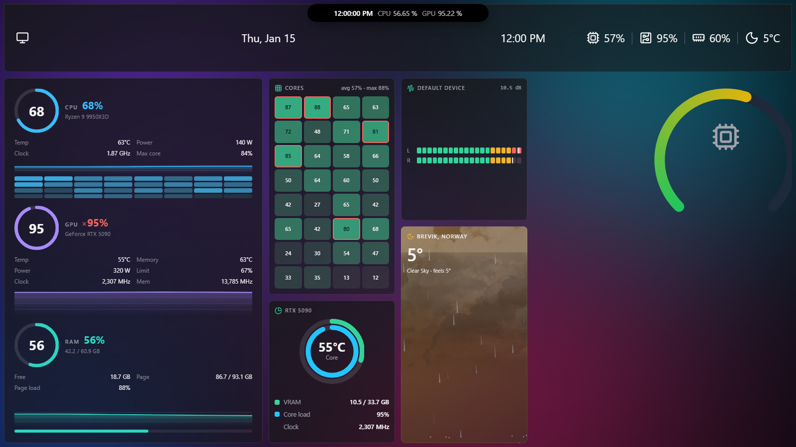

**What you see:** the page a display shows (`/?kiosk=1`, optionally `&profile=<id>&page=<id>`). Here that is the status bar across the top (logo, date, time, CPU/GPU/RAM/weather chips), System Overview (CPU, GPU and RAM rings with sparklines), the Core Heatmap, the Audio Meter, the GPU Rings card, the Weather card with a rain effect, and one big CPU gauge at the right. The Dynamic Island pill sits top centre. The background is a theme gradient.

**How it works:**
- `src/App.tsx` reads the URL. `kiosk=1` means no header, no studio button, no config push, and the layout is pulled from the server (SSE). `profile=` and `page=` pin a profile or page. With no pin it picks the profile whose design size is closest to the window (`resolveProfile`).
- The profile grid is `cols x rows` (12x6 here). `fit: fill` shares the viewport height equally across rows, and `scroll` uses 120 px rows. Gaps and padding come from `src/lib/profile-grid.ts`.
- Each zone renders its widget through the per-zone pipeline (`src/widgets/`, the shell in `src/components/widget-style.ts` and `src/components/widgets/`). Sensors stream from the InfoPanel Data API through `src/lib/sensor-store.ts` and `useSensors`.
- The lower-right gauge is an InfoPanel-style canvas "item" (a Free-area group), not a studio widget. Docs: `docs/architecture.md` section 4 "Kiosk and studio".

**Rough edges:** the fixture's gauge item is absolutely positioned in pixels (x 1314, w 290) and was authored for 1920x550. At 1600x900 it is clipped at the right edge on the kiosk. That is a fixture issue, but it shows items do not reflow with the grid.

---

## 2. The editor (Edit)

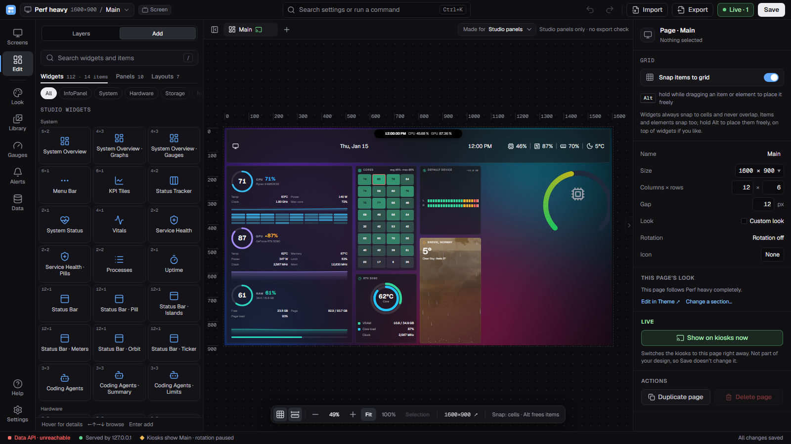

**What you see:** top bar (screen and page name with size, command search `Ctrl+K`, undo/redo, Import, Export, "Live" kiosk count, Save). Below it, three columns:
- the left panel has Layers and Add tabs. Add holds Widgets (112), Items (14), Panels (10) and Layouts (7).
- the centre is the page canvas with rulers, a dot grid and a floating zoom bar (49% "Fit" at this size).
- the right column is the page inspector (name, size, columns x rows, gap, look, rotation, icon, "Show on kiosks now").

The first-run "Quick tips" card was dismissed for this shot. It comes back in a fresh browser profile.

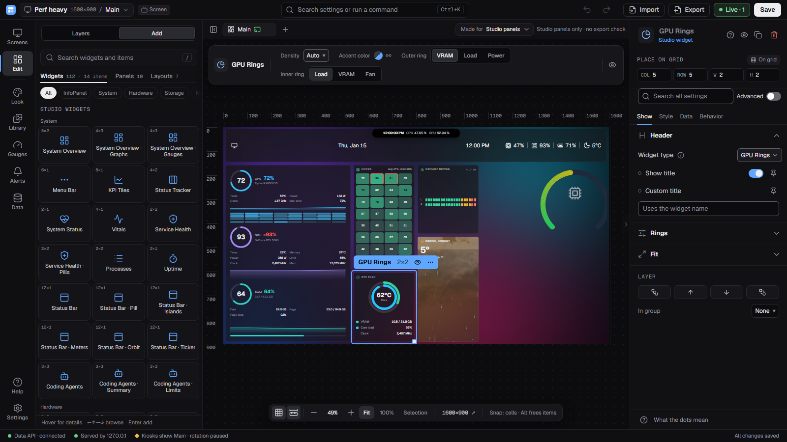

**With a widget selected** (GPU Rings): a selection chip (name, size, hide, more), a floating quick-settings bar above the canvas (the widget's main options), and the inspector with tabs **Show / Style / Data / Behavior**, a "Place on grid" row (col, row, w, h), "Search all settings", an Advanced toggle and Layer controls. Sections are an accordion.

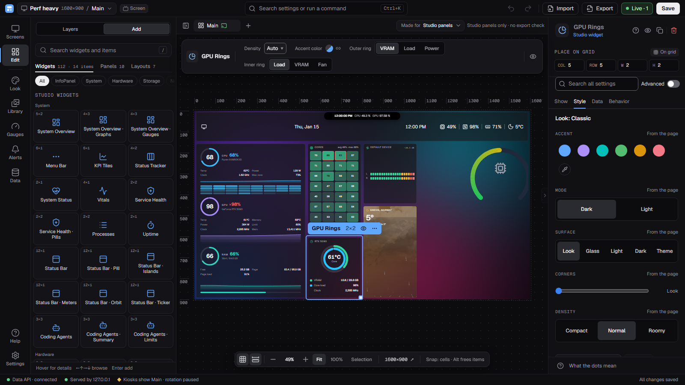
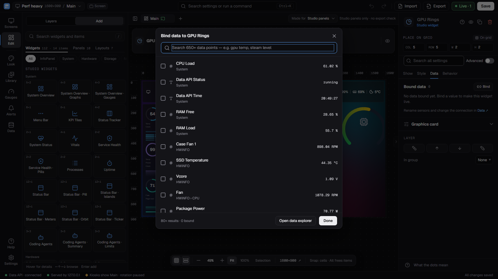

The Style tab holds the shared look sections. The Data tab holds "Bound data" with **Bind**, which opens the **source picker**: a searchable list of 650+ data points with live values, check boxes and "Open data explorer".

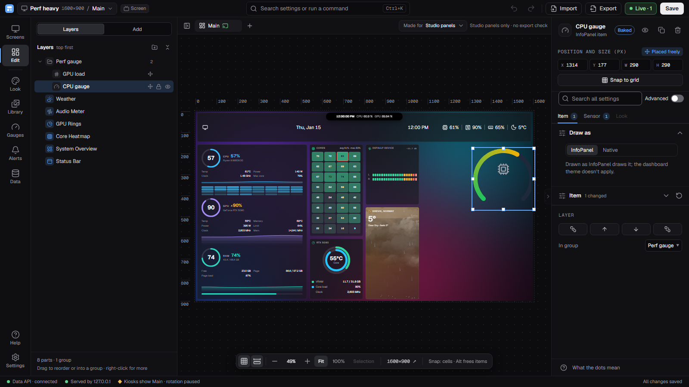

The Layers tab is a tree, top first. The "Perf gauge" group holds the two InfoPanel items. Selecting an item gives the item inspector (Draw as InfoPanel / Native, position and size in px, Snap to grid, Item / Sensor / Look tabs).

**How it works:**
- `src/components/studio/studio-view.tsx` only composes. Layout is in `studio-shell.tsx`, the rail in `left-rail.tsx` and the left panel in `design-left-panel.tsx`. The canvas is `studio-canvas.tsx` with `placement-frame.tsx` per zone (press = select, past a threshold = move, Shift/Ctrl toggles, empty-grid press draws a new zone).
- The inspector is data-driven: `inspector-model.ts` (pure: tabs and sections for the selection), `inspector-categories.ts` (shared sections), `inspector/` (views), `zone-inspector.tsx` and `item-inspector.tsx`. State lives in `use-studio-selection.ts`, `use-studio-ui.ts`, `use-studio-mutations.ts` and `use-studio-commands.ts`.
- Config is saved with Save or `Ctrl+S`, debounced, to `POST /api/config`. Undo and redo are in `src/hooks/config-history.ts`.
- Zones never overlap (`zone-geometry.ts`). Docs: `docs/architecture.md` "Studio shell", "Studio canvas" and "Studio inspector". Help: `src/help/articles/studio.md`, `zones.md`.

**Rough edges:**
- At 1600x900 the canvas is 49% zoom and the studio chrome takes ~700 px of width, so widget text on the canvas is hard to read.
- "Made for: Studio panels" and "Studio panels only - no export check" in the canvas header is jargon.
- Items (InfoPanel canvas objects) are only selectable through Layers here. Clicking one on the canvas did not select it in my run.
- The left panel and the inspector both carry layer controls ("In group", Layer buttons).

---

## 3. Library (My Library / assets)

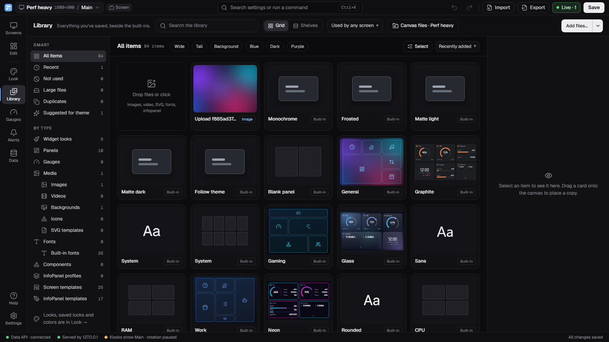

**What you see:** "Library - Everything you've saved, beside the built-ins". The left side has smart collections (All items 84, Recent, Not used, Large files, Duplicates, Suggested for theme), "By type" (Widget looks, Panels, Gauges, Media, Fonts, Components, InfoPanel profiles, Screen templates, InfoPanel templates) and a link to Look. The centre is a card grid, with Grid / Shelves views, search, a "Used by any screen" filter, a "Canvas files - Perf heavy" button, Add files, Select and a sort. The first card is a drop zone. Most cards are built-in looks, panels and templates. The one user item is the fixture's uploaded background image. A toast "Added 1 earlier upload to My library" appeared on first open (adoption of an orphaned asset).

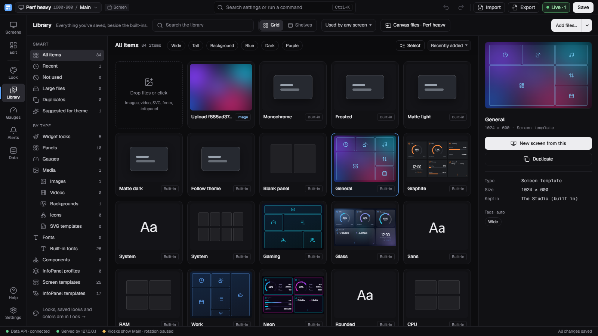

Selecting a card opens a details pane (preview, "New screen from this", Duplicate, type, size, where it is kept, tags).

**How it works:** `src/components/library/` (`library-page.tsx`, `library-views.tsx`, `library-detail.tsx`, `use-my-library.ts`, `library-actions.ts`, `fonts-view.tsx`, `profile-assets.tsx`). The model is pure, in `src/lib/my-library/` (tags, collections, search, duplicates by SHA-256 or dHash, theme suggestions). The server items are `/api/library` and uploads go to `/api/assets` (`src-tauri/crates/ips-server/src/assets.rs`, `library.rs`). Uploads run two at a time, are classified from their bytes (`intake.ts`), and a bad font or an unsafe SVG is refused. Actions per item: Set as background, Add to profile or canvas, Apply a style, Optimise (WebP), Merge duplicates, Export. Cards can be dragged onto the canvas (`library-drop.ts`). Docs: `docs/architecture.md` "The Library page"; Help `library.md`, `assets.md`.

**Rough edges:** the page is dominated by built-ins (84 items, one real), so your own things are hard to find. The sidebar footer repeats "Looks, saved looks and colors are in Look". Several smart collections show 0 here.

---

## 4. Alerts and the Dynamic Island

**Island idle** (crop of the kiosk top):

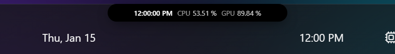

The island is a per-profile pill at the top centre. Idle it shows the time and chosen values (here CPU and GPU load, "Time and values").

**Alert rules:**

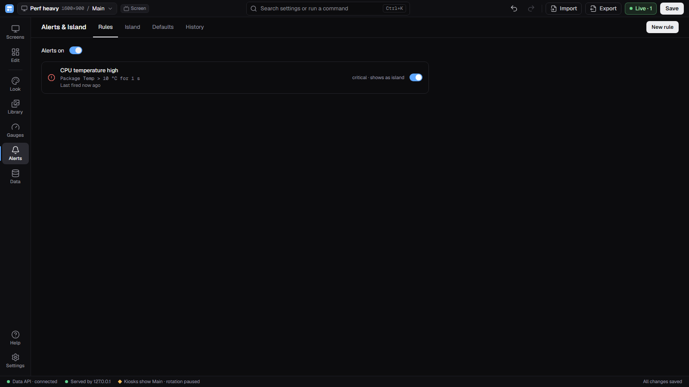
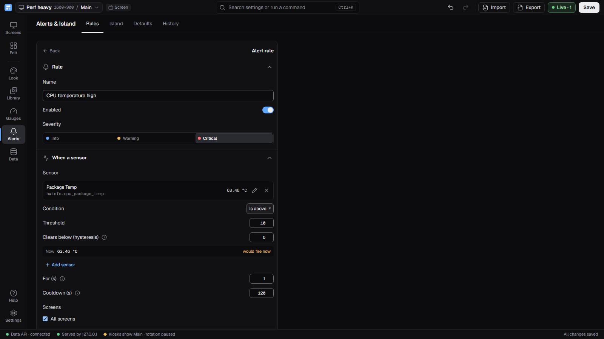

Rules tab: master "Alerts on", list of rules, New rule, and presets ("CPU temperature high", "GPU temperature high", "RAM almost full", "Drive almost full"). The editor has name, enabled, severity (Info / Warning / Critical), "When a sensor" (sensor, condition, threshold, hysteresis, a live "Now ... would fire now / not firing" readout, For and Cooldown seconds, screens), Display (Toast / Banner / Overlay / Island, size, seconds, text template), Switch to page, Highlight widget and **Test**. For the demo the threshold was set to 10 so it fires at once.

**An alert showing.** With the default style **Toast** it appears top-right over the status bar:

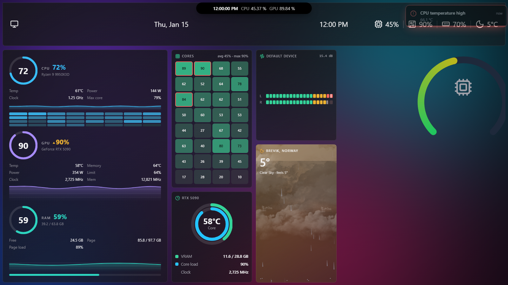

With Display set to **Island** (here after pressing **Test**; the earlier toast was still on screen) the island expands to the alert:

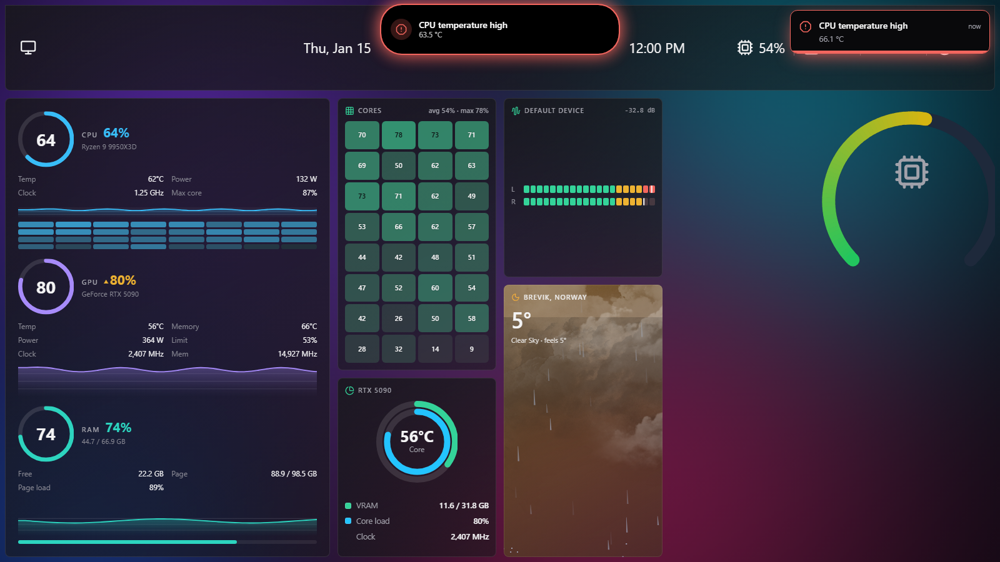
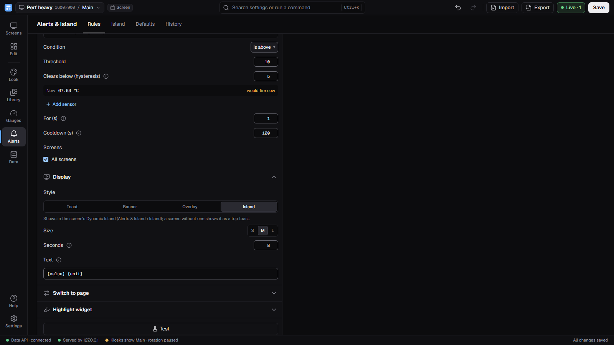

**Island settings, defaults, history:**

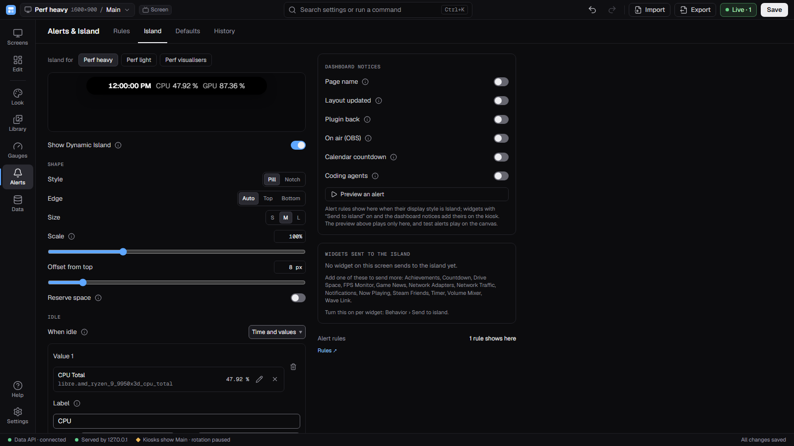
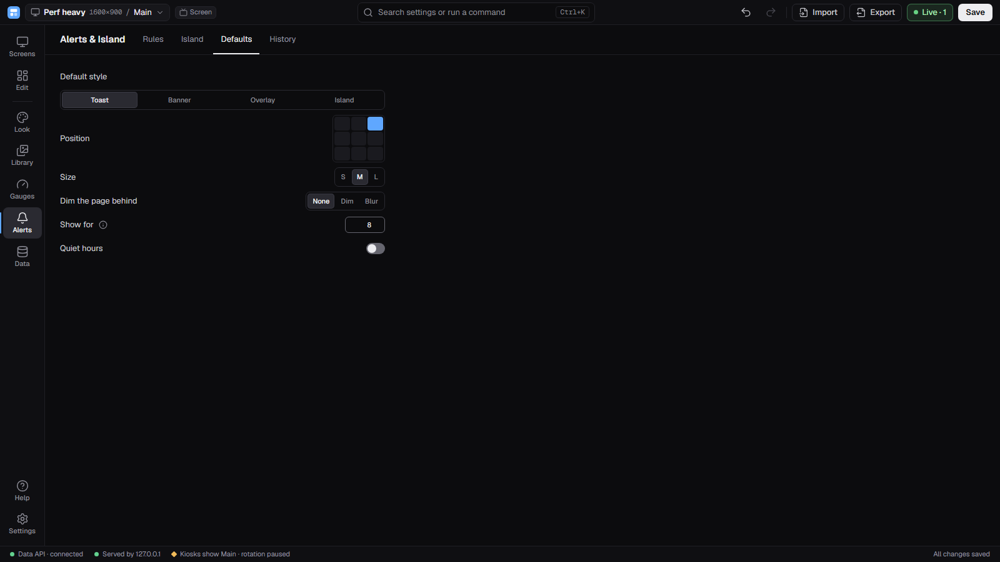
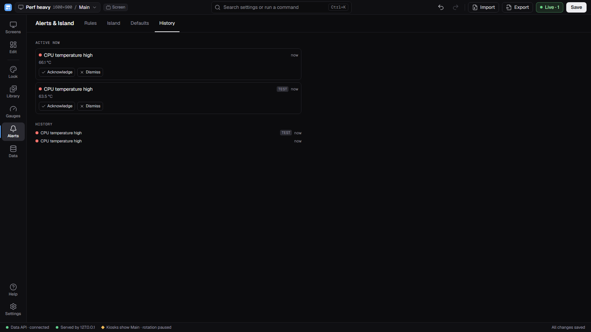

- Island tab: per-screen island (a screen picker, a live preview, Show Dynamic Island, Shape (Pill / Notch, edge, size, scale, offset, reserve space), Idle content, dashboard notices (page name, layout updated, plugin back, OBS on air, calendar countdown, coding agents), "Preview an alert", and widgets sent to the island).
- Defaults tab: default style, position, size, dim or blur behind, show-for seconds, quiet hours.
- History tab: "Active now" with Acknowledge / Dismiss, and the past alerts.

**How it works:**
- Rules are config (`config.alerts`, `src/lib/alerts.ts`, presets in `src/lib/alert-presets.ts`). The engine runs in the server (`src-tauri/crates/ips-server/src/alerts.rs`). It watches the Data API keys, evaluates threshold (duration, hysteresis, cooldown), changes, contains and "missing", and publishes the active list on `/events/control`. `POST /api/control/alert` handles acknowledge, dismiss and test, and `GET /api/alerts/history` returns the last 200. Alerts never enter undo.
- The studio UI is `src/components/studio/alerts-view.tsx`, `alerts-rules.tsx`, `alerts-rule-editor.tsx`, `alerts-outputs.tsx`, `alerts-defaults.tsx`, `alerts-live.tsx`, `island-tab.tsx` and `alerts-model.ts`. The kiosk layer is `src/components/alerts/alert-layer.tsx`. The island is `src/components/island/dynamic-island.tsx` and `src/lib/island/` (one notice bus, `bus.ts` and `queue.ts`), with sources in `src/widgets/island-sources.ts`.
- On the kiosk, `App.tsx` splits alerts with `splitIslandAlerts`: Island-style alerts go to the island, and a profile without an island shows them as a top toast. Docs: `docs/architecture.md` "Alerts" and "Dynamic Island", `docs/redesign/island/PLAN.md`, Help `island-alerts.md`.

**Rough edges:**
- The default display style is Toast, and the toast sits over the status bar chips (their text overlaps in `05b`). Island is not the default even for a profile that has an island.
- After Test with Island selected, the island and the earlier toast showed at once, so the same alert appears twice.
- The live "Active now" list is on History, away from Rules.
- The rule editor is one long scroll, with Display below the fold.

---

## 5. Gauges

**On a page.** The kiosk and editor shots show them. The big arc on the right of `01-main-kiosk.png` is a canvas gauge item. The rings in System Overview and GPU Rings are widget rings, not gauge-editor gauges.

**Gauges page (browse):**

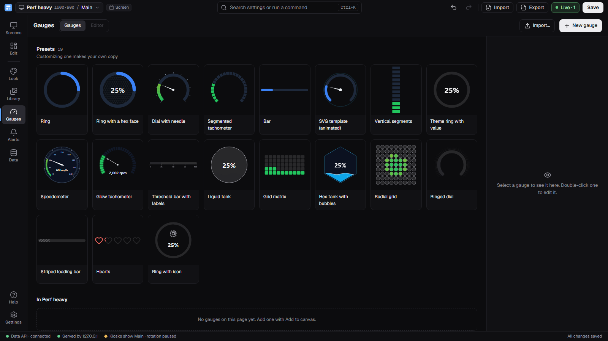

Rail "Gauges" opens a page with "Gauges" and "Editor" sub-tabs and Import / **New gauge**. It lists 19 presets (Ring, Dial with needle, Speedometer, Liquid tank, Hex tank, Hearts, ...), then "In <screen>" (none in this profile), then My library. A right pane shows the selected gauge's live preview with Customise a copy, Add to canvas, Duplicate and Export (`.gauge.json`).

**Gauge editor:**

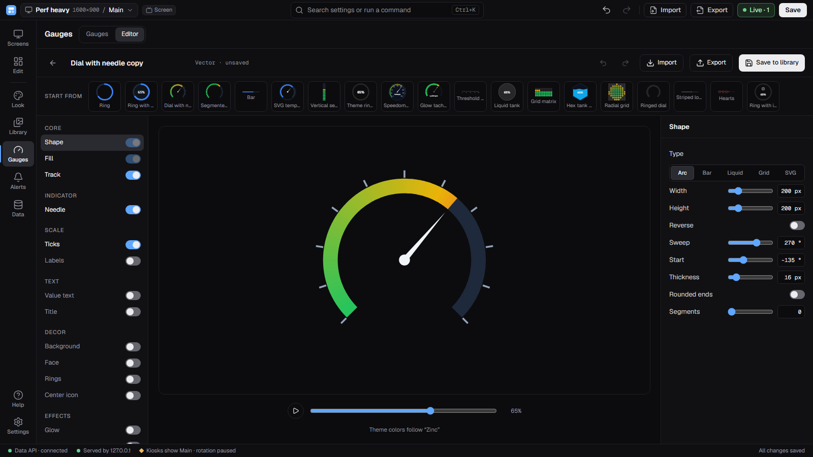

Opened by double-clicking a preset ("Dial with needle copy", an unsaved vector). A preset strip along the top ("Start from"), a parts list on the left (Core: Shape / Fill / Track, Indicator: Needle, Scale: Ticks / Labels, Text, Decor, Effects: Glow, Shadow, ...), a stage with play and a scrubber, and an inspector for the selected part (shown: Shape type Arc / Bar / Liquid / Grid / SVG, width, height, sweep, start, thickness, rounded ends, segments). Save to library, Import, Export and undo/redo are in the header.

**The item on the canvas:** `06c-gauge-item-selected.png` (section 2) shows a canvas gauge item with a "Baked" badge (its frames match its spec).

**How it works:** `src/components/gauges/` (`gauges-page.tsx`, `gauge-editor.tsx`, `parts-list.tsx`, `preset-strip.tsx`, `inspector/`, `editor-stage.tsx`, `save-gauge.ts`) and the model in `src/lib/gauge-studio/`. A gauge lives in one of four places: a preset (read-only), a My library item (`kind: "gauge"`), a Gauge item in an imported canvas zone (spec in `$.vector`), or a **Custom gauge** widget zone (`src/widgets/CustomGauge.tsx`, the spec as JSON in its `gauge` setting). Profile gauges write through with `setConfig` (one undo step each); others are a working copy with their own undo and a Save / Discard / Cancel dialog on leave. The page also handles image-sequence gauges (frames, recolour, convert to vector) and a bake bar for `.infopanel` export. Docs: `docs/architecture.md` "The Gauges page"; Help `gauges.md`.

**Rough edges:** a double-click drops you into an unsaved copy, so it is easy to leave with unsaved work. Two gauge systems co-exist: studio widget rings, and canvas or Custom gauges, which have different editors. This profile shows "No gauges on this page yet" in the gauges page, although the page has two gauge items (they are InfoPanel canvas items, which the "In <screen>" list apparently does not count).

---

## 6. Data: sensors, source picker, connection

**Data view:**

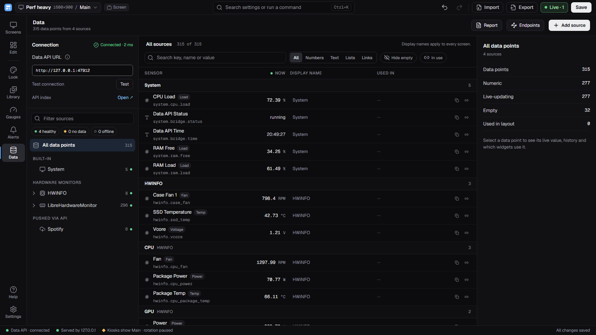
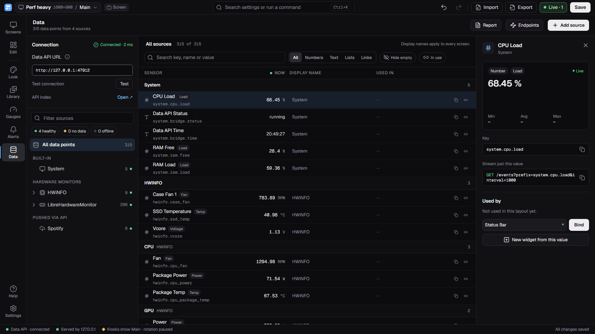

Rail "Data". Left: **Connection** (Data API URL, Test connection, API index link, connected status with latency), a source filter with health counts ("4 healthy / 0 no data / 0 offline"), and the source tree (Built-in: System; Hardware monitors: HWiNFO, LibreHardwareMonitor; Pushed via API: Spotify). Centre: the points table (Sensor, Now, Display name, Used in) with search, type filters (All / Numbers / Text / Lists / Links), "Hide empty" and "In use", and copy and link buttons per row. Right: a summary (315 points, 277 numeric, 32 empty, 0 used in layout), or for a selected point its live value, type, Min / Avg / Max, key, the SSE stream URL for just that value, "Used by", **Bind** to a widget and "New widget from this value".

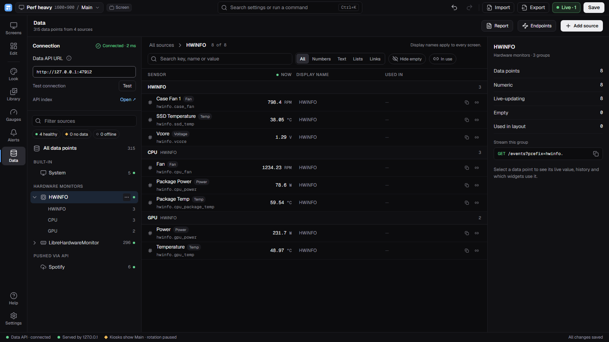
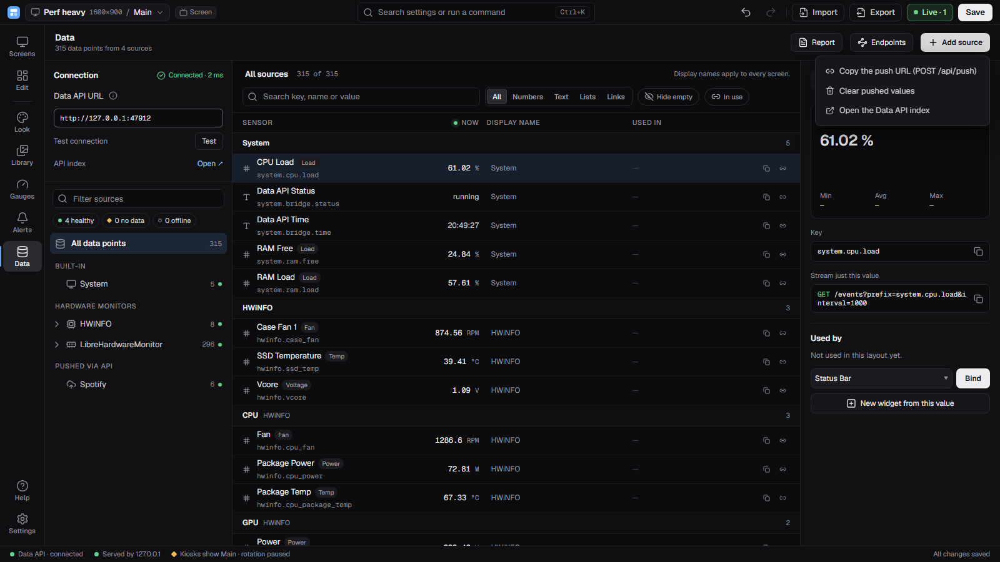
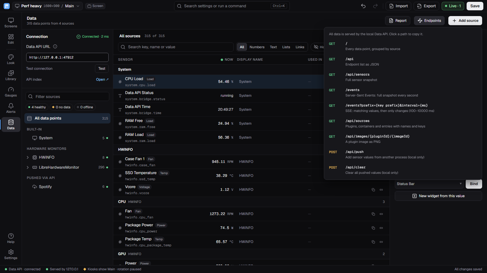
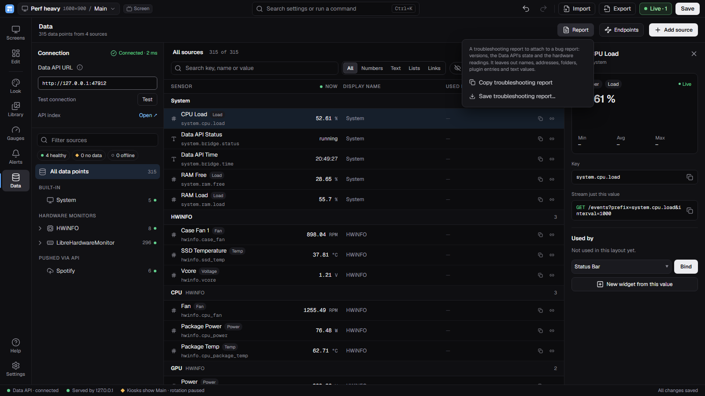

Header buttons: **Report** (copy or save a troubleshooting report that leaves out names, addresses and folders), **Endpoints** (the local Data API routes: `/`, `/api`, `/api/sensors`, `/events`, `/events?prefix=...`, `/api/sources`, `/api/images/...`, `/api/push`, `/api/clear`) and **Add source** (copy the push URL `POST /api/push`, clear pushed values, open the API index).

**Source picker in the editor:** `03c-editor-source-picker.png` (section 2), from a widget's Data tab, Bind. Alert rules and the island's value slots use the same kind of sensor field.

**How it works:**
- `src/components/studio/explorer/` (`explorer-header.tsx`, `source-tree.tsx`, `point-table.tsx`, `point-inspector.tsx`, `explorer-model.ts`, `report.ts`), `connection-card.tsx` and `sources-panel.tsx`. The picker is `src/components/studio/inspector/data-picker.tsx` and `bound-data.tsx`.
- Data comes straight from the InfoPanel Data API (default `http://127.0.0.1:3921`; the `dataApiUrl` in config), not through the studio server: a catalog fetch (`src/lib/catalog.ts`, `data-points.ts`, `data-usage.ts`) plus prefix streams (`sensor-store.ts`, `sensor-stream.ts`). Display names are stored per dashboard.
- In this tour the Data API was the repo's fake (port 47912, captured sensors). Docs: `docs/architecture.md` section 1 "The InfoPanel Data API"; Help `sensors.md`.

**Rough edges:**
- Min / Avg / Max on a live point show dashes in the first seconds.
- In an exploratory run the Connection card flipped to a red "Can't reach the Data API" (and the footer to "unreachable") right after opening Add source, then recovered. I saw it once and did not keep the screenshot, so treat it as unconfirmed. (Controller note: `02-editor-canvas.png` does show "Data API · unreachable" in the status footer, so it happened at least once more during capture.)
- Wording: "Display names apply to every screen" is far from where you set them. "Bind" in the right pane has a bare dropdown of zone names ("Status Bar").

**Data settings are not captured.** The Settings button on the rail opens a separate desktop (Tauri) window, `settings.html` + `src/settings/`, which calls `invoke("get_settings")` and so on (`src/settings/ipc.ts`). It cannot run in a browser, and I did not fake it. Its pages (`src/settings/pages.ts`): General, Server, Connections (OBS, Twitch, YouTube, calendars), Agents, Touch, Updates, Diagnostics, Logs, About, Changelog. In a browser the rail's Settings button just stays on Screens (that shot was discarded). The Data API URL itself is editable in the Data view's Connection card (above).

---

## Extras

**Look** (themes, looks and colours, the other full-page view):

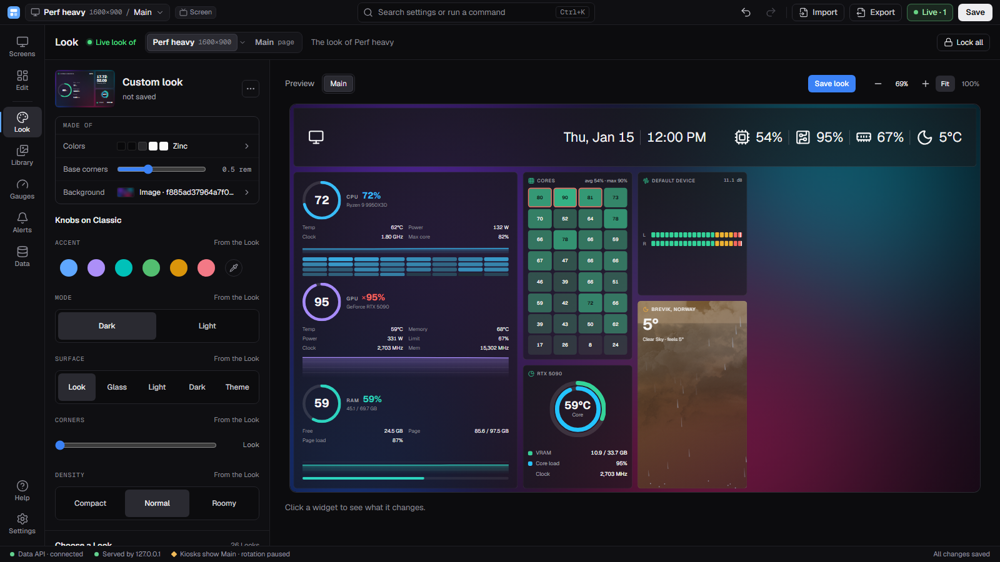

**Screens** (the opening view; one card per profile with thumbnails, a "Shown on" panel and size and fit):

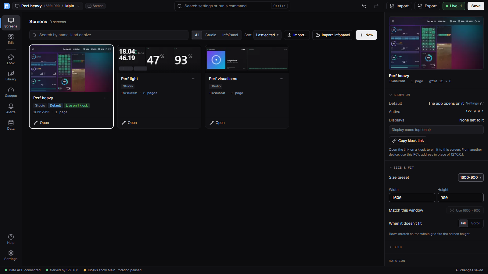

**Help** (served by the server at `/help.html`, articles from `src/help/articles/*.md`):

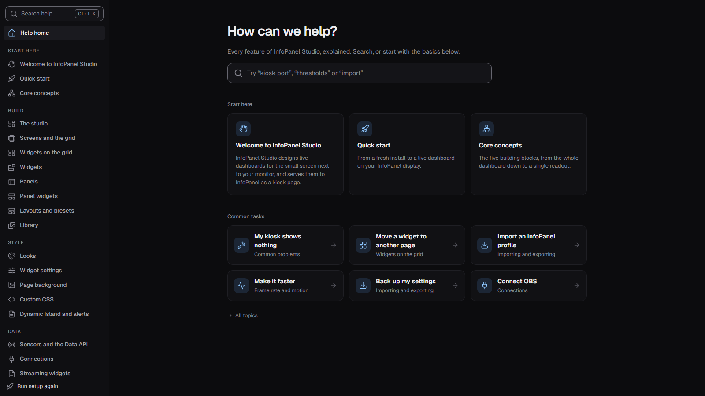

## Not captured

- The Settings window (see section 6).
- The first-run setup flow (`src/components/studio/first-run/`), Look sub-views in depth, the InfoPanel import dialogs, touch setup and the Library fonts view.
